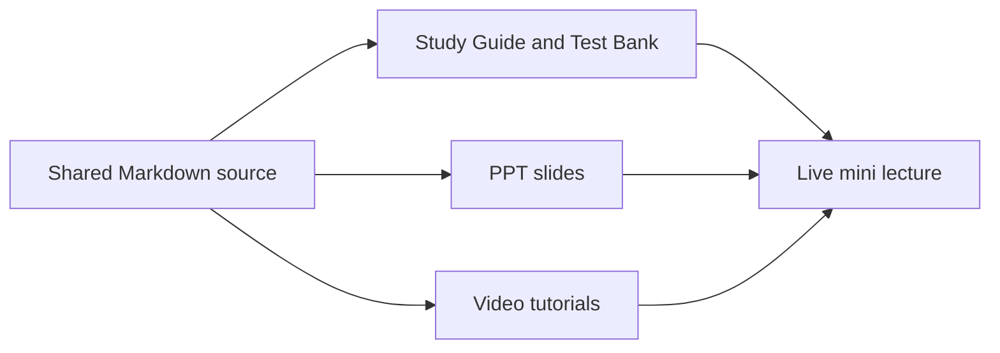

<p align="center">
  
</p>

<p align="center"><b>Team SLN · AI Overview · Final version V3.0 (28 November 2026)</b></p>

<p align="center"><b>
<a href="content/00_module_outline.md">Start here</a> ·
<a href="plan/README.md">Project plan</a> ·
<a href="plan/master_task_list.md">Task list</a> ·
<a href="references/sources.md">References</a> ·
<a href="CONTRIBUTION.md">Contributions</a>
</b></p>

> **Understand AI. Evaluate its outputs. Use it responsibly.**
> Team SLN's introductory learning module on Artificial Intelligence, written for university students and beginners who have little or no prior knowledge of AI.

---

## About this project

| | |
|---|---|
| **Team** | SLN |
| **Module** | AI Overview |
| **Intended learners** | University students and beginners with little or no prior AI knowledge |
| **Scope** | Fundamental concepts, practical applications, and responsible use. Introductory, not highly technical. |
| **Deliverables** | Study Guide and Test Bank · PPT slides · Video tutorials · Live mini lecture (4 minutes) |
| **Version** | V3.0, final (Stage 3), 28 November 2026 |

**Purpose.** Every explanation, example, activity and reference is written here in Markdown first, reviewed by a teammate, and only then turned into the study guide, slides and videos. When something is corrected here, every resource that uses it is updated.

## Start here

1. Read the [module outline](content/00_module_outline.md). It explains the purpose, the learning goals, how each topic is organised and how the Markdown maps to the Study Guide, slides and videos.
2. Read Topics 01 to 05 in order (table below). Each topic builds on the one before it and takes about 45–60 minutes to read.
3. In each topic, do the **Learner Activities** and the **Check Your Understanding** questions before opening the answers.
4. Finish with the **Final Challenge** at the end of Topic 05, which uses all five topics.

## Learning journey

| Topic | Essential question | Read |
|---|---|---|
| 0 · Module outline | What will I learn, and in what order? | [Open](content/00_module_outline.md) |
| 1 · Introduction to AI | What makes a system AI, and how does it differ from traditional software? | [Open](content/01_introduction-to-ai.md) |
| 2 · Types of AI and how AI works | How do data, algorithms and machine learning produce an output? | [Open](content/02_types-and-how-ai-works.md) |
| 3 · Applications of AI | Where do people already use AI every day? | [Open](content/03_applications-of-ai.md) |
| 4 · Benefits, limitations and challenges | What can go wrong, and how can we tell? | [Open](content/04_benefits-limitations-challenges.md) |
| 5 · Ethical and responsible use | How should people govern their own use of AI? | [Open](content/05_ethical-and-responsible-use.md) |

## By the end, learners can

1. **What is AI?** Explain what Artificial Intelligence is and how it works in simple terms.
2. **How AI works.** Describe how data, rules (algorithms) and machine learning help AI function.
3. **Where AI is used.** Show where people use AI every day, in school, at work and elsewhere.
4. **Pros and cons.** Weigh the benefits of AI against problems such as mistakes and unfair bias.
5. **AI rules and ethics.** Explain key principles: privacy, fairness and honesty.
6. **Checking AI information.** Verify information produced by AI before relying on it.
7. **Using AI wisely.** Use AI responsibly to complete school work or solve problems.

## How the resources fit together



## Team

| Member | Role | GitHub |
|---|---|---|
| 墨仁 | Visual design | [@morenomanulang](https://github.com/morenomanulang) |
| 周利福 | CEO and coordinator | [@NicolausLionel](https://github.com/NicolausLionel) |
| 姚光耀 | Quality lead | [@Roberybot](https://github.com/Roberybot)  |
| 何恩强 | Video lead | [@Marcoharyanto](https://github.com/Marcoharyanto)  |
| 曾瑞琳 | CIO, visual design and submission lead | [@rachellpetronella](https://github.com/rachellpetronella)  |
| 薛春兰 | Content lead | [@kaylasi21](https://github.com/kaylasi21)  |

## Repository map

```
SLN/
├── README.md              ← this file: start here
├── content/               ← the learning material (00 outline, then topics 01–05)
├── assets/
│   ├── banner.svg
│   └── images/topic-01 … topic-05/   ← figures used in the topic files
├── references/sources.md  ← source register for all topics
├── game/index.html        ← optional AI QUEST practice game (open in a browser)
├── study-guide/           ← how the Study Guide and Test Bank map to the topics
├── slides/                ← how the PPT slides map to the topics
├── videos/                ← video list, lengths, presenters and topics
├── mini-lecture/          ← live mini lecture summary
├── plan/                  ← project plan and master task list
├── project-management/    ← project log, review log, AI-use log
├── docs/previous-stages/  ← earlier stage reports, kept for traceability
├── scripts/               ← helper to create one GitHub Issue per task
└── .github/               ← issue and pull request templates
```

| What | Where |
|---|---|
| Learning content | [`content/`](content/00_module_outline.md): one Markdown file per topic |
| Figures | [`assets/images/`](assets/README.md): one folder per topic; every figure has a numbered caption that names its source |
| Diagrams | Mermaid code inside the topic files (flowcharts and timelines) |
| References | A list at the end of every topic, and the full [source register](references/sources.md) |
| Learner activities and answers | "Learner Activities" and "Check Your Understanding" sections near the end of every topic |
| Study Guide, Test Bank, PPT, videos | Submitted under their own course assignments; the mapping is in the [module outline](content/00_module_outline.md#how-the-markdown-is-used-in-the-learning-resources) and in [`study-guide/`](study-guide/README.md), [`slides/`](slides/README.md) and [`videos/`](videos/README.md) |
| Project records | [`plan/`](plan/README.md) and [`project-management/`](project-management/README.md) |

## How to open the materials

| Material | How to open it |
|---|---|
| Topic files (`.md`) | Open them on GitHub, where figures and Mermaid diagrams are shown automatically. In other editors (for example VS Code with a Markdown preview), keep the folder structure unchanged so the relative image links work. |
| Mermaid diagrams | Shown as diagrams on GitHub. A plain-text editor shows them as code. The PDF copy submitted with this stage shows every diagram as a picture. |
| PDF copy of the content | `SLN_AI_Overview_Markdown_V3.0_Content.pdf` in the Stage 3 submission package: the same text, figures and diagrams for reading offline or printing. |
| AI QUEST game | Open [`game/index.html`](game/README.md) in any modern browser. No installation is needed; it also works offline. |
| Study Guide, PPT and videos | Open the files submitted under each course assignment. Each learner activity names the matching Study Guide mission and page, slide numbers and video time code. |

## Final version

| | |
|---|---|
| **Version** | V3.0 (final), Stage 3 |
| **Date** | 28 November 2026 |
| **Status** | Content frozen; all five topics reviewed by a teammate |
| **Content** | Module outline and five topics with learning goals, key terms, Mermaid diagrams, 51 numbered figures, learner activities, check questions with answers and references |

**Main changes since Stage 2 (V2.0).** Real figures from the team's AI QUEST slides were added to every topic, as requested in the Stage 2 feedback. The activities from the Study Guide, slides and videos were added to each topic with their answers, so all resources use the same examples. Repeated passages and inconsistencies were removed, a resource map was added to the module outline, and private and temporary files were removed from the repository. Details are recorded in the [review log](project-management/review_log.md) and the Stage 3 submission report.

## Known limitations

- **Introductory scope.** The module explains ideas for beginners and does not teach programming or mathematics.
- **Fast-changing topic.** Examples of AI tools, laws and court cases are correct as of November 2026 and may become out of date.
- **Resources outside the repository.** The Study Guide, Test Bank, PPT file and videos are too large for this repository and are submitted under their own assignments. The topic files are complete without them.
- **Mermaid outside GitHub.** Some Markdown viewers do not draw Mermaid diagrams; use GitHub or the PDF copy.
- **Figures with text.** Most figures are slides that contain text. Every figure has alt text and a caption, and the main point is also explained in the text around it.
- **Optional game.** The game loads a pixel font from the internet when it can; offline, the browser's default font is used.

## Project timeline

| Stage | Deadline (Beijing time) | Focus |
|---|---|---|
| 1 | 24 Oct 2026 | Project plan, task list, repository, outline, Markdown V1.0 |
| 2 | 7 Nov 2026 | Study Guide, Test Bank, slide draft, video storyboard. Internal draft 3 Nov, review 5 Nov |
| 3 | 28 Nov 2026 | Final resources, consistency check, mini-lecture rehearsal. Content freeze 20 Nov, final 23 Nov |

## Quality and integrity

All content is checked against reliable sources and reviewed by a teammate for accuracy and beginner-friendliness. Corrections are recorded in the [review log](project-management/review_log.md). Significant AI assistance is documented in the [AI-use log](project-management/ai_use_log.md) and independently checked, following the course rules. Student IDs and private logs are never published in this repository.
