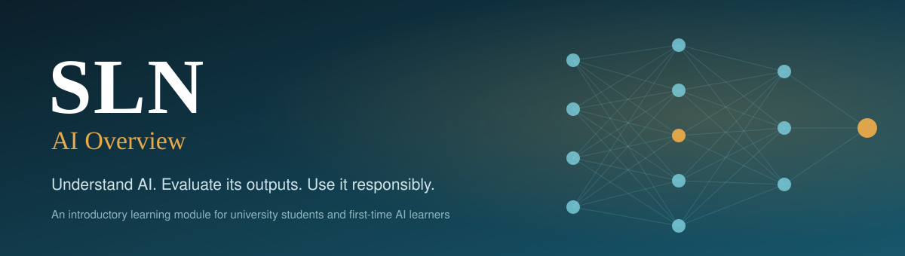
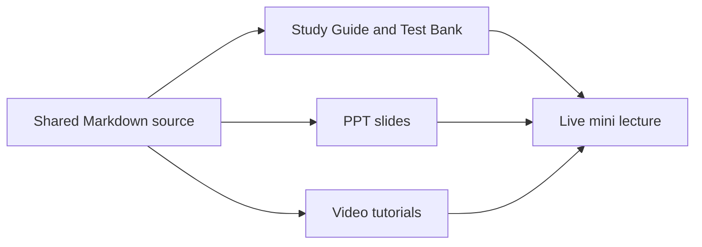

<p align="center">
  
</p>

<p align="center"></p>

<p align="center">


</p>

<p align="center"><b>
<a href="content/00_module_outline.md">Module outline</a> ·
<a href="plan/README.md">Project plan</a> ·
<a href="plan/master_task_list.md">Task list</a> ·
<a href="references/sources.md">References</a> ·
<a href="CONTRIBUTING.md">Contributing</a>
</b></p>

> **Understand AI. Evaluate its outputs. Use it responsibly.**
> Team SLN's introductory learning module on Artificial Intelligence, written for university students and beginners who have little or no prior knowledge of AI.

---

## About this project

| | |
|---|---|
| **Team** | SLN |
| **Module** | AI Overview |
| **Intended learners** | University students and beginners with little or no prior AI knowledge |
| **Scope** | Fundamental concepts, practical applications, and responsible use. Introductory, not highly technical. |
| **Deliverables** | Study Guide and Test Bank · PPT slides · Video tutorials · Live mini lecture (4 minutes) |

**Purpose.** Every explanation, example, activity and reference is written here in Markdown first, reviewed by a teammate, and only then turned into the study guide, slides and videos. When something is corrected here, every resource that uses it is updated.

## Learning journey

| Topic | Essential question | Read |
|---|---|---|
| 1 · Introduction to AI | What makes a system AI, and how does it differ from traditional software? | [Open](content/01_introduction-to-ai.md) |
| 2 · Types of AI and how AI works | How do data, algorithms and machine learning produce an output? | [Open](content/02_types-and-how-ai-works.md) |
| 3 · Applications of AI | Where do people already use AI every day? | [Open](content/03_applications-of-ai.md) |
| 4 · Benefits, limitations and challenges | What can go wrong, and how can we tell? | [Open](content/04_benefits-limitations-challenges.md) |
| 5 · Ethical and responsible use | How should people govern their own use of AI? | [Open](content/05_ethical-and-responsible-use.md) |

## By the end, learners can

1. **What is AI?** Explain what Artificial Intelligence is and how it works in simple terms.
2. **How AI works.** Describe how data, rules (algorithms) and machine learning help AI function.
3. **Where AI is used.** Show where people use AI every day, in school, at work and elsewhere.
4. **Pros and cons.** Weigh the benefits of AI against problems such as mistakes and unfair bias.
5. **AI rules and ethics.** Explain key principles: privacy, fairness and honesty.
6. **Checking AI information.** Verify information produced by AI before relying on it.
7. **Using AI wisely.** Use AI responsibly to complete school work or solve problems.

## How the resources fit together



## Team

| Member | Role | GitHub |
|---|---|---|
| 墨仁 | Visual design | [@morenomanulang](https://github.com/morenomanulang) |
| 周利福 | CEO and coordinator | _add handle_ |
| 姚光耀 | Quality lead | _add handle_ |
| 何恩强 | Video lead | _add handle_ |
| 曾瑞琳 | CIO, visual design and submission lead | _add handle_ |
| 薛春兰 | Content lead | _add handle_ |

## Repository map

```
SLN/
├── README.md
├── CONTRIBUTING.md
├── content/               ← the learning material (start at 00_module_outline.md)
├── study-guide/           ← study guide and test bank plan
├── slides/                ← PPT plan and files
├── videos/                ← tutorial scripts and storyboards
├── mini-lecture/          ← live mini lecture plan
├── plan/                  ← project plan and master task list
├── project-management/    ← project log, review log, AI-use notes, log templates
├── references/            ← source register
├── assets/                ← banner and diagrams
├── scripts/               ← helper to create one GitHub Issue per task
└── .github/               ← issue and pull request templates
```

## Current progress

Status labels: ✅ checked by a reviewer · 📝 drafted · 🔲 outline only

| Part | Status |
|---|---|
| Repository setup and README | ✅ Done |
| [Project plan](plan/project_plan.md) and [task list](plan/master_task_list.md) | 📝 Drafted from the Stage 1 plan |
| [Module outline](content/00_module_outline.md) | 📝 Drafted |
| Topics 1–5 | 🔲 Outline only. Markdown V1.0 is the next milestone |
| Study Guide, Test Bank, slides, videos | 🔲 Stage 2 |

## Roadmap

| Stage | Deadline (Beijing time) | Focus |
|---|---|---|
| 1 | 24 Oct 2026 | Project plan, task list, repository, outline, Markdown V1.0 |
| 2 | 7 Nov 2026 | Study Guide, Test Bank, slide draft, video storyboard. Internal draft 3 Nov, review 5 Nov |
| 3 | 28 Nov 2026 | Final resources, consistency check, mini-lecture rehearsal. Content freeze 20 Nov, final 23 Nov |

## Quality and integrity

All content is checked against reliable sources and reviewed by a teammate for accuracy and beginner-friendliness. Corrections are recorded in the [review log](project-management/review_log.md). Significant AI assistance is documented in the [AI-use log](project-management/ai_use_log.md) and independently checked, following the course rules. Student IDs and private logs are never published in this repository.
