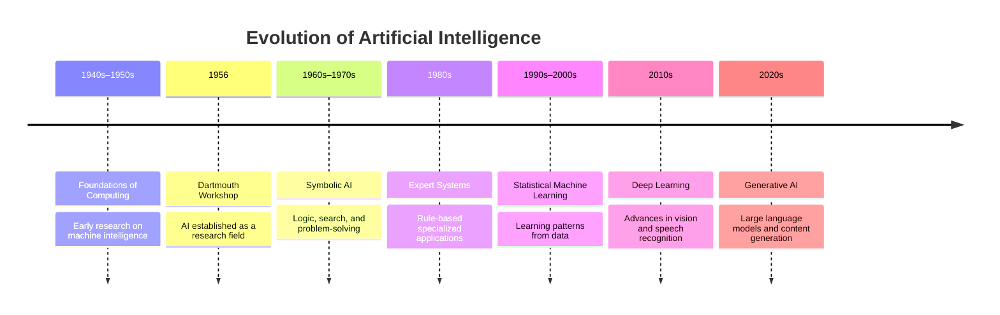
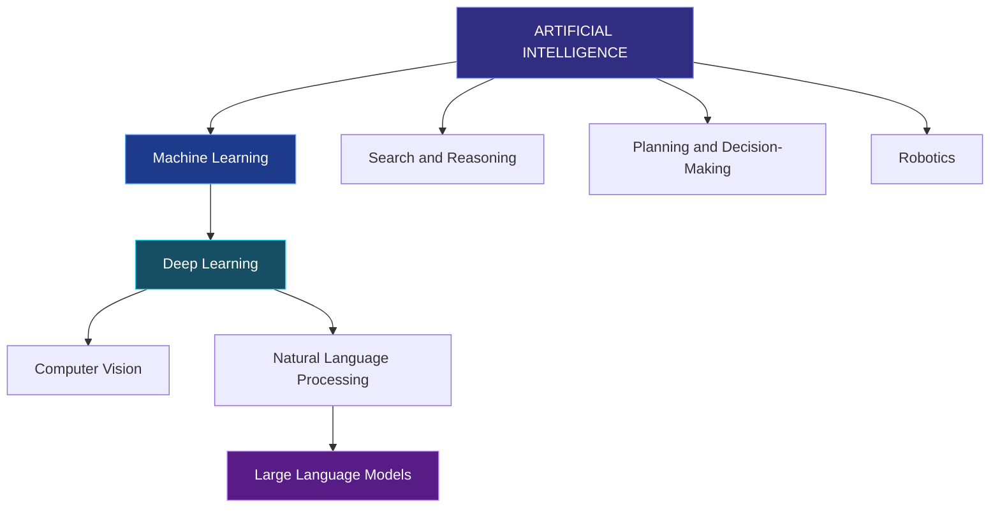
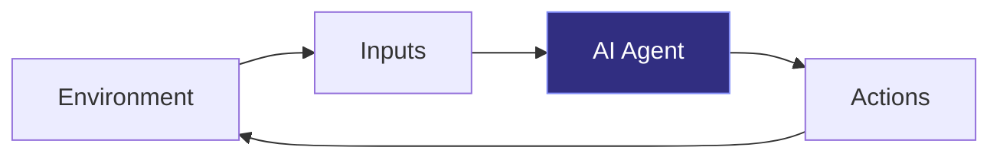

# TOPIC 01 — INTRODUCTION TO ARTIFICIAL INTELLIGENCE

  <strong>SLN · AI OVERVIEW</strong> 
  <em>Understanding the Foundations of Intelligent Systems</em>

---

## CONTENTS

| Section | Topic |
|:---:|---|
| 01 | [Definition and Meaning of AI](#01--definition-and-meaning-of-ai) |
| 02 | [History and Development of AI](#02--history-and-development-of-ai) |
| 03 | [Basic Concepts and Characteristics of AI](#03--basic-concepts-and-characteristics-of-ai) |
| 04 | [AI vs. Traditional Computer Systems](#04--ai-vs-traditional-computer-systems) |

---

# 01 · DEFINITION AND MEANING OF AI

## What Is Artificial Intelligence?

**Artificial Intelligence (AI)** is a field of computer science concerned with developing systems capable of performing tasks commonly associated with intelligent behavior, including learning, reasoning, problem-solving, perception, and language processing.

According to Russell and Norvig (2020), AI can be understood through different perspectives, including systems that think or act like humans and systems that think or act rationally.

AI does not refer to a single technology. It encompasses multiple methods and approaches designed to enable computers to perform intelligent tasks.

### Four Perspectives on Artificial Intelligence

| Perspective | Description | Example |
|---|---|---|
| Thinking Humanly | Modeling human thought processes | Cognitive modeling |
| Acting Humanly | Producing behavior similar to human behavior | Conversational assistants |
| Thinking Rationally | Using logical reasoning to reach conclusions | Logic-based reasoning |
| Acting Rationally | Selecting actions to achieve specified objectives | Autonomous navigation |

These perspectives describe different approaches to understanding intelligence. An AI system does not necessarily need to imitate human thinking to perform an intelligent task.

### AI in Everyday Life

| Application | Function |
|---|---|
| Recommendation Systems | Suggest content based on user preferences and activity |
| Computer Vision | Interpret images and recognize objects |
| Natural Language Processing | Analyze and generate human language |
| Robotics | Support machines in interacting with their environment |
| Generative AI | Generate text, images, code, and other content |

> **Core Insight**
>
> AI enables computer systems to perform tasks involving learning, reasoning, perception, and decision-making. Its capabilities depend on the methods, information, and objectives used to develop each system.

---

# 02 · HISTORY AND DEVELOPMENT OF AI

Artificial Intelligence has developed through decades of research in computing, mathematics, statistics, and cognitive science.

Its evolution reflects a gradual shift from early symbolic reasoning systems toward data-driven learning methods and modern generative models.

## A Timeline of AI Evolution

*This timeline highlights selected milestones rather than every development in AI history.*

## Major Stages of Development

### 1. Early Foundations — 1940s–1950s

Early researchers explored computation, mathematical logic, and the possibility of machines demonstrating intelligent behavior.

In 1950, Alan Turing published *Computing Machinery and Intelligence*, contributing to discussions about machine intelligence.

### 2. The Birth of AI — 1956

The Dartmouth Summer Research Project on Artificial Intelligence is widely recognized as a foundational event in the establishment of AI as a research field.

Researchers investigated whether aspects of intelligence could be represented and reproduced computationally.

### 3. Symbolic AI and Expert Systems — 1960s–1980s

Many systems relied on explicitly represented knowledge, logical rules, and symbolic reasoning.

Expert systems applied collections of rules to solve specialized problems. However, maintaining large rule sets and handling unfamiliar situations remained challenging.

### 4. Statistical Machine Learning — 1990s–2000s

Researchers increasingly developed algorithms that learned patterns from data.

These methods supported applications such as spam filtering, predictive analysis, and speech recognition.

### 5. Deep Learning — 2010s

Improvements in computing hardware, data availability, and neural network techniques contributed to significant advances in image recognition, speech processing, and language technologies.

### 6. Generative AI — 2020s

Generative AI systems can produce content such as text, images, audio, and code.

Large language models have expanded the use of AI in education, research, communication, and software development.

However, convincing output does not guarantee factual accuracy or reliable reasoning.

> **Core Insight**
>
> AI has evolved from early symbolic approaches to a diverse field that includes machine learning, deep learning, generative models, and intelligent agents.

---

# 03 · BASIC CONCEPTS AND CHARACTERISTICS OF AI

Understanding AI requires distinguishing its major subfields and recognizing the capabilities commonly associated with intelligent systems.

## Fundamental Concepts

### Artificial Intelligence

The broader field of developing systems capable of intelligent behavior, including learning, reasoning, planning, and problem-solving.

### Machine Learning

A subset of AI that enables systems to learn patterns from data and use those patterns to make predictions or decisions.

### Deep Learning

A subset of machine learning that uses neural networks with multiple processing layers to learn complex patterns.

### Natural Language Processing

A field concerned with enabling computers to analyze, process, and generate human language.

### Computer Vision

A field focused on interpreting visual information, including images and videos.

### Robotics

An interdisciplinary field combining mechanical systems, sensors, control, software, and sometimes AI to enable machines to interact with physical environments.

## Relationship Between AI Concepts

*This diagram illustrates selected relationships. Computer vision and natural language processing also use methods that do not rely on deep learning.*

## Characteristics of AI Systems

| Characteristic | Meaning | Example |
|---|---|---|
| Learning | Identifying patterns from data or experience | Classifying images |
| Reasoning | Deriving conclusions from available information | Evaluating possible solutions |
| Perception | Processing sensory or visual information | Detecting objects |
| Prediction | Estimating likely outcomes | Forecasting demand |
| Adaptation | Updating behavior or models when information changes | Retraining a model |
| Decision-Making | Selecting actions or outputs according to objectives | Recommending a route |
| Language Processing | Analyzing or generating human language | Translating text |

Not every AI system possesses all these characteristics. Different systems are designed for different tasks and operate using different methods.

## The Intelligent Agent

In *Artificial Intelligence: A Modern Approach*, Russell and Norvig discuss intelligent agents that perceive their environments and select actions based on available information and objectives.

A simplified intelligent agent operates through the following cycle:

For example, a navigation system receives information about a destination and available routes, processes relevant information, and recommends a route according to its objectives.

An agent's performance depends on its design, information, objectives, and operating environment.

> **Core Insight**
>
> AI is a broad field, machine learning is one approach within AI, and deep learning is one approach within machine learning. Their applications depend on the problem being solved.

---

# 04 · AI VS. TRADITIONAL COMPUTER SYSTEMS

Traditional computer systems and AI-based systems can both solve problems effectively. Their differences often involve how their behavior is defined, how data is used, and how they handle uncertainty.

## Comparative Overview

| Aspect | Traditional Computer Systems | AI-Based Systems |
|---|---|---|
| Approach | Often follow explicitly programmed instructions | May use learned models, rules, search, or reasoning |
| Behavior | Commonly defined by program logic | May depend on learned parameters or decision processes |
| Data Usage | Processes data according to programmed instructions | May use data to train models and generate predictions |
| Adaptability | Changes often require code or configuration updates | Some systems can be retrained or updated using new data |
| Output | Often predictable for the same inputs and system state | May involve uncertainty or variation, depending on the system |
| Suitable Tasks | Clearly defined procedures and exact calculations | Tasks involving patterns, perception, language, or uncertainty |
| Evaluation | Correctness against specified requirements | Accuracy, generalization, reliability, and other task-specific criteria |
| Limitations | May struggle with situations not covered by its logic | May produce inaccurate predictions or unreliable outputs |

These are general tendencies rather than absolute distinctions. Traditional programs can process complex data, and AI systems can incorporate explicit rules. Some AI systems also produce deterministic outputs.

## Practical Example: Email Spam Detection

Consider a system designed to identify unwanted emails.

### Approach A — Traditional Rule-Based Programming

A programmer defines rules such as:

- Flag messages containing specified suspicious phrases.
- Check whether the sender appears on a manually maintained list.
- Apply predefined conditions to classify incoming messages.

The system follows the rules written by its developer.

### Approach B — Machine Learning

A developer trains a model using examples labeled as spam or legitimate messages.

The model learns patterns associated with each category and estimates whether a new email is spam.

### Comparing the Approaches

| Consideration | Rule-Based System | Machine-Learning System |
|---|---|---|
| Development | Requires explicit rules | Requires a suitable model and training data |
| Pattern Recognition | Limited to defined rules and features | Can learn complex statistical patterns |
| Updates | Rules may need manual revision | Models may need retraining or updating |
| Interpretability | Individual rules can often be inspected directly | Explanations may be more difficult, depending on the model |
| Reliability | Depends on rule coverage and implementation | Depends on data quality, model performance, and operating conditions |

Neither approach is universally superior. A rule-based system may be appropriate when conditions are clear and stable, while machine learning may be useful when patterns are complex and difficult to specify manually.

## Choosing the Appropriate Approach

| Task | Possible Approach | Reason |
|---|---|---|
| Calculating an average score | Traditional programming | Uses a clearly defined mathematical formula |
| Recognizing objects in photographs | AI-based vision model | Requires identifying complex visual patterns |
| Recommending study resources | AI-based or rule-based system | Can use user preferences or predefined criteria |

The appropriate approach depends on the problem, available resources, performance requirements, and acceptable risks.

> **Core Insight**
>
> Traditional programming and AI are complementary approaches. The goal is not to use AI for every problem, but to choose a suitable method for the task.

---

  <strong>SLN · AI OVERVIEW</strong> 
  Topic 01 — Introduction to Artificial Intelligence

