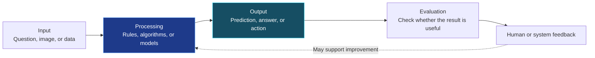
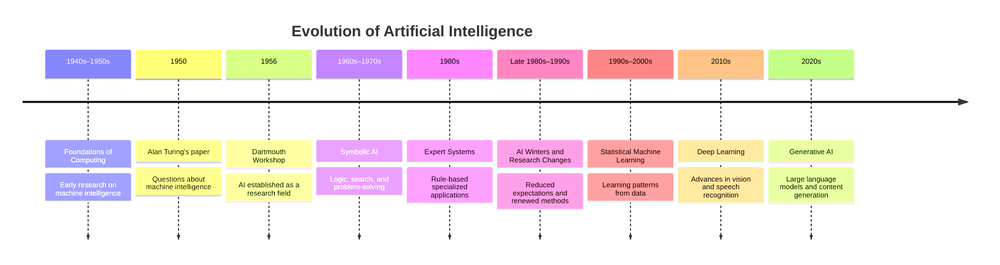
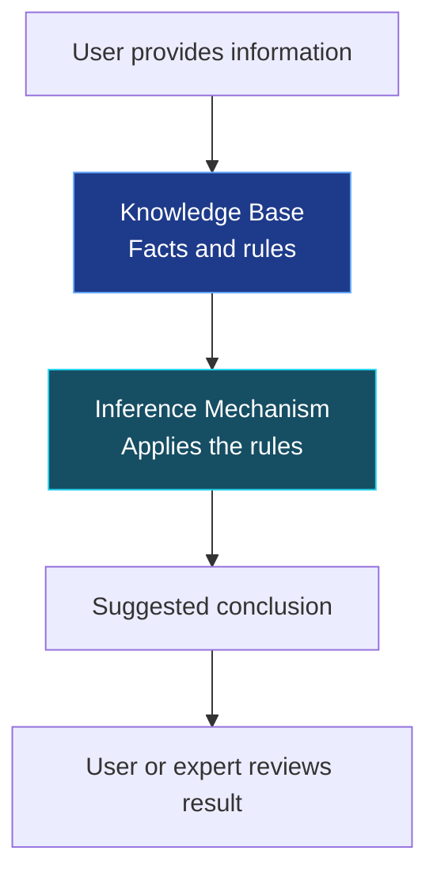
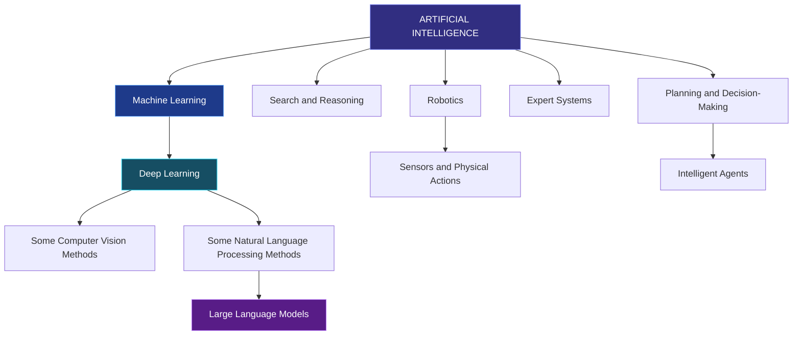
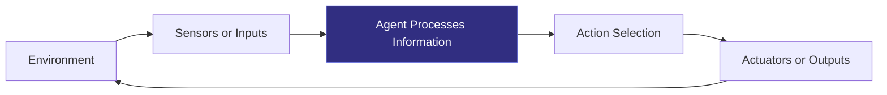
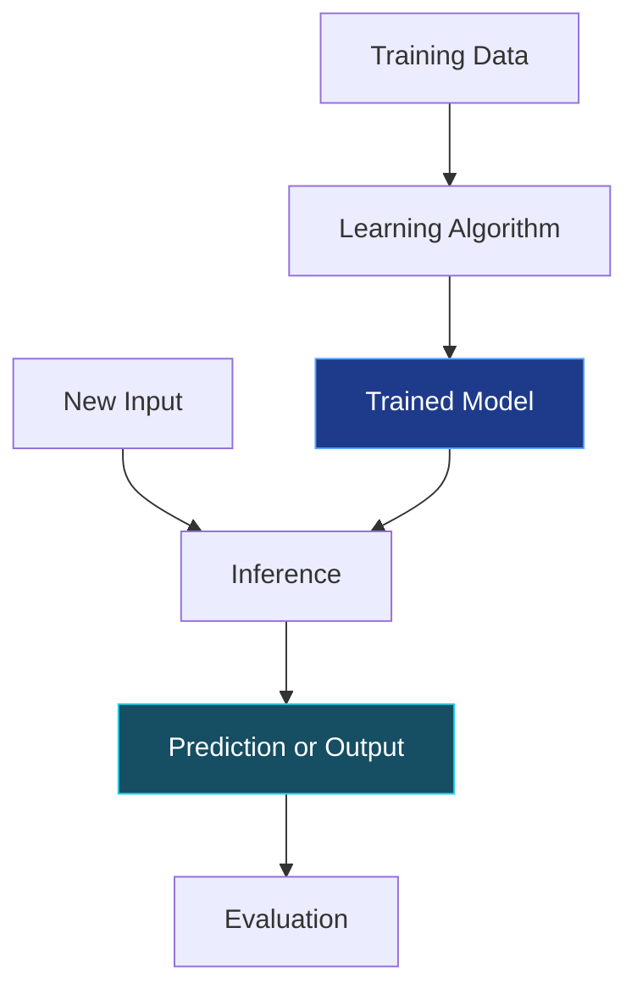

# TOPIC 01 — INTRODUCTION TO ARTIFICIAL INTELLIGENCE

  <strong>SLN · AI OVERVIEW</strong> 
  <em>Understanding the Foundations of Intelligent Systems</em>

---

## CONTENTS

| Section | Topic |
|:---:|---|
| 01 | [Definition and Meaning of AI](#01--definition-and-meaning-of-ai) |
| 02 | [History and Development of AI](#02--history-and-development-of-ai) |
| 03 | [Basic Concepts and Characteristics of AI](#03--basic-concepts-and-characteristics-of-ai) |
| 04 | [AI vs. Traditional Computer Systems](#04--ai-vs-traditional-computer-systems) |

---

# 01 · DEFINITION AND MEANING OF AI

## What Is Artificial Intelligence?

**Artificial Intelligence (AI)** is a field of computer science concerned with developing computer systems that can perform tasks commonly connected with intelligent behavior. These tasks may include learning, reasoning, problem-solving, recognizing information, understanding language, making predictions, and choosing actions.

In everyday language, intelligence is often connected with the ability to understand a situation, use information, learn from experience, and respond in a useful way. AI research explores how some of these abilities can be represented and carried out by computer systems.

According to Russell and Norvig (2020), AI can be understood through different perspectives. Some approaches focus on systems that think like humans, while others focus on systems that act like humans or make rational decisions. These perspectives are useful because intelligence is a broad idea and cannot be explained through only one definition.

AI is not one single machine, program, or application. It is a broad field that includes different methods. Some AI systems use carefully written rules. Others learn patterns from examples. Some systems work with images, sound, or language, while others help plan actions or make predictions.

For example, an email service may use AI to identify unwanted messages. A navigation application may estimate traffic and recommend a route. A translation tool may process a sentence and produce it in another language. These applications have different purposes, but they all use computational methods to perform tasks that can require some form of intelligent information processing.

## Understanding the Meaning of Intelligence in AI

When people describe a system as intelligent, they do not always mean that it thinks or understands in the same way as a human. In AI, the word *intelligence* is often connected with the system's ability to achieve a task by using information, rules, learned patterns, or reasoning methods.

A system may be considered useful for an intelligent task when it can do one or more of the following:

- Receive information from its environment or from a user.
- Identify important details in the information.
- Recognize patterns or relationships.
- Use rules or previous learning to process a problem.
- Estimate possible results.
- Select an answer or action based on a goal.
- Improve its performance when its design allows learning or updating.

These abilities do not mean that every AI system can do everything on the list. A program designed to recognize faces, for example, does not automatically know how to translate a paragraph or plan a delivery route. AI systems are usually developed for particular tasks and have limits based on their design and information.

### Four Perspectives on Artificial Intelligence

Russell and Norvig (2020) describe four broad ways to think about AI. Each perspective highlights a different meaning of intelligent behavior.

| Perspective | Main Idea | Simple Explanation | Example |
|---|---|---|---|
| Thinking Humanly | Systems that model human thought | The system tries to represent parts of how people think or solve problems | A model used to study human problem-solving |
| Acting Humanly | Systems that behave in ways similar to humans | The system produces responses or actions that appear human-like | A conversational assistant |
| Thinking Rationally | Systems that use logical reasoning | The system follows logical relationships to reach a conclusion | A rule-based reasoning program |
| Acting Rationally | Systems that choose actions to achieve goals | The system selects an action that is expected to help it reach an objective | A route-planning system |

The four perspectives are related, but they are not identical. A system can produce a useful result without copying the way a human thinks. For example, a route-planning system may compare many possible routes using mathematical calculations. It does not need to think like a human driver to recommend a suitable route.

### 1. Thinking Humanly

Thinking humanly focuses on how people think and how some of those processes may be represented in a computer system. Researchers may study memory, learning, problem-solving, and decision-making to understand how human thinking works.

This perspective is connected with cognitive science, psychology, and computer science. A computer model may be designed to represent a limited part of human thinking, such as how a person solves a puzzle or remembers information.

However, modeling human thought is difficult. Human thinking can be influenced by experience, emotions, attention, culture, and many other factors. A computer model may represent only a small part of this complexity.

### 2. Acting Humanly

Acting humanly focuses on the behavior of a system. The main question is whether a computer can respond or behave in a way that resembles human behavior in a particular situation.

A conversational assistant is a familiar example. It receives a written question and produces a response in natural language. A user may interact with it through a conversation, even though the system processes information using computational methods rather than human experience.

Human-like behavior does not automatically prove that a system has human understanding. A system may produce fluent language while still making mistakes, missing context, or giving an answer that sounds convincing but is incorrect.

### 3. Thinking Rationally

Thinking rationally focuses on the use of logic to reach conclusions. A system receives information, applies logical relationships or rules, and produces a conclusion.

For example, a simple system may use these statements:

- All registered students can access the student portal.
- Maya is a registered student.
- Therefore, Maya can access the student portal.

The conclusion follows from the two statements if the information is correct. This kind of reasoning can be useful when the problem can be represented clearly through facts and rules.

However, real situations are not always complete or perfectly clear. A system may not have all the information it needs. Some problems also involve uncertainty, so logical rules alone may not be enough.

### 4. Acting Rationally

Acting rationally focuses on selecting actions that help a system reach a goal. The system considers available information, possible actions, and the expected result of each action.

A navigation system is a simple example. It receives a destination and information about roads. It then compares possible routes and recommends one according to factors such as estimated travel time or distance.

The best action depends on the goal and the information available. A route that is shortest in distance may not be the fastest route if traffic is heavy. A rational choice therefore depends on what the system is trying to achieve.

## Main Elements of an AI System

Although AI systems can be very different, many of them involve several basic elements. Understanding these elements helps explain what an AI system does and why its results may vary.

| Element | Meaning | Example |
|---|---|---|
| Input | Information received by the system | A question, image, sound recording, or sensor reading |
| Data | Information used by the system, including examples used during development | Photos used to train an image classifier |
| Algorithm | A set of steps or procedures used to process information | A method for comparing patterns |
| Model | A system or learned representation used to produce results | A trained model that classifies images |
| Output | The result produced by the system | A prediction, recommendation, label, or generated paragraph |
| Objective | The task or goal the system is designed to support | Identifying unwanted email |

Not every AI application uses these elements in exactly the same way. A rule-based system may rely mainly on instructions written by a developer, while a machine-learning system may use a model that has been adjusted through training data.

### A Simplified View of an AI System

This diagram shows a general idea, not a fixed technical design. Some systems do not learn from feedback while they are being used. In other systems, feedback may be collected and used later to improve a model or update its rules.

## AI in Everyday Life

AI is used in many services and devices that people may already know. Some applications work in the background, so users may not always notice that AI is involved.

| Application | What It Does | Everyday Example |
|---|---|---|
| Recommendation Systems | Suggest items based on activity or preferences | Recommending videos, music, or products |
| Computer Vision | Processes images and visual information | Identifying objects in a photograph |
| Natural Language Processing | Works with human language | Translation and text analysis |
| Speech Recognition | Converts spoken language into text or commands | Voice typing |
| Robotics | Helps machines respond to their surroundings | A robot that moves around obstacles |
| Fraud Detection | Identifies unusual patterns in transactions | Flagging a transaction for further checking |
| Generative AI | Produces new content based on an input | Drafting text or creating an image |

These examples show that AI is not limited to robots or advanced machines. It can also be part of ordinary software, websites, and mobile applications.

### Example: A Recommendation System

Imagine that a person often watches science videos on a video platform. The platform may use information about viewing activity to identify patterns in the person's interests. It can then recommend other videos that may be relevant.

A simplified process is:

1. The platform receives information about activity, such as videos watched or topics selected.
2. A recommendation method processes this information.
3. The system compares patterns with other available information.
4. It creates a list of suggested videos.
5. The user chooses whether to watch any of the suggestions.

The recommendations are predictions, not guarantees. The system may suggest something that the user does not like because its estimate is not always correct.

## What AI Can and Cannot Do

AI can support many tasks, but its abilities depend on the system. It is important to understand both its useful functions and its limitations.

| AI Can Help With | Important Limitation |
|---|---|
| Finding patterns in large amounts of data | Patterns may be incomplete or misleading |
| Classifying images or other information | Results may be incorrect, especially with unfamiliar examples |
| Processing or generating language | Fluent language does not guarantee correct meaning or facts |
| Making predictions from available information | A prediction is an estimate, not a guarantee |
| Recommending possible actions | The recommendation may not fit every person's needs |
| Automating repeated tasks | The system still needs suitable design, testing, and monitoring |

AI systems depend on the information and methods used to develop them. If important information is missing or inaccurate, the system may produce an unreliable result.

Bender et al. (2021) discuss important limits of large language models, including the risk of treating fluent language as proof of understanding. This is a useful reminder that an answer can sound natural without being fully accurate or well-grounded.

The NIST AI Risk Management Framework (AI RMF 1.0) also highlights the importance of considering risks throughout the life cycle of an AI system. In practice, AI should be assessed according to its purpose, context, performance, and possible effects on people.

> **Core Insight**
>
> AI is a broad field that develops computer systems for tasks involving information processing, learning, reasoning, perception, prediction, and decision-making. Different AI systems have different abilities, and human-like output does not automatically mean that a system thinks or understands like a person.

---

# 02 · HISTORY AND DEVELOPMENT OF AI

## An Overview of AI History

Artificial Intelligence did not appear suddenly. It developed through many years of research in mathematics, logic, computing, statistics, engineering, and the study of human thinking.

Researchers have long asked whether machines could perform tasks that normally require human intelligence. As computers became more powerful, researchers developed new ways to represent information, solve problems, learn from examples, and process language.

The history of AI includes periods of progress as well as periods when expectations were higher than the technology could support. These changes were influenced by computing power, available data, research methods, funding, and the difficulty of real-world problems.

## A Timeline of AI Evolution

*This timeline presents selected milestones. AI research developed across many countries and institutions, and not every important development is shown here.*

## Major Stages of Development

### 1. Early Foundations — 1940s–1950s

Before AI became a formal research field, researchers were already developing the mathematical and technical foundations that later made AI possible.

The development of electronic computers showed that machines could perform calculations and follow complex instructions. At the same time, work in mathematical logic explored how statements and reasoning could be represented in formal systems.

These ideas encouraged researchers to ask whether computers could do more than calculate numbers. Could a machine solve a puzzle, use rules to reach a conclusion, or perform a task that appeared to require intelligence?

In 1950, Alan Turing published *Computing Machinery and Intelligence*. The paper discussed questions about machine intelligence and introduced what became known as the Turing Test as a way to consider whether a machine's conversational behavior could be difficult to distinguish from a human's.

The paper did not create modern AI by itself, but it became an important part of the discussion about whether machines could demonstrate intelligent behavior.

### 2. The Birth of AI as a Research Field — 1956

The Dartmouth Summer Research Project on Artificial Intelligence, held in 1956, is widely recognized as a foundational event in the establishment of AI as a research field.

Researchers involved in the project explored whether aspects of learning, reasoning, and problem-solving could be described clearly enough for a machine to perform them.

The term *Artificial Intelligence* became closely associated with this research direction. Early researchers were interested in developing programs that could solve mathematical problems, play games, prove logical statements, and manipulate symbols.

The early period created important ideas and research questions. However, the computers of that time had limited memory and processing power. They also had difficulty dealing with large amounts of information and complicated real-world situations.

### 3. Symbolic AI — 1960s–1970s

Many early AI systems used a method known as **symbolic AI**. This approach represents information using symbols, facts, and rules. A program then applies those rules to solve a problem or reach a conclusion.

For example, a simple rule-based program might contain these rules:

- If a person is registered for a course, the person can view the course page.
- If a person is not registered, the person cannot view the course page.

The program checks the available information and follows the relevant rule.

Symbolic AI was useful for problems that could be described through clear rules. It supported early work in logical reasoning, planning, language processing, and game-playing programs.

However, symbolic systems faced difficulties when information was incomplete, unclear, or too complicated to describe with a fixed set of rules. A system could only use the knowledge and rules that had been represented in it.

### 4. Expert Systems — 1970s–1980s

An **expert system** is an AI approach designed to use stored knowledge and rules to support decisions in a specific area.

The system usually contains a knowledge base and an inference mechanism. The knowledge base stores facts and rules, while the inference mechanism applies those rules to the information provided.

For example, a technical support expert system might ask a user about a computer problem. It could then apply stored rules to suggest possible causes or troubleshooting steps.

A simplified expert system may work like this:

Expert systems showed that computers could support specialized decision-making when knowledge could be represented clearly.

However, they also had limitations. Experts had to provide and update the rules. Large rule collections could become difficult to maintain. The system might also fail when it received information that did not match the situations covered by its rules.

### 5. AI Winters and Changes in Research — Late 1980s–1990s

AI research experienced periods when progress and practical results did not meet the expectations of researchers, funders, or the public. These periods are often called **AI winters**.

Some early projects promised more than the available computers and methods could deliver. Systems that worked in small demonstrations sometimes struggled when used in larger or less controlled situations.

As a result, interest and financial support decreased in some areas of AI research. Researchers continued working, but the field had to reconsider its methods and expectations.

AI winters are important because they show that progress in technology is not always a straight line. New ideas need to be tested, and a successful demonstration does not guarantee that a system will work reliably in every situation.

### 6. Statistical Machine Learning — 1990s–2000s

Over time, researchers increasingly used statistical methods that allowed computers to learn patterns from data.

Instead of writing every rule manually, developers could provide examples and use algorithms to build a model. The model could then make predictions or classifications for new information.

For example, a spam filter could be trained using emails that had already been labeled as spam or legitimate. By studying patterns in those examples, the model could estimate the category of a new email.

Statistical machine learning supported applications such as:

- Email filtering.
- Speech recognition.
- Recommendation systems.
- Pattern detection.
- Predictive analysis.
- Data classification.

This shift did not mean that rules disappeared. Many systems continued to combine rules and learned patterns. The important change was that learning from data became a major approach in AI.

### 7. Deep Learning — 2010s

**Deep learning** became especially important during the 2010s. It uses artificial neural networks with multiple layers to learn patterns from data.

Several developments helped deep learning become more successful:

- More digital data became available.
- Computers and specialized processors became more powerful.
- Researchers improved neural network methods.
- Better tools made it easier to train and test models.

Deep learning contributed to major improvements in tasks such as image recognition, speech recognition, and language processing.

For example, an image recognition model can be trained using many labeled images. During training, the model adjusts its internal values to improve its ability to identify patterns related to different objects.

Deep learning can work well with complex data, but it also has limitations. It may require large amounts of data and computing resources. Its internal decision process can also be difficult to explain in simple terms.

### 8. Generative AI and Large Language Models — 2020s

Generative AI became widely known through tools that can produce text, images, audio, code, and other types of content.

Large language models are one important type of generative AI. They are trained on large collections of text and learn statistical patterns in language. When given a prompt, they generate a response based on the input and patterns learned during training.

Generative AI can support activities such as:

- Drafting and revising written content.
- Summarizing information.
- Explaining concepts.
- Generating ideas.
- Supporting some coding tasks.
- Creating or editing images and other media.

These systems can make interaction with computers easier because people can use ordinary language to describe what they need.

However, generated content is not automatically correct. A model may produce inaccurate statements, leave out important context, or present an uncertain answer confidently. Bender et al. (2021) discuss why fluent language output should not be treated as proof of human-like understanding.

### How the Stages Are Connected

The history of AI is not a story in which every new method completely replaces the previous one. Different approaches continue to be used because they are suitable for different problems.

| Period or Approach | Main Method | Example of Use | Important Limitation |
|---|---|---|---|
| Early symbolic AI | Symbols, logic, and written rules | Solving formal puzzles | Difficult to cover every real-world situation |
| Expert systems | Stored specialist knowledge and rules | Supporting technical decisions | Rules require maintenance |
| Statistical machine learning | Learning patterns from data | Spam detection | Depends on data quality |
| Deep learning | Multi-layer neural networks | Image and speech recognition | Can require significant data and computing resources |
| Generative AI | Models that generate new content | Text and image generation | Output may be inaccurate or misleading |

## Why AI Development Accelerated

AI progress has been influenced by several factors. No single invention explains the growth of the field.

### 1. Improvements in Computing Power

AI methods can require many calculations. More powerful computers allow researchers to train larger models, process more information, and test more complex methods.

Specialized hardware has also helped speed up some AI calculations.

### 2. Greater Availability of Data

Many machine-learning methods need examples to learn patterns. As more information became available in digital form, researchers gained access to larger collections of text, images, sound, and other data.

However, having more data does not automatically produce a better system. Data must also be relevant, sufficiently accurate, and suitable for the task.

### 3. Better Algorithms and Research Methods

Researchers have improved the methods used to train models, represent information, and evaluate results. These improvements have helped AI systems perform tasks that were previously difficult.

### 4. Wider Access to AI Tools

Software libraries, cloud computing, and online services have made AI tools easier for organizations and developers to use. AI is no longer limited to a small number of research laboratories.

## Important Lessons from AI History

The development of AI offers several lessons:

- AI progress depends on research, computing resources, data, and practical testing.
- A method that works well in a controlled demonstration may not work equally well in every real-world situation.
- Different approaches can be combined instead of treated as complete replacements for one another.
- Expectations about AI should be realistic and based on evidence.
- AI systems need evaluation because their outputs can contain errors or limitations.

The NIST AI Risk Management Framework (AI RMF 1.0) supports the idea that AI risks should be considered throughout the system life cycle, rather than only after a system has been released.

> **Core Insight**
>
> AI has developed through several important approaches, from symbolic reasoning and expert systems to machine learning, deep learning, and generative AI. Each stage added new capabilities, but every approach also introduced limitations that must be understood.

---

# 03 · BASIC CONCEPTS AND CHARACTERISTICS OF AI

## Understanding the Main Concepts of AI

AI includes many areas of research and technology. Some areas focus on learning from data, while others focus on reasoning, language, images, planning, or physical machines.

Knowing the basic concepts helps learners understand how different AI applications are related. It also prevents common misunderstandings, such as thinking that all AI systems use machine learning or that every AI system can learn while it is being used.

## Fundamental Concepts

### 1. Artificial Intelligence

**Artificial Intelligence** is the broad field of developing computer systems that perform tasks associated with intelligent behavior.

AI can include systems that use:

- Rules and logical reasoning.
- Search methods for exploring possible solutions.
- Planning methods for choosing actions.
- Machine learning for finding patterns in data.
- Language processing for working with text or speech.
- Computer vision for interpreting images.
- Robotics for interacting with physical environments.

Machine learning is an important part of AI, but it is not the whole field. Some AI systems rely on search, logic, planning, or rules without learning from a large training dataset.

### 2. Machine Learning

**Machine Learning (ML)** is a subset of AI that allows a system to learn patterns from data and use those patterns to make predictions or decisions.

In traditional programming, a developer writes instructions that describe how a task should be completed. In machine learning, a developer provides data and selects a learning method. The algorithm uses the data to adjust a model so that it can perform a task.

For example, a machine-learning system can learn to classify emails by studying examples of spam and legitimate messages. After training, it can estimate the category of a new email.

Machine learning is useful when patterns are difficult to describe with a short list of fixed rules. Its performance depends on the quality of the data, the learning method, and the way the model is evaluated.

### 3. Deep Learning

**Deep Learning (DL)** is a subset of machine learning that uses artificial neural networks with multiple layers.

The layers process information and learn different patterns. In an image task, early layers may respond to simple visual features, while later layers may combine those features to recognize more complex shapes or objects.

Deep learning is used in areas such as:

- Image recognition.
- Speech recognition.
- Language processing.
- Some recommendation systems.
- Generative AI.

Deep learning can identify complex patterns, but it may require large datasets, powerful computing resources, and careful evaluation.

### 4. Natural Language Processing

**Natural Language Processing (NLP)** is an area of AI concerned with enabling computers to work with human language.

Human language can be difficult for computers because words may have different meanings depending on context. People also use informal expressions, incomplete sentences, spelling variations, and references to earlier parts of a conversation.

NLP applications include:

- Language translation.
- Text classification.
- Sentiment analysis.
- Search systems.
- Speech-to-text tools.
- Question-answering systems.
- Text summarization.

For example, a translation tool receives a sentence in one language and produces a sentence in another language. The quality of the result depends on how well the system handles vocabulary, grammar, context, and meaning.

### 5. Computer Vision

**Computer Vision** is an area of AI that focuses on processing and interpreting visual information, such as images and videos.

A computer vision system may be designed to:

- Identify objects in an image.
- Classify a photograph.
- Detect movement in a video.
- Read printed or handwritten text.
- Find visual differences between images.

For example, a system may analyze a photograph and identify that it contains a bicycle, a road, and a person. This does not mean the system sees the world in exactly the same way as a human. It processes visual information using computational methods.

### 6. Robotics

**Robotics** combines mechanical engineering, electronics, sensors, control systems, and software to create machines that can perform physical tasks.

AI may be included in a robot to help it recognize objects, plan movement, or respond to changes in its environment. However, not every robot uses AI. Some robots follow fixed instructions and repeat the same movement.

A robot used in a warehouse, for example, may use sensors to detect its surroundings and software to move items between locations. If it uses AI, the AI component may help with tasks such as object recognition or route planning.

### 7. Expert Systems

An **Expert System** is a computer system that uses stored knowledge and rules to support decisions in a specific area.

It may contain:

- A knowledge base that stores facts and rules.
- An inference mechanism that applies the rules.
- A user interface for receiving information and presenting results.

Expert systems are useful when knowledge can be represented clearly. They are different from many machine-learning systems because their knowledge is usually entered as rules rather than learned automatically from examples.

### 8. Intelligent Agents

An **Intelligent Agent** is a system that receives information from an environment and selects actions based on that information and its objectives.

The environment may be physical, such as a road for a navigation system, or digital, such as a website for a software agent.

A simple agent may follow this cycle:

1. Receive information from the environment.
2. Process the information.
3. Consider its goal and possible actions.
4. Select an action.
5. Observe the result and continue.

An agent does not have to be a physical robot. A software system that recommends a route or manages a digital task can also be described as an agent.

## Relationship Between AI Concepts

The following diagram shows a simplified relationship between several important areas. It is not a complete map of AI, because many fields overlap and can use different methods.

*Computer vision and natural language processing are not limited to deep learning. They can also use other methods. Robotics can use AI, but robotics and AI are not the same field.*

## Characteristics of AI Systems

AI systems may show several characteristics depending on the task they are designed to perform.

| Characteristic | Meaning | Example |
|---|---|---|
| Learning | Finding patterns from data or experience | Learning to classify images |
| Reasoning | Using information and relationships to reach a conclusion | Applying logical rules |
| Perception | Processing information from images, sound, or sensors | Detecting an object in a photograph |
| Prediction | Estimating what may happen or what category is likely | Predicting product demand |
| Adaptation | Changing a model or behavior when it is updated with new information | Retraining a model with newer examples |
| Decision-Making | Selecting an action or result based on an objective | Recommending a route |
| Language Processing | Working with written or spoken language | Translating a sentence |
| Problem-Solving | Exploring possible ways to reach a goal | Finding a solution to a puzzle |
| Automation | Performing a task with limited repeated human input | Sorting incoming messages |

Not every AI system has all these characteristics. A translation system may focus on language processing, while a vision system may focus on identifying objects. A rule-based system may perform reasoning without learning from new data.

### Learning

Learning is the ability to identify patterns from examples or experience. In machine learning, a model is adjusted during training so that it can perform a task on new data.

For example, a model can learn from labeled photographs of cats and dogs. It may then use the learned patterns to classify a new photograph.

Learning does not always happen continuously. Many AI models are trained first and then used later. Updating them may require a separate training process.

### Reasoning

Reasoning involves using available information to reach a conclusion or decide what to do.

A system may use logical rules, search methods, or other procedures. For example, a rule-based program can check whether a user meets a set of requirements before allowing access to a service.

Reasoning systems depend on the information and rules available to them. If the information is incorrect or incomplete, the conclusion may also be incorrect.

### Perception

Perception in AI means processing information from the environment. This may include images, audio, video, or sensor readings.

A camera-based system may detect objects in an image. A speech recognition system may process audio and convert spoken words into text.

Perception is challenging because real-world information can be unclear. Lighting, background noise, unusual angles, or missing information can affect the result.

### Prediction

Prediction means estimating a likely result based on available information.

For example, a system may use previous sales information to estimate future demand. The prediction is an estimate based on patterns, not a promise that the predicted event will happen.

A prediction can become less reliable when conditions change or when the new situation is very different from the data used to develop the model.

### Adaptation

Adaptation refers to a system changing its model or behavior when it is updated with new information or settings.

For example, a recommendation system may be updated to reflect newer user activity. However, not all systems automatically change their behavior after every interaction. Some systems require developers to collect new data, retrain a model, test it, and then release an updated version.

### Decision-Making

Decision-making involves selecting an action or output according to a goal, available information, and system rules.

A navigation system may compare routes and recommend one based on estimated travel time. The recommendation depends on the objective and the quality of traffic information.

A decision made by an AI system should be evaluated carefully when it may affect people or important outcomes.

## The Intelligent Agent

Russell and Norvig (2020) explain AI through the idea of intelligent agents. An agent receives information from its environment and selects actions based on what it perceives and what it is trying to achieve.

A simplified agent cycle is shown below:

In this model:

- **Environment** is the situation or place in which the agent operates.
- **Sensors or inputs** provide information to the agent.
- **Processing** is where the agent uses rules, models, or other methods.
- **Action selection** is the choice made by the agent.
- **Actuators or outputs** carry out the selected action or communicate a result.

### Example: A Navigation Agent

A navigation application can be understood as a simple software agent.

| Stage | What Happens |
|---|---|
| Environment | The road network and current travel conditions |
| Input | Starting point, destination, road information, and traffic data |
| Processing | The system compares possible routes |
| Decision | It selects a route based on the chosen objective |
| Output | It displays or speaks the recommended route |
| New Information | Updated traffic or road conditions may lead to a new recommendation |

The system's performance depends on the accuracy of its map information, the availability of traffic data, and the method used to compare routes.

## AI Models, Training, and Inference

Several terms are commonly used when explaining machine-learning systems.

| Term | Meaning | Simple Example |
|---|---|---|
| Data | Information used by a system | A collection of labeled photographs |
| Algorithm | A method or set of steps for processing information | A learning procedure |
| Model | A trained system that uses learned patterns | A model that classifies images |
| Training | The process of adjusting a model using data | Teaching a model with example images |
| Inference | Using a trained model to process new information | Classifying a new photograph |
| Evaluation | Checking how well a system performs | Measuring how often classifications are correct |

### Training and Inference

Training and inference are two different stages.

**Training** is the process in which a learning algorithm uses examples to adjust a model. During training, the system attempts to improve its performance on a chosen task.

**Inference** happens when the trained model receives new input and produces a result. For example, after a model has been trained to recognize cats and dogs, inference occurs when it receives a new photograph and predicts which category is more likely.

A model does not automatically become correct just because it has completed training. It must be tested with suitable data and checked for errors.

## Why These Concepts Matter

Understanding the relationship between AI concepts helps people choose the right explanation for a system.

For example:

- A chatbot may use natural language processing and a machine-learning model.
- An image classifier may use computer vision and deep learning.
- A rule-based decision program may be AI without using machine learning.
- A robot may combine sensors, control systems, and AI methods.
- A recommendation system may use machine learning to estimate user preferences.

These examples show that AI is a collection of connected fields and methods rather than one single technology.

> **Core Insight**
>
> AI is the broad field. Machine learning is one approach within AI, and deep learning is one approach within machine learning. Other important areas include reasoning, language processing, computer vision, robotics, and intelligent agents. Different systems combine these ideas according to the task they need to perform.

---

# 04 · AI VS. TRADITIONAL COMPUTER SYSTEMS

## Understanding Traditional Computer Systems

Traditional computer systems usually follow instructions written by programmers. The developer defines the steps, conditions, and calculations that the program should perform.

For example, a calculator follows mathematical instructions. When a user enters two numbers and selects addition, the program applies the addition operation and displays the result.

Traditional programs are very useful when a task has clear rules and the required steps can be described directly.

## Understanding AI-Based Systems

AI-based systems may use rules, search methods, learned models, or reasoning processes to perform tasks. Some systems use data to learn patterns instead of relying only on instructions written for every possible situation.

For example, a machine-learning spam filter can study examples of unwanted and legitimate emails. It learns patterns from those examples and uses the trained model to estimate whether a new email is spam.

AI systems can be useful when a task involves complex patterns, images, language, or uncertainty. However, they can also make mistakes and may require careful testing and monitoring.

## Comparative Overview

| Aspect | Traditional Computer Systems | AI-Based Systems |
|---|---|---|
| Main Approach | Often follow instructions written by programmers | May use rules, search, reasoning, or learned models |
| How Behavior Is Defined | Mainly through program logic and conditions | Through program logic, model design, learned parameters, or a combination |
| Use of Data | Processes data according to written instructions | May use data for training, prediction, classification, or decision support |
| Learning | Does not normally learn patterns unless a learning method is added | Some systems learn patterns from data during training |
| Adaptability | Changes often require code or configuration updates | Some systems can be retrained or updated using new data |
| Output | Often predictable for the same input and system state | May involve estimates or uncertainty, depending on the system |
| Suitable Tasks | Clear procedures, calculations, and fixed rules | Tasks involving complex patterns, perception, language, or uncertainty |
| Evaluation | Checked against expected results and program requirements | Checked using accuracy, reliability, generalization, and task-specific measures |
| Limitations | May not handle situations that were not included in its instructions | May produce incorrect predictions or unreliable outputs |

These are general differences, not absolute rules. Traditional programs can process very large amounts of data. AI systems can also include traditional programming and explicit rules. Some AI systems produce the same output for the same input, while others may produce different results because of their design or settings.

## How Traditional Programming Works

In traditional programming, a developer writes instructions that tell the computer what to do.

A simplified process is:

1. Define the problem.
2. Write the instructions or rules.
3. Provide input.
4. Let the program follow the instructions.
5. Display the result.

For example, a program that calculates the average of three scores can use a fixed formula:

\[
\text{Average} = \frac{\text{Score 1}+\text{Score 2}+\text{Score 3}}{3}
\]

The program does not need to learn what an average means. It follows the formula written by the developer.

### Example: Calculating an Average Score

Suppose a student receives scores of 80, 85, and 90.

The program adds the scores and divides the total by three:

\[
\text{Average} = \frac{80+85+90}{3} = 85
\]

The calculation is based on a clear mathematical rule. Traditional programming is suitable because the required steps are known and do not need to be learned from examples.

## How a Machine-Learning System Works

A machine-learning system uses data to learn patterns that can help it perform a task.

A simplified process is:

1. Define the task.
2. Collect suitable examples.
3. Prepare and check the data.
4. Select a learning algorithm.
5. Train the model.
6. Evaluate the model.
7. Use the trained model with new input.

For example, a spam filter may be trained using many emails that have already been labeled as spam or legitimate. The model learns patterns associated with each category. When a new email arrives, the model estimates which category is more likely.

The model does not simply memorize a single rule such as "every email containing a certain word is spam." It may use several patterns together. However, its prediction can still be wrong.

## Practical Example: Email Spam Detection

Consider a system designed to identify unwanted emails. Both traditional programming and machine learning can be used for this task, but they work in different ways.

### Approach A — Traditional Rule-Based Programming

A programmer creates rules such as:

- Flag a message if it contains a specific suspicious phrase.
- Check whether the sender appears on a blocked list.
- Flag a message if it matches a predefined condition.
- Allow a message if it meets the required conditions.

The system follows the rules written by the developer.

This approach can be useful when the rules are clear and the conditions do not change often. However, unwanted emails may use new phrases or patterns that are not included in the rules.

### Approach B — Machine Learning

A developer prepares examples of spam and legitimate emails. The examples are used to train a model to recognize patterns.

When a new email arrives, the model processes its information and estimates whether it is spam.

The model may consider several features, such as the message content, sender information, and patterns found in previous examples. The exact features depend on the system.

### Comparing the Approaches

| Consideration | Rule-Based System | Machine-Learning System |
|---|---|---|
| Development | Requires developers to write clear rules | Requires a suitable model, data, and training process |
| Pattern Recognition | Uses patterns directly described in rules | Can learn statistical patterns from examples |
| New Situations | May fail when a new situation is not covered by the rules | May handle some new examples if they are similar to learned patterns |
| Updates | Rules may need manual changes | Model may need retraining or updating |
| Interpretability | Individual rules can often be inspected | The reason for a prediction may be harder to explain |
| Reliability | Depends on rule coverage and correct implementation | Depends on data quality, model performance, and operating conditions |
| Best Use | Clear and stable conditions | Complex patterns that are difficult to describe manually |

Neither approach is always better. A rule-based system may be suitable when the conditions are simple and stable. Machine learning may be useful when patterns are complex and difficult to write as fixed rules.

## Another Example: Recognizing Objects in Photographs

Consider a system that needs to identify whether a photograph contains a cat or a dog.

### Traditional Rule-Based Approach

A developer could try to write rules based on visible features, such as shape, size, or other image details. However, animals can appear in many positions, lighting conditions, and backgrounds. Writing rules for every possible photograph would be difficult.

### AI-Based Vision Approach

A computer vision model can be trained using many labeled photographs. During training, it learns patterns that are useful for distinguishing categories. When it receives a new photograph, it predicts whether the image is more likely to contain a cat or a dog.

The model may still make mistakes if the image is blurry, unusual, or very different from the training examples.

## When Should Each Approach Be Used?

The best approach depends on the problem. AI should not be used simply because it is a newer technology.

| Task | Possible Approach | Reason |
|---|---|---|
| Calculating an average score | Traditional programming | Uses a clear mathematical formula |
| Sorting names alphabetically | Traditional programming | Follows a fixed set of steps |
| Checking whether a form field is empty | Traditional programming | Uses a simple condition |
| Recognizing objects in photographs | AI-based vision model | Requires identifying complex visual patterns |
| Translating a sentence | AI-based language system | Needs language processing and context handling |
| Recommending study resources | AI-based or rule-based system | Can use preferences or predefined criteria |
| Detecting unusual transaction patterns | AI-based or combined system | May benefit from learning patterns in data |

A combined approach is also common. A system may use AI to recognize a pattern and traditional programming to apply fixed rules after the recognition step.

## Advantages of Traditional Computer Systems

Traditional computer systems have several strengths:

- **Clear instructions:** The program follows steps written by the developer.
- **Predictable behavior:** The same input and system state often produce the same result.
- **Easy testing for fixed tasks:** Expected results can be checked against known answers.
- **Good for exact calculations:** Mathematical operations and fixed procedures can be handled directly.
- **Direct control:** Developers can inspect and change the rules or instructions.

However, traditional systems may require many manually written rules when a task contains numerous possible situations.

## Advantages of AI-Based Systems

AI-based systems can offer different strengths:

- **Pattern recognition:** They can identify patterns in large or complex datasets.
- **Support for perception tasks:** They can process images, audio, and other information.
- **Prediction:** They can estimate likely outcomes based on available examples.
- **Language processing:** They can analyze or generate human language.
- **Flexible learning methods:** Some models can be retrained when new data becomes available.

These strengths do not mean AI is always more accurate or more suitable. An AI system can perform poorly if it is trained with unsuitable data or used in a situation that differs from its intended purpose.

## Limitations and Challenges of Both Approaches

Both traditional programming and AI have limitations.

| Issue | Traditional Computer Systems | AI-Based Systems |
|---|---|---|
| Unfamiliar Situations | May not have instructions for the new situation | May make an unreliable prediction if the situation differs from training data |
| Data Problems | Incorrect input can lead to incorrect results | Poor-quality or unbalanced data can affect model performance |
| Maintenance | Program rules and code need updates | Models, data, and supporting software may need updates |
| Explanation | Program steps can often be inspected | Some model decisions may be difficult to explain |
| Testing | Requires checking program logic and expected results | Requires testing accuracy, reliability, and performance in different conditions |
| Human Oversight | Needed when the program affects important tasks | Important when predictions or generated outputs may affect people |

AI risk is not only a technical issue. The purpose of the system, the people affected by it, and the way its results are used also matter. The NIST AI Risk Management Framework (AI RMF 1.0) emphasizes considering the context and possible risks of AI systems throughout their life cycle.

## Common Misunderstandings About AI and Traditional Systems

### Misunderstanding 1: All Computer Programs Are AI

This is not correct. A program that follows a fixed formula or sorts a list does not automatically use AI. AI refers to systems designed to perform tasks associated with intelligent behavior through methods such as learning, reasoning, search, or perception.

### Misunderstanding 2: AI Always Learns by Itself

Not every AI system learns continuously. Many machine-learning models are trained before they are used. They may require a separate process to collect new data, retrain the model, test it, and release an update.

### Misunderstanding 3: AI Is Always More Accurate Than Traditional Programming

AI performance depends on the task, data, model, and operating conditions. A simple formula is usually more suitable than machine learning for a basic arithmetic calculation. A vision model may be more suitable for recognizing objects in photographs.

### Misunderstanding 4: Traditional Programming and AI Cannot Be Used Together

They can be combined. A software application may use traditional code to manage its interface and data while using an AI model for recommendations or image recognition.

## Choosing the Appropriate Approach

A developer or organization should consider several questions before choosing a method:

1. Is the task clearly defined?
2. Can the required steps be written as fixed rules?
3. Does the task involve complex patterns in data?
4. Is suitable data available?
5. How important is it to explain the result?
6. What level of accuracy and reliability is required?
7. What could happen if the system makes a mistake?
8. Will a person review important outputs or decisions?

These questions help ensure that the selected method fits the real problem.

## Summary of the Four Sections

| Main Idea | Explanation |
|---|---|
| Meaning of AI | AI is a field of computer science that develops systems for tasks involving intelligent behavior |
| AI Perspectives | AI can be studied through systems that think or act like humans and systems that think or act rationally |
| AI History | AI developed through symbolic methods, expert systems, machine learning, deep learning, and generative AI |
| AI Concepts | Important areas include machine learning, deep learning, NLP, computer vision, robotics, and intelligent agents |
| AI Characteristics | AI systems may learn, reason, perceive, predict, adapt, and support decisions |
| Traditional Programming | Uses instructions and rules written by developers |
| AI-Based Systems | May use learned models, reasoning, search, or other AI methods |
| Choosing a Method | The best approach depends on the task, available data, required reliability, and possible risks |

> **Core Insight**
>
> Traditional programming and AI are complementary approaches. Traditional programming is effective for clear rules and exact procedures, while AI can help with tasks involving complex patterns, perception, language, and uncertainty. The right choice depends on the problem, and important results should be tested and reviewed.

---

  <strong>SLN · AI OVERVIEW</strong> 
  Topic 01 — Introduction to Artificial Intelligence

