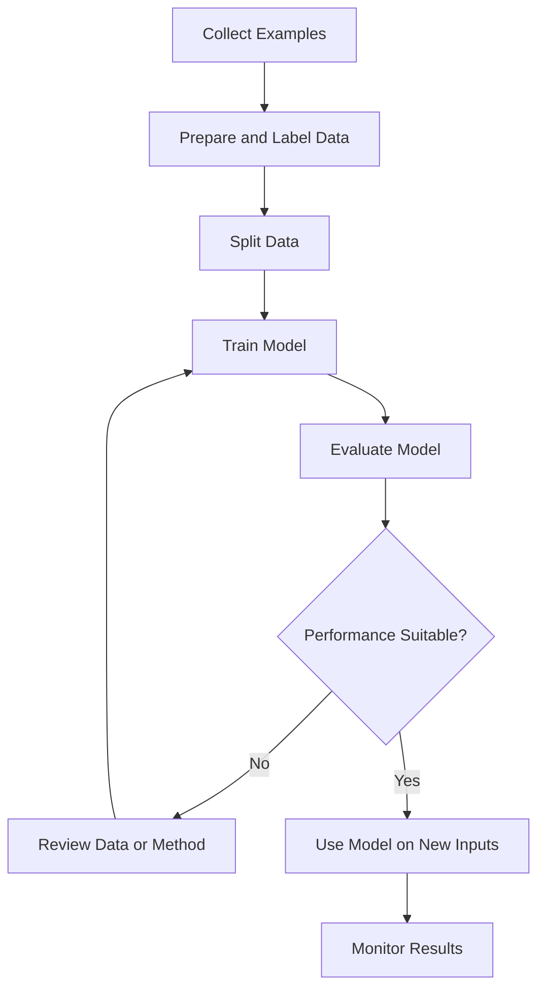
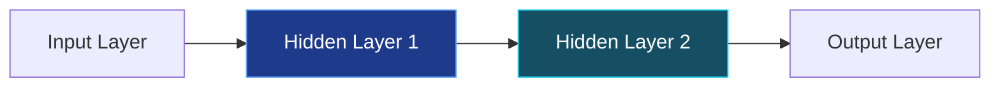
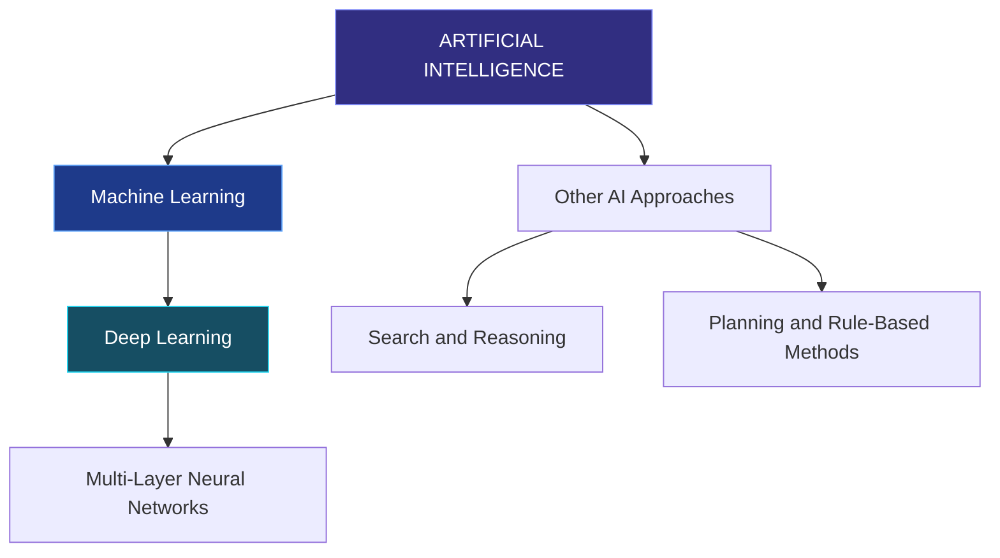
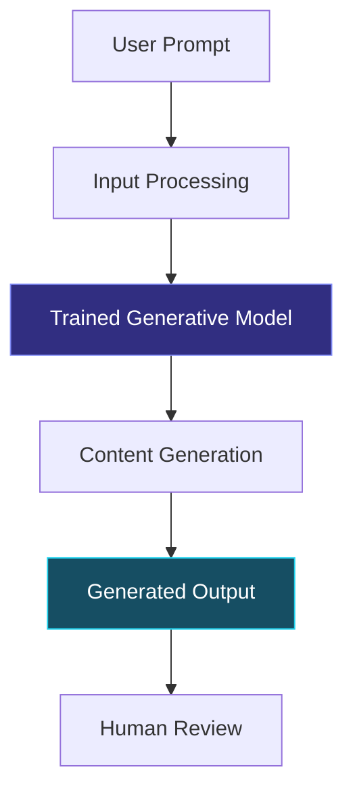
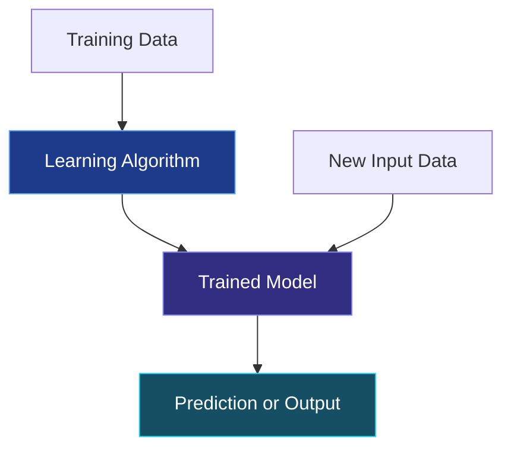
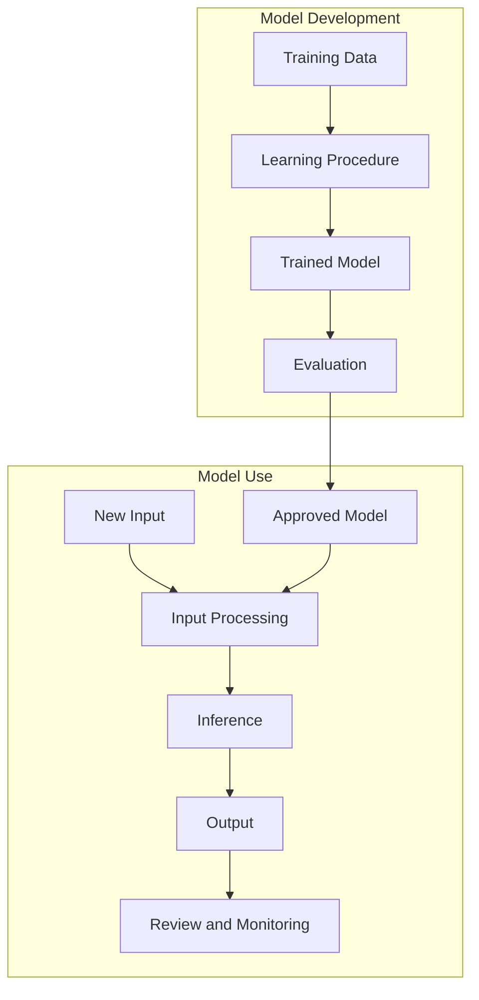
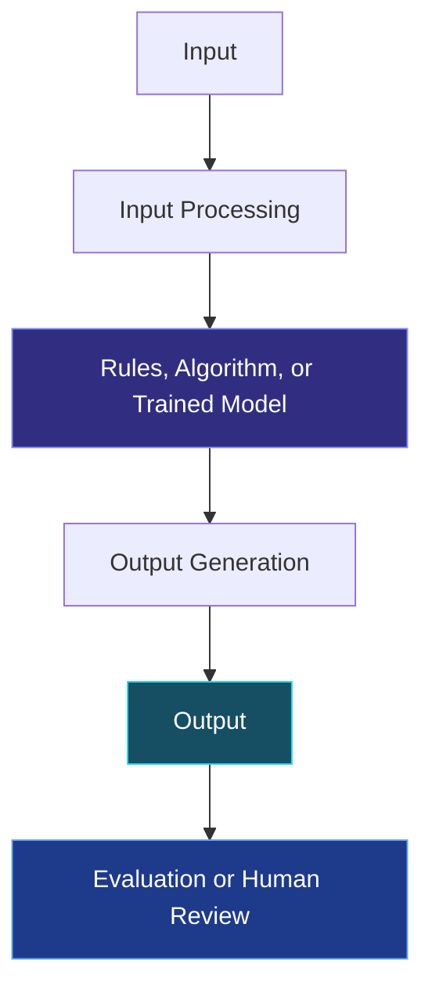

# TOPIC 02 — TYPES OF AI AND HOW AI WORKS

  <strong>SLN · AI OVERVIEW</strong> 
  <em>Understanding the Types and Processes of Artificial Intelligence</em>

---

## CONTENTS

| Section | Topic |
|:---:|---|
| 01 | [Types of AI Based on Capabilities](#01--types-of-ai-based-on-capabilities) |
| 02 | [Introduction to Machine Learning and Deep Learning](#02--introduction-to-machine-learning-and-deep-learning) |
| 03 | [Generative AI](#03--generative-ai) |
| 04 | [The Roles of Data and Algorithms](#04--the-roles-of-data-and-algorithms) |
| 05 | [How AI Processes Information and Generates Outputs](#05--how-ai-processes-information-and-generates-outputs) |

---

# 01 · TYPES OF AI BASED ON CAPABILITIES

Artificial Intelligence can be classified in different ways. One common introductory classification groups AI according to the range of tasks and abilities a system is designed or expected to perform. This classification includes **Narrow AI**, **Artificial General Intelligence (AGI)**, and **Artificial Superintelligence (ASI)**.

These categories describe the scope of a system's capabilities. They should not be confused with technical methods such as machine learning or deep learning, which describe approaches used to develop AI systems.

## Three Categories of AI Based on Capabilities

The capability-based classification focuses on **how broadly an AI system can perform tasks**. It is a conceptual way to discuss the scope of intelligence, not a measurement that can be determined from one impressive demonstration. A system may perform well on many tasks while still depending on learned patterns, instructions, tools, and operating conditions.

It is also important to separate capability from autonomy. A system that can perform a task without constant human input is not automatically AGI. Autonomy describes how independently a system can operate within a defined environment, while the ANI–AGI–ASI classification concerns the breadth and level of its capabilities.

| Category | Description | Status and Example |
|---|---|---|
| Narrow AI (ANI) | Designed to perform a specific task or a limited range of related tasks. | Widely used today; examples include spam filters, recommendation systems, and image-recognition tools. |
| Artificial General Intelligence (AGI) | A proposed form of AI that could learn and perform a broad range of intellectual tasks across different domains with flexibility comparable to human intelligence. | A research concept; there is no generally accepted confirmation that current AI systems have achieved AGI. |
| Artificial Superintelligence (ASI) | A hypothetical form of AI that would exceed human intellectual abilities across most or all areas. | A theoretical possibility, not an established category of currently available AI systems. |

### 1. Narrow AI (ANI)

Narrow AI systems are usually developed around a clearly described objective. Their performance is evaluated against that objective, such as identifying a category, ranking search results, detecting unusual activity, or transcribing speech. A narrow system can be highly capable in its domain without having general understanding across unrelated domains.

For example, an image-recognition model may identify objects in photographs with high accuracy. That does not mean it can automatically explain a legal contract, plan a science experiment, or operate a vehicle. Those tasks require different capabilities, data, and system designs.

**Typical characteristics of Narrow AI include:**

- **Task-specific design:** The system is developed for a particular function or a limited set of related functions.
- **Defined operating conditions:** Its performance is usually strongest when inputs resemble the situations it was designed and evaluated for.
- **Limited transfer:** Skills learned for one task do not necessarily transfer to a different task without additional development.
- **Measurable performance:** Developers can often evaluate it using task-specific measures, such as accuracy, error rate, or response time.
- **Dependence on human design:** People choose the objective, prepare data, select methods, and decide how the system is deployed.

A common misunderstanding is that a narrow system must be simple. This is not correct. A narrow AI system may use a very large model and sophisticated algorithms while remaining limited to a defined purpose.

**Narrow AI**, also called *Artificial Narrow Intelligence*, refers to AI systems developed for particular tasks or a limited set of tasks. A system may perform its assigned task quickly and accurately, but its capability is generally restricted to the purpose and conditions for which it was designed.

Examples include:

- **Recommendation systems:** Suggest videos, music, or products based on user activity and preferences.
- **Spam detection:** Identify messages that are likely to be unwanted or suspicious.
- **Navigation systems:** Analyze route information and recommend a suitable route.
- **Image recognition:** Identify objects or other visual patterns in photographs.
- **Voice assistants:** Process supported spoken requests and provide responses or perform selected actions.

Most AI applications commonly encountered in everyday life belong to this category. A system that performs one task successfully should not automatically be considered capable of understanding or performing unrelated tasks.

### 2. Artificial General Intelligence (AGI)

AGI is often discussed in terms of **generalization**: the ability to apply knowledge and problem-solving skills across different tasks and situations. A general system would not need a completely separate design for every new task. It would be expected to adapt to unfamiliar problems, use knowledge flexibly, and learn new tasks with less task-specific engineering.

However, there is no single universally accepted test that settles whether a system is AGI. Researchers and commentators may use different definitions, benchmarks, and expectations. Success on a collection of tests is informative, but it does not by itself prove that a system has all the broad abilities associated with human intelligence.

When discussing AGI, distinguish three ideas:

1. **Broad task performance:** A system can perform many kinds of tasks.
2. **Generalization:** A system can apply what it has learned to situations that differ from its training examples.
3. **Robust adaptation:** A system can respond appropriately when the task, context, or conditions change.

These ideas are related, but they are not identical. A system may demonstrate broad performance while still struggling with reliability, unfamiliar situations, or independent adaptation.

**Artificial General Intelligence (AGI)** describes a proposed type of AI with broad and flexible intellectual capabilities. In principle, an AGI system would be able to learn, understand, and apply knowledge across many different tasks rather than being limited to one narrow function.

For example, the idea of AGI involves a system that could transfer what it has learned in one area to a different area, adapt to unfamiliar tasks, and solve a wide variety of problems.

AGI is an important concept in discussions about the future of AI. However, it is necessary to distinguish the concept from existing systems. Current AI tools can perform many impressive tasks, but their performance does not by itself demonstrate that they possess general human-level intelligence.

### 3. Artificial Superintelligence (ASI)

ASI is a hypothetical concept used to discuss a possible level of machine capability that would exceed human intellectual performance across a very broad range of fields. Discussions of ASI often raise questions about control, safety, social effects, and how people would govern systems with capabilities far beyond current technology.

Because ASI is hypothetical, descriptions of its abilities are necessarily speculative. It is more accurate to discuss it as a future-oriented concept than to describe it as an existing product or established scientific achievement. The idea is useful for considering long-term questions, but it should not be confused with the practical capabilities of today's AI applications.

**Artificial Superintelligence (ASI)** refers to a hypothetical form of AI whose intellectual capabilities would exceed human abilities across most or all areas. The concept is usually discussed in relation to possible future developments and their wider implications.

ASI is not a description of an established technology currently available for ordinary use. It is a theoretical category and should be presented as such rather than as a current fact.

## Comparing the Three Categories

A useful way to compare the categories is to consider how each one would handle a task outside its original purpose. A narrow system is designed for a particular task. AGI is proposed to handle a wide variety of tasks and transfer knowledge between them. ASI is a hypothetical category that would exceed human intellectual abilities across most domains.

| Aspect | Narrow AI | AGI | ASI |
|---|---|---|---|
| Scope | Specific tasks or limited related tasks | Broad range of intellectual tasks | Hypothetically exceeds human abilities across most areas |
| Flexibility | Usually limited to its designed purpose | Intended to be highly flexible | Hypothetically very broad and advanced |
| Transfer Between Tasks | Limited and dependent on system design | Expected to transfer knowledge across domains | Expected to exceed human-level transfer and performance |
| Current Status | Commonly used today | Not confirmed as achieved | Hypothetical |
| Example | Spam filter or recommendation system | A proposed general-purpose intelligent system | A hypothetical superintelligent system |

> **Important Distinction**
>
> Narrow AI, AGI, and ASI classify AI according to the scope of its capabilities. Machine learning and deep learning, discussed in the next section, describe methods used to build systems. These are different ways of classifying AI.

### Why This Classification Matters

This classification helps people avoid exaggerating what an AI system can do. A chatbot may answer questions, summarize text, and draft content, but these abilities do not automatically establish that it has general intelligence. Its performance must be considered in relation to the tasks, evidence, limitations, and conditions involved.

When evaluating a claim about an AI system, ask:

- What tasks can the system actually perform?
- Under what conditions was its performance measured?
- Can it transfer its capabilities to unfamiliar tasks?
- What kinds of errors or limitations have been observed?
- Is the claim describing a current system or a hypothetical future capability?

> **Core Insight**
>
> Most AI systems currently used in everyday life are Narrow AI. AGI and ASI are broader concepts used to discuss possible levels of future AI capability, and they should not be described as technologies that have already been achieved.

---

# 02 · INTRODUCTION TO MACHINE LEARNING AND DEEP LEARNING

AI systems can be developed using different approaches. One important approach is **Machine Learning (ML)**, which allows a computer system to learn patterns from data. **Deep Learning (DL)** is a more specialized approach within machine learning that uses neural networks with multiple processing layers.

Understanding the relationship between AI, machine learning, and deep learning helps explain how many modern AI applications are developed. Russell and Norvig (2020) discuss machine learning and deep learning as major areas within the broader study of AI.

## Machine Learning (ML)

Machine learning is especially useful when a task involves patterns that are difficult to express completely through a fixed list of instructions. Instead of manually specifying every possible case, developers use examples and a learning procedure to adjust a model.

A machine-learning model does not learn by forming human experiences or intentions. In technical terms, training changes model parameters so that the model's outputs become better according to a chosen objective and training procedure.

### Main Types of Machine Learning

Machine learning is commonly introduced through three broad learning settings: supervised learning, unsupervised learning, and reinforcement learning. These categories describe the kind of feedback or information available during learning.

| Learning Type | Information Available During Learning | Main Purpose | Example |
|---|---|---|---|
| Supervised Learning | Examples paired with target labels or values | Learn to predict a known category or value | Classifying emails as spam or not spam |
| Unsupervised Learning | Data without supplied target labels | Find structure, groups, or patterns in data | Grouping customers by similar activity |
| Reinforcement Learning | Feedback or rewards from actions in an environment | Learn actions that improve a reward objective | Training an agent in a simulated game |

#### Supervised Learning

In supervised learning, training examples include both inputs and expected answers, often called labels or targets. The model produces a prediction, and a learning procedure compares that prediction with the target. The model is adjusted to reduce a measure of error.

Two common supervised-learning tasks are:

- **Classification:** Predicting a category, such as spam/not spam or positive/negative sentiment.
- **Regression:** Predicting a numerical value, such as an estimated delivery time or house price.

The usefulness of supervised learning depends on the quality of the examples and labels. Incorrect labels can teach the model incorrect associations.

#### Unsupervised Learning

In unsupervised learning, the data does not include a target answer for every example. The method attempts to identify structure in the data, such as groups of similar records or patterns that may be useful for further analysis.

For example, a retailer might use clustering to group products or customer activity according to similarities. The resulting groups do not automatically explain why people behave in a particular way; they are patterns identified by the method and require interpretation.

#### Reinforcement Learning

In reinforcement learning, an agent interacts with an environment and receives feedback, often represented as rewards or penalties. The learning process aims to find a strategy, called a policy, that produces a higher cumulative reward over time.

A simplified example is an agent learning to navigate a simulated environment. It observes a state, chooses an action, receives feedback, and uses that feedback to improve its future choices. Real-world applications require careful design because the reward objective may not capture every human value or safety requirement.

### A Simple Machine-Learning Training Cycle

**Machine Learning** is a subset of Artificial Intelligence that enables computer systems to learn patterns from data and use those patterns to make predictions, classifications, or decisions.

In traditional rule-based programming, developers write instructions that specify how a system should respond to particular conditions. In machine learning, developers provide data and choose a learning method so that a model can identify useful patterns from examples.

This does not mean that a machine learns in exactly the same way as a human. It means that a computational model is adjusted using data so that it can perform a particular task.

### How Machine Learning Works at a Basic Level

The following diagram expands the basic training process. It separates training from later use of the trained model.

A simplified machine-learning process includes:

1. **Collect data:** Gather examples relevant to the task.
2. **Prepare data:** Organize the information and address problems such as missing or inconsistent values.
3. **Train a model:** Use a learning algorithm to identify patterns in the training data.
4. **Evaluate the model:** Test the model with data that was not used in training to examine how well it performs.
5. **Use the model:** Apply the trained model to new inputs to produce predictions or classifications.
6. **Review and improve:** Monitor results and update the model when necessary and appropriate.

The quality of the result depends on several factors, including the relevance and quality of the data, the learning method, the model, and the conditions in which it is used.

### Example: Email Spam Detection

A more detailed example shows why machine learning requires more than simply feeding information into a computer.

1. **Define the task:** The system must classify an email as spam or not spam.
2. **Collect examples:** Developers obtain a suitable collection of emails for model development, subject to privacy and data-handling requirements.
3. **Prepare the examples:** The text and relevant features are converted into a format the model can process. The examples are labelled where supervised learning is used.
4. **Train the model:** A learning algorithm adjusts model parameters so that predictions better match the training labels.
5. **Evaluate performance:** The model is tested on separate examples to estimate how well it handles messages it did not train on.
6. **Deploy and monitor:** The model classifies new messages. Its performance is reviewed because message patterns and user needs can change.

A model may incorrectly classify a legitimate email as spam or fail to identify a spam message. Therefore, the system should be evaluated using more than one measure. For example, **precision** asks how many messages flagged as spam really are spam, while **recall** asks how many of the actual spam messages were successfully detected. The appropriate balance depends on the consequences of each type of error.

Imagine an email service that needs to identify spam messages.

A machine-learning system can be trained using many examples of emails labelled as **spam** or **not spam**. During training, the model identifies patterns that are associated with each category. When a new email arrives, the model analyzes its characteristics and estimates whether it is likely to be spam.

The model does not simply memorize one fixed list of suspicious words. It learns statistical patterns from the examples it receives. Its predictions can still be wrong, especially when a new message differs from the training examples.

### Common Uses of Machine Learning

| Application | What the System Learns or Estimates |
|---|---|
| Spam filtering | Patterns associated with unwanted messages |
| Recommendation systems | Relationships between user activity, preferences, and items |
| Fraud detection | Patterns that may indicate unusual or suspicious transactions |
| Demand forecasting | Patterns in historical information that help estimate future demand |
| Speech recognition | Relationships between audio signals and spoken words |

These examples illustrate that machine learning is useful when a task involves patterns that may be difficult to describe completely through manually written rules.

## Deep Learning (DL)

Deep learning uses artificial neural networks composed of multiple layers of computational units. The design is loosely inspired by some ideas about biological neural systems, but artificial neural networks are mathematical and computational models; they are not literal copies of the human brain.

Each layer transforms information and passes a representation to the next layer. During training, the model's parameters are adjusted so that the network produces outputs that better fit its training objective.

### A Simplified Neural Network

- **Input layer:** Receives a numerical representation of the input information.
- **Hidden layers:** Transform information and learn intermediate representations.
- **Output layer:** Produces the model's result, such as a category, score, or generated sequence.

The diagram is conceptual. Real neural networks can have many layers, connections, and design variations.

### Training a Neural Network

During training, the model produces an output for an example. A loss function measures how far that output is from the desired target or objective. An optimization procedure then adjusts the model's parameters to reduce the loss. This process is repeated over many examples and training iterations.

A common training concept is **backpropagation**, which calculates how changes in model parameters contribute to the error. An optimization algorithm uses this information to update the parameters. These steps are repeated so the network can learn useful patterns from the training data.

Deep learning can automatically learn useful features from raw or lightly processed data, but this does not remove the need for data preparation, suitable objectives, evaluation, and human decisions about system design.

### Why Deep Learning Became Important

Several developments contributed to the progress of deep learning:

- **More available data:** Digital systems produce and store large collections of text, images, audio, and other information.
- **Improved computing hardware:** More powerful processors and specialized hardware make it possible to train larger neural networks.
- **Algorithmic improvements:** Research has produced better ways to train and structure neural networks.
- **Larger-scale experimentation:** Researchers can test models using larger datasets and more computing resources.

These factors work together. More data alone does not guarantee a better model, and a larger model is not automatically more accurate or appropriate for every task.

### Training, Validation, and Testing

A dataset is often divided into separate portions so that model development and evaluation do not rely on exactly the same examples.

| Dataset Portion | Purpose |
|---|---|
| Training Set | Used to adjust the model's parameters |
| Validation Set | Used during development to compare configurations and tune choices |
| Test Set | Used for a final evaluation on examples kept separate from training and model selection |

Keeping these roles separate helps provide a more realistic estimate of how a model may perform on new data. If information from the test set influences repeated development decisions, the test results may no longer provide an independent evaluation.

### Overfitting and Generalization

**Overfitting** occurs when a model learns details or noise in its training data so closely that it performs poorly on new examples. A model may achieve very strong training results but fail to generalize to situations it has not seen before.

**Generalization** refers to a model's ability to perform appropriately on new data from the relevant task or environment. Evaluating generalization requires testing with data that is separate from the examples used to fit the model and considering whether the test data represents likely real-world conditions.

**Deep Learning** is a subset of machine learning that uses artificial neural networks with multiple processing layers to learn complex patterns from data.

The term *deep* refers to the use of multiple layers in the network. These layers process information and help the model learn different levels of patterns. The technical details can become complex, but the central idea is that a deep-learning model learns representations from examples through a training process.

Deep learning has contributed to progress in tasks involving large amounts of data, especially images, audio, speech, and language.

### Examples of Deep Learning Applications

- **Image recognition:** A model can learn visual patterns that help identify objects in photographs.
- **Speech recognition:** A model can process audio patterns and estimate the words being spoken.
- **Language processing:** A model can learn patterns in text that support language-related tasks.
- **Generative systems:** Deep-learning models can be used to generate text, images, audio, and other forms of content.

Deep learning often requires substantial data and computing resources, although the requirements vary depending on the task and model. It is not automatically the best approach for every problem.

## Relationship Between AI, Machine Learning, and Deep Learning

The relationship is hierarchical in the common introductory classification: deep learning is part of machine learning, and machine learning is part of the broader field of AI. However, AI also includes methods that are not machine learning, such as search, planning, and logical reasoning.

The relationship can be represented as follows:

- **Artificial Intelligence** is the broad field concerned with systems that perform tasks associated with intelligent behavior.
- **Machine Learning** is one approach within AI. It uses data to help models learn patterns.
- **Deep Learning** is one approach within machine learning. It uses neural networks with multiple layers.

Machine learning is not the only way to develop AI. AI also includes approaches such as search, logical reasoning, planning, and systems based on explicitly represented rules.

## Machine Learning and Deep Learning Compared

| Aspect | Machine Learning | Deep Learning |
|---|---|---|
| Relationship | A broad subset of AI | A subset of machine learning |
| Main Approach | Uses algorithms to learn patterns from data | Uses multi-layer neural networks to learn complex patterns |
| Data Requirements | Varies by method and task | Often benefits from large amounts of data |
| Feature Handling | Some methods rely on features selected or prepared by people | Can learn useful representations through multiple layers |
| Computing Requirements | Varies; some methods are relatively lightweight | Can require substantial computing resources |
| Common Applications | Spam filtering, forecasting, recommendations | Image recognition, speech processing, advanced language tasks |

These are general comparisons. Actual data and computing requirements depend on the model, task, and implementation.

> **Core Insight**
>
> Machine learning allows models to learn patterns from data. Deep learning is a type of machine learning that uses multi-layer neural networks. Both are important approaches within the broader field of AI, but neither is required for every AI application.

---

# 03 · GENERATIVE AI

**Generative AI** refers to AI systems designed to generate new content based on patterns learned from data. Depending on the system, the content may include text, images, audio, video, or computer code.

Generative AI is different from systems that only classify information or make predictions. A classification system may identify whether an image contains a cat, while a generative system may create a new image from a written description.

## What Is Generative AI?

Generative AI is a category of AI focused on producing new content. The generated content is created by a model that has learned statistical or structural patterns from training data. The model uses those learned patterns and the prompt or other context to generate an output.

The word *generate* does not mean that the system creates content without constraints or from nothing. Its output is influenced by its training process, model architecture, input prompt, system configuration, and any additional information provided at the time of use.

### Generative AI Compared with Discriminative AI

A useful distinction is between systems that primarily generate content and systems that primarily distinguish or predict categories and values.

| Aspect | Generative Approach | Discriminative Approach |
|---|---|---|
| Main Purpose | Model patterns in data and generate new examples or content | Distinguish categories or estimate target values from inputs |
| Example | Generate a paragraph from a prompt | Classify a paragraph as positive or negative sentiment |
| Typical Output | New text, image, audio, or other content | Label, score, or prediction |
| Important Note | Generated content still requires evaluation | Predictions also require evaluation and can be wrong |

This is an introductory distinction. Some systems combine generative and discriminative components, and the exact technical boundary depends on the model design.

Generative AI systems learn patterns and relationships from training data. When a user provides an input, the system uses what it has learned, together with the current input and context, to produce content.

For example, a user may provide a prompt asking an AI tool to explain a scientific concept in simple language. The system processes the prompt and generates a response that follows patterns learned during training.

The generated response is newly produced by the system. It is not necessarily a direct copy of a particular training example, and it is not automatically guaranteed to be accurate.

## Common Types of Generative AI Output

Generative systems can work with one or more modalities. A **modality** is a type or form of information, such as text, image, audio, or video. A system that works with multiple modalities may be described as multimodal.

| Output Type | Description | Example Task |
|---|---|---|
| Text | Produces written language | Drafting an explanation or summary |
| Images | Produces visual content | Creating an illustration from a description |
| Audio | Produces or transforms sound | Generating speech or music-like audio |
| Video | Produces or assists with video content | Creating a short visual sequence |
| Code | Produces computer-programming text | Suggesting a code draft or explaining a code example |

The capabilities of each tool depend on the model and the features provided by its developers.

## Prompts and Generated Outputs

Prompt quality can influence the relevance and format of a response. A prompt is not a guarantee of correctness, but clear instructions can reduce ambiguity and help the system focus on the intended task.

### Elements of a Clear Prompt

| Element | Purpose | Example |
|---|---|---|
| Task | States what the system should do | Explain, compare, summarize, classify |
| Context | Provides relevant background | The explanation is for a beginner studying AI |
| Constraints | Sets boundaries | Use simple language and avoid unnecessary jargon |
| Format | Specifies how the answer should be organized | Use a table or three short paragraphs |
| Evaluation focus | Identifies what matters in the result | Include definitions and one example |

A prompt can be improved by adding missing context, specifying the audience, and stating the expected output format. If the request involves factual information, the user should also verify important claims with reliable sources.

### Example of Prompt Refinement

**Less specific prompt:** "Explain machine learning."

**More specific prompt:** "Explain supervised machine learning for a beginner in one short paragraph. Define training data and labels, then give an example using email spam detection."

The second prompt gives the system a clearer task and audience. It does not guarantee that the response will be accurate, but it makes the expected answer easier to interpret and evaluate.

A **prompt** is the instruction, question, or information supplied by a user to guide an AI system's response.

A prompt may include:
- The task the user wants the system to perform.
- Relevant background information.
- The desired format or level of detail.
- Constraints that the system should follow.

For example:

**Prompt:** "Explain how photosynthesis works in three simple sentences for a beginner."

The prompt identifies the subject, the intended audience, and the requested length. The generative AI system processes this input and produces a text response based on learned patterns and the context available to it.

A more specific prompt can help clarify what the user expects. However, a detailed prompt does not guarantee that every generated statement will be correct.

## A Simplified Generative AI Process

1. **User prompt:** The user provides an instruction or other input.
2. **Input processing:** The system processes the prompt and relevant context.
3. **Trained model:** The model uses patterns learned during training.
4. **Content generation:** The system produces content in response to the input.
5. **Generated output:** The user receives text, an image, audio, code, or another supported form.
6. **Human review:** The user checks whether the output is accurate, relevant, and suitable.

This is a simplified explanation. Different generative AI systems use different model designs and generation methods.

## Generative AI and Large Language Models

Large language models process text as sequences of smaller units often called **tokens**. A token may represent a word, part of a word, punctuation, or another unit used by the model. The model uses the current context to estimate likely next tokens and generates a sequence that forms a response.

Many modern language models use a neural-network architecture known as a **Transformer**. Transformer-based models use attention mechanisms to help represent relationships between tokens in a sequence. This architecture has been influential in language modeling and other AI applications.

A simplified text-generation process is:

1. The user's prompt is converted into tokens.
2. The model processes the token sequence and its context.
3. The model calculates possible next-token probabilities.
4. A token is selected according to the model's generation method and settings.
5. The process repeats until the response is complete or a stopping condition is reached.
6. The generated tokens are converted back into readable text.

This description is simplified and does not cover every model design. It helps explain why a language model can produce fluent text without independently verifying every statement against an external source.

### Context Window and Conversation Context

A model can use only the information made available within its active context and any connected tools or retrieval systems it is designed to use. The amount of text it can consider at one time is often described as its **context window**. If important information is missing from the context, the response may omit it or make an incorrect assumption.

### Why a Language Model May Produce Errors

A language model is trained to generate likely sequences based on patterns and context. That objective is not identical to checking every claim against a verified database. As a result, it may produce statements that sound plausible but are inaccurate, incomplete, outdated, or unsupported.

Such errors are sometimes called **hallucinations** in discussions of generative AI. The term describes unreliable generated content; it does not mean that the system has human-like perception or experiences.

A **Large Language Model (LLM)** is a type of model trained to process and generate human language. LLMs are commonly used in chat-based AI tools, writing assistance, summarization, and question answering.

An LLM generates language based on patterns learned from large collections of text and the context provided in a prompt. Its ability to produce fluent sentences does not mean that it understands every topic in the same way a human expert does.

Bender et al. (2021) discuss concerns about very large language models, including the risks of treating fluent language output as evidence of genuine understanding. Their paper also raises concerns about training data, environmental and financial costs, and the social impacts associated with large language models.

This is an important distinction when using generative AI: an answer may sound convincing while still containing inaccurate, incomplete, or misleading information.

## Generative AI: Capabilities and Careful Use

Generative AI can support learning and creative work, but it should be treated as an aid rather than an unquestionable authority. Users should consider the importance of the task, the sensitivity of the information, and the possibility of errors before relying on generated content.

### Common Limitations

- **Factual errors:** A response may contain incorrect names, dates, definitions, or explanations.
- **Missing context:** The model may not know the user's full situation or the latest developments.
- **Bias:** Patterns in training data can be reflected in generated outputs.
- **Inconsistent responses:** Similar prompts may produce different wording or details.
- **Attribution problems:** A generated answer may not provide reliable evidence for where a claim originated.
- **Privacy concerns:** Users should avoid entering confidential or personal information unless the tool and its data practices are appropriate for that information.
- **Overreliance:** Accepting outputs without checking can weaken the quality of decisions and learning.

### A Practical Review Checklist

Before using generated content, consider:

1. Does the response answer the actual question?
2. Are key facts and figures supported by trustworthy sources?
3. Is the information current enough for the task?
4. Does the response omit important context or alternative explanations?
5. Is the content appropriate to share or submit?
6. Have you followed relevant school, workplace, and tool-use rules?

Bender et al. (2021) caution against interpreting fluent language output as proof of understanding and discuss wider issues associated with large language models. This supports a careful approach: evaluate the content, its sources, and its consequences rather than judging reliability by writing quality alone.

Generative AI can support many activities:

- Producing an initial draft that a person can review and edit.
- Explaining a topic using simpler language.
- Suggesting ideas or possible outlines.
- Creating visual concepts or illustrations.
- Helping users understand examples of computer code.

However, generated content should be evaluated before it is relied upon. A system may provide incorrect facts, omit important context, reflect limitations in its training data, or produce content that is unsuitable for the intended purpose.

NIST's AI Risk Management Framework emphasizes that AI risks should be considered and managed throughout the AI system life cycle. This supports the need to evaluate AI systems in context rather than assuming that an output is reliable simply because it was generated by an advanced model.

> **Core Insight**
>
> Generative AI creates content using patterns learned from data and the context in a user's prompt. Fluent or realistic output is not proof of factual accuracy, so human review remains important.

---

# 04 · THE ROLES OF DATA AND ALGORITHMS

Data and algorithms are two important elements in the development and operation of AI systems. Data provides the information that a system processes or learns from, while algorithms provide procedures for processing information and, in machine learning, for adjusting models based on examples.

The quality of an AI system depends not only on the model itself but also on the data, methods, objectives, and conditions involved in its development and use.

## Data in AI Systems

Data is central to many AI systems because it provides the examples, measurements, or context that a system processes. In machine learning, data is used to estimate patterns and adjust model parameters. In other AI approaches, data may be used as input to rules, search procedures, or reasoning processes.

### Structured and Unstructured Data

Data can also be described by how it is organized.

| Form | Description | Example |
|---|---|---|
| Structured Data | Organized in a predefined format, often rows and columns | A table of dates, product IDs, and sales values |
| Unstructured Data | Does not follow one simple tabular structure | Images, audio recordings, and free-form documents |
| Semi-Structured Data | Contains organizational markers but does not fit a rigid table | JSON records, tagged documents, and log entries |

The format affects how information is stored and prepared. A system processing photographs requires different preparation from one analyzing a spreadsheet.

**Data** is information that can be collected, stored, processed, and analyzed by a computer system. Depending on the task, data may take different forms.

| Data Type | Description | Example |
|---|---|---|
| Text | Written words, sentences, or documents | Emails, articles, and user questions |
| Images | Visual information represented digitally | Photographs and scanned documents |
| Audio | Recorded sound or speech | Voice recordings |
| Video | Sequences of visual frames, often with audio | Recorded lectures |
| Numerical Data | Values represented as numbers | Sales figures and temperature readings |
| Sensor Data | Measurements collected by devices | Location or movement readings |

AI systems use data in different ways. A machine-learning model may use examples during training to learn patterns. A system that is already trained may then process new input data to make a prediction, classification, recommendation, or generated response.

## Training Data and Input Data

In addition to training and input data, machine-learning projects may use validation and test data. Understanding these roles helps explain how developers check whether a model has learned useful patterns rather than merely memorizing examples.

It is useful to distinguish between data used to develop a model and data supplied when the model is being used.

### Training Data

**Training data** is the information used during the model-training process. It provides examples from which a machine-learning model can learn patterns and adjust its internal parameters.

For example, an image-recognition model may be trained using many images with labels that identify the objects shown in them.

### Input Data

**Input data** is the information supplied to a system when it performs a task. It may be a new image, a written question, a recorded sound, or another type of information.

For example, after an image-recognition model has been trained, a user can provide a new photograph as input. The model processes the photograph and produces a result based on patterns learned during training.

### Training Data and Input Data Compared

| Aspect | Training Data | Input Data |
|---|---|---|
| Main Purpose | Helps develop or train the model | Gives the system information for a current task |
| When Used | During training or model development | During operation or use |
| Example | Labelled images used to train an image model | A new photograph submitted for recognition |
| Expected Role | Helps the model learn patterns | Is analyzed by the trained system |

The distinction is important because a model's performance on training examples does not necessarily show how well it will perform on new information.

## The Importance of Data Quality

Data quality is not only about whether individual records are correct. It also concerns whether the data is suitable for the purpose, population, and environment in which the model will be used.

### Data Preparation

Before data can be used, it may need to be prepared. Common preparation activities include:

- **Cleaning:** Correcting or removing duplicate, invalid, or inconsistent records when appropriate.
- **Handling missing values:** Deciding whether missing information should be filled, flagged, or excluded.
- **Standardization:** Making formats and units consistent.
- **Labeling:** Assigning categories or target values when a supervised-learning task requires them.
- **Transformation:** Converting information into a representation that the model can process.
- **Splitting:** Separating data into training, validation, and test sets for appropriate development and evaluation.

These steps require judgment. Removing unusual records without understanding them may remove important information, and filling missing values incorrectly can introduce misleading patterns.

### Bias and Representativeness

A dataset may overrepresent some situations and underrepresent others. If the model learns from such data, its performance may vary across groups or contexts. Bias can also enter through the way a task is defined, how labels are assigned, which examples are collected, and how results are evaluated.

For example, if a speech-recognition system is trained on audio that does not adequately represent the accents and speaking conditions of its intended users, its accuracy may be lower for some speakers. This example illustrates why dataset coverage and evaluation conditions matter.

Data quality and fairness cannot be reduced to one simple checklist. Developers need to understand the intended use, examine limitations, and evaluate performance in relevant conditions.

The quality and suitability of data can influence the results of an AI system. Data that is inaccurate, incomplete, outdated, or not representative of the intended situation may lead to unreliable results.

Important data-quality considerations include:

- **Accuracy:** Does the data correctly represent the information it is intended to describe?
- **Completeness:** Is important information missing?
- **Consistency:** Is information recorded in a compatible and consistent way?
- **Relevance:** Is the data appropriate for the task?
- **Representativeness:** Does the data adequately reflect the people, situations, or conditions in which the system will be used?
- **Timeliness:** Is the data sufficiently up to date for the task?

For example, if a recommendation system is developed using incomplete information about user preferences, its recommendations may not be suitable. If a model is trained on data that does not adequately represent the situations in which it will be used, its performance may differ across those situations.

Bender et al. (2021) highlight concerns about the data used to develop large language models, including the difficulty of understanding the full contents and limitations of very large training datasets. This reinforces the importance of examining where data comes from, what it represents, and what limitations it may contain.

## Algorithms in AI Systems

Algorithms are not exclusive to AI. They are used throughout computing, from sorting lists to calculating routes. In AI, algorithms may support search, reasoning, planning, optimization, and learning from data.

### Algorithm, Model, and Parameters

These terms are related but refer to different things:

| Term | Meaning | Example in Machine Learning |
|---|---|---|
| Algorithm | A procedure or set of steps used to solve a problem or carry out learning | A learning procedure that updates model parameters |
| Model | The learned computational structure used to make predictions or produce outputs | A trained classifier for spam detection |
| Parameters | Internal values adjusted during training | Weights in a neural network |
| Hyperparameters | Settings chosen to guide the training process | Learning rate or number of training iterations |

A learning algorithm uses data and a training objective to adjust model parameters. Hyperparameters influence how the training process operates and are usually selected or tuned during development.

### Rules-Based Processing and Learning-Based Processing

A rule-based system uses instructions explicitly written or configured by people. A learning-based system uses a model whose parameters have been adjusted through a learning process. Some practical systems combine both approaches.

For example, a customer-support system might use a language model to interpret a request but apply explicit rules to decide which account actions are permitted. This combination can help separate flexible language processing from clearly defined operational constraints.

An **algorithm** is a defined set of steps or procedures for solving a problem or completing a task. This broad idea is consistent with the problem-solving, learning, and reasoning approaches discussed by Russell and Norvig (2020).

In AI, algorithms can be used to:
- Process and organize input information.
- Search for possible solutions.
- Apply rules or logical procedures.
- Learn patterns from training data.
- Adjust a model during training.
- Produce predictions, classifications, or other outputs.

In machine learning, a learning algorithm uses training data to adjust a model so that it can perform a particular task. The model is the resulting computational system or learned representation used to process new inputs.

An algorithm and a model are related, but they are not the same thing: the algorithm describes a procedure, while the trained model contains the learned parameters or structure used when the system is applied.

## How Data, Algorithms, and Models Work Together

A useful distinction is between **training** and **inference**.

- **Training** is the development stage in which a learning procedure uses training data to adjust a model.
- **Inference** is the stage in which the trained model processes new input and produces an output.

The two stages have different purposes. Training builds or adjusts the model; inference applies the model. Some systems may be updated or retrained over time, but not every model learns continuously from every user interaction.

### Training and Inference Compared

| Aspect | Training | Inference |
|---|---|---|
| Main Purpose | Learn or adjust model parameters | Apply a trained model to new inputs |
| Data | Training examples | New input data |
| Process | Repeated parameter updates and evaluation | Processing an input to produce a result |
| Output | A trained model or updated model version | A prediction, classification, recommendation, or generated content |
| Resource Use | Can require substantial computation, depending on the model | Varies with model size and deployment method |

| Element | Main Role | Simple Example |
|---|---|---|
| Data | Provides examples or information | Emails labelled as spam or not spam |
| Algorithm | Defines the learning or processing procedure | A method that adjusts the model based on examples |
| Model | Uses learned patterns to perform a task | A trained spam-classification model |
| Input | Supplies new information for the task | A newly received email |
| Output | Presents the result produced by the system | A prediction that the email may be spam |

A simplified relationship is:

This diagram represents a simplified machine-learning workflow. Not every AI system is trained in the same way, and some AI systems use rules, search, or other methods rather than a model learned from training data.

> **Core Insight**
>
> Data supplies the information and examples, algorithms provide the procedures for processing or learning from that information, and a trained model applies learned patterns to new inputs. Weak data or an unsuitable method can affect the quality of the output.

---

# 05 · HOW AI PROCESSES INFORMATION AND GENERATES OUTPUTS

AI systems process information through a sequence of operations. The exact process depends on the type of system and the task it is designed to perform. A machine-learning model, a rule-based system, and a generative AI tool do not all operate in exactly the same way.

At a general level, an AI system receives an input, processes relevant information, applies its rules or learned model, and produces an output. The output can then be reviewed or used by a person or another system.

## A General AI Processing Workflow

A general workflow is useful for understanding AI, but it should not be treated as a universal technical blueprint. A simple rule-based program may not have a model-training stage, while a generative AI service may use several processing components before producing a response.

### Training Versus Using an AI System

This diagram represents a common machine-learning workflow. In practice, deployment and monitoring involve additional technical, organizational, and governance decisions.

### 1. Input

The system receives information from a user, a device, or another computer system.

Examples include:
- A written question entered into a chatbot.
- A photograph submitted to an image-recognition system.
- Audio recorded by a speech-recognition application.
- Numerical information supplied to a forecasting system.

The input must be relevant to the task the system is designed to perform.

### 2. Input Processing

The system prepares or converts the input into a form that its processing method can use. The exact preparation depends on the type of input and the system.

For example, a language system processes text, while an image-recognition system processes visual information. Some systems may also use additional context, settings, or information from other sources.

### 3. Applying Rules, Algorithms, or a Trained Model

The processing stage depends on the type of AI system:

- **Rule-based system:** Checks conditions and follows predefined instructions.
- **Search-based system:** Explores possible states or solutions according to a search strategy.
- **Machine-learning system:** Applies a model whose parameters were learned from data.
- **Generative system:** Uses a generative model to produce a sequence or other form of content based on input and context.
- **Hybrid system:** Combines multiple approaches, such as a learned model with explicit rules or external information retrieval.

This distinction matters because not every AI system learns from data in the same way. Some systems rely heavily on explicit knowledge and search, while others rely on statistical models learned during training.

The system applies the relevant procedure to the processed input.

A traditional rule-based system follows instructions and conditions defined by its developers. A machine-learning system uses a trained model that has learned patterns from data. Other AI systems may combine learned models with rules, search, or reasoning procedures.

The system's result depends on its design, the information available, and the task it is intended to complete.

### 4. Output Generation

After processing the input, the system produces a result. The form of the output depends on the application.

| AI Task | Possible Output |
|---|---|
| Classification | A category or label |
| Prediction | An estimated value or likely outcome |
| Recommendation | A suggested item or action |
| Recognition | An identified object, word, or pattern |
| Generative task | Newly generated text, image, audio, or other content |

An output is the result produced by the system. It should not automatically be treated as a verified fact or a correct decision.

### 5. Evaluation and Human Review

The output should be checked according to the importance and purpose of the task. A person may compare it with reliable information, examine whether it answers the original question, or decide whether it is appropriate to use.

NIST's AI Risk Management Framework (AI RMF 1.0) presents AI risk management as a continuing activity across the AI system life cycle. Its functions—**Govern, Map, Measure, and Manage**—provide an organized way to consider context, identify and assess risks, and respond to them (Tabassi, 2023).

For an introductory learner, the practical lesson is that AI systems should be evaluated in the context in which they are used. Human review is particularly important when an output may affect important decisions or when accuracy is essential.

## Worked Example: A Generative AI Study Assistant

The example can be examined more closely by identifying what happens before and after the model generates its answer.

### Example Workflow

1. **The student defines a goal:** They want a beginner-friendly explanation of a topic.
2. **The student writes a prompt:** The prompt identifies the topic, audience, and desired format.
3. **The system processes the prompt:** The text is converted into a representation that the model can process.
4. **The model generates a response:** It uses the prompt context and learned language patterns to produce text.
5. **The student evaluates the response:** They compare important claims with course materials or reliable references.
6. **The student revises the result:** They correct unclear wording, remove unsupported statements, and adapt the explanation to the assignment.

### Example of Reviewing an Output

Suppose the generated answer defines machine learning as "a computer learning exactly like a human." This wording is misleading. A more accurate beginner-level explanation is that machine learning uses algorithms and data to adjust a model so it can identify patterns and make predictions or other outputs. The correction matters because a technical learning process should not be confused with human experience or understanding.

The example also shows that human review is not simply checking spelling. It includes checking meaning, evidence, context, and suitability for the intended task.

Consider a student who asks a generative AI tool:

**Prompt:** "Explain the water cycle in simple language and give one everyday example."

The process can be understood as follows:

| Stage | What Happens |
|---|---|
| Input | The student enters the prompt. |
| Input Processing | The system processes the words and identifies the requested topic and style. |
| Model Processing | The trained language model uses patterns learned during training and the prompt context. |
| Output Generation | The system produces a written explanation and an example. |
| Human Review | The student checks the explanation against class notes or a reliable learning resource. |

The system may produce a clear and useful explanation, but it could still leave out an important detail or include an error. The student remains responsible for checking the information before relying on it.

## Why AI Outputs Can Differ

Output differences are not always errors. A system may be designed to generate varied responses, or different systems may use different models and settings. However, variation can make it harder to rely on an output without checking it.

### Feedback and Monitoring

After deployment, developers and operators may monitor how a system performs. They can examine error patterns, user feedback, changes in the input data, and whether the system remains suitable for its intended purpose. Monitoring can reveal that real-world conditions have changed or that the model performs differently from its evaluation results.

Feedback does not automatically mean that a model updates itself. In many systems, feedback is collected for review and a separate development process is required before the model is changed or retrained.

### Common Evaluation Measures

The appropriate evaluation measure depends on the task.

| Measure | General Meaning | Example Use |
|---|---|---|
| Accuracy | Proportion of predictions that are correct | Overall performance in a balanced classification task |
| Precision | How many positive predictions are actually positive | Avoiding too many false spam flags |
| Recall | How many actual positive cases are identified | Detecting as many relevant cases as possible |
| Error Rate | Proportion of predictions that are incorrect | Tracking classification mistakes |
| Human Evaluation | Review by people using task-relevant criteria | Judging clarity and usefulness of generated explanations |

No single measure is sufficient for every AI system. A model can have high overall accuracy while performing poorly on an important subgroup or underrepresented condition. Evaluation should reflect the real purpose and consequences of the system.

AI outputs may vary because systems can use different models, data, algorithms, settings, and input context. Even when two systems receive similar prompts, they may produce different results.

Several factors can influence the output:

- **Input quality:** Unclear or incomplete information can make the task harder.
- **Data quality:** Training data may contain gaps, errors, or limitations.
- **Model design:** Different models may identify and represent patterns differently.
- **Algorithm and settings:** The processing method and system configuration can affect results.
- **Context:** Additional instructions or information can change what the system produces.
- **Evaluation conditions:** A model may perform differently when used in situations unlike those represented in its training or testing data.

These factors help explain why an AI output should be evaluated rather than accepted without review.

> **Core Insight**
>
> A general AI workflow involves receiving input, processing information, applying rules or a trained model, generating an output, and evaluating the result. The exact process differs between AI systems, and human review helps determine whether an output is reliable and appropriate.

---

  <strong>SLN · AI OVERVIEW</strong> 
  Topic 02 — Types of AI and How AI Works

---
