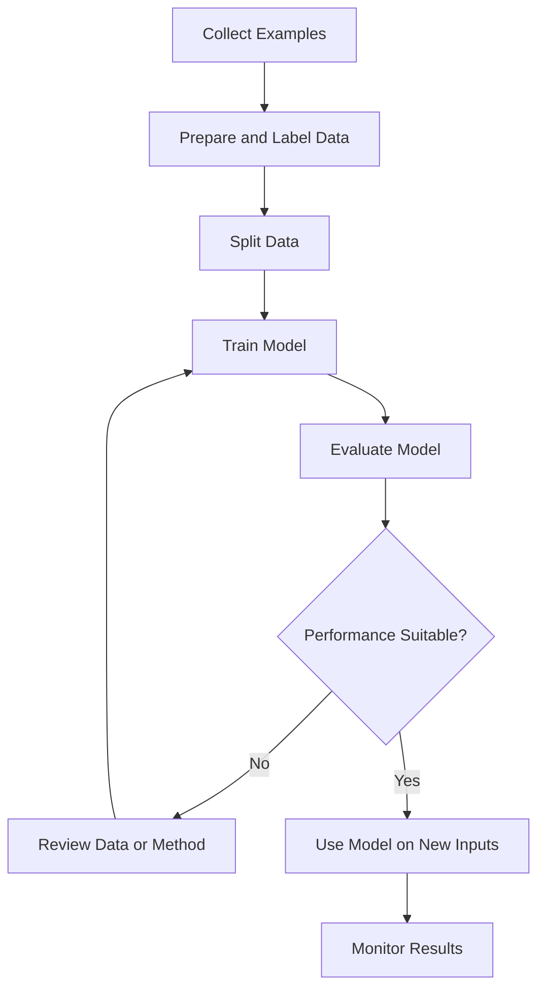
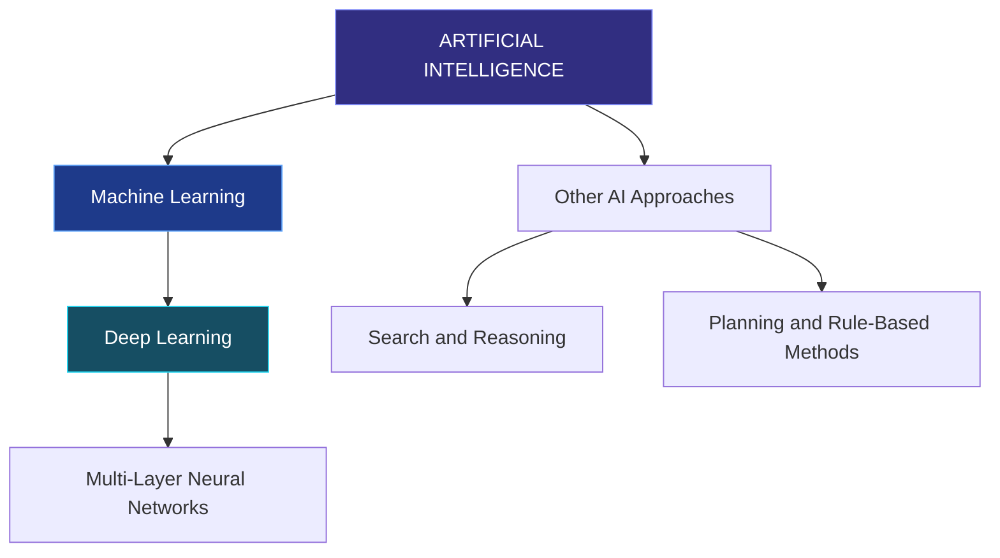
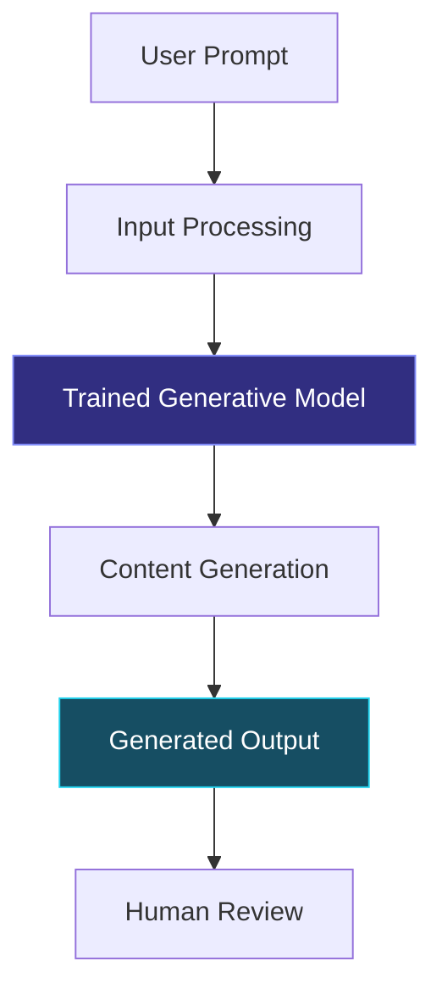
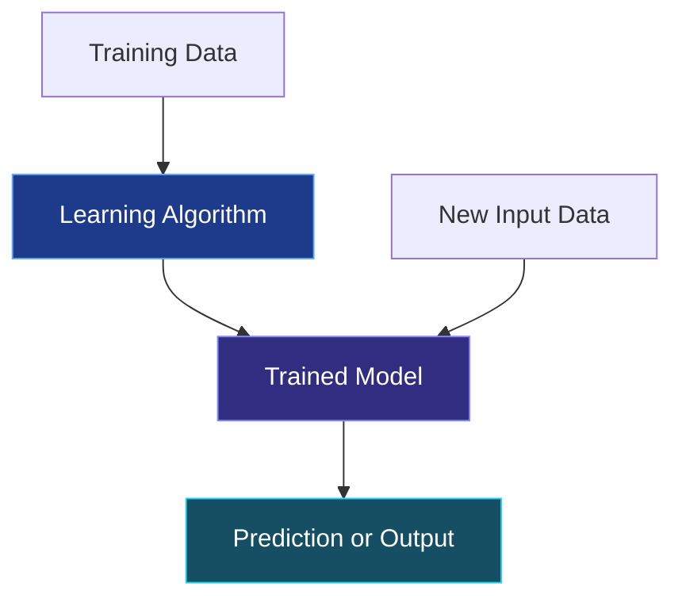
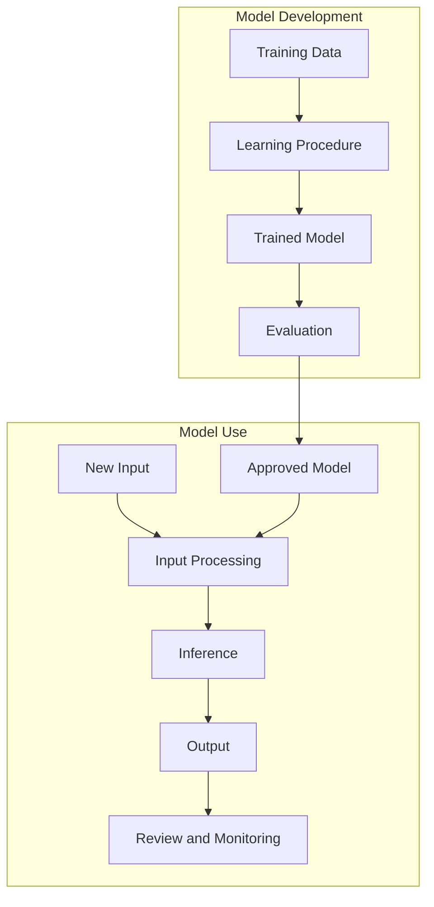
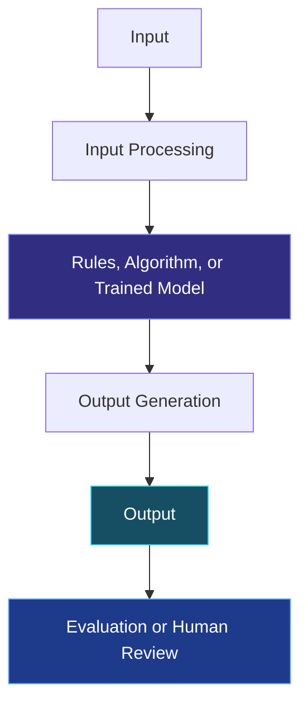

# TOPIC 02 — TYPES OF AI AND HOW AI WORKS

  <strong>SLN · AI OVERVIEW</strong> 
  <em>Learning About AI Types, How AI Learns, and How AI Works</em>

---

## CONTENTS

| Section | Topic |
|:---:|---|
| 01 | [Types of AI Based on Capabilities](#01--types-of-ai-based-on-capabilities) |
| 02 | [Introduction to Machine Learning and Deep Learning](#02--introduction-to-machine-learning-and-deep-learning) |
| 03 | [Generative AI](#03--generative-ai) |
| 04 | [The Roles of Data and Algorithms](#04--the-roles-of-data-and-sets of steps a computer follows) |
| 05 | [How AI Processes Information and Generates Outputs](#05--how-ai-works with-information-and-creates-results) |

---

# 01 · TYPES OF AI BASED ON CAPABILITIES

Artificial Intelligence can be divided into different groups. One common introductory sorting information into groups groups AI according to the number and types of tasks a system is designed or expected to do. This sorting information into groups includes **Narrow AI**, **Artificial General Intelligence (AGI)**, and **Artificial Superintelligence (ASI)**.

These categories describe the how much a system can do. They should not be confused with ways of building AI systems such as machine learning or deep learning, which describe approaches used to develop AI systems.

## Three Categories of AI Based on Capabilities

The grouping based on ability focuses on **how broadly an AI system can do tasks**. It is a simple way to talk about the scope of intelligence, not a measurement that can be determined from one successful example. A system may do well on many tasks while still depending on learned patterns, instructions, tools, and situations in which it is used.

It is also important to separate capability from ability to work on its own. A system that can do a task without constant human information given to the system is not automatically AGI. Autonomy describes how on its own a system can operate within a specific situation, while the ANI–AGI–ASI sorting information into groups concerns the how many different tasks it can do and how well it can do them.

| Category | Description | Status and Example |
|---|---|---|
| Narrow AI (ANI) | Designed to do a specific task or a limited range of related tasks. | Widely used today; examples include spam filters, recommendation systems, and image-recognition tools. |
| Artificial General Intelligence (AGI) | A proposed form of AI that could learn and do a broad range of intellectual tasks across different areas with flexibility comparable to human intelligence. | A research concept; there is no generally accepted confirmation that current AI systems have achieved AGI. |
| Artificial Superintelligence (ASI) | A imagined as a possibility form of AI that would exceed human intellectual abilities across most or all areas. | A idea about what might happen in the future, not an proven type of technology of currently available AI systems. |

### 1. Narrow AI (ANI)

Narrow AI systems are usually developed around a clearly described goal. Their how well it works is checkd against that goal, such as finding a category, ranking search results, detecting unusual activity, or transcribing speech. A narrow system can be highly capable in its area without having general understanding across unrelated areas.

For example, an image-recognition computer system may find objects in photographs with high accuracy. That does not mean it can automatically explain a legal contract, plan a science experiment, or operate a vehicle. Those tasks need different capabilities, data, and system designs.

**Typical characteristics of Narrow AI include:**

- **Task-specific design:** The system is developed for a particular task or a limited set of related tasks.
- **Defined situations in which it is used:** Its how well it works is usually strongest when information given to the systems resemble the situations it was designed and checkd for.
- **Limited transfer:** Skills learned for one task do not necessarily transfer to a different task without additional development.
- **Measurable how well it works:** Developers can often check it using made for a particular task measures, such as accuracy, error rate, or response time.
- **Dependence on human design:** People choose the goal, prepare data, select methods, and decide how the system is deployed.

A common misunderstanding is that a narrow system must be simple. This is not correct. A narrow AI system may use a very large computer system and sophisticated sets of steps a computer follows while remaining limited to a defined purpose.

**Narrow AI**, also called *Artificial Narrow Intelligence*, refers to AI systems developed for particular tasks or a limited set of tasks. A system may do its assigned task quickly and accurately, but its capability is generally restricted to the purpose and conditions for which it was designed.

Examples include:

- **Recommendation systems:** Suggest videos, music, or products based on user activity and preferences.
- **Spam detection:** Identify messages that are likely to be unwanted or suspicious.
- **Navigation systems:** Analyze route information and recommend a right for the situation route.
- **Image recognition:** Identify objects or other visual patterns in photographs.
- **Voice assistants:** Process supported spoken requests and provide responses or do selected actions.

Most AI applications commonly encountered in everyday life belong to this category. A system that dos one task successfully should not automatically be considered capable of understanding or doing unrelated tasks.

### 2. Artificial General Intelligence (AGI)

AGI is often discussed in terms of **using what it has learned in new situations**: the ability to apply knowledge and problem-solving skills across different tasks and situations. A general system would not need a completely separate design for every new task. It would be expected to adapt to unfamiliar problems, use knowledge flexibly, and learn new tasks with less made for a particular task engineering.

However, there is no single universally accepted test that settles whether a system is AGI. Researchers and commentators may use different definitions, benchmarks, and expectations. Success on a collection of tests is informative, but it does not by itself prove that a system has all the broad abilities connected to human intelligence.

When discussing AGI, distinguish three ideas:

1. **Broad task how well it works:** A system can do many kinds of tasks.
2. **Generalization:** A system can apply what it has learned to situations that differ from its training examples.
3. **Robust adaptation:** A system can respond right for the situationly when the task, situation, or conditions change.

These ideas are related, but they are not identical. A system may show broad how well it works while still struggling with how dependable it is, unfamiliar situations, or separate adaptation.

**Artificial General Intelligence (AGI)** describes a proposed type of AI with broad and flexible thinking and problem-solving abilities. In principle, an AGI system would be able to learn, understand, and apply knowledge across many different tasks rather than being limited to one narrow task.

For example, the idea of AGI involves a system that could transfer what it has learned in one area to a different area, adapt to unfamiliar tasks, and solve a wide variety of problems.

AGI is an important concept in discussions about the future of AI. However, it is necessary to distinguish the concept from existing systems. Current AI tools can do many impressive tasks, but their how well it works does not by itself show that they possess general human-level intelligence.

### 3. Artificial Superintelligence (ASI)

ASI is a imagined as a possibility concept used to discuss a possible level of machine capability that would exceed human intellectual how well it works across a very broad range of fields. Discussions of ASI often raise questions about control, safety, social effects, and how people would govern systems with capabilities far beyond current technology.

Because ASI is imagined as a possibility, descriptions of its abilities are necessarily speculative. It is more accurate to discuss it as a future-oriented concept than to describe it as an existing product or established scientific achievement. The idea is useful for considering long-term questions, but it should not be confused with the practical capabilities of today's AI applications.

**Artificial Superintelligence (ASI)** refers to a imagined as a possibility form of AI whose thinking and problem-solving abilities would exceed human abilities across most or all areas. The concept is usually discussed when discussing possible future developments and their wider implications.

ASI is not a description of an established technology currently available for ordinary use. It is a theoretical category and should be presented as such rather than as a current fact.

## Comparing the Three Categories

A useful way to compare the categories is to consider how each one would handle a task outside its original purpose. A narrow system is designed for a particular task. AGI is proposed to handle a wide variety of tasks and transfer knowledge between them. ASI is a imagined as a possibility category that would exceed human intellectual abilities across most areas.

| Aspect | Narrow AI | AGI | ASI |
|---|---|---|---|
| Scope | Specific tasks or limited related tasks | Broad range of intellectual tasks | Hypothetically exceeds human abilities across most areas |
| Flexibility | Usually limited to its designed purpose | Intended to be highly flexible | Hypothetically very broad and advanced |
| Transfer Between Tasks | Limited and dependent on system design | Expected to transfer knowledge in different areas | Expected to exceed human-level transfer and how well it works |
| Current Status | Commonly used today | Not confirmed as achieved | Hypothetical |
| Example | Spam filter or recommendation system | A proposed general-purpose intelligent system | A imagined as a possibility superintelligent system |

> **Important Distinction**
>
> Narrow AI, AGI, and ASI classify AI according to the scope of its capabilities. Machine learning and deep learning, discussed in the next section, describe methods used to build systems. These are different ways of classifying AI.

### Why This Classification Matters

This sorting information into groups helps people avoid exaggerating what an AI system can do. A chatbot may answer questions, summarize text, and draft content, but these abilities do not automatically establish that it has general intelligence. Its how well it works must be considered when discussing the tasks, evidence, limitations, and conditions involved.

When evaluating a claim about an AI system, ask:

- What tasks can the system actually do?
- Under what conditions was its how well it works measured?
- Can it transfer its capabilities to unfamiliar tasks?
- What kinds of errors or limitations have been observed?
- Is the claim describing a current system or a imagined as a possibility future capability?

> **Core Insight**
>
> Most AI systems currently used in everyday life are Narrow AI. AGI and ASI are broader concepts used to discuss possible levels of future AI capability, and they should not be described as technologies that have already been achieved.

---

# 02 · INTRODUCTION TO MACHINE LEARNING AND DEEP LEARNING

AI systems can be developed using different approaches. One important approach is **Machine Learning (ML)**, which allows a computer system to learn patterns from data. **Deep Learning (DL)** is a more specialized approach within machine learning that uses neural networks with multiple working with layers.

Understanding the relationship between AI, machine learning, and deep learning helps explain how many modern AI applications are developed. Russell and Norvig (2020) discuss machine learning and deep learning as major areas within the broader study of AI.

## Machine Learning (ML)

In simple words, machine learning is a way to teach a computer system using examples. Instead of giving the computer a separate instruction for every possible situation, people give it data and a learning method. The system looks for patterns in that data and uses them when it receives new information.

Machine learning is especially useful when a task involves patterns that are difficult to express completely through a fixed list of instructions. Instead of manually specifying every possible case, developers use examples and a learning procedure to adjust a computer system.

A machine-learning computer system does not learn by forming human experiences or intentions. In technical terms, training changes computer system internal settings so that the computer system's results become better according to a chosen goal and training procedure.

### Main Types of Machine Learning

Machine learning is commonly introduced through three broad learning settings: supervised learning, unsupervised learning, and reinforcement learning. These categories describe the kind of feedback or information available during learning.

| Learning Type | Information Available During Learning | Main Purpose | Example |
|---|---|---|---|
| Supervised Learning | Examples paired with target labels or values | Learn to predict a known category or value | Classifying emails as spam or not spam |
| Unsupervised Learning | Data without supplied target labels | Find structure, groups, or patterns in data | Grouping customers by similar activity |
| Reinforcement Learning | Feedback or rewards from actions in an surrounding situation | Learn actions that improve a reward goal | Training an agent in a simulated game |

#### Supervised Learning

In supervised learning, training examples include both information given to the systems and expected answers, often called labels or targets. The computer system produces a prediction, and a learning procedure compares that prediction with the target. The computer system is adjusted to reduce a measure of error.

Two common supervised-learning tasks are:

- **Classification:** Predicting a category, such as spam/not spam or positive/negative sentiment.
- **Regression:** Predicting a numerical value, such as an estimated delivery time or house price.

The usefulness of supervised learning depends on the quality of the examples and labels. Incorrect labels can teach the computer system incorrect associations.

#### Unsupervised Learning

In unsupervised learning, the data does not include a target answer for every example. The method attempts to find structure in the data, such as groups of similar records or patterns that may be useful for further analysis.

For example, a retailer might use grouping similar information to group products or customer activity according to similarities. The resulting groups do not automatically explain why people behave in a particular way; they are patterns identified by the method and need interpretation.

#### Reinforcement Learning

In reinforcement learning, an agent interacts with an surrounding situation and receives feedback, often represented as rewards or penalties. The learning work with aims to find a strategy, called a strategy, that produces a higher total reward over time over time.

A simplified example is an agent learning to navigate a simulated surrounding situation. It observes a state, chooses an action, receives feedback, and uses that feedback to improve its future choices. Real-world applications need careful design because the reward goal may not capture every human value or safety needment.

### A Simple Machine-Learning Training Cycle

**Machine Learning** is a subset of Artificial Intelligence that enables computer systems to learn patterns from data and use those patterns to make predictions, sorting information into groupss, or decisions.

In traditional rule-based programming, developers write instructions that specify how a system should respond to particular conditions. In machine learning, developers provide data and choose a learning method so that a computer system can find useful patterns from examples.

This does not mean that a machine learns in exactly the same way as a human. It means that a computational computer system is adjusted using data so that it can do a particular task.

### How Machine Learning Works at a Basic Level

The following diagram expands the basic training work with. It separates training from later use of the trained computer system.

A simplified machine-learning work with includes:

1. **Collect data:** Gather examples related to the task.
2. **Prepare data:** Organize the information and address problems such as missing or not recorded in the same way values.
3. **Train a computer system:** Use a learning set of steps a computer follows to find patterns in the training data.
4. **Evaluate the computer system:** Test the computer system with data that was not used in training to examine how well it dos.
5. **Use the computer system:** Apply the trained computer system to new information given to the systems to produce predictions or sorting information into groupss.
6. **Review and improve:** Monitor results and update the computer system when necessary and right for the situation.

The quality of the result depends on several factors, including the relevance and quality of the data, the learning method, the computer system, and the conditions in which it is used.

### Example: Email Spam Detection

A more detailed example shows why machine learning needs more than simply feeding information into a computer.

1. **Define the task:** The system must classify an email as spam or not spam.
2. **Collect examples:** Developers get a right for the situation collection of emails for computer system development, subject to privacy and data-handling needments.
3. **Prepare the examples:** The text and related features are converted into a format the computer system can work with. The examples are labelled where supervised learning is used.
4. **Train the computer system:** A learning set of steps a computer follows adjusts computer system internal settings so that predictions better match the training labels.
5. **Evaluate how well it works:** The computer system is tested on separate examples to estimate how well it handles messages it did not train on.
6. **Deploy and monitor:** The computer system classifies new messages. Its how well it works is reviewed because message patterns and user needs can change.

A computer system may incorrectly classify a legitimate email as spam or fail to find a spam message. Therefore, the system should be checkd using more than one measure. For example, **precision** asks how many messages flagged as spam really are spam, while **recall** asks how many of the actual spam messages were successfully detected. The right for the situation balance depends on the consequences of each type of error.

Imagine an email service that needs to find spam messages.

A machine-learning system can be trained using many examples of emails labelled as **spam** or **not spam**. During training, the computer system identifies patterns that are connected to each category. When a new email arrives, the computer system analyzes its characteristics and estimates whether it is likely to be spam.

The computer system does not simply memorize one fixed list of suspicious words. It learns patterns found in data from the examples it receives. Its predictions can still be wrong, especially when a new message differs from the training examples.

### Common Uses of Machine Learning

| Application | What the System Learns or Estimates |
|---|---|
| Spam filtering | Patterns connected to unwanted messages |
| Recommendation systems | Relationships between user activity, preferences, and items |
| Fraud detection | Patterns that may show unusual or suspicious transactions |
| Demand forecasting | Patterns in historical information that help estimate future demand |
| Speech recognition | Relationships between audio signals and spoken words |

These examples illustrate that machine learning is useful when a task involves patterns that may be difficult to describe completely through manually written rules.

## Deep Learning (DL)

Deep learning is a type of machine learning. It uses a computer system made of connected layers, called a neural network. Each layer works with information and passes it to the next layer. By using many layers, the system can learn more complex patterns.

Deep learning uses artificial neural networks composed of multiple layers of computational units. The design is loosely inspired by some ideas about biological neural systems, but artificial neural networks are mathematical and computational computer systems; they are not literal copies of the human brain.

Each layer transforms information and passes a representation to the next layer. During training, the computer system's internal settings are adjusted so that the network produces results that better fit its training goal.

### A Simplified Neural Network

- **Input layer:** Receives a numerical representation of the information given to the system information.
- **Hidden layers:** Transform information and learn intermediate useful patterns or ways of describing information.
- **Output layer:** Produces the computer system's result, such as a category, score, or created sequence.

The diagram is conceptual. Real neural networks can have many layers, connections, and design variations.

### Training a Neural Network

During training, the computer system produces an result for an example. A loss task measures how far that result is from the desired target or goal. An optimization procedure then adjusts the computer system's internal settings to reduce the loss. This work with is repeated over many examples and training iterations.

A common training concept is **backpropagation**, which calculates how changes in computer system internal settings contribute to the error. An optimization set of steps a computer follows uses this information to update the internal settings. These steps are repeated so the network can learn useful patterns from the training data.

Deep learning can automatically learn useful features from raw or lightly work withed data, but this does not remove the need for data preparation, right for the situation goals, checking, and human decisions about system design.

### Why Deep Learning Became Important

Several developments contributed to the progress of deep learning:

- **More available data:** Digital systems produce and store large collections of text, images, audio, and other information.
- **Improved computing hardware:** More powerful work withors and specialized hardware make it possible to train larger neural networks.
- **Algorithmic improvements:** Research has produced better ways to train and structure neural networks.
- **Larger-scale experimentation:** Researchers can test computer systems using larger group of datas and more computing resources.

These factors work together. More data alone does not guarantee a better computer system, and a larger computer system is not automatically more accurate or right for the situation for every task.

### Training, Validation, and Testing

A group of data is often divided into separate portions so that computer system development and checking do not rely on exactly the same examples.

| Dataset Portion | Purpose |
|---|---|
| Training Set | Used to adjust the computer system's internal settings |
| Validation Set | Used during development to compare configurations and tune choices |
| Test Set | Used for a final checking on examples kept separate from training and computer system selection |

Keeping these roles separate helps provide a more realistic estimate of how a computer system may do on new data. If information from the test set influences repeated development decisions, the test results may no longer provide an separate checking.

### Overfitting and Generalization

**Overfitting** occurs when a computer system learns details or noise in its training data so closely that it dos poorly on new examples. A computer system may achieve very strong training results but fail to generalize to situations it has not seen before.

**Generalization** refers to a computer system's ability to do right for the situationly on new data from the related task or surrounding situation. Evaluating using what it has learned in new situations needs testing with data that is separate from the examples used to fit the computer system and considering whether the test data represents likely real-world conditions.

**Deep Learning** is a subset of machine learning that uses artificial neural networks with multiple working with layers to learn complex patterns from data.

The term *deep* refers to the use of multiple layers in the network. These layers work with information and help the computer system learn different levels of patterns. The technical details can become complex, but the central idea is that a deep-learning computer system learns useful patterns or ways of describing information from examples through a training work with.

Deep learning has contributed to progress in tasks involving large amounts of data, especially images, audio, speech, and language.

### Examples of Deep Learning Applications

- **Image recognition:** A computer system can learn visual patterns that help find objects in photographs.
- **Speech recognition:** A computer system can work with audio patterns and estimate the words being spoken.
- **Language working with:** A computer system can learn patterns in text that support language-related tasks.
- **Generative systems:** Deep-learning computer systems can be used to create text, images, audio, and other forms of content.

Deep learning often needs large data and computing resources, although the needments vary depending on the task and computer system. It is not automatically the best approach for every problem.

## Relationship Between AI, Machine Learning, and Deep Learning

The relationship is hierarchical in the common introductory sorting information into groups: deep learning is part of machine learning, and machine learning is part of the broader field of AI. However, AI also includes methods that are not machine learning, such as search, planning, and logical reasoning.

The relationship can be represented as follows:

- **Artificial Intelligence** is the broad field concerned with systems that do tasks connected to intelligent behavior.
- **Machine Learning** is one approach within AI. It uses data to help computer systems learn patterns.
- **Deep Learning** is one approach within machine learning. It uses neural networks with multiple layers.

Machine learning is not the only way to develop AI. AI also includes approaches such as search, logical reasoning, planning, and systems based on explicitly represented rules.

## Machine Learning and Deep Learning Compared

| Aspect | Machine Learning | Deep Learning |
|---|---|---|
| Relationship | A broad subset of AI | A subset of machine learning |
| Main Approach | Uses sets of steps a computer follows to learn patterns from data | Uses multi-layer neural networks to learn complex patterns |
| Data Requirements | Varies by method and task | Often benefits from large amounts of data |
| Feature Handling | Some methods rely on features selected or prepared by people | Can learn useful useful patterns or ways of describing information through multiple layers |
| Computing Requirements | Varies; some methods are relatively lightweight | Can need large computing resources |
| Common Applications | Spam filtering, forecasting, recommendations | Image recognition, speech working with, advanced language tasks |

These are general comparisons. Actual data and computing needments depend on the computer system, task, and implementation.

> **Core Insight**
>
> Machine learning allows computer systems to learn patterns from data. Deep learning is a type of machine learning that uses multi-layer neural networks. Both are important approaches within the broader field of AI, but neither is needd for every AI application.

---

# 03 · GENERATIVE AI

**Generative AI** refers to AI systems designed to create new content based on patterns learned from data. Depending on the system, the content may include text, images, audio, video, or computer code.

Generative AI is different from systems that only classify information or make predictions. A sorting information into groups system may find whether an image contains a cat, while a generative system may create a new image from a written description.

## What Is Generative AI?

Generative AI is a category of AI focused on producing new content. The created content is created by a computer system that has learned statistical or structural patterns from training data. The computer system uses those learned patterns and the prompt or other situation to create an result.

The word *create* does not mean that the system creates content without constraints or from nothing. Its result is influenced by its training work with, computer system architecture, information given to the system prompt, system configuration, and any additional information provided at the time of use.

### Generative AI Compared with Discriminative AI

A useful distinction is between systems that primarily create content and systems that primarily distinguish or predict categories and values.

| Aspect | Generative Approach | Discriminative Approach |
|---|---|---|
| Main Purpose | Model patterns in data and create new examples or content | Distinguish categories or estimate target values from information given to the systems |
| Example | Generate a paragraph from a prompt | Classify a paragraph as positive or negative sentiment |
| Typical Output | New text, image, audio, or other content | Label, score, or prediction |
| Important Note | Generated content still needs checking | Predictions also need checking and can be wrong |

This is an introductory distinction. Some systems combine generative and discriminative components, and the exact technical boundary depends on the computer system design.

Generative AI systems learn patterns and relationships from training data. When a user provides an information given to the system, the system uses what it has learned, together with the current information given to the system and situation, to produce content.

For example, a user may provide a prompt asking an AI tool to explain a scientific concept in simple language. The system works with the prompt and creates a response that follows patterns learned during training.

The created response is newly produced by the system. It is not necessarily a direct copy of a particular training example, and it is not automatically guaranteed to be accurate.

## Common Types of Generative AI Output

Generative systems can work with one or more modalities. A **modality** is a type or form of information, such as text, image, audio, or video. A system that works with multiple modalities may be described as multimodal.

| Output Type | Description | Example Task |
|---|---|---|
| Text | Produces written language | Drafting an explanation or summary |
| Images | Produces visual content | Creating an illustration from a description |
| Audio | Produces or transforms sound | Generating speech or music-like audio |
| Video | Produces or assists with video content | Creating a short visual sequence |
| Code | Produces computer-programming text | Suggesting a code draft or explaining a code example |

The capabilities of each tool depend on the computer system and the features provided by its developers.

## Prompts and Generated Outputs

Prompt quality can influence the relevance and format of a response. A prompt is not a guarantee of correctness, but clear instructions can reduce ambiguity and help the system focus on the intended task.

### Elements of a Clear Prompt

| Element | Purpose | Example |
|---|---|---|
| Task | States what the system should do | Explain, compare, summarize, classify |
| Context | Provides related background | The explanation is for a beginner studying AI |
| Constraints | Sets boundaries | Use simple language and avoid unnecessary jargon |
| Format | Specifies how the answer should be organized | Use a table or three short paragraphs |
| Evaluation focus | Identifies what matters in the result | Include definitions and one example |

A prompt can be improved by adding missing situation, specifying the audience, and stating the expected result format. If the request involves factual information, the user should also verify important claims with dependable sources.

### Example of Prompt Refinement

**Less specific prompt:** "Explain machine learning."

**More specific prompt:** "Explain supervised machine learning for a beginner in one short paragraph. Define training data and labels, then give an example using email spam detection."

The second prompt gives the system a clearer task and audience. It does not guarantee that the response will be accurate, but it makes the expected answer easier to interpret and check.

A **prompt** is the instruction, question, or information supplied by a user to guide an AI system's response.

A prompt may include:
- The task the user wants the system to do.
- Relevant background information.
- The desired format or level of detail.
- Constraints that the system should follow.

For example:

**Prompt:** "Explain how photosynthesis works in three simple sentences for a beginner."

The prompt identifies the subject, the intended audience, and the requested length. The generative AI system works with this information given to the system and produces a text response based on learned patterns and the situation available to it.

A more specific prompt can help clarify what the user expects. However, a detailed prompt does not guarantee that every created statement will be correct.

## A Simplified Generative AI Process

1. **User prompt:** The user provides an instruction or other information given to the system.
2. **Input working with:** The system works with the prompt and related situation.
3. **Trained computer system:** The computer system uses patterns learned during training.
4. **Content creation:** The system produces content in response to the information given to the system.
5. **Generated result:** The user receives text, an image, audio, code, or another supported form.
6. **Human review:** The user checks whether the result is accurate, related, and right for the situation.

This is a simplified explanation. Different generative AI systems use different computer system designs and creation methods.

## Generative AI and Large Language Models

Large language computer systems work with text as sequences of smaller units often called **tokens**. A token may represent a word, part of a word, punctuation, or another unit used by the computer system. The computer system uses the current situation to estimate likely next tokens and creates a sequence that forms a response.

Many modern language computer systems use a neural-network architecture known as a **Transformer**. Transformer-based computer systems use attention mechanisms to help represent relationships between tokens in a sequence. This architecture has been influential in language computer systeming and other AI applications.

A simplified text-creation work with is:

1. The user's prompt is converted into tokens.
2. The computer system works with the token sequence and its situation.
3. The computer system calculates possible next-token probabilities.
4. A token is selected according to the computer system's creation method and settings.
5. The work with repeats until the response is complete or a stopping condition is reached.
6. The created tokens are converted back into readable text.

This description is simplified and does not cover every computer system design. It helps explain why a language computer system can produce fluent text without on its own verifying every statement against an external source.

### Context Window and Conversation Context

A computer system can use only the information made available within its active situation and any connected tools or retrieval systems it is designed to use. The amount of text it can consider at one time is often described as its **situation window**. If important information is missing from the situation, the response may omit it or make an incorrect assumption.

### Why a Language Model May Produce Errors

A language computer system is trained to create likely sequences based on patterns and situation. That goal is not identical to checking every claim against a verified database. As a result, it may produce statements that sound plausible but are not correct, missing some information, outdated, or unsupported.

Such errors are sometimes called **hallucinations** in discussions of generative AI. The term describes undependable created content; it does not mean that the system has human-like perception or experiences.

A **Large Language Model (LLM)** is a type of computer system trained to work with and create human language. LLMs are commonly used in chat-based AI tools, writing assistance, summarization, and question answering.

An LLM creates language based on patterns learned from large collections of text and the situation provided in a prompt. Its ability to produce fluent sentences does not mean that it understands every topic in the same way a human expert does.

Bender et al. (2021) discuss concerns about very large language computer systems, including the risks of treating fluent language result as evidence of genuine understanding. Their paper also raises concerns about training data, surrounding situational and financial costs, and the social impacts connected to large language computer systems.

This is an important distinction when using generative AI: an answer may sound convincing while still containing not correct, missing some information, or misleading information.

## Generative AI: Capabilities and Careful Use

Generative AI can support learning and creative work, but it should be treated as an aid rather than an unquestionable authority. Users should consider the importance of the task, the sensitivity of the information, and the possibility of errors before relying on created content.

### Common Limitations

- **Factual errors:** A response may contain incorrect names, dates, definitions, or explanations.
- **Missing situation:** The computer system may not know the user's full situation or the latest developments.
- **Bias:** Patterns in training data can be reflected in created results.
- **Inconsistent responses:** Similar prompts may produce different wording or details.
- **Attribution problems:** A created answer may not provide dependable evidence for where a claim originated.
- **Privacy concerns:** Users should avoid entering confidential or personal information unless the tool and its data practices are right for the situation for that information.
- **Overreliance:** Accepting results without checking can weaken the quality of decisions and learning.

### A Practical Review Checklist

Before using created content, consider:

1. Does the response answer the actual question?
2. Are key facts and figures supported by trustworthy sources?
3. Is the information current enough for the task?
4. Does the response omit important situation or alternative explanations?
5. Is the content right for the situation to share or submit?
6. Have you followed related school, workplace, and tool-use rules?

Bender et al. (2021) caution against interpreting fluent language result as proof of understanding and discuss wider issues connected to large language computer systems. This supports a careful approach: check the content, its sources, and its consequences rather than judging how dependable it is by writing quality alone.

Generative AI can support many activities:

- Producing an initial draft that a person can review and edit.
- Explaining a topic using simpler language.
- Suggesting ideas or possible outlines.
- Creating visual concepts or illustrations.
- Helping users understand examples of computer code.

However, created content should be checkd before it is relied upon. A system may provide incorrect facts, omit important situation, reflect limitations in its training data, or produce content that is unright for the situation for the intended purpose.

NIST's AI Risk Management Framework emphasizes that AI risks should be considered and managed throughout the AI system life cycle. This supports the need to check AI systems in situation rather than assuming that an result is dependable simply because it was created by an advanced computer system.

> **Core Insight**
>
> Generative AI creates content using patterns learned from data and the situation in a user's prompt. Fluent or realistic result is not proof of factual accuracy, so human review remains important.

---

# 04 · THE ROLES OF DATA AND ALGORITHMS

Data and sets of steps a computer follows are two important elements in the development and operation of AI systems. Data provides the information that a system works with or learns from, while sets of steps a computer follows provide procedures for working with information and, in machine learning, for adjusting computer systems based on examples.

The quality of an AI system depends not only on the computer system itself but also on the data, methods, goals, and conditions involved in its development and use.

## Data in AI Systems

Data is central to many AI systems because it provides the examples, measurements, or situation that a system works with. In machine learning, data is used to estimate patterns and adjust computer system internal settings. In other AI approaches, data may be used as information given to the system to rules, search procedures, or reasoning works with.

### Structured and Unstructured Data

Data can also be described by how it is organized.

| Form | Description | Example |
|---|---|---|
| Structured Data | Organized in a predefined format, often rows and columns | A table of dates, product IDs, and sales values |
| Unstructured Data | Does not follow one simple tabular structure | Images, audio recordings, and free-form documents |
| Semi-Structured Data | Contains organizational markers but does not fit a rigid table | JSON records, tagged documents, and log entries |

The format affects how information is stored and prepared. A system working with photographs needs different preparation from one analyzing a spreadsheet.

**Data** is information that can be collected, stored, work withed, and analyzed by a computer system. Depending on the task, data may take different forms.

| Data Type | Description | Example |
|---|---|---|
| Text | Written words, sentences, or documents | Emails, articles, and user questions |
| Images | Visual information represented digitally | Photographs and scanned documents |
| Audio | Recorded sound or speech | Voice recordings |
| Video | Sequences of visual frames, often with audio | Recorded lectures |
| Numerical Data | Values represented as numbers | Sales figures and temperature readings |
| Sensor Data | Measurements collected by devices | Location or movement readings |

AI systems use data in different ways. A machine-learning computer system may use examples during training to learn patterns. A system that is already trained may then work with new information given to the system data to make a prediction, sorting information into groups, recommendation, or created response.

## Training Data and Input Data

In addition to training and information given to the system data, machine-learning projects may use validation and test data. Understanding these roles helps explain how developers check whether a computer system has learned useful patterns rather than merely memorizing examples.

It is useful to distinguish between data used to develop a computer system and data supplied when the computer system is being used.

### Training Data

**Training data** is the information used during the computer system-training work with. It provides examples from which a machine-learning computer system can learn patterns and adjust its internal internal settings.

For example, an image-recognition computer system may be trained using many images with labels that find the objects shown in them.

### Input Data

**Input data** is the information supplied to a system when it dos a task. It may be a new image, a written question, a recorded sound, or another type of information.

For example, after an image-recognition computer system has been trained, a user can provide a new photograph as information given to the system. The computer system works with the photograph and produces a result based on patterns learned during training.

### Training Data and Input Data Compared

| Aspect | Training Data | Input Data |
|---|---|---|
| Main Purpose | Helps develop or train the computer system | Gives the system information for a current task |
| When Used | During training or computer system development | During operation or use |
| Example | Labelled images used to train an image computer system | A new photograph submitted for recognition |
| Expected Role | Helps the computer system learn patterns | Is analyzed by the trained system |

The distinction is important because a computer system's how well it works on training examples does not necessarily show how well it will do on new information.

## The Importance of Data Quality

Data quality is not only about whether individual records are correct. It also concerns whether the data is right for the situation for the purpose, population, and surrounding situation in which the computer system will be used.

### Data Preparation

Before data can be used, it may need to be prepared. Common preparation activities include:

- **Cleaning:** Correcting or removing duplicate, invalid, or not recorded in the same way records when right for the situation.
- **Handling missing values:** Deciding whether missing information should be filled, flagged, or excluded.
- **Standardization:** Making formats and units consistent.
- **Labeling:** Assigning categories or target values when a supervised-learning task needs them.
- **Transformation:** Converting information into a representation that the computer system can work with.
- **Splitting:** Separating data into training, validation, and test sets for right for the situation development and checking.

These steps need judgment. Removing unusual records without understanding them may remove important information, and filling missing values incorrectly can introduce misleading patterns.

### Bias and Representativeness

A group of data may overrepresent some situations and underrepresent others. If the computer system learns from such data, its how well it works may vary across groups or situations. Bias can also enter through the way a task is defined, how labels are assigned, which examples are collected, and how results are checkd.

For example, if a speech-recognition system is trained on audio that does not adequately represent the accents and speaking conditions of its intended users, its accuracy may be lower for some speakers. This example illustrates why group of data coverage and checking conditions matter.

Data quality and fairness cannot be reduced to one simple checklist. Developers need to understand the intended use, examine limitations, and check how well it works in related conditions.

The quality and suitability of data can influence the results of an AI system. Data that is not correct, missing some information, outdated, or not covering the different cases the system may face of the intended situation may lead to undependable results.

Important data-quality considerations include:

- **Accuracy:** Does the data correctly represent the information it is intended to describe?
- **Completeness:** Is important information missing?
- **Consistency:** Is information recorded in a compatible and consistent way?
- **Relevance:** Is the data right for the situation for the task?
- **Representativeness:** Does the data adequately reflect the people, situations, or conditions in which the system will be used?
- **Timeliness:** Is the data enoughly up to date for the task?

For example, if a recommendation system is developed using missing some information information about user preferences, its recommendations may not be right for the situation. If a computer system is trained on data that does not adequately represent the situations in which it will be used, its how well it works may differ across those situations.

Bender et al. (2021) highlight concerns about the data used to develop large language computer systems, including the difficulty of understanding the full contents and limitations of very large training group of datas. This reinforces the importance of examining where data comes from, what it represents, and what limitations it may contain.

## Algorithms in AI Systems

Algorithms are not exclusive to AI. They are used throughout computing, from sorting lists to calculating routes. In AI, sets of steps a computer follows may support search, reasoning, planning, optimization, and learning from data.

### Algorithm, Model, and Parameters

These terms are related but refer to different things:

| Term | Meaning | Example in Machine Learning |
|---|---|---|
| Algorithm | A procedure or set of steps used to solve a problem or carry out learning | A learning procedure that updates computer system internal settings |
| Model | The learned computational structure used to make predictions or produce results | A trained classifier for spam detection |
| Parameters | Internal values adjusted during training | Weights in a neural network |
| Hyperinternal settings | Settings chosen to guide the training work with | Learning rate or number of training iterations |

A learning set of steps a computer follows uses data and a training goal to adjust computer system internal settings. Hyperinternal settings influence how the training work with operates and are usually selected or tuned during development.

### Rules-Based Processing and Learning-Based Processing

A rule-based system uses instructions explicitly written or configured by people. A learning-based system uses a computer system whose internal settings have been adjusted through a learning work with. Some practical systems combine both approaches.

For example, a customer-support system might use a language computer system to interpret a request but apply explicit rules to decide which account actions are permitted. This combination can help separate flexible language working with from clearly defined operational constraints.

An **set of steps a computer follows** is a defined set of steps or procedures for solving a problem or completing a task. This broad idea is consistent with the problem-solving, learning, and reasoning approaches discussed by Russell and Norvig (2020).

In AI, sets of steps a computer follows can be used to:
- Process and organize information given to the system information.
- Search for possible solutions.
- Apply rules or logical procedures.
- Learn patterns from training data.
- Adjust a computer system during training.
- Produce predictions, sorting information into groupss, or other results.

In machine learning, a learning set of steps a computer follows uses training data to adjust a computer system so that it can do a particular task. The computer system is the resulting computational system or learned representation used to work with new information given to the systems.

An set of steps a computer follows and a computer system are related, but they are not the same thing: the set of steps a computer follows describes a procedure, while the trained computer system contains the learned internal settings or structure used when the system is applied.

## How Data, Algorithms, and Models Work Together

A useful distinction is between **training** and **using a trained computer system to work with new information**.

- **Training** is the development stage in which a learning procedure uses training data to adjust a computer system.
- **Inference** is the stage in which the trained computer system works with new information given to the system and produces an result.

The two stages have different purposes. Training builds or adjusts the computer system; using a trained computer system to work with new information applies the computer system. Some systems may be updated or retrained over time, but not every computer system learns continuously from every user interaction.

### Training and Inference Compared

| Aspect | Training | Inference |
|---|---|---|
| Main Purpose | Learn or adjust computer system internal settings | Apply a trained computer system to new information given to the systems |
| Data | Training examples | New information given to the system data |
| Process | Repeated parameter updates and checking | Processing an information given to the system to produce a result |
| Output | A trained computer system or updated computer system version | A prediction, sorting information into groups, recommendation, or created content |
| Resource Use | Can need large computation, depending on the computer system | Varies with computer system size and putting a system into use method |

| Element | Main Role | Simple Example |
|---|---|---|
| Data | Provides examples or information | Emails labelled as spam or not spam |
| Algorithm | Defines the learning or working with procedure | A method that adjusts the computer system based on examples |
| Model | Uses learned patterns to do a task | A trained spam-sorting information into groups computer system |
| Input | Supplies new information for the task | A newly received email |
| Output | Presents the result produced by the system | A prediction that the email may be spam |

A simplified relationship is:

This diagram represents a simplified machine-learning workflow. Not every AI system is trained in the same way, and some AI systems use rules, search, or other methods rather than a computer system learned from training data.

> **Core Insight**
>
> Data supplies the information and examples, sets of steps a computer follows provide the procedures for working with or learning from that information, and a trained computer system applies learned patterns to new information given to the systems. Weak data or an unright for the situation method can affect the quality of the result.

---

# 05 · HOW AI PROCESSES INFORMATION AND GENERATES OUTPUTS

This section explains, step by step, how an AI system receives information, works with it, and gives a result. The details can be different depending on the type of AI, but the main idea is similar: the system receives information, uses its rules or learned patterns, and then gives a result.

AI systems work with information through a sequence of operations. The exact work with depends on the type of system and the task it is designed to do. A machine-learning computer system, a rule-based system, and a generative AI tool do not all operate in exactly the same way.

At a general level, an AI system receives an information given to the system, works with related information, applies its rules or learned computer system, and produces an result. The result can then be reviewed or used by a person or another system.

## A General AI Processing Workflow

A general workflow is useful for understanding AI, but it should not be treated as a universal technical blueprint. A simple rule-based program may not have a computer system-training stage, while a generative AI service may use several working with components before producing a response.

### Training Versus Using an AI System

This diagram represents a common machine-learning workflow. In practice, putting a system into use and monitoring involve additional technical, organizational, and governance decisions.

### 1. Input

The system receives information from a user, a device, or another computer system.

Examples include:
- A written question entered into a chatbot.
- A photograph submitted to an image-recognition system.
- Audio recorded by a speech-recognition application.
- Numerical information supplied to a forecasting system.

The information given to the system must be related to the task the system is designed to do.

### 2. Input Processing

The system prepares or converts the information given to the system into a form that its working with method can use. The exact preparation depends on the type of information given to the system and the system.

For example, a language system works with text, while an image-recognition system works with visual information. Some systems may also use additional situation, settings, or information from other sources.

### 3. Applying Rules, Algorithms, or a Trained Model

The working with stage depends on the type of AI system:

- **Rule-based system:** Checks conditions and follows predefined instructions.
- **Search-based system:** Explores possible states or solutions according to a search strategy.
- **Machine-learning system:** Applies a computer system whose internal settings were learned from data.
- **Generative system:** Uses a generative computer system to produce a sequence or other form of content based on information given to the system and situation.
- **Hybrid system:** Combines multiple approaches, such as a learned computer system with explicit rules or external information retrieval.

This distinction matters because not every AI system learns from data in the same way. Some systems rely heavily on explicit knowledge and search, while others rely on statistical computer systems learned during training.

The system applies the related procedure to the work withed information given to the system.

A traditional rule-based system follows instructions and conditions defined by its developers. A machine-learning system uses a trained computer system that has learned patterns from data. Other AI systems may combine learned computer systems with rules, search, or reasoning procedures.

The system's result depends on its design, the information available, and the task it is intended to complete.

### 4. Output Generation

After working with the information given to the system, the system produces a result. The form of the result depends on the application.

| AI Task | Possible Output |
|---|---|
| Classification | A category or label |
| Prediction | An estimated value or likely outcome |
| Recommendation | A suggested item or action |
| Recognition | An identified object, word, or pattern |
| Generative task | Newly created text, image, audio, or other content |

An result is the result produced by the system. It should not automatically be treated as a verified fact or a correct decision.

### 5. Evaluation and Human Review

The result should be checked according to the importance and purpose of the task. A person may compare it with dependable information, examine whether it answers the original question, or decide whether it is right for the situation to use.

NIST's AI Risk Management Framework (AI RMF 1.0) presents AI risk management as a continuing activity across the AI system life cycle. Its tasks—**Govern, Map, Measure, and Manage**—provide an organized way to consider situation, find and assess risks, and respond to them (Tabassi, 2023).

For an introductory learner, the practical lesson is that AI systems should be checkd in the situation in which they are used. Human review is particularly important when an result may affect important decisions or when accuracy is essential.

## Worked Example: A Generative AI Study Assistant

The example can be examined more closely by finding what happens before and after the computer system creates its answer.

### Example Workflow

1. **The student defines a goal:** They want a beginner-friendly explanation of a topic.
2. **The student writes a prompt:** The prompt identifies the topic, audience, and desired format.
3. **The system works with the prompt:** The text is converted into a representation that the computer system can work with.
4. **The computer system creates a response:** It uses the prompt situation and learned language patterns to produce text.
5. **The student checks the response:** They compare important claims with course materials or dependable references.
6. **The student revises the result:** They correct unclear wording, remove unsupported statements, and adapt the explanation to the assignment.

### Example of Reviewing an Output

Suppose the created answer defines machine learning as "a computer learning exactly like a human." This wording is misleading. A more accurate beginner-level explanation is that machine learning uses sets of steps a computer follows and data to adjust a computer system so it can find patterns and make predictions or other results. The correction matters because a technical learning work with should not be confused with human experience or understanding.

The example also shows that human review is not simply checking spelling. It includes checking meaning, evidence, situation, and suitability for the intended task.

Consider a student who asks a generative AI tool:

**Prompt:** "Explain the water cycle in simple language and give one everyday example."

The work with can be understood as follows:

| Stage | What Happens |
|---|---|
| Input | The student enters the prompt. |
| Input Processing | The system works with the words and identifies the requested topic and style. |
| Model Processing | The trained language computer system uses patterns learned during training and the prompt situation. |
| Output Generation | The system produces a written explanation and an example. |
| Human Review | The student checks the explanation against class notes or a dependable learning resource. |

The system may produce a clear and useful explanation, but it could still leave out an important detail or include an error. The student remains responsible for checking the information before relying on it.

## Why AI Outputs Can Differ

Output differences are not always errors. A system may be designed to create varied responses, or different systems may use different computer systems and settings. However, variation can make it harder to rely on an result without checking it.

### Feedback and Monitoring

After putting a system into use, developers and operators may monitor how a system dos. They can examine error patterns, user feedback, changes in the information given to the system data, and whether the system remains right for the situation for its intended purpose. Monitoring can reveal that real-world conditions have changed or that the computer system dos differently from its checking results.

Feedback does not automatically mean that a computer system updates itself. In many systems, feedback is collected for review and a separate development work with is needd before the computer system is changed or retrained.

### Common Evaluation Measures

The right for the situation checking measure depends on the task.

| Measure | General Meaning | Example Use |
|---|---|---|
| Accuracy | Proportion of predictions that are correct | Overall how well it works in a balanced sorting information into groups task |
| Precision | How many positive predictions are actually positive | Avoiding too many false spam flags |
| Recall | How many actual positive cases are identified | Detecting as many related cases as possible |
| Error Rate | Proportion of predictions that are incorrect | Tracking sorting information into groups mistakes |
| Human Evaluation | Review by people using task-related criteria | Judging clarity and usefulness of created explanations |

No single measure is enough for every AI system. A computer system can have high overall accuracy while doing poorly on an important subgroup or underrepresented condition. Evaluation should reflect the real purpose and consequences of the system.

AI results may vary because systems can use different computer systems, data, sets of steps a computer follows, settings, and information given to the system situation. Even when two systems receive similar prompts, they may produce different results.

Several factors can influence the result:

- **Input quality:** Unclear or missing some information information can make the task harder.
- **Data quality:** Training data may contain gaps, errors, or limitations.
- **Model design:** Different computer systems may find and represent patterns differently.
- **Algorithm and settings:** The working with method and system configuration can affect results.
- **Context:** Additional instructions or information can change what the system produces.
- **Evaluation conditions:** A computer system may do differently when used in situations unlike those represented in its training or testing data.

These factors help explain why an AI result should be checkd rather than accepted without review.

> **Core Insight**
>
> A general AI workflow involves receiving information given to the system, working with information, applying rules or a trained computer system, generating an result, and evaluating the result. The exact work with differs between AI systems, and human review helps determine whether an result is dependable and right for the situation.

---

  <strong>SLN · AI OVERVIEW</strong> 
  Topic 02 — Types of AI and How AI Works

---
