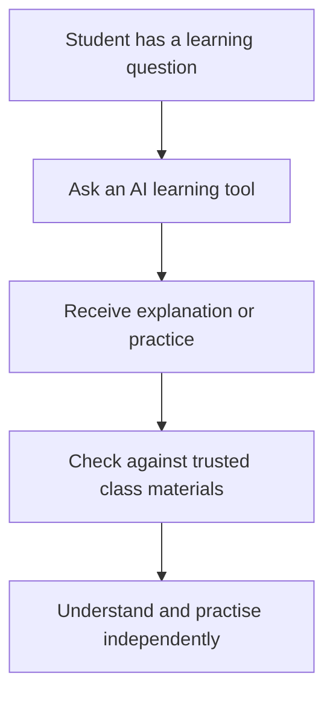
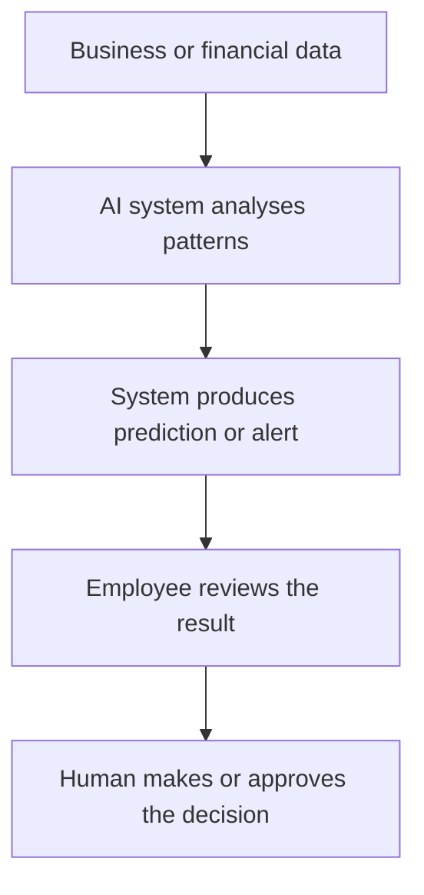
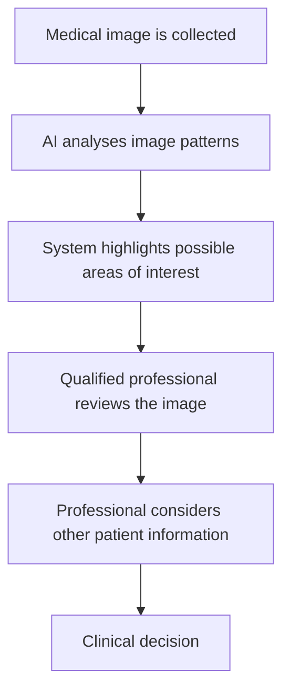
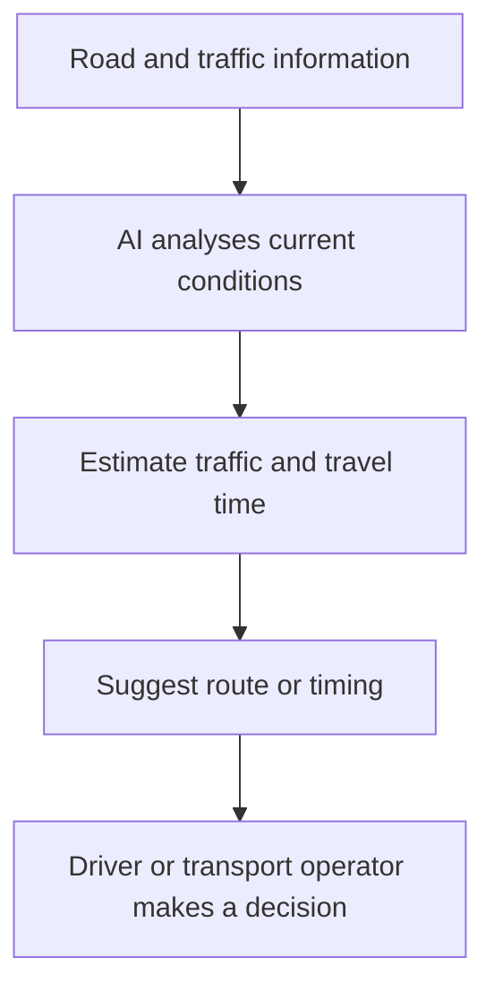
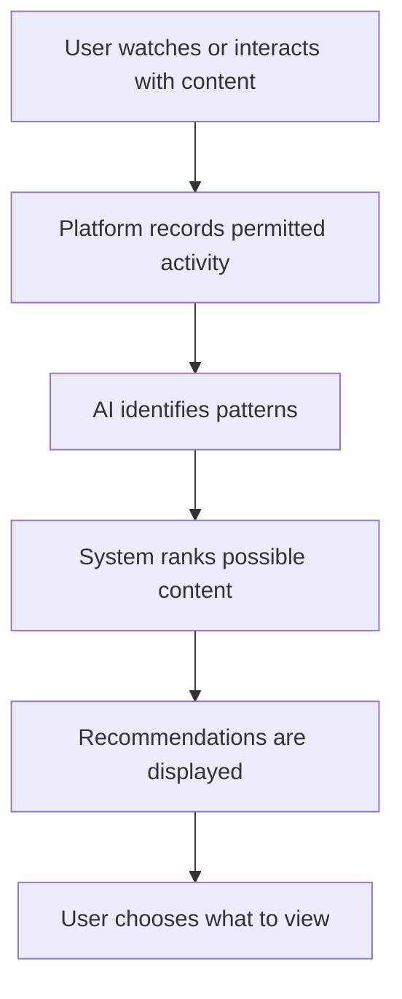

# TOPIC 03 — APPLICATIONS OF AI

  <strong>SLN · AI OVERVIEW</strong> 
  <em>How Artificial Intelligence Is Used in Different Areas of Life</em>

---

## CONTENTS

| No. | Section |
|---:|---|
| 01 | [AI in Education](#01--ai-in-education) |
| 02 | [AI in Business and Finance](#02--ai-in-business-and-finance) |
| 03 | [AI in Healthcare](#03--ai-in-healthcare) |
| 04 | [AI in Transportation](#04--ai-in-transportation) |
| 05 | [AI in Communication and Entertainment](#05--ai-in-communication-and-entertainment) |
| 06 | [Examples of Commonly Used AI Tools](#06--examples-of-commonly-used-ai-tools) |

---

# 01 · AI in Education

Artificial intelligence is becoming an important part of education. It can support students, teachers, and schools by helping people access information, practise skills, and organise learning activities. AI does not replace the full role of a teacher. Instead, it can be used as a learning assistant when its output is checked and used thoughtfully.

### How AI is used in education

- **Personalised learning:** Learning platforms can adjust practice questions or explanations based on a learner's progress. A student who needs more practice with fractions may receive additional examples, while another student may move to a more advanced activity.
- **Intelligent tutoring:** Some systems provide hints, step-by-step explanations, and feedback. They can help learners practise outside class, although their explanations may still contain mistakes.
- **Automatic feedback:** AI tools can help identify spelling, grammar, or structure issues in written work. Teachers should still assess meaning, reasoning, originality, and subject knowledge.
- **Learning administration:** Schools may use AI-supported systems to organise timetables, answer common questions, or help manage learning resources.
- **Accessibility:** Speech-to-text, text-to-speech, captions, and translation tools can make learning materials easier to access for people with different needs.

### Example: using an AI learning assistant

A student studying photosynthesis might ask an AI tool to explain the process in simpler language, request a labelled text description of a diagram, and then ask for practice questions. The student should compare important facts with class materials and answer the questions independently.

### Benefits and cautions

AI can make practice more flexible and provide quick support. However, it may misunderstand a question, give an incorrect explanation, or make learning too passive if students copy answers without understanding them. Teachers provide context, encouragement, classroom discussion, and professional judgement that automated tools cannot fully replace.

| Educational use | Possible benefit | Important caution |
|---|---|---|
| Personalised practice | Activities match learning needs | Recommendations may be unsuitable |
| Writing support | Helps improve clarity | Must not replace the student's own work |
| Translation and captions | Improves access | Meaning may be lost in translation |
| Tutoring chatbot | Quick explanations | Answers need checking |

> **Core Insight:** AI can support learning, but real learning still depends on curiosity, practice, critical thinking, and guidance from teachers.

---

# 02 · AI in Business and Finance

Businesses and financial organisations use AI to analyse information, support customer services, detect unusual activity, and improve planning. These systems can process large amounts of data quickly, helping staff notice patterns that may be difficult to find manually.

### AI in business

- **Customer service:** Chatbots can answer frequently asked questions, provide order updates, and direct customers to the correct department.
- **Marketing:** AI can help analyse customer interests and group audiences so businesses can plan more relevant communication.
- **Inventory management:** Forecasting systems estimate product demand and help businesses plan stock levels.
- **Document processing:** AI can extract information from forms, invoices, and other documents, reducing repetitive data entry.
- **Decision support:** AI can summarise business data and identify trends. Managers remain responsible for decisions.

### AI in finance

- **Fraud detection:** Systems can flag transactions that differ from a person's usual activity. A flag is a reason to review a transaction, not proof that fraud occurred.
- **Risk assessment:** AI can help organisations examine financial information when considering risk. Poor data or unfair assumptions can lead to unfair results.
- **Customer support:** Virtual assistants can explain basic account processes and direct users to human support.
- **Forecasting:** Models can analyse historical information to estimate possible trends. Forecasts are uncertain and should not be treated as guarantees.

### Example

A bank may use an AI system to flag a payment that appears unusual compared with previous activity. The bank can then apply its review process and contact the customer when appropriate. The system assists detection; it does not independently establish the full circumstances.

| Area | Example of AI use |
|---|---|
| Retail | Product recommendations and stock forecasts |
| Banking | Unusual-transaction alerts |
| Accounting | Invoice data extraction |
| Marketing | Customer trend analysis |
| Customer service | Chatbots for common questions |

Businesses should protect customer information, test systems for bias, and provide a way for people to challenge important decisions. Speed and automation are useful only when combined with accuracy, security, and accountability.

> **Core Insight:** In business and finance, AI is mainly a tool for analysing data and supporting people—not a substitute for responsible human decisions.

---

# 03 · AI in Healthcare

AI is used in healthcare to support medical professionals, organise information, and improve some services. Healthcare is a high-impact area, so AI output must be reviewed by qualified professionals. An AI system should not be treated as a doctor or as a replacement for professional medical care.

### Common applications

- **Medical image support:** AI can help examine images such as X-rays or scans and highlight areas that may need closer review.
- **Clinical decision support:** Some systems organise patient information or show patterns that may be relevant to a healthcare professional.
- **Patient administration:** AI can help schedule appointments, sort routine messages, and process documents.
- **Health research:** Researchers can use AI to examine large datasets and explore possible patterns.
- **Remote monitoring:** Certain approved systems analyse information from monitoring devices and may alert care teams when readings need attention.

### How image support may work

### Benefits and limitations

AI may help professionals review information more efficiently and can support research involving large datasets. Nevertheless, an AI result can be wrong. Its performance may vary across hospitals, equipment, and patient groups. Incomplete or unrepresentative training data can create unequal performance.

Privacy is also essential. Health information is sensitive and should only be accessed and shared under appropriate rules and safeguards. Healthcare organisations need to understand how a system is used, who is responsible for reviewing it, and what happens when it produces an unreliable result.

| Application | What AI may support | Human role |
|---|---|---|
| Image analysis | Highlighting patterns | Interpret findings |
| Appointment systems | Organising schedules | Handle special circumstances |
| Research | Analysing datasets | Evaluate evidence |
| Monitoring | Identifying unusual readings | Assess and respond appropriately |

> **Core Insight:** AI can assist healthcare professionals, but patient care requires professional expertise, privacy protection, and human responsibility.

---

# 04 · AI in Transportation

AI supports transportation by helping systems interpret traffic information, plan routes, monitor vehicles, and improve logistics. These applications can make transport services more organised, but safety and human oversight remain essential.

### Common applications

- **Traffic management:** AI can analyse traffic-flow information and help adjust traffic signals or identify congestion.
- **Navigation:** Map applications estimate journey times and suggest routes using road conditions and other available data.
- **Driver assistance:** Some vehicles use AI-supported features to warn drivers about possible hazards or assist with specific driving tasks. Drivers must understand the limits of these features and remain attentive.
- **Public transport:** Transport operators can use forecasting tools to estimate passenger demand and plan services.
- **Delivery and logistics:** Businesses can use AI to plan delivery routes, organise schedules, and estimate arrival times.

### Example: route planning

A navigation application may combine road information, current traffic reports, and historical travel patterns to estimate which route is likely to be faster. The estimate can change when an accident, road closure, or unexpected delay occurs.

### Benefits and cautions

AI may reduce delays, improve scheduling, and help transport organisations use resources efficiently. However, sensors can fail, information can be outdated, and predictions may not reflect sudden events. Automated driving features have specific operating limits and should never be assumed to make every journey safe.

| Transport area | AI application | Key consideration |
|---|---|---|
| Navigation | Route and arrival-time estimates | Conditions can change |
| Traffic control | Traffic-flow analysis | Reliable sensors and oversight |
| Driver assistance | Warnings and limited assistance | Driver attention remains necessary |
| Logistics | Delivery-route planning | Weather and unexpected events |

> **Core Insight:** AI can improve transport planning, but safe transportation depends on reliable systems, clear limits, and responsible human operation.

---

# 05 · AI in Communication and Entertainment

AI influences how people communicate, discover information, and enjoy digital entertainment. It can help process language, recommend content, create media, and make digital services more accessible.

### AI in communication

- **Translation:** AI translation tools convert text or speech between languages. They are useful for understanding general meaning, but idioms and cultural context may be translated incorrectly.
- **Speech recognition:** Systems convert spoken words into text for captions, dictation, and voice commands.
- **Writing assistance:** Tools can suggest grammar corrections, summarise text, or help organise ideas. Users should review the result and keep their own meaning.
- **Email filtering:** AI can help identify spam or sort messages based on patterns.
- **Virtual assistants:** Voice assistants interpret certain spoken requests and perform supported tasks.

### AI in entertainment

- **Recommendations:** Streaming and social platforms may suggest films, music, videos, or posts based on viewing and interaction patterns.
- **Games:** AI can control non-player characters, adjust difficulty, or support game testing.
- **Media creation:** Generative AI can help create images, music, video, and text. Users should consider accuracy, permission, attribution, and the rights of creators.
- **Content moderation:** AI may help identify content that could violate platform rules, although automated moderation can make mistakes.

### Recommendation systems

Recommendations can make discovery easier, but they may also repeatedly show similar material. Users can benefit from exploring different sources and adjusting recommendation settings where available.

| Tool category | Common examples | Typical use |
|---|---|---|
| Translation | Google Translate, DeepL | Translate text or speech |
| Writing assistance | Grammarly, writing assistants | Review language and clarity |
| Conversational AI | ChatGPT, Google Gemini | Ask questions and generate drafts |
| Voice assistants | Siri, Google Assistant | Voice commands and simple tasks |
| Media recommendations | YouTube, Netflix, Spotify | Suggest videos, films, and music |

> **Core Insight:** AI can make communication and entertainment more convenient, but users should stay aware of recommendation patterns, privacy, and the reliability of generated content.

---

# 06 · Examples of Commonly Used AI Tools

AI tools are applications that use one or more AI techniques to perform tasks such as answering questions, translating languages, recognising speech, generating images, or analysing information. Different tools are designed for different purposes, and their features may change over time.

### Examples by purpose

| Tool | Main purpose | Example of use |
|---|---|---|
| ChatGPT | Conversational and generative AI | Explaining a concept or drafting ideas |
| Google Gemini | AI assistant | Summarising information and brainstorming |
| Microsoft Copilot | AI assistance in Microsoft services | Supporting writing and productivity tasks |
| Google Translate | Translation | Translating a phrase or document |
| DeepL | Translation and writing support | Translating text between languages |
| Grammarly | Writing assistance | Checking grammar, spelling, and clarity |
| Siri | Voice assistant | Setting reminders or asking simple questions |
| Google Assistant | Voice assistant | Voice searches and supported commands |
| Canva AI features | Design assistance | Supporting visual design tasks |
| GitHub Copilot | Coding assistance | Suggesting code while a developer works |

### Choosing an appropriate tool

Before using an AI tool, consider the task, the sensitivity of the information, the tool's limitations, and whether the result needs expert review. Check the tool's privacy settings and avoid entering passwords, private records, or confidential information into services unless you are authorised and understand how the data is handled.

A useful workflow is:

1. Define the task clearly.
2. Choose a tool designed for that task.
3. Provide only the information needed.
4. Review the output for errors and missing context.
5. Verify important claims using reliable sources.
6. Make the final decision yourself or with an appropriate human expert.

> **Core Insight:** Knowing examples of AI tools is useful, but choosing the right tool and checking its output are just as important as knowing its name.

---

  <strong>SLN · AI OVERVIEW</strong> 
  Topic 03 — Applications Of Ai

