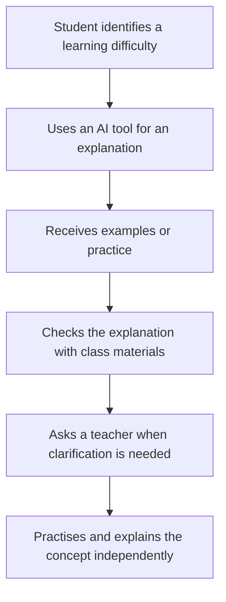
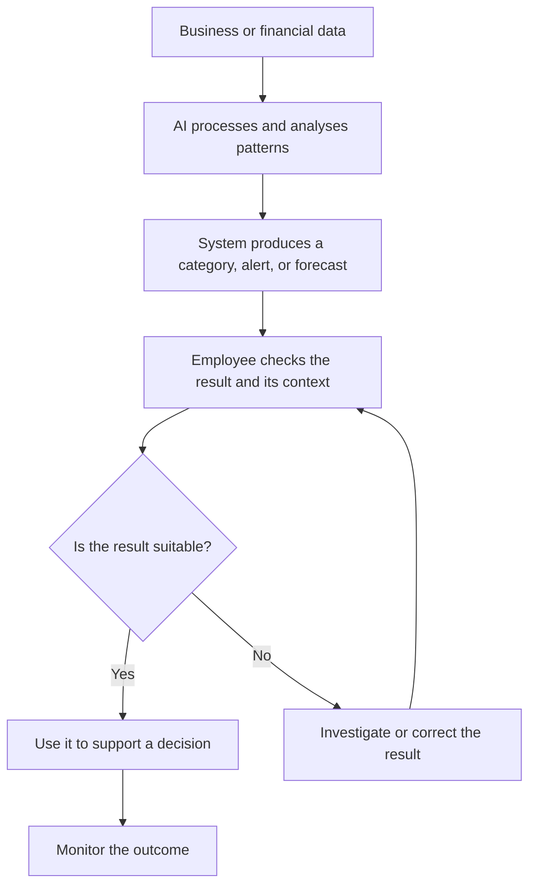
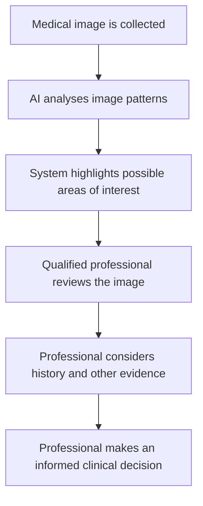
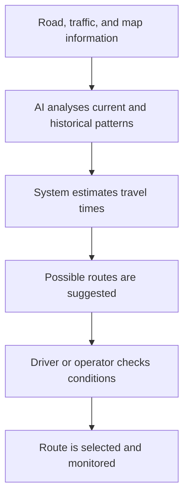
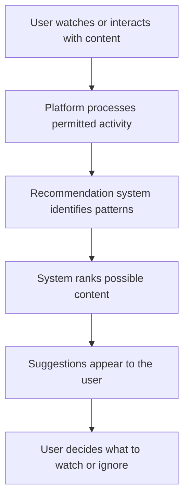
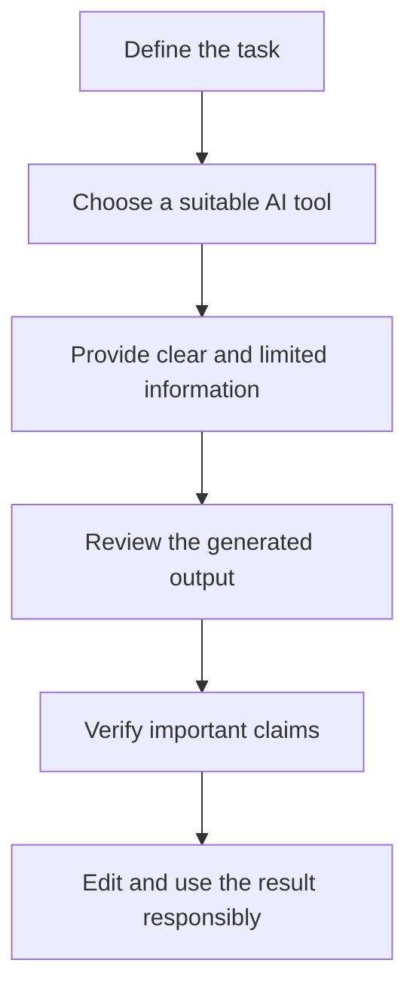

# TOPIC 03 — APPLICATIONS OF AI

  <strong>SLN · AI OVERVIEW</strong> 
  <em>How Artificial Intelligence Is Used in Different Areas of Life</em>

---

## CONTENTS

| No. | Section |
|---:|---|
| 01 | [AI in Education](#01--ai-in-education) |
| 02 | [AI in Business and Finance](#02--ai-in-business-and-finance) |
| 03 | [AI in Healthcare](#03--ai-in-healthcare) |
| 04 | [AI in Transportation](#04--ai-in-transportation) |
| 05 | [AI in Communication and Entertainment](#05--ai-in-communication-and-entertainment) |
| 06 | [Examples of Commonly Used AI Tools](#06--examples-of-commonly-used-ai-tools) |

### Evaluating learning outcomes

Schools should evaluate educational AI by asking whether it actually improves learning, not only whether it makes a task faster. Useful questions include whether students understand a concept more clearly, whether feedback helps them correct mistakes, and whether the tool is accessible to the learners who need it. A platform that produces many practice questions is not automatically effective if the questions are poorly matched to the curriculum.

Teachers can compare student work over time, ask learners to explain their reasoning, and collect feedback about confusing features. They should also consider whether students are becoming more independent or simply relying on the tool for answers. The purpose of evaluation is to understand what is helping, what is not helping, and what needs to change.

### Digital access and the role of teachers

Not every student has the same device, internet connection, language support, or quiet place to study. If an activity depends entirely on an online AI service, some students may be disadvantaged. Schools should consider alternatives and avoid assuming that every learner can use the same technology in the same way.

Teachers also provide important social and emotional support. They notice classroom dynamics, encourage discussion, explain why a topic matters, and adapt lessons based on their knowledge of students. AI may help prepare materials, but it cannot take full responsibility for building a supportive learning environment.

---

# 01 · AI in Education

Artificial intelligence is becoming an important part of education. It can support students, teachers, and schools by helping people access information, practise skills, organise learning activities, and make some educational services more accessible. AI is not a replacement for teachers, classmates, or a student's own effort. Its strongest role is to support learning while people remain responsible for understanding, judgement, and decisions.

### Understanding the role of AI in education

Education involves more than receiving information. Students need to ask questions, connect ideas, practise skills, receive feedback, discuss different viewpoints, and apply knowledge to new situations. AI tools can assist with some of these activities, especially when they provide explanations, examples, practice tasks, or language support.

An AI learning tool may respond to a student's question, suggest a different explanation, or generate practice questions. A teacher may use an AI-supported platform to review learning progress or prepare classroom resources. A school may use automated systems to help organise schedules or respond to common administrative questions. These uses are different, but they share one purpose: reducing certain routine difficulties so that students and educators can focus on meaningful learning.

AI tools do not all work in the same way. Some systems follow rules written by developers. Others use machine learning to identify patterns in data. Generative AI systems can produce new text, images, audio, or other content in response to prompts. Understanding the type of tool helps users understand what it can and cannot do.

### Personalised learning

Personalised learning means adapting learning activities to a student's current needs, progress, or learning goals. In a traditional classroom, one teacher may need to support many students at the same time. A digital learning platform can provide additional practice or different levels of difficulty based on a student's answers.

For example, a mathematics platform may notice that a learner repeatedly makes mistakes when adding fractions with different denominators. It may offer simpler examples, a visual explanation, or another practice set. When the learner answers correctly several times, the platform may provide more challenging questions. This can make practice more responsive.

Personalisation should not be confused with knowing a student completely. A platform only has access to the information available to it, and its interpretation may be incomplete. A student may answer incorrectly because a question is unclear, because they are tired, or because they misunderstood one instruction. The system may interpret the result as a lack of knowledge even when the real reason is different. Teachers and students should therefore use recommendations as helpful information rather than unquestionable conclusions.

### Intelligent tutoring and learning assistants

Some AI systems are designed to act as digital tutors. They may explain a concept, provide hints, ask follow-up questions, or show a worked example. A conversational assistant can allow a student to ask questions in ordinary language rather than searching through a large textbook.

A useful learning interaction does not simply give away an answer. It helps the learner understand why an answer works. For example, when studying the water cycle, a student might ask for an explanation of evaporation. The tool could explain that heat causes liquid water to change into water vapour, then give an everyday example such as water drying from a wet surface. The student can then ask how condensation is connected to evaporation.

AI tutoring can be available outside normal classroom hours, which may help students review a topic at their own pace. However, an AI tutor may provide a misleading explanation, skip an important step, or misunderstand what the student is asking. Students should compare important information with textbooks, class notes, and teacher explanations.

### Feedback on writing and assignments

AI writing tools can help identify spelling mistakes, grammar problems, unclear sentences, or repeated words. They can also suggest ways to organise a paragraph. This can be useful when a student is learning a language or reviewing a first draft.

There is an important difference between feedback and replacing a student's work. Feedback helps a student recognise a problem and improve their own writing. Replacing the work means allowing a tool to produce the complete answer without the student understanding or contributing meaningfully. The second approach may conflict with academic rules and can reduce learning.

A responsible process is to write an initial draft, ask for feedback on specific features, consider the suggestions, and revise the work independently. The student should keep the original meaning and voice. If a teacher requires disclosure of AI assistance, the student should follow that requirement.

### Accessibility and inclusive education

AI-supported accessibility tools can help people access educational materials in different ways. Speech-to-text systems convert spoken language into written text. Text-to-speech tools read written material aloud. Automatic captions can make videos easier to follow, while translation tools may help learners understand information in another language.

These tools can support students with different learning needs, language backgrounds, or temporary difficulties accessing a particular format. For example, a student may listen to a reading passage while following the text on screen. Another student may use captions to review a recorded lesson in a noisy environment.

Accessibility tools are not perfect. Speech recognition may misunderstand an accent, captions may contain errors, and automatic translation may miss technical terms or cultural meaning. Important learning materials should be checked, and students should be able to request suitable human support when technology does not meet their needs.

### Supporting teachers and school administration

Teachers can use AI to brainstorm lesson activities, prepare examples at different reading levels, generate draft quiz questions, or organise notes. These uses may save preparation time, but teachers must check whether the materials are accurate, appropriate for the age group, aligned with learning goals, and free from unsuitable content.

Schools may also use AI-supported systems for administrative tasks such as sorting enquiries, helping users find timetable information, or organising records. These systems can reduce repetitive work, but personal student information must be handled carefully. Decisions that affect a student's opportunities or wellbeing require suitable human review.

### Example: a responsible learning process

Imagine that a student is studying photosynthesis. The student first reads the class notes and identifies a confusing part. They ask an AI assistant to explain the role of sunlight in simpler language. The tool provides an explanation and a simple example. The student compares it with the textbook, asks the teacher about a remaining question, and then writes a summary using their own understanding.

### Benefits and limitations in education

| Educational use | Possible benefit | Limitation or responsibility |
|---|---|---|
| Personalised practice | Activities can respond to progress | Recommendations may misunderstand a learner |
| AI tutoring | Explanations are available when needed | Answers can be inaccurate |
| Writing feedback | Helps improve clarity and grammar | Must not replace original thinking |
| Translation | Supports multilingual learning | Nuance and technical terms may be lost |
| Captions and speech tools | Improves access to materials | Recognition errors need correction |
| Teacher preparation | Helps create draft resources | Teachers must review all materials |
| Administration | Reduces repetitive tasks | Student data needs protection |

### Good practices for students and teachers

Students should use AI with a clear learning purpose. They can ask for explanations, examples, or practice questions, but should make an effort to solve problems and explain ideas themselves. They should check factual claims and avoid sharing private information.

Teachers should explain which uses are allowed for each task. They can show students how to evaluate AI answers, identify unsupported claims, and acknowledge assistance where required. Schools should consider privacy, accessibility, fairness, and the possibility that not every student has equal access to digital tools.

> **Core Insight:** AI can make learning more flexible and accessible, but education still depends on student effort, teacher guidance, reliable information, and independent thinking.

### Customer relationships and service quality

Customer service is not only about providing a quick answer. It also involves listening, understanding a customer's circumstances, communicating respectfully, and resolving unusual problems. AI can handle simple questions, but a person may be needed when a customer is distressed, when a request is unusual, or when a decision requires flexibility.

Businesses should measure more than the number of enquiries handled automatically. They should also examine whether customers receive correct answers, whether they can reach a person when needed, and whether the system creates repeated frustration. A fast but unhelpful response is not a successful service.

### Governance and control of business AI

An organisation should know which AI tools are being used, what information they process, and who is responsible for reviewing their results. Employees should not upload confidential business documents to an unapproved service. Access should be limited according to job responsibilities, and important outputs should be retained or checked according to the organisation's procedures.

When an AI-supported process changes, staff should be informed and trained. Organisations should test updates because a change in a model or connected data source may affect the quality of its output. Regular review helps prevent a useful tool from becoming an unmanaged source of risk.

---

# 02 · AI in Business and Finance

Artificial intelligence is widely used in business and finance because these fields involve large amounts of information, repeated processes, customer interactions, and decisions under uncertainty. AI can help organisations organise data, identify patterns, predict possible outcomes, and support employees. It should be understood as a decision-support tool rather than an automatic source of truth.

### AI in everyday business operations

Businesses collect information from sales, customer enquiries, inventory systems, websites, payments, and internal processes. AI can help process this information more quickly than a person could manage manually. It may classify documents, identify repeated questions, estimate demand, or summarise trends.

For example, an online shop may receive thousands of customer messages. An AI system can group messages into categories such as delivery questions, returns, payment problems, or product information. Staff can then respond to common issues more efficiently and focus their attention on unusual or complicated cases.

The value of this system depends on its accuracy and design. If a message is placed in the wrong category, a customer may be directed to the wrong support team. Businesses should monitor performance and provide a way for customers to reach a person when the automated process does not solve the problem.

### Customer service and chatbots

A chatbot is a software application that communicates with users through text or voice. Some chatbots use AI to interpret questions and generate responses. They can answer frequently asked questions, explain basic procedures, provide order updates, and guide customers through simple tasks.

A chatbot may be useful because it can respond outside normal office hours and handle several routine enquiries at once. It can also provide consistent information when it is connected to an approved knowledge base.

However, chatbots may misunderstand unusual wording, fail to recognise a complaint, or provide an answer that does not match a customer's circumstances. A responsible service should make it clear when a user is communicating with an automated system and offer access to human support for complex or sensitive matters.

### Marketing and customer experience

AI can analyse patterns in customer activity to help businesses understand which products, services, or messages may be relevant to different audiences. Recommendation systems may suggest products based on previous purchases or browsing activity. Marketing teams may use AI to group feedback, summarise survey responses, or prepare draft communication.

Personalisation can make a service more relevant, but it also raises questions about privacy and fairness. Customers should not be treated unfairly because of inaccurate assumptions about their interests or circumstances. Organisations should use personal data only in appropriate ways and respect applicable privacy requirements.

### Inventory and demand forecasting

Inventory management involves keeping enough products available without storing excessive quantities. AI systems can examine historical sales, seasonal patterns, promotions, and other information to estimate future demand. These estimates may help businesses decide when to reorder products or adjust stock levels.

A forecast is not a guarantee. A sudden event, supply disruption, change in customer preferences, or inaccurate data can make a prediction unreliable. Employees should consider the model's estimate alongside current information and practical knowledge of the business.

### Document processing and workflow automation

Businesses often handle invoices, forms, receipts, applications, and other documents. AI-supported document tools can recognise text, extract selected information, classify files, and transfer data into another system. This can reduce repetitive data entry.

For instance, a system may identify an invoice number, date, supplier name, and total amount. An employee can then check the extracted details before the invoice is approved. This human review is important because scanned documents may be unclear or contain unusual layouts.

### AI in banking and financial services

Financial organisations use AI to support services such as transaction monitoring, customer support, risk analysis, and document processing. These applications can help identify patterns in complex financial information, but financial decisions can have serious effects on individuals and organisations.

**Fraud detection** is one common application. A system may compare a transaction with patterns such as transaction size, location information, timing, or previous activity. If something appears unusual, it can create an alert for further review. An alert is not proof of fraud. Legitimate activity can look unusual, and suspicious activity may not always be detected.

**Risk assessment** involves examining information to estimate the possibility of a financial loss or other unfavourable outcome. AI may help analyse many variables, but the result depends on the quality and suitability of the data. Historical data may contain unfair patterns, and a model may not perform equally well for every group.

**Customer support** tools can answer general questions about account services, explain routine procedures, or direct customers to the appropriate department. They should not request unnecessary sensitive information or make users believe that a chatbot has authority it does not possess.

### Forecasting and business decisions

AI can help analyse trends and create forecasts about sales, demand, costs, or market conditions. A forecast is an estimate based on available information and assumptions. It is not a promise about what will happen.

Managers should ask what data was used, how recent it is, what assumptions were made, and how uncertain the estimate may be. They should also consider information that the model may not include, such as a new competitor, a major policy change, or an unexpected event.

### Examples across business sectors

| Sector | AI application | Practical purpose |
|---|---|---|
| Retail | Demand forecasting | Plan stock levels |
| Banking | Transaction monitoring | Flag unusual activity for review |
| Insurance | Document classification | Organise claims information |
| Customer service | Chatbots | Answer routine questions |
| Manufacturing | Predictive maintenance | Identify equipment patterns that may signal a problem |
| Marketing | Customer trend analysis | Understand audience interests |
| Accounting | Invoice extraction | Reduce manual data entry |
| Logistics | Route planning | Organise deliveries |

### Risks and responsible implementation

Business use of AI should include data protection, security, testing, monitoring, and clear responsibility. Organisations should not assume that a tool is suitable simply because it is fast or popular. They should test it using realistic examples, identify possible errors, and decide which tasks require human approval.

Employees also need training. They should understand what the system does, what information it uses, how to recognise a questionable output, and how to report problems. Customers should have a suitable way to question important decisions that affect them.

> **Core Insight:** AI can improve business and financial processes by analysing information and supporting routine work, but organisations remain responsible for accuracy, fairness, privacy, and final decisions.

### Communication with patients

Healthcare involves communication as well as technical analysis. Patients may need explanations in clear language, an opportunity to ask questions, and support in understanding their options. An AI-generated summary may help organise information, but it should not replace a direct conversation with an appropriate healthcare professional.

Healthcare organisations should also make sure that patients can access services if they cannot use a digital tool. Language barriers, disabilities, limited internet access, and personal circumstances may affect whether an automated service is suitable. Providing human assistance helps prevent technology from becoming a barrier to care.

### Evaluating healthcare AI

Before using an AI system in a healthcare setting, organisations should understand what task it is designed to support and what evidence exists about its performance. Testing should reflect the environment in which the system will be used. A tool developed using one type of equipment or population may not perform in the same way elsewhere.

After implementation, organisations should monitor errors, unexpected outcomes, and differences in performance. Staff should know how to report concerns and when to stop relying on a system. Evaluation is ongoing because software, data, clinical practice, and patient needs can change.

---

# 03 · AI in Healthcare

Healthcare is an important area for AI because medical services involve complex information, time-sensitive tasks, research, and decisions that can affect people's wellbeing. AI can support healthcare professionals by helping organise information, identify patterns, and assist with certain technical tasks. It must not be treated as a replacement for qualified medical professionals.

### Medical image analysis

Medical imaging includes X-rays, CT scans, MRI scans, and other images used by healthcare professionals. AI systems can be trained to recognise patterns in images and may highlight areas that deserve closer attention. This can support a professional's review, especially when large numbers of images need to be examined.

An AI result is not a complete diagnosis. The professional must consider the image quality, the patient's history, symptoms, other test results, and the limits of the system. A highlighted area may not represent a serious condition, and a system may fail to highlight something important.

### Clinical decision support

Clinical decision-support systems organise information that may help healthcare professionals consider possible next steps. Depending on the system, this may include displaying relevant information, identifying possible interactions, or highlighting patterns in patient records.

These systems should provide support rather than make unsupported decisions on behalf of professionals. Medical care requires individual context, professional training, communication with patients, and careful consideration of possible benefits and risks.

### Patient records and administration

Healthcare organisations manage appointments, patient records, test requests, billing information, and communication. AI-supported systems may help sort documents, identify missing fields, transcribe spoken notes, or answer routine administrative questions.

Administrative automation can reduce repetitive work, but errors in healthcare records can have important consequences. Information should be checked by authorised staff, and access should be limited to people who need it for their role.

### Health research and drug discovery

Researchers can use AI to examine large datasets, compare patterns, organise scientific information, and explore possible research directions. In drug discovery, AI may help researchers examine molecular information or prioritise candidates for further investigation.

A computer-generated prediction is only one part of scientific research. Possible findings must be tested through appropriate experiments, evaluation, and review. AI does not remove the need for scientific evidence or ethical research practices.

### Remote monitoring and health devices

Some health technologies collect information through sensors or monitoring devices. AI may help identify patterns in these measurements and produce an alert when a reading appears unusual. Such systems can support monitoring, but readings may be affected by device quality, user activity, or incorrect use.

An alert should be interpreted in context. It is not automatically a diagnosis, and users should follow guidance from qualified healthcare professionals rather than making important health decisions based only on an automated message.

### Example: image-support workflow

### Benefits and limitations

AI may help healthcare teams organise information, support image review, and conduct research. It may also help reduce some administrative workload. However, healthcare data can be incomplete, systems may perform differently across patient groups, and errors can be difficult for users to recognise.

Privacy is especially important because health information is sensitive. Organisations should apply appropriate access controls, security measures, and rules for collecting and sharing information. Patients should be informed about relevant uses of their data according to applicable policies and laws.

| Healthcare application | What AI may support | Required human role |
|---|---|---|
| Medical imaging | Highlighting patterns | Professional interpretation |
| Clinical records | Organising information | Checking accuracy and relevance |
| Administration | Scheduling and document sorting | Handling exceptions |
| Research | Analysing large datasets | Evaluating evidence |
| Remote monitoring | Identifying unusual patterns | Interpreting alerts appropriately |

### Fairness and access

AI systems developed using data from only a limited population may not work equally well for everyone. Differences in age, medical history, equipment, or other factors may affect performance. Developers and healthcare organisations should evaluate systems across relevant groups and monitor their performance after introduction.

Access is another consideration. Not every clinic or patient has the same technology, internet connection, or digital skills. AI should not create unnecessary barriers for people who need healthcare services. Human alternatives and accessible communication remain important.

### Responsible use in healthcare

Healthcare professionals should understand the purpose and limitations of the systems they use. Organisations should test systems before relying on them, define who reviews their outputs, protect patient information, and investigate errors. Patients should be able to ask questions and receive explanations from an appropriate professional.

> **Core Insight:** AI can support healthcare services and research, but safe patient care depends on professional expertise, reliable evidence, privacy protection, fairness, and human responsibility.

### Weather, disruption, and changing conditions

Transportation systems operate in environments that change constantly. Rain, snow, roadworks, accidents, special events, and equipment failures can affect travel plans. An AI model may use historical patterns to estimate likely conditions, but an unusual event may make those patterns less useful.

Transport operators should combine automated analysis with current reports and local knowledge. Drivers and passengers should follow official instructions and road signs. A digital route suggestion should never be treated as more authoritative than a temporary closure or a safety instruction from the relevant authority.

### Planning for different users

Transport planning should consider more than average travel time. People may need step-free routes, accessible stations, clear announcements, safe walking connections, or information in different languages. If a planning system ignores these needs, its recommendation may be efficient for some users but unsuitable for others.

Human feedback can reveal problems that are not visible in traffic data alone. Transport organisations should consider reports from passengers, drivers, maintenance teams, and communities when evaluating AI-supported services.

---

# 04 · AI in Transportation

Artificial intelligence supports transportation by helping systems analyse traffic information, estimate travel times, plan routes, monitor equipment, and organise logistics. These applications can improve the flow of people and goods, but transportation systems must be designed around safety, reliability, and clear human responsibility.

### Traffic monitoring and management

Road networks produce large amounts of information through traffic sensors, cameras, connected devices, and reports. AI systems can analyse this information to identify congestion patterns, estimate traffic flow, or help transport authorities plan signal timing.

For example, a traffic-management system may detect that vehicles are moving slowly along a particular road. It may help operators understand where congestion is building and consider changes to signal timing. The system's suggestions need to be evaluated because traffic conditions can change quickly.

### Navigation and route recommendations

Navigation applications use location information, road maps, traffic reports, and historical travel patterns to estimate journey times. AI may help predict which route is likely to be faster or identify a delay.

A route recommendation is an estimate, not a guarantee. Road closures, severe weather, accidents, construction, and inaccurate map information can change the best route. Drivers should pay attention to road signs and current conditions rather than following an application without judgement.

### Driver assistance systems

Some vehicles use AI-supported features to help drivers notice certain conditions. Depending on the vehicle, these may include lane warnings, alerts about nearby objects, or assistance with maintaining a selected speed or distance.

The capabilities and limits vary between systems. A driver-assistance feature does not mean that the vehicle can handle every situation. Drivers must understand the vehicle's instructions, remain attentive, and be ready to take control when required. Marketing terms should not be interpreted as proof that a vehicle can operate safely without human supervision.

### Public transportation

Public transport operators may use AI to estimate passenger demand, analyse delays, plan schedules, and manage vehicle availability. If a system predicts higher demand at certain times, operators may use that information when planning services.

Predictions can be affected by special events, weather, school holidays, service disruptions, or changes in passenger behaviour. Staff should combine model outputs with operational knowledge and current reports.

### Logistics and delivery

Logistics involves moving goods between suppliers, warehouses, businesses, and customers. AI can help plan delivery routes, estimate arrival times, organise warehouse activities, and forecast demand. These tools may reduce unnecessary travel and help organisations use vehicles and staff more effectively.

However, the shortest route is not always the best route. Vehicle capacity, road restrictions, delivery deadlines, weather, and customer requirements may all matter. A human operator may need to adjust a plan when conditions change.

### Predictive maintenance

Transportation organisations maintain vehicles, trains, aircraft, and infrastructure. Some systems analyse equipment information to identify patterns that may indicate a developing maintenance issue. This is often called predictive maintenance.

A prediction can help maintenance teams decide what to inspect, but it does not replace required inspections or safety procedures. Equipment should be maintained according to professional standards and applicable rules.

### Example: route-planning process

### Benefits and limitations

| Transportation area | AI application | Possible benefit | Important limitation |
|---|---|---|---|
| Road traffic | Traffic-flow analysis | Better traffic planning | Sensors may be incomplete |
| Navigation | Route estimates | Helps plan journeys | Conditions can change |
| Driver assistance | Alerts and limited assistance | Supports driver awareness | Driver attention remains necessary |
| Public transport | Demand forecasting | Helps schedule services | Events can change demand |
| Delivery | Route planning | Organises journeys | Restrictions and delays matter |
| Maintenance | Pattern monitoring | Helps prioritise inspections | Predictions need professional review |

### Safety, privacy, and fairness

Transportation AI may use location data, images, or information about travel patterns. Organisations should protect this information and use it only for appropriate purposes. Systems should also be evaluated for reliability in different weather, road, and operating conditions.

Fair access matters as well. A transport system should consider people with disabilities, people who do not use smartphones, and communities with limited digital access. Automated services should not make essential transport information unavailable to people who cannot use a particular technology.

> **Core Insight:** AI can improve traffic planning, navigation, logistics, and maintenance, but safe transportation depends on reliable information, clear system limits, and responsible human operation.

### The effect of recommendations on information choices

Recommendation systems influence which material users notice first. If a platform repeatedly recommends similar content, users may see a narrower range of subjects or viewpoints than they would find through an independent search. This does not mean every recommendation is harmful; it means that recommendations should be understood as selected suggestions rather than neutral lists of everything available.

Users can take an active role by searching for topics directly, comparing different sources, and choosing content for a clear purpose. Platforms can support informed use by offering understandable controls and explaining why certain recommendations appear.

### Authenticity and trust in generated media

Generative tools can create realistic-looking images, voices, and videos. This makes it important to consider whether media is authentic and whether viewers could be misled about its origin. A generated image may be useful for illustration, but it should not be presented as documentary evidence of a real event.

When authenticity matters, users should check the original source, look for reliable confirmation, and consider whether the material has been labelled as AI-generated or edited. The ability to create convincing media increases the importance of careful interpretation.

---

# 05 · AI in Communication and Entertainment

AI has changed how people communicate, search for information, create media, and discover entertainment. It can process language, recognise speech, translate content, recommend media, and generate new material. These tools can make digital services more convenient, but they also raise questions about accuracy, privacy, creativity, and the influence of automated recommendations.

### AI in language translation

Translation tools use AI techniques to convert words and sentences from one language into another. Modern systems may consider surrounding words and sentence patterns rather than translating each word separately. This can help people understand messages, websites, instructions, and general documents.

Translation is not always exact. Words may have several meanings, idioms may not have direct equivalents, and formal or informal language may be handled incorrectly. Cultural references and humour can also be difficult to translate. Important legal, medical, academic, or official documents should receive suitable human review.

### Speech recognition and speech generation

Speech recognition converts spoken language into text. It is used in dictation, voice search, automatic captions, and some customer-service systems. Speech-generation tools perform the opposite task by producing spoken audio from text.

These features can support accessibility and convenience. A person may dictate a note instead of typing, or use captions to follow a video. However, recognition accuracy can vary because of background noise, accents, speaking speed, and technical vocabulary. Users should correct errors when the exact wording matters.

### Writing and communication assistance

AI writing tools can suggest grammar corrections, improve sentence clarity, summarise long text, or help organise ideas. Email and messaging systems may also use AI to classify spam or suggest responses.

These tools can save time, but users should review every important message before sending it. A generated sentence may sound polite but communicate the wrong meaning. It may also include details that the user did not intend to share. Personal communication should reflect the sender's actual meaning and judgement.

### Virtual assistants

Virtual assistants respond to spoken or written requests and may perform supported tasks such as setting reminders, searching for information, or controlling compatible devices. They combine speech recognition, language processing, and other software functions.

A virtual assistant may misunderstand a command or provide an outdated answer. Users should check the result before relying on it, especially when a request involves an important appointment, payment, or personal information.

### Recommendation systems in entertainment

Streaming platforms, video services, music applications, and social media platforms may use recommendation systems to select content that a user might find interesting. These systems can consider activity such as viewing history, likes, searches, or the behaviour of users with similar patterns, depending on the service and its settings.

Recommendations can make it easier to discover relevant content in a very large collection. At the same time, they can repeatedly show similar material or encourage users to spend more time on a platform. A recommendation is not necessarily the most educational, reliable, or balanced choice.

Users can explore different sources, search intentionally, and adjust recommendation settings where available. They should also remember that platform recommendations are selected by a system and do not represent a complete picture of all available information.

### AI in video games

AI has been used in games for many years. It can control non-player characters, help characters respond to player actions, adjust certain difficulty settings, and support testing. Game developers may use AI to identify bugs or analyse how players interact with a game.

AI behaviour in a game is designed for entertainment and should not be confused with human intelligence. A character may appear to make decisions, but its actions are produced by the rules, models, and data used by the game.

### Generative AI and creative media

Generative AI tools can create or modify text, images, audio, video, and other media based on prompts or supplied material. They may help users brainstorm a design, create a draft image, generate background music, or produce an outline for a video.

These tools can support creative exploration, but generated content should be reviewed. It may contain inaccurate details, visual inconsistencies, or material that resembles existing work. Users should respect copyright, licensing conditions, platform rules, and the rights of creators. They should not present generated material in a misleading way.

### Content moderation and online safety

Some platforms use AI to help identify spam, abusive messages, or content that may violate community rules. Automated moderation can process large amounts of content, which may help platforms respond more quickly.

However, language is complex. A system may misunderstand humour, quotations, educational discussion, or cultural expressions. It may remove content that is acceptable or fail to identify harmful material. Human review and an appeal process can help address mistakes.

### Common examples

| Communication or entertainment use | Example tool or service | Typical function |
|---|---|---|
| Translation | Google Translate, DeepL | Translate text or speech |
| Writing assistance | Grammarly | Review grammar and clarity |
| Conversational AI | ChatGPT, Google Gemini | Explain, brainstorm, and draft |
| Voice assistance | Siri, Google Assistant | Respond to supported voice commands |
| Video recommendations | YouTube | Suggest videos |
| Film recommendations | Netflix | Suggest programmes and films |
| Music recommendations | Spotify | Suggest music and playlists |
| Game development | AI-supported game tools | Support testing and selected game behaviours |

### Privacy and informed use

Communication and entertainment services may process information about messages, preferences, searches, or viewing activity. Users should understand the service's settings and avoid sharing sensitive information unnecessarily. They should also consider whether generated content is clearly labelled when disclosure is relevant.

> **Core Insight:** AI makes communication and entertainment more accessible and personalised, but users should remain aware of accuracy, privacy, creator rights, and the influence of recommendations.

### Understanding tool categories

A tool's category gives a general idea of its purpose, but it does not guarantee that every feature will be available in every version. Some services offer free and paid plans, while others require a school or workplace account. Features may also depend on country, language, device, and privacy settings. Users should check the current service information instead of assuming that a feature works in exactly the same way for everyone.

It is also useful to distinguish a general-purpose assistant from a specialised tool. A general assistant can help with many kinds of prompts, while a specialised tool may be designed for a narrower task such as translation, grammar checking, or code completion. The specialised tool may be more convenient for that task, but its result still needs review.

### Keeping skills while using tools

People should continue practising the skills that AI tools support. A student using a writing assistant should still learn grammar and organisation. A person using translation software should still check meaning and learn important vocabulary. A programmer using code suggestions should still understand the logic and test the program.

The goal is not to avoid all assistance. It is to use assistance in a way that builds capability rather than hiding a lack of understanding. When users can explain why an output is suitable and identify where it might be wrong, they are using the tool more effectively.

---

# 06 · Examples of Commonly Used AI Tools

AI tools are applications or software features that use artificial intelligence to support particular tasks. Some tools are designed for conversation, others for translation, writing, design, coding, search, or voice interaction. A tool may combine several AI capabilities, and its features can change as the service is updated.

### Conversational and generative AI tools

Conversational AI tools allow users to ask questions and receive responses in natural language. Generative AI can create drafts, explanations, summaries, ideas, or other content based on a prompt.

**ChatGPT** is a conversational AI tool that can help explain concepts, brainstorm, summarise supplied text, and draft content. Its output still needs to be checked because it may misunderstand instructions or generate inaccurate details.

**Google Gemini** is an AI assistant that can support tasks such as asking questions, brainstorming, and working with information. Available features depend on the product version, account, and settings.

**Microsoft Copilot** provides AI assistance across supported Microsoft products and services. Depending on the version and environment, it may help users draft text, summarise information, or work with documents.

These tools are not interchangeable in every situation. Users should choose based on the task, available features, privacy requirements, and the rules of their school or organisation.

### Translation tools

**Google Translate** and **DeepL** help translate words, sentences, and documents between supported languages. They can be useful for understanding general meaning, communicating across languages, or preparing a first translation.

A translation tool may not understand specialist vocabulary, local expressions, or the tone required for a particular audience. Users should review important translations, especially when mistakes could affect understanding or decisions.

### Writing and language tools

**Grammarly** is commonly used to review grammar, spelling, punctuation, and writing clarity. Similar writing assistants may suggest alternative wording or identify repeated expressions.

Writing suggestions should not automatically be accepted. A tool may change the intended meaning, make a sentence sound too formal, or suggest a phrase that does not fit the context. The writer remains responsible for the final version.

### Voice assistants

**Siri** and **Google Assistant** are examples of voice assistants. They can respond to supported commands, search for information, set reminders, or interact with compatible services and devices.

Voice assistants may mishear words or misunderstand a request. Users should check actions that involve important information and review permissions for microphone, location, contacts, and other data.

### Design and image tools

Some design platforms include AI features that can help users generate visual ideas, remove backgrounds, suggest layouts, or create draft images from text prompts. Canva is an example of a design platform that offers AI-supported features.

Generated designs should be reviewed for accuracy, suitability, accessibility, and rights. Text inside generated images may be misspelled, and visual results may not match the user's exact intention.

### Coding assistants

**GitHub Copilot** is an example of an AI coding assistant. It can suggest code while a developer writes a program, explain selected code, or help produce a starting point for a function.

Code suggestions can contain errors, security weaknesses, or assumptions that do not fit the project. Developers should read, test, and understand suggested code rather than accepting it automatically. Students should also follow their course rules about AI assistance in programming assignments.

### Choosing the right AI tool

A useful choice begins with the task. A translation tool may be more suitable for translating a short passage than a general chatbot. A writing assistant may be useful for grammar feedback, while a spreadsheet or data-analysis tool may be more suitable for structured numerical work.

Before using a tool, consider:
- **Purpose:** Does the tool support the task you need to complete?
- **Accuracy:** Can its output be checked using reliable information?
- **Privacy:** What information will you submit, and how may it be handled?
- **Limitations:** What kinds of mistakes does the tool commonly make?
- **Access:** Is the tool available and permitted in your learning or work environment?
- **Cost and conditions:** Are there usage limits, account requirements, or terms that matter?
- **Responsibility:** Who will review the result before it is used?

### A practical workflow

### Comparing tools by purpose

| Tool | Main category | Common use | What users should check |
|---|---|---|---|
| ChatGPT | Conversational AI | Explanations, brainstorming, drafting | Facts, context, and sources |
| Google Gemini | AI assistant | Questions and information tasks | Accuracy and available features |
| Microsoft Copilot | Productivity assistant | Drafting and supported office tasks | Document context and permissions |
| Google Translate | Translation | General text and speech translation | Meaning and specialist terms |
| DeepL | Translation | Text and document translation | Nuance and terminology |
| Grammarly | Writing assistance | Grammar and clarity feedback | Whether suggestions preserve meaning |
| Siri | Voice assistant | Supported voice commands | Correct interpretation and permissions |
| Google Assistant | Voice assistant | Search and supported actions | Accuracy and account settings |
| Canva AI features | Design assistance | Visual drafts and design support | Text accuracy and usage rights |
| GitHub Copilot | Coding assistance | Code suggestions and explanations | Correctness, security, and understanding |

### Using tools responsibly

The presence of an AI feature does not mean it is appropriate for every task. Users should follow school and workplace policies, protect personal information, and disclose AI assistance when required. They should also remember that product names and features may change over time.

A good user does not simply ask which tool is the most powerful. A good user asks which tool is suitable for the task, what information it needs, how its output will be checked, and whether using it is appropriate.

> **Core Insight:** Knowing common AI tools is useful, but effective AI use depends on selecting the right tool, understanding its limits, and checking its output.

---

  <strong>SLN · AI OVERVIEW</strong> 
  Topic 03 — Applications of AI

