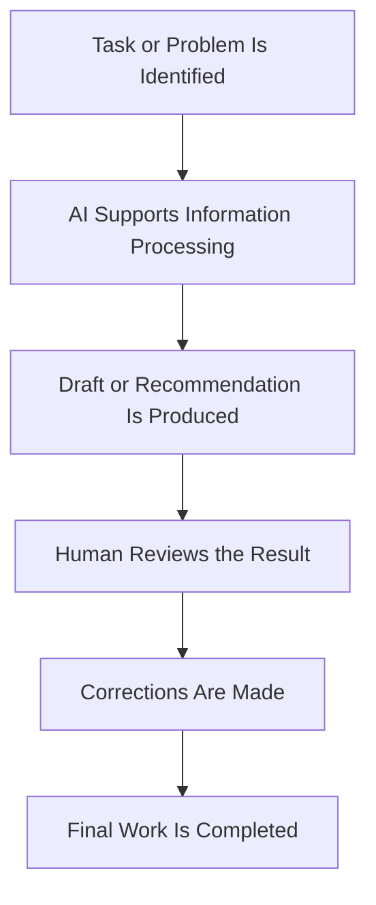
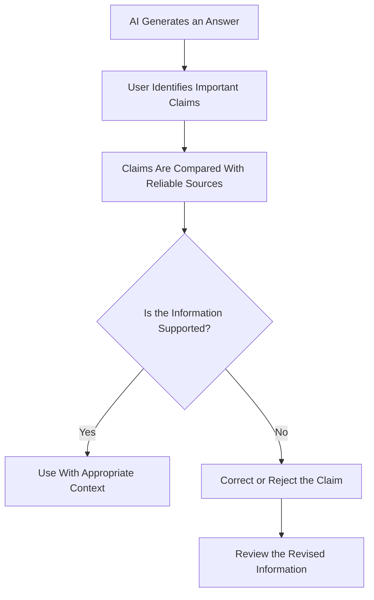
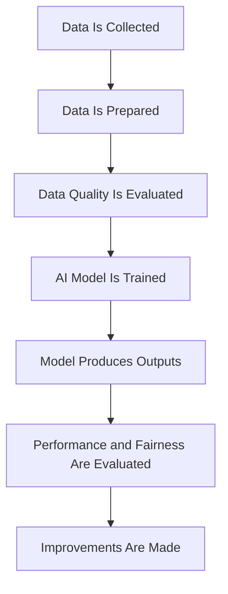
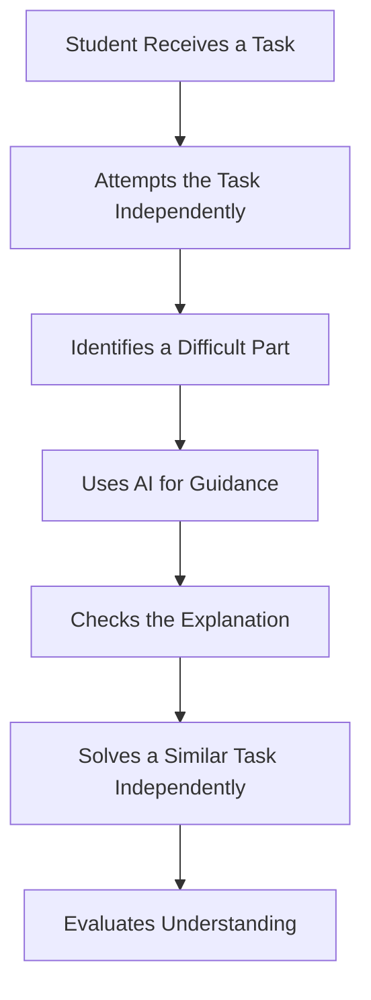
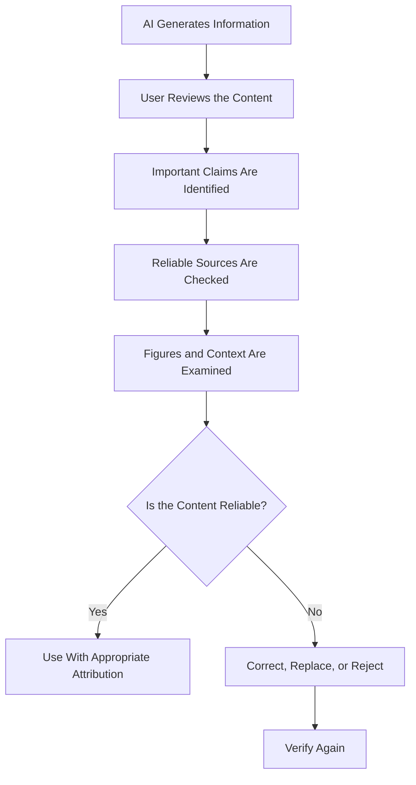

# TOPIC 04 — BENEFITS, LIMITATIONS, AND CHALLENGES OF ARTIFICIAL INTELLIGENCE

  <strong>SLN · AI OVERVIEW</strong> 
  <em>Understanding the Advantages, Weaknesses, and Responsible Evaluation of AI Systems</em>

---

## CONTENTS

1. [Benefits of AI: Efficiency, Automation, and Productivity](#01--benefits-of-ai-efficiency-automation-and-productivity)
2. [Limitations in Understanding Context](#02--limitations-in-understanding-context)
3. [Inaccurate Outputs and AI Hallucinations](#03--inaccurate-outputs-and-ai-hallucinations)
4. [Data Quality and Bias](#04--data-quality-and-bias)
5. [Overdependence on AI](#05--overdependence-on-ai)
6. [The Importance of Verifying AI-Generated Information](#06--the-importance-of-verifying-ai-generated-information)

---

# 01 · BENEFITS OF AI: EFFICIENCY, AUTOMATION, AND PRODUCTIVITY

## 1.1 Understanding the Benefits of AI

Artificial Intelligence provides several benefits across education, business, healthcare, transportation, communication, and other areas. Its ability to process information, recognize patterns, generate outputs, and automate certain tasks can help individuals and organizations complete activities more efficiently.

In traditional processes, people may need to examine large amounts of information manually. AI systems can assist by processing data and presenting results in a structured form.

For example, an organization may use an AI system to classify thousands of documents. Instead of manually reviewing every document from the beginning, employees can use the system's classifications as an initial organizational aid.

However, the benefits of AI depend on the quality of its implementation. A poorly designed system may create additional work instead of reducing it.

## 1.2 Improved Efficiency

Efficiency refers to completing tasks while making effective use of time, resources, and effort.

AI can improve efficiency by supporting activities that involve repeated steps, large datasets, or frequent information processing.

Examples include:

- Organizing digital documents.
- Classifying customer messages.
- Summarizing long texts.
- Supporting scheduling activities.
- Identifying patterns in datasets.
- Generating initial drafts of written content.

| Activity | Traditional Approach | AI-Supported Approach |
|---|---|---|
| Document organization | Manual classification | Automated classification assistance |
| Text summarization | Reading and summarizing manually | AI-generated draft summary |
| Customer inquiries | Employees answer every basic question | Chatbot handles selected routine questions |
| Data analysis | Manual examination | Automated pattern analysis |
| Scheduling | Manual comparison of availability | Scheduling recommendations |

AI-supported processes may reduce time spent on repetitive activities, but they still require appropriate supervision.

## 1.3 Automation of Repetitive Tasks

Automation refers to using technology to perform tasks with limited manual intervention.

AI can support automation when a task involves recognizable patterns, predictable procedures, or decisions that can be supported by available information.

For example, an email system may classify messages into categories such as promotions, updates, or suspected spam.

AI-supported automation may be useful in:

| Area | Automated Activity | Possible Benefit |
|---|---|---|
| Administration | Sorting documents | Better organization |
| Customer service | Responding to routine questions | Faster basic assistance |
| Manufacturing | Monitoring equipment information | Operational support |
| Finance | Flagging unusual transactions | Additional review |
| Communication | Classifying messages | Easier information management |

Automation does not mean that every task should be performed without human involvement. Important or unusual cases may require human judgment.

## 1.4 Increased Productivity

Productivity refers to the amount and quality of useful work completed using available resources.

AI can support productivity by helping users prepare drafts, organize ideas, examine information, and complete routine work.

For example, a student may use AI to generate practice questions about a lesson. The student can then answer the questions independently and identify topics that require additional study.

A professional may use an AI assistant to prepare a first draft of a report, then review and revise it before submission.

AI supports productivity when it helps people work more effectively without removing necessary thinking and evaluation.

## 1.5 Faster Information Processing

AI systems can process large amounts of information and identify patterns within datasets.

This can be useful in areas such as research, finance, business planning, and healthcare administration.

| Information Task | AI Contribution |
|---|---|
| Data classification | Groups information into categories |
| Pattern recognition | Identifies repeated characteristics |
| Summarization | Produces a shorter version of information |
| Forecasting | Estimates possible future patterns |
| Search assistance | Helps identify relevant information |

Fast processing does not guarantee accurate interpretation. The results must still be checked against the purpose and context of the task.

## 1.6 Improved Accessibility

AI can support accessibility through tools such as speech recognition, text-to-speech, automated captions, and translation.

These applications can help people interact with digital information in different ways.

| AI Feature | Accessibility Support |
|---|---|
| Speech-to-text | Converts spoken language into written text |
| Text-to-speech | Reads written content aloud |
| Automated captions | Displays spoken words as text |
| Translation | Supports multilingual communication |
| Image description | Provides textual descriptions of visual information |

These technologies can make digital services more accessible, although their effectiveness varies according to language, audio quality, and system capabilities.

## 1.7 Support for Decision-Making

AI can help people evaluate information by identifying patterns, comparing options, and generating predictions.

For example, a business may analyze historical sales information to understand changes in demand.

AI provides information that may support decisions, but the final decision should consider factors that are not necessarily represented in the dataset.

| Decision Area | AI Contribution | Human Role |
|---|---|---|
| Business planning | Identifies patterns | Evaluates business priorities |
| Education | Tracks learning progress | Understands student needs |
| Healthcare | Supports information analysis | Makes professional judgments |
| Transportation | Estimates traffic conditions | Oversees safety and operations |
| Finance | Flags unusual patterns | Reviews relevant circumstances |

## 1.8 Limitations of AI Benefits

The benefits of AI are not automatic. They depend on suitable data, system reliability, user knowledge, and effective implementation.

AI may produce inaccurate results, require expensive infrastructure, or create new risks related to privacy and fairness.

> **Core Insight:** AI can improve efficiency, automation, and productivity, but these benefits are meaningful only when the system is suitable, its outputs are reviewed, and people remain responsible for important decisions.

## 1.9 Example: AI and Productivity

---

# 02 · LIMITATIONS IN UNDERSTANDING CONTEXT

## 2.1 Understanding Context

Context refers to the circumstances and background information that help determine the meaning of a message, event, or situation.

A sentence may have different meanings depending on who says it, where it is used, and what happened before it.

Humans often use shared experiences, social understanding, cultural knowledge, and situational awareness to interpret communication.

AI systems process information through computational methods. Although advanced systems can recognize many contextual patterns, they may still misunderstand meanings that depend on subtle or missing information.

## 2.2 Ambiguous Language

Ambiguous language occurs when a word, sentence, or expression has more than one possible interpretation.

For example, the sentence "The student saw the teacher with the telescope" may describe a student using a telescope or a teacher carrying one.

Without additional information, the intended meaning may be unclear.

| Expression | Possible Interpretation | Why Context Matters |
|---|---|---|
| "I saw her duck" | Observed a duck belonging to her | The word "duck" has multiple meanings |
| "The bank is closed" | A financial institution is closed | "Bank" can refer to different places |
| "That was cold" | Low temperature or an unfriendly action | Meaning depends on the situation |
| "Break a leg" | A good-luck expression | Literal interpretation would be misleading |

AI systems may identify likely meanings from patterns, but they can still select an interpretation that does not match the user's intention.

## 2.3 Cultural and Social Context

Language and communication are influenced by culture, social expectations, and local expressions.

A phrase that is polite in one situation may sound unusual or inappropriate in another. Humor, irony, sarcasm, and informal expressions may also depend on shared cultural knowledge.

AI systems may not fully understand these differences.

| Contextual Factor | Possible AI Difficulty |
|---|---|
| Local slang | Misinterpreting informal expressions |
| Humor | Missing the intended joke |
| Sarcasm | Treating criticism as a literal statement |
| Cultural references | Lacking relevant background knowledge |
| Social relationships | Misunderstanding the relationship between speakers |

## 2.4 Missing Information

AI outputs depend on the information available to the system.

If a user provides incomplete instructions, the AI may make assumptions to produce an answer.

For example, asking "Is this a good result?" without explaining the purpose, criteria, or relevant background may lead to a vague or inappropriate response.

Providing relevant context improves the opportunity for a useful answer, but it does not guarantee correctness.

## 2.5 Limitations in Real-World Understanding

AI may process descriptions of real-world situations without directly experiencing those situations as humans do.

For example, an AI system may describe how a crowded classroom operates based on available information. However, it may not recognize every practical detail that a teacher observes in the actual classroom.

This distinction matters when a task requires physical awareness, interpersonal judgment, or direct observation.

## 2.6 Why Context Matters in AI Outputs

| Situation | Risk of Missing Context | Possible Consequence |
|---|---|---|
| Academic question | Missing course requirements | Irrelevant answer |
| Translation | Ignoring cultural meaning | Incorrect translation |
| Customer support | Misunderstanding a complaint | Unsuitable response |
| Healthcare information | Missing personal circumstances | Misleading general information |
| Workplace communication | Misreading tone | Inappropriate message |

## 2.7 Improving Contextual Accuracy

Users can improve the relevance of AI responses by:

1. Explaining the purpose of the task.
2. Providing relevant background information.
3. Defining important terms.
4. Specifying the expected format.
5. Clarifying ambiguous instructions.
6. Reviewing the output before using it.

Even with clear instructions, AI may misunderstand context. Human evaluation remains necessary.

> **Core Insight:** AI can recognize many patterns in language, but contextual understanding is not perfect. Clear instructions and human review help reduce misunderstandings.

---

# 03 · INACCURATE OUTPUTS AND AI HALLUCINATIONS

## 3.1 Understanding Inaccurate AI Outputs

An inaccurate AI output is information generated by an AI system that contains mistakes, unsupported claims, incorrect calculations, or misleading interpretations.

AI systems can produce fluent and convincing responses even when the information is incorrect.

This is important because users may assume that a well-written response is automatically reliable.

The quality of an AI response should be evaluated based on evidence and accuracy, not merely on how confidently it is written.

## 3.2 What Is an AI Hallucination?

An AI hallucination occurs when an AI system generates information that appears plausible but is unsupported, fabricated, or incorrect.

For example, an AI assistant may provide a fictional publication title, an incorrect historical date, or a source that does not exist.

Hallucinations may occur because generative systems produce outputs based on learned patterns rather than automatically verifying every statement against authoritative evidence.

## 3.3 Common Forms of AI Hallucination

| Type | Description | Example |
|---|---|---|
| Fabricated facts | Generates unsupported information | Inventing an event |
| Incorrect dates | Provides an inaccurate date | Giving the wrong publication year |
| False citations | Creates nonexistent references | Naming a fictional article |
| Misleading explanations | Describes a concept incorrectly | Confusing two scientific terms |
| Incorrect calculations | Produces an arithmetic error | Giving a wrong total |
| Unsupported certainty | Presents a guess as fact | Claiming something is confirmed without evidence |

## 3.4 Why Hallucinations Occur

Several factors may contribute to hallucinations:

- The prompt contains insufficient information.
- The subject is uncommon or highly specialized.
- The system has limited or outdated knowledge.
- The model generates a plausible continuation instead of verifying a claim.
- The question contains incorrect assumptions.
- The information required is not available to the system.

Not every inaccurate response has the same cause. The important point is that AI outputs must be evaluated independently.

## 3.5 The Difference Between a Mistake and a Hallucination

An ordinary mistake may involve incorrect arithmetic, a misunderstanding, or a factual error.

A hallucination generally refers to generated information that is presented as plausible despite lacking sufficient support.

The categories can overlap.

| Situation | Description |
|---|---|
| Incorrect arithmetic | A calculation mistake |
| Misunderstood question | An interpretation error |
| Invented reference | A hallucinated source |
| Unsupported historical detail | Potential hallucination |
| Outdated information | Information accuracy problem |

## 3.6 Why Fluent Responses Can Be Misleading

AI-generated text may have clear grammar, organized paragraphs, and professional wording.

These qualities do not prove that the content is correct.

A response can sound authoritative while containing unsupported information.

Users should therefore distinguish presentation quality from factual reliability.

## 3.7 Consequences of Inaccurate Outputs

The effects of inaccurate information depend on the context in which it is used.

| Area | Possible Consequence |
|---|---|
| Education | Students learn incorrect concepts |
| Business | Decisions rely on misleading analysis |
| Research | Unsupported claims enter written work |
| Healthcare | General information may be misunderstood |
| Finance | Incorrect calculations affect planning |
| Communication | False information may spread |

## 3.8 How to Reduce the Risk of Hallucinations

Users can reduce risk by checking important claims against reliable sources.

Useful practices include:

1. Identify factual claims that require verification.
2. Check dates, names, figures, and definitions.
3. Open cited sources instead of trusting citation titles.
4. Compare information across credible sources.
5. Ask for clarification when an answer is uncertain.
6. Avoid treating generated content as an authoritative source.

> **Core Insight:** A convincing AI response is not necessarily a correct response. Accuracy must be evaluated through evidence and independent verification.

## 3.9 Example: Verification Process

---

# 04 · DATA QUALITY AND BIAS

## 4.1 Understanding Data Quality

Data quality refers to how suitable, accurate, complete, consistent, and relevant information is for a particular purpose.

AI systems often depend on data for training, testing, and operation.

If the data is inaccurate, incomplete, outdated, or poorly organized, the system may produce unreliable results.

For example, a forecasting system trained on incomplete sales records may produce estimates that do not represent actual demand.

## 4.2 Characteristics of High-Quality Data

| Characteristic | Meaning | Example |
|---|---|---|
| Accuracy | Information correctly represents reality | Correct transaction values |
| Completeness | Important information is included | Records contain required fields |
| Consistency | Information follows compatible formats | Dates use a consistent format |
| Relevance | Data relates to the intended task | Relevant sales information |
| Timeliness | Information is sufficiently current | Updated records |
| Validity | Data follows required rules | Correct data types |

## 4.3 Incomplete Data

Incomplete data occurs when important information is missing.

For example, a dataset containing customer transactions may be missing dates or product categories.

The AI system may struggle to identify patterns accurately because relevant information is unavailable.

## 4.4 Outdated Data

Information can become outdated when it no longer represents current conditions.

An AI system relying on old information may produce recommendations that are no longer suitable.

This is especially important in areas where information changes frequently, such as technology, financial conditions, regulations, and public services.

## 4.5 Understanding Bias in AI

Bias occurs when an AI system produces systematically unfair or unbalanced outcomes.

AI bias may arise from training data, data collection methods, system design, evaluation procedures, or the way people use the system.

For example, if a dataset does not adequately represent different groups, a model may perform less accurately for groups that are underrepresented.

## 4.6 Sources of AI Bias

| Source | Explanation | Possible Effect |
|---|---|---|
| Historical data | Reflects existing inequalities | Reproduces unfair patterns |
| Unrepresentative samples | Excludes important groups | Unequal performance |
| Measurement methods | Records information inconsistently | Distorted results |
| Labeling decisions | Human labels contain assumptions | Biased training outcomes |
| System design | Evaluation criteria are incomplete | Unbalanced performance |
| Deployment conditions | Real-world use differs from testing | Unexpected outcomes |

## 4.7 Examples of Bias in AI Applications

Bias can affect many types of AI systems.

In recruitment, an AI system trained on historical employment information may reproduce patterns that disadvantage certain groups.

In image recognition, a system may perform differently across populations if its training data is not sufficiently representative.

In recommendation systems, users may repeatedly receive similar content because the system emphasizes previous interactions.

These examples demonstrate why fairness must be evaluated rather than assumed.

## 4.8 The Relationship Between Data and AI Performance

## 4.9 Reducing Data Quality Problems and Bias

Organizations can improve data quality and fairness through:

- Reviewing data sources.
- Correcting incomplete records.
- Removing duplicate information where appropriate.
- Checking whether datasets represent relevant groups.
- Evaluating performance across different populations.
- Documenting system limitations.
- Monitoring systems after deployment.
- Providing channels for human review.

No single technique guarantees fairness. Continuous evaluation is necessary.

> **Core Insight:** AI performance depends heavily on data quality. Incomplete or biased data can produce inaccurate and unfair results, making data evaluation an essential part of responsible AI development.

---

# 05 · OVERDEPENDENCE ON AI

## 5.1 Understanding Overdependence

Overdependence on AI occurs when individuals or organizations rely too heavily on AI systems and reduce their own critical thinking, judgment, or independent problem-solving.

AI can be a useful assistant, but it should not become the only source of information or the automatic decision-maker in every situation.

For example, a student who copies generated answers without understanding the lesson may complete an assignment but fail to develop the knowledge needed to solve similar problems independently.

## 5.2 Reduced Critical Thinking

Critical thinking involves examining information, evaluating evidence, recognizing assumptions, and reaching reasoned conclusions.

If users accept AI responses without questioning them, they may lose opportunities to practice these skills.

AI should be used to support analysis rather than replace it.

## 5.3 Reduced Independent Learning

Learning requires active participation.

Students need to practice recalling information, solving problems, making connections, and explaining concepts in their own words.

AI can support learning by providing examples and explanations, but simply receiving generated answers does not guarantee understanding.

| Learning Activity | Helpful AI Use | Overdependent Use |
|---|---|---|
| Understanding a topic | Requests another explanation | Accepts an answer without learning |
| Mathematics | Studies worked examples | Copies final answers |
| Writing | Requests feedback | Submits unreviewed generated text |
| Research | Uses suggestions to explore sources | Treats AI output as the only source |
| Revision | Generates practice questions | Memorizes generated answers without understanding |

## 5.4 Dependence in Workplace Decisions

Organizations may also become overdependent on automated systems.

For example, employees may follow an AI-generated recommendation without examining whether it fits the actual circumstances.

This can create problems when a system produces inaccurate outputs or encounters an unusual situation.

Human review is particularly important for decisions involving safety, rights, finances, or significant consequences.

## 5.5 Reduced Problem-Solving Practice

Problem-solving skills develop through repeated attempts, reflection, and correction.

If AI performs every difficult step, users may have fewer opportunities to practice reasoning independently.

A better approach is to use AI as a guide.

For example, students can first attempt a problem themselves, then ask AI to explain a step they do not understand, and finally solve a similar problem independently.

## 5.6 Risks of Blind Trust

Blind trust occurs when users accept AI outputs without considering the possibility of error.

It may lead to:

- Incorrect information being repeated.
- Poor decisions based on incomplete analysis.
- Reduced attention to evidence.
- Failure to recognize bias.
- Dependence on automated recommendations.

## 5.7 Maintaining a Healthy Balance

| Practice | Purpose |
|---|---|
| Attempt tasks independently | Develop personal skills |
| Use AI for explanations | Support understanding |
| Ask for reasoning | Examine how an answer is developed |
| Check important facts | Improve reliability |
| Compare multiple sources | Avoid relying on one output |
| Review recommendations | Preserve independent judgment |
| Reflect on the result | Strengthen learning |

## 5.8 Example: Balanced Use of AI in Learning

> **Core Insight:** AI should strengthen human abilities rather than replace them. Independent thinking, learning, and decision-making remain essential even when AI assistance is available.

---

# 06 · THE IMPORTANCE OF VERIFYING AI-GENERATED INFORMATION

## 6.1 Why Verification Matters

Verification is the process of checking whether information is accurate, supported, relevant, and appropriate for its intended purpose.

AI-generated information should be verified because AI systems may produce incorrect facts, misleading explanations, outdated information, or unsupported claims.

Verification is especially important when information will be used in academic work, research, business decisions, public communication, or other situations where accuracy matters.

## 6.2 Checking Factual Accuracy

Users should identify important claims and compare them with reliable information.

For example, if an AI response includes a historical date, the date should be checked against a trustworthy historical source.

If a response includes a scientific explanation, the user should compare it with established educational or scientific material.

## 6.3 Evaluating Sources

A source should be evaluated according to its authority, relevance, accuracy, and publication context.

| Evaluation Factor | Question to Ask |
|---|---|
| Author | Who created the information? |
| Authority | Does the source have relevant expertise? |
| Evidence | Does it provide supporting evidence? |
| Date | Is the information sufficiently current? |
| Purpose | Is the source intended to inform, persuade, or advertise? |
| Relevance | Does it directly support the claim? |

A source should not be trusted only because it appears in an AI-generated citation.

Users should open the source and confirm that it exists and actually supports the statement.

## 6.4 Cross-Checking Information

Cross-checking means comparing information with more than one reliable source.

This is useful when a claim is important, controversial, or difficult to confirm.

For example, a student researching a scientific concept may compare a textbook explanation with information from an established educational institution.

Different sources may use different wording, so users should focus on whether the underlying facts are consistent.

## 6.5 Checking Numerical Information

AI-generated calculations, percentages, and statistics should be checked.

Users can recalculate important figures, examine the original dataset, and confirm whether units and assumptions are correct.

| Numerical Information | Verification Method |
|---|---|
| Percentages | Recalculate from the original values |
| Totals | Add the figures independently |
| Dates | Check authoritative records |
| Measurements | Confirm units and conversion methods |
| Statistics | Locate the original dataset or report |
| Forecasts | Examine assumptions and uncertainty |

## 6.6 Checking Relevance and Context

An answer may contain correct information but still be unsuitable for a particular task.

For example, a general explanation may not meet the requirements of a specific assignment.

Users should check whether the response addresses the actual question, uses appropriate terminology, and follows the required format.

## 6.7 A Practical Verification Checklist

Before using AI-generated content, users can ask:

- Is the main information factually correct?
- Are important claims supported by reliable sources?
- Do cited sources actually exist?
- Are names, dates, and figures accurate?
- Is the information current enough?
- Does the response address the intended question?
- Are there missing perspectives or limitations?
- Have I understood the content myself?

## 6.8 Verification Workflow

## 6.9 Verification in Academic Work

Students should use AI-generated material as assistance rather than automatically treating it as a completed academic answer.

Good academic practice includes:

1. Understanding the original question.
2. Consulting relevant learning materials.
3. Using AI explanations to clarify difficult concepts.
4. Checking factual claims.
5. Writing conclusions based on personal understanding.
6. Following institutional rules about AI assistance.
7. Acknowledging AI use when required.

## 6.10 Verification in Professional Settings

Organizations should establish procedures for checking AI-generated information before it is used in important work.

The level of review should reflect the possible consequences of an error.

A draft email may require a different level of review from a financial report or healthcare-related document.

| Type of Output | Appropriate Review |
|---|---|
| General brainstorming | Check relevance and usefulness |
| Educational explanation | Compare with learning materials |
| Public communication | Review factual claims and wording |
| Financial analysis | Check data and calculations |
| Professional report | Review evidence and assumptions |
| High-impact recommendation | Require appropriate expert oversight |

## 6.11 Human Responsibility

AI systems do not remove the responsibility of the people who use or deploy them.

Users should understand that they are responsible for evaluating how generated content is applied.

Organizations should also establish clear procedures for monitoring systems, correcting mistakes, and responding to problems.

> **Core Insight:** Verification is an essential part of using AI responsibly. AI can generate useful information, but users must evaluate evidence, context, and accuracy before relying on its outputs.

---

  <strong>SLN · AI OVERVIEW</strong> 
  Topic 04 — Benefits, Limitations, and Challenges of Artificial Intelligence

