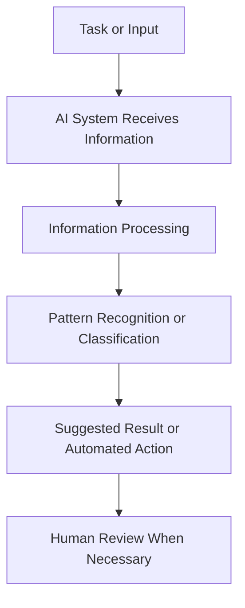
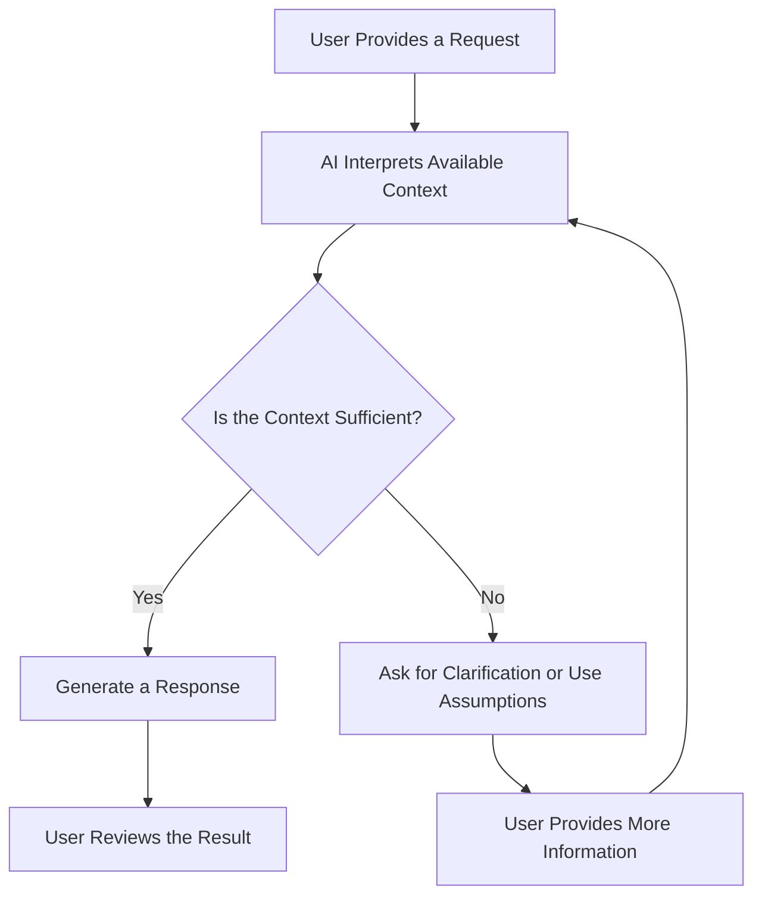
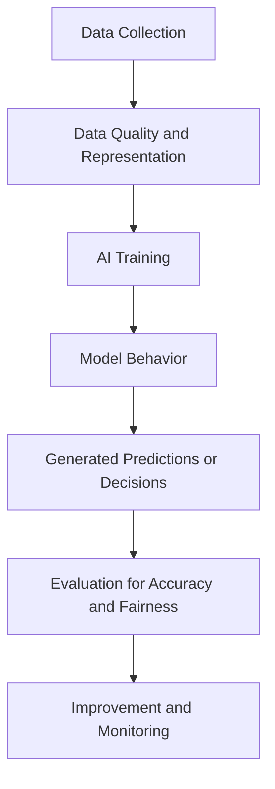
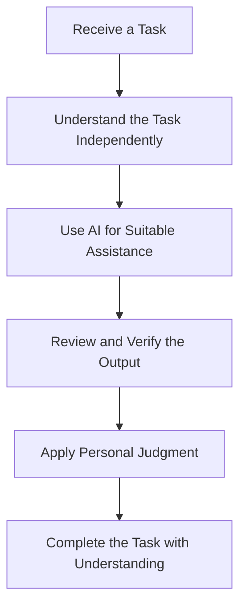
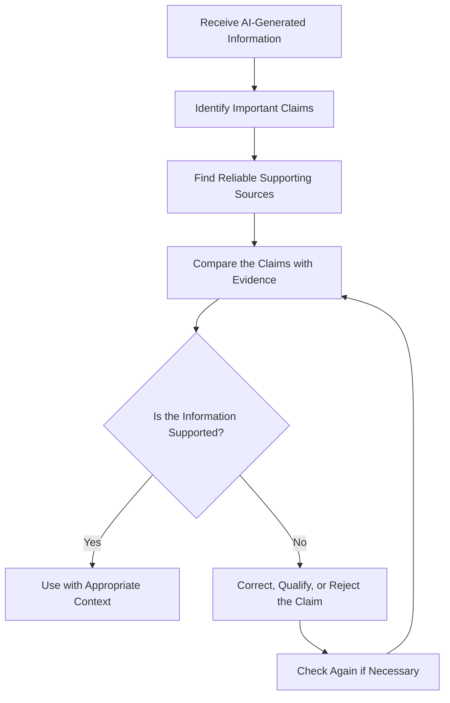

# TOPIC 04 — BENEFITS, LIMITATIONS, AND CHALLENGES OF AI

  <strong>SLN · AI OVERVIEW</strong> 
  <em>Understanding the Advantages, Limitations, and Challenges of Artificial Intelligence</em>

---

## CONTENTS

1. [Benefits of Artificial Intelligence](#01--benefits-of-artificial-intelligence)
2. [Limitations in Understanding Context](#02--limitations-in-understanding-context)
3. [Inaccurate Outputs and AI Hallucinations](#03--inaccurate-outputs-and-ai-hallucinations)
4. [Data Quality and Bias](#04--data-quality-and-bias)
5. [Overdependence on AI](#05--overdependence-on-ai)
6. [The Importance of Verifying AI-Generated Information](#06--the-importance-of-verifying-ai-generated-information)

---

# 01 · BENEFITS OF ARTIFICIAL INTELLIGENCE

## 1.1 Understanding the Benefits of AI

Artificial Intelligence provides many benefits in modern society. AI systems can process information, recognize patterns, generate content, and support decisions. These capabilities allow individuals and organizations to complete certain tasks more efficiently.

AI is increasingly used in education, healthcare, business, transportation, communication, entertainment, and scientific research. Its benefits are not limited to one particular industry because many activities involve information processing, prediction, classification, or repetitive work.

The main purpose of using AI is not simply to replace human activities. In many situations, AI is designed to support people by reducing repetitive work, providing useful information, and helping them perform tasks more effectively.

For example, a student may use an AI tool to organize study notes, while a business may use an AI system to analyze customer feedback. A healthcare organization may use AI-supported software to help examine medical images. These examples demonstrate how AI can assist different groups of people with different needs.

However, the benefits of AI depend on how the technology is developed, implemented, and used. An AI system does not automatically improve every task. Its effectiveness depends on data quality, system design, human supervision, and the suitability of the task.

> **Core Insight:** AI creates value when its capabilities are applied to appropriate tasks and supported by responsible human judgment.

## 1.2 Efficiency and Time Savings

One of the most important benefits of AI is its ability to improve efficiency. Efficiency refers to completing tasks with less unnecessary effort, time, or resources while maintaining an acceptable level of quality.

Many everyday activities involve repeated steps. These activities may include sorting information, organizing records, checking documents, searching for patterns, and answering common questions.

AI can assist with these activities by processing large amounts of information and performing specific operations automatically.

For example, an organization that receives hundreds of customer messages may use an AI system to classify messages according to their topics. Instead of manually organizing every message, employees can review the classifications and focus on cases that require personal attention.

AI can also help individuals save time. A student may use an AI assistant to create an initial outline for a presentation, summarize a long passage, or explain an unfamiliar concept. The student can then review and improve the result.

### Examples of Efficiency Improvements

| Activity | Without AI Assistance | With AI Assistance |
|---|---|---|
| Document organization | Documents are sorted manually | AI can classify documents by content |
| Information searching | Users examine many results individually | AI can help identify relevant information |
| Customer support | Staff answer every common question manually | AI can handle suitable routine enquiries |
| Data analysis | Analysts inspect records manually | AI can identify patterns for further review |
| Writing preparation | Users organize all initial ideas themselves | AI can suggest outlines and structures |
| Translation | Users translate every sentence manually | AI can provide an initial translation |

These examples show that AI can reduce the time needed for certain activities. However, faster completion does not always mean better results. Important information may still need to be checked.

## 1.3 Automation of Repetitive Tasks

Automation refers to using technology to perform tasks with limited direct human involvement.

AI can support automation by recognizing patterns, interpreting certain inputs, and selecting actions based on programmed rules or learned behavior.

Traditional automation usually follows clearly defined instructions. AI-supported automation can handle some tasks involving patterns or changing information, although its capabilities depend on the system.

For example, a simple automated system may send an email whenever a specific condition is met. An AI-supported system may classify incoming messages and identify which ones are likely to require attention.

### How AI-Supported Automation Works

AI-supported automation can be useful in several areas:

- **Administration:** Organizing records and classifying documents.
- **Customer service:** Answering common questions and directing enquiries.
- **Manufacturing:** Supporting quality inspection and equipment monitoring.
- **Finance:** Identifying unusual transaction patterns for further investigation.
- **Education:** Organizing learning materials and supporting administrative work.

Automation can reduce repetitive workloads and allow people to focus on tasks requiring creativity, communication, and judgment.

Nevertheless, automation must be designed carefully. An incorrect automated decision may affect many records or users if the system operates without suitable supervision.

## 1.4 Increased Productivity

Productivity describes the amount of useful work completed in relation to the time and resources used.

AI can improve productivity by helping people complete certain activities more quickly and organize their work more effectively.

For example, an employee may use an AI assistant to prepare a first draft of a report. Instead of starting with a blank document, the employee receives an initial structure that can be checked, corrected, and improved.

Similarly, a student may use AI to generate practice questions based on a lesson. This can make revision more organized, provided that the questions are reviewed for accuracy.

AI may support productivity through:

1. Generating initial ideas.
2. Organizing information.
3. Summarizing long materials.
4. Supporting data analysis.
5. Preparing drafts.
6. Identifying patterns.
7. Reducing repetitive work.

However, productivity should not be measured only by the number of tasks completed. Quality, accuracy, originality, and understanding are also important.

A person who produces many documents using AI but does not understand their contents may not achieve meaningful productivity.

## 1.5 Supporting Better Decision-Making

AI can support decision-making by analyzing information and identifying patterns that may be difficult to notice manually.

Decision-making involves evaluating available information, considering possible outcomes, and selecting an appropriate action.

AI systems can provide predictions, classifications, recommendations, and summaries. These outputs may help people understand a situation before making a decision.

For example:

- A business may analyze customer purchasing patterns before planning its inventory.
- A transport organization may examine traffic information to support route planning.
- A school may review learning progress data to identify topics that students may need to practice.
- A financial organization may use anomaly detection to identify transactions that require additional review.

AI does not automatically make every decision correct. A prediction is not a guarantee, and a recommendation is not necessarily the best choice.

Human decision-makers must consider relevant circumstances, possible risks, and information that the AI system may not have received.

## 1.6 Processing Large Amounts of Data

AI systems can process large datasets and identify relationships between different pieces of information.

A dataset is a collection of information organized for analysis. It may contain text, numbers, images, audio recordings, or other forms of data.

When datasets become very large, examining every record manually may be difficult. AI can help identify patterns, similarities, unusual values, and possible relationships.

For example, an online store may examine purchasing patterns to understand which products are frequently viewed together. A research team may use AI-supported analysis to organize large collections of scientific information.

The ability to process large amounts of data can support:

- Pattern recognition.
- Classification.
- Prediction.
- Recommendation.
- Anomaly detection.
- Information retrieval.

However, processing more data does not automatically produce more accurate results. The information must be relevant, reliable, and appropriate for the task.

## 1.7 Improving Accessibility

AI can make certain digital services easier to access for people with different needs.

Accessibility refers to designing systems and services so that more people can use them, including people who experience physical, sensory, or learning-related barriers.

Examples of AI-supported accessibility include:

- Speech-to-text systems that convert spoken words into written text.
- Text-to-speech tools that read written information aloud.
- Automatic captions that support users who have difficulty hearing audio.
- Translation tools that help users understand different languages.
- Image descriptions that provide information about visual content.
- Writing assistance that supports users who need help organizing language.

These tools can improve access to information and communication. However, accessibility tools may still make mistakes. Captions may misinterpret speech, translations may lose meaning, and image descriptions may overlook important details.

Users should therefore have alternative ways to access important information when AI-generated accessibility features are inaccurate.

## 1.8 Supporting Creativity and Innovation

AI can support creative work by helping users explore ideas and produce initial drafts.

Creative activities include writing, designing, composing, planning, and developing new concepts. AI tools may generate suggestions that users can evaluate and develop further.

For example, a student preparing a presentation may ask an AI assistant to suggest possible structures. A designer may use AI to explore different visual concepts. A writer may use an AI tool to identify possible ways to organize an article.

AI can also support innovation in research and product development by helping people examine information and explore possible solutions.

However, creativity involves more than producing content. It also includes personal experience, cultural understanding, intention, originality, and the ability to evaluate whether an idea is meaningful.

AI-generated suggestions should therefore be treated as starting points rather than automatic replacements for human creativity.

## 1.9 Benefits for Organizations and Society

AI can provide benefits beyond individual productivity. Organizations may use it to improve services, analyze information, and manage resources.

In education, AI may support learning activities and administrative organization.

In healthcare, AI-supported tools may assist professionals with certain information-processing tasks.

In transportation, AI may support traffic analysis and route planning.

In business, AI may assist with customer service, forecasting, and inventory management.

At a broader level, AI research may contribute to scientific discovery, accessibility, and the development of new technologies.

The effects of AI on society are not always positive. Benefits may be distributed unevenly, and organizations must consider privacy, fairness, employment, and accountability.

## 1.10 Understanding the Limits of AI Benefits

The benefits of AI should always be evaluated in relation to its limitations.

An AI system may save time but produce an incorrect answer. It may automate a task but fail when an unusual situation occurs. It may generate a useful recommendation but overlook personal circumstances.

Before using AI, individuals and organizations should consider:

- Is AI suitable for this task?
- Is the information being processed reliable?
- What could happen if the output is incorrect?
- Is human review necessary?
- Does the system protect personal information?
- Can users understand and challenge its results?

> **Core Insight:** The greatest benefit of AI is not simply speed or automation. It is the ability to support people in completing suitable tasks more effectively while preserving human responsibility.

---

# 02 · LIMITATIONS IN UNDERSTANDING CONTEXT

## 2.1 What Does Understanding Context Mean?

Context refers to the surrounding information and circumstances that give meaning to a statement, event, question, or situation.

Understanding context involves interpreting information beyond its literal words. It may require knowledge of the speaker's intention, previous events, cultural background, emotional situation, and the purpose of communication.

Humans often use context naturally. For example, the sentence "That was great" may express genuine appreciation, disappointment, or sarcasm depending on the situation.

AI systems can identify patterns in language and other information, but they may not interpret every situation correctly.

A system may produce a grammatically correct response while misunderstanding what the user actually means.

## 2.2 Literal Meaning and Intended Meaning

Literal meaning refers to the direct meaning of words. Intended meaning refers to what a person wants to communicate.

These meanings are not always identical.

Consider the statement:

"Can you open the window?"

Its literal form is a question about ability. In ordinary conversation, however, it is usually a polite request.

An AI system must use language patterns and available context to identify the likely intention.

Other examples include:

| Statement | Possible Intended Meaning |
|---|---|
| "It is very cold in here." | The speaker may want the window closed or heating adjusted |
| "Nice work." | Genuine praise or sarcasm, depending on context |
| "I have a mountain of homework." | A large amount of homework, not a literal mountain |
| "Can you give me a hand?" | A request for help, not a physical hand |
| "That idea is interesting." | Genuine interest or polite disagreement |

AI may interpret common expressions correctly, but unusual wording or missing context can lead to misunderstanding.

## 2.3 Ambiguous Language

Ambiguity occurs when a word, phrase, or sentence has more than one possible meaning.

For example:

"I saw the person with the telescope."

This sentence may mean that the speaker used a telescope to see someone, or that the person being observed had a telescope.

The correct interpretation depends on context.

AI systems may select one interpretation even when the available information does not clearly support it.

Ambiguity can occur in:

- Everyday conversation.
- Technical instructions.
- Legal documents.
- Academic writing.
- Cultural expressions.
- Short messages.
- Questions with missing details.

When a question is unclear, a reliable AI interaction should involve clarification rather than pretending that only one interpretation is possible.

## 2.4 Missing Background Information

AI systems can only work with the information available to them and the knowledge represented in their design or training.

If important background information is missing, the system may produce an incomplete or unsuitable response.

For example, a user may ask:

"What is the best option?"

Without knowing the user's goal, available resources, location, or requirements, the question cannot be answered accurately.

The AI may provide a general recommendation, but that recommendation may not fit the actual situation.

Missing context can include:

1. The purpose of a task.
2. The user's specific requirements.
3. Previous events in a conversation.
4. Local rules or conditions.
5. The date and time of a situation.
6. Cultural or professional expectations.

Users can reduce this problem by providing relevant details and checking whether the system has understood the task correctly.

## 2.5 Cultural and Social Context

Communication is influenced by culture, social expectations, and local practices.

A phrase that is considered polite in one culture may sound unusual or too direct in another. A gesture, expression, or reference may also have different meanings in different communities.

AI systems may not always recognize these differences.

For example, an AI-generated translation may preserve the dictionary meaning of a sentence but fail to preserve its level of politeness.

Cultural context can affect:

- Language and translation.
- Humor and sarcasm.
- Formality.
- Social relationships.
- Traditions.
- Communication styles.
- Local expressions.

This limitation is important when AI is used in international communication, education, customer service, and public information.

Users should review culturally sensitive content instead of assuming that a fluent response is automatically appropriate.

## 2.6 Emotional Context

Human communication often contains emotional meaning. People may express frustration, uncertainty, excitement, sadness, or concern indirectly.

AI can recognize certain emotional patterns in text or audio, but these interpretations are not always reliable.

For example, a short message may appear angry because it contains direct language, even though the writer is simply in a hurry.

Similarly, a person may use humor when discussing a difficult situation. An AI system may misunderstand the intended tone.

AI-generated responses should not be treated as proof that a system fully understands a person's emotional experience.

In sensitive situations, careful human communication and judgment remain important.

## 2.7 Context in Long Conversations

Long conversations may contain many topics, instructions, and changes in direction.

An AI system may fail to connect information from different parts of a conversation. It may overlook an earlier requirement or interpret a later message incorrectly.

For example, a user may explain several formatting requirements and then ask for a revision. If the system does not correctly apply the earlier instructions, the result may not match the user's expectations.

A useful approach is to:

- State the main task clearly.
- Include essential requirements.
- Explain important changes.
- Review the result against the original instructions.
- Correct misunderstandings when they appear.

## 2.8 Context in Real-World Situations

Real-world situations contain information that may not be included in a digital prompt.

A person making a decision may consider physical surroundings, local conditions, previous experience, personal responsibilities, and other factors.

An AI system may not have access to these details.

For example, a route recommendation may not account for a temporary road closure if the system has not received current information.

A business recommendation may overlook a user's specific requirements if those requirements were not provided.

A general explanation may not apply to a local regulation that has recently changed.

This means AI-generated answers should be evaluated according to the situation in which they will be used.

## 2.9 Why Context Limitations Matter

Misunderstanding context can produce several problems:

| Problem | Possible Consequence |
|---|---|
| Misinterpreting a question | The response does not answer the actual request |
| Missing background details | The result is incomplete |
| Misreading cultural meaning | Communication becomes inappropriate |
| Misunderstanding tone | The response may sound insensitive |
| Ignoring local conditions | Recommendations may be unsuitable |
| Losing earlier instructions | The final output may not meet requirements |

The seriousness of these problems depends on the task. A misunderstanding in a casual brainstorming activity may have a small effect, while a misunderstanding in a professional or healthcare setting may require much more careful review.

## 2.10 How to Reduce Context-Related Errors

Users can improve the quality of AI responses by providing clear and relevant information.

A useful prompt should explain:

- The task that needs to be completed.
- The purpose of the task.
- Important background information.
- The expected format.
- Any restrictions or requirements.
- The level of detail needed.

If a response seems unrelated, users should clarify the original intention rather than automatically accepting the result.

> **Core Insight:** AI can process language patterns, but it may not understand the full circumstances behind a message. Clear instructions and relevant background information help reduce misunderstandings.

---

# 03 · INACCURATE OUTPUTS AND AI HALLUCINATIONS

## 3.1 Understanding Inaccurate AI Outputs

An AI output is the information or content generated by an AI system after receiving an input.

An output may be inaccurate when it contains incorrect facts, incomplete explanations, misleading conclusions, or information that does not match the user's request.

AI-generated information can appear professional and convincing even when it is incorrect.

This is an important limitation because users may assume that a well-written answer is reliable.

Accuracy refers to how closely information matches reality or an accepted standard. Fluency refers to how naturally or smoothly information is expressed.

These are different qualities. A response can be fluent without being accurate.

## 3.2 What Is an AI Hallucination?

An AI hallucination occurs when an AI system generates information that appears meaningful or factual but is unsupported, incorrect, or fabricated.

The term is commonly used for generative AI systems, especially systems that produce text.

For example, a user may ask an AI assistant for a scientific article. The system might generate a realistic-looking article title, author name, or publication detail that does not actually exist.

The answer may appear convincing because it follows the structure of an academic reference.

However, the information is not necessarily real.

AI hallucinations can include:

- Invented facts.
- Incorrect dates.
- Nonexistent publications.
- Fabricated quotations.
- Incorrect statistics.
- Misleading explanations.
- Unsupported technical claims.
- False descriptions of events.

A hallucination is not always an obvious mistake. It may be mixed with correct information, making it difficult to identify without checking.

## 3.3 Why Do AI Hallucinations Happen?

Generative AI systems learn patterns from training data and use those patterns to produce outputs.

A language model generally generates text by estimating which tokens are likely to follow the previous tokens in a sequence.

This process can produce natural language, but it does not guarantee that every generated statement is factually correct.

Several factors can contribute to hallucinations.

### A. Incomplete or Unclear Input

A vague question may not provide enough information to produce a reliable answer.

If the system is asked to explain an unspecified event, it may make assumptions about what the user means.

### B. Missing or Limited Information

The system may not have sufficient information about a particular subject.

This can happen when the topic is highly specialized, recent, or poorly represented in available information.

### C. Conflicting Information

Training data may contain different descriptions or conflicting claims.

The system may generate an answer that combines these patterns without correctly resolving the disagreement.

### D. Requests That Encourage Guessing

A user may request very specific details that are not available.

Instead of clearly indicating uncertainty, a system may generate plausible-sounding information.

### E. Limitations in Reasoning

AI systems can make mistakes when following complex instructions, performing calculations, interpreting relationships, or combining several pieces of information.

### F. Lack of Verification

A generated answer may not be checked against reliable external evidence.

Without verification, unsupported claims may remain in the final output.

## 3.4 Examples of AI Hallucinations

| User Request | Possible Inaccurate Output |
|---|---|
| Find a research paper | The AI invents a paper title or author |
| Explain a historical event | The AI provides an incorrect date |
| Calculate a percentage | The AI gives an incorrect result |
| Describe a law | The AI presents an outdated or nonexistent rule |
| Summarize a document | The AI includes information not found in the document |
| Provide statistics | The AI invents numerical data |
| Identify a quotation | The AI attributes words to the wrong person |

These examples demonstrate why users should not rely only on how confident or detailed an AI response sounds.

## 3.5 Incorrect Information and Plausible Explanations

A major challenge with generative AI is that incorrect information can be presented in a convincing way.

For example, an AI system may explain a scientific concept using technical vocabulary, organized paragraphs, and a logical structure. However, one of the central explanations may still be wrong.

This can make the error difficult to notice, especially for users who are unfamiliar with the subject.

A useful distinction is:

| Output Quality | Meaning |
|---|---|
| Fluent | The response is expressed naturally |
| Relevant | The response relates to the request |
| Complete | The response covers the required points |
| Accurate | The information is factually correct |
| Verified | The claims have been checked against appropriate evidence |

A strong response should aim for all these qualities where they are relevant.

## 3.6 The Difference Between an AI Error and a Hallucination

Not every incorrect AI output is necessarily a hallucination.

An error may occur because of a calculation mistake, incorrect interpretation, outdated information, or a failure to follow instructions.

A hallucination more specifically involves generated information that is unsupported or fabricated but presented as if it were meaningful or factual.

| Situation | Description |
|---|---|
| Calculation mistake | The system performs a mathematical operation incorrectly |
| Misinterpretation | The system misunderstands the user's question |
| Outdated information | The system provides information that was previously correct |
| Incomplete response | Important details are missing |
| Hallucination | The system generates unsupported or fabricated information |

The distinction helps users understand what kind of correction may be needed.

## 3.7 Consequences of Inaccurate Outputs

Inaccurate AI-generated information can affect individuals, organizations, and communities.

### Education

Students may learn incorrect information or include fabricated sources in assignments.

### Business

Employees may make poor decisions if they rely on inaccurate summaries, forecasts, or reports.

### Healthcare

Incorrect medical information may cause confusion and may lead users to misunderstand health-related matters.

### Finance

Incorrect calculations or descriptions may influence financial decisions.

### Communication

False information may be repeated through messages, articles, or social media.

The consequences depend on the importance of the information and how it is used.

## 3.8 Recognizing Warning Signs

Users should pay attention when an AI response contains:

- Very specific details without supporting evidence.
- References that cannot be located.
- Statistics without a clear source.
- Contradictions within the same response.
- Unexplained changes in dates or names.
- Claims that appear unusually certain despite limited information.
- Information that conflicts with reliable sources.

These signs do not prove that a response is incorrect, but they indicate that further checking may be necessary.

## 3.9 How to Reduce the Risk of Hallucinations

Users can reduce the risk of relying on hallucinated information through several practices.

**Provide clear instructions.** Explain exactly what information is needed and include relevant context.

**Ask for uncertainty to be identified.** Users can request that the system distinguish confirmed information from assumptions.

**Check important claims.** Dates, statistics, quotations, and technical statements should be verified.

**Use reliable sources.** Important claims should be compared with official publications, recognized institutions, or original documents.

**Avoid treating generated references as real.** Every citation should be checked independently.

**Review the final result.** Users should examine the response for contradictions and unsupported statements.

## 3.10 Why Confidence Does Not Guarantee Accuracy

AI systems may generate responses using confident language even when the information is incorrect.

Confidence in wording is not the same as evidence.

For example, the sentence "The event definitely occurred in 1985" may sound certain, but the date still needs to be checked.

Users should evaluate the quality of supporting evidence rather than relying on the tone of the answer.

> **Core Insight:** A convincing AI response is not automatically a correct response. Accuracy must be evaluated through evidence and verification.

---

# 04 · DATA QUALITY AND BIAS

## 4.1 Understanding Data Quality

Data quality refers to how suitable, accurate, complete, consistent, and reliable data is for a particular purpose.

AI systems depend on data to learn patterns, identify relationships, and generate outputs.

If the data is inaccurate or incomplete, the system may produce unreliable results.

For example, an AI system trained to classify images needs suitable images with correct labels. If many images are mislabeled, the system may learn incorrect relationships.

The quality of the data is therefore an important factor in the quality of an AI system.

## 4.2 Characteristics of High-Quality Data

High-quality data generally has several important characteristics.

| Characteristic | Explanation |
|---|---|
| Accuracy | Information correctly represents what it describes |
| Completeness | Important information is not unnecessarily missing |
| Consistency | Information follows compatible formats and definitions |
| Relevance | Data is suitable for the task |
| Timeliness | Information is sufficiently current |
| Validity | Data follows expected rules and formats |
| Reliability | Information comes from dependable processes or sources |

These characteristics help ensure that an AI system receives suitable information.

## 4.3 How Poor Data Affects AI

Poor-quality data can affect the way an AI system learns and performs.

For example, consider a system designed to recognize different types of plants.

If the training dataset contains only images taken in bright daylight, the system may perform poorly when it receives images taken in low light.

Similarly, if the dataset contains incorrect labels, the system may learn incorrect associations.

Poor data may result in:

- Incorrect predictions.
- Unreliable classifications.
- Inconsistent performance.
- Limited generalization.
- Misleading recommendations.
- Unfair outcomes.

An AI system cannot automatically correct every problem in its training data.

## 4.4 Understanding Bias in AI

Bias refers to a systematic tendency that causes information, decisions, or outcomes to favor or disadvantage certain groups or conditions.

In AI, bias may appear when data, system design, assumptions, or evaluation methods produce unfair patterns.

For example, an AI system may perform better for one group than another because the training data does not represent all relevant groups equally.

Bias is not always caused by intentional discrimination. It can also result from historical inequalities, incomplete datasets, or unsuitable system design.

## 4.5 Sources of AI Bias

### A. Historical Bias

Historical bias occurs when data reflects unfair conditions or unequal treatment that existed in the past.

If an AI system learns from this data without suitable evaluation, it may reproduce those patterns.

### B. Representation Bias

Representation bias occurs when certain groups or situations are insufficiently represented in a dataset.

For example, an image-recognition system trained using images from a limited range of environments may perform poorly in other environments.

### C. Measurement Bias

Measurement bias occurs when the method used to collect or measure information does not represent the intended concept accurately.

### D. Labeling Bias

Labeling bias occurs when the people or processes assigning labels make inconsistent or unfair judgments.

### E. Selection Bias

Selection bias occurs when the data collected does not adequately represent the population or situations that the system is expected to handle.

## 4.6 Examples of Bias in AI Systems

| Area | Possible Bias | Potential Effect |
|---|---|---|
| Recruitment | Historical employment data reflects unequal opportunities | Some applicants may be evaluated unfairly |
| Image recognition | Training images do not represent different conditions | Performance varies between groups or environments |
| Education | Learning data reflects unequal access to resources | Recommendations may be unsuitable |
| Language processing | Some languages or dialects are poorly represented | Certain users receive less accurate results |
| Recommendation systems | Historical engagement patterns dominate | Users receive a narrow range of content |

These examples demonstrate why AI systems should be evaluated across different users and situations.

## 4.7 The Relationship Between Data Quality and Bias

Data quality and bias are closely connected.

A dataset may contain a large amount of information but still be unsuitable if it does not represent the intended population.

Similarly, a dataset may be technically consistent but still reflect historical inequalities.

The quantity of data alone does not guarantee fairness or reliability.

The evaluation process should examine not only overall performance but also whether the system works appropriately across different conditions.

## 4.8 Detecting and Reducing Bias

Organizations can reduce the risk of bias through several practices:

1. Examine the source of training data.
2. Identify missing or underrepresented groups.
3. Review how information is collected and labeled.
4. Test the system under different conditions.
5. Evaluate performance across relevant groups.
6. Involve people with different areas of expertise.
7. Monitor the system after deployment.
8. Provide processes for reporting and correcting problems.

Reducing bias is not a one-time activity. AI systems may change in performance as data, users, and conditions change.

## 4.9 The Importance of Diverse and Representative Data

A representative dataset reflects the range of situations and groups that an AI system is expected to encounter.

For example, a language system intended for international use should be evaluated using different languages, writing styles, and communication contexts.

A transportation system should be tested under different road and traffic conditions.

A healthcare-related system should be evaluated using suitable data for the intended population and task.

Representative data can improve the ability of a system to work in different situations. However, representation alone does not guarantee fairness. The quality of labels, evaluation methods, and system design also matters.

## 4.10 Human Responsibility in Data Management

People and organizations remain responsible for deciding how data is collected, used, stored, and evaluated.

They should consider:

- Whether data was collected appropriately.
- Whether personal information is protected.
- Whether the dataset is suitable for the task.
- Whether information is outdated.
- Whether certain groups are underrepresented.
- Whether the system produces unfair outcomes.

AI should not be treated as automatically objective simply because it uses mathematical models.

> **Core Insight:** AI learns from data, and data can contain mistakes and unfair patterns. Reliable AI requires careful data management, evaluation, and ongoing human oversight.

---

# 05 · OVERDEPENDENCE ON AI

## 5.1 Understanding Overdependence on AI

Overdependence on AI occurs when people rely too heavily on AI systems and use them without applying enough independent thinking, judgment, or verification.

AI can be a useful tool for learning, writing, planning, and analyzing information. However, problems may occur when users allow AI to perform tasks that they should understand or evaluate themselves.

For example, a student may use AI to generate an entire assignment without understanding the topic. The student may submit the output but struggle to explain the ideas.

This demonstrates the difference between using AI as support and depending on it as a replacement for personal learning.

## 5.2 AI as a Tool, Not a Replacement for Thinking

AI is most useful when it supports human abilities.

People can use AI to:

- Explore unfamiliar topics.
- Organize ideas.
- Generate practice questions.
- Receive explanations.
- Identify possible errors.
- Prepare initial drafts.
- Compare possible approaches.

However, users should still evaluate the information and make their own decisions.

Critical thinking involves examining information, questioning assumptions, comparing evidence, and reaching reasoned conclusions.

If people accept AI outputs without evaluation, they may gradually reduce their opportunities to practice these skills.

## 5.3 Effects on Learning and Education

Overdependence on AI can affect the learning process.

Learning involves more than obtaining a final answer. It includes understanding concepts, practicing skills, making mistakes, and developing the ability to solve problems independently.

If students use AI to complete every difficult task, they may miss important opportunities to develop these abilities.

Possible effects include:

- Reduced independent problem-solving practice.
- Limited understanding of lesson materials.
- Difficulty explaining submitted work.
- Less practice in writing and reasoning.
- Dependence on instant answers.
- Reduced ability to evaluate information.

AI can still support learning when it is used appropriately.

For example, students can ask AI to explain a difficult concept, generate practice questions, or provide feedback on a draft. They should then complete their own reasoning and review the result.

## 5.4 Effects on Critical Thinking

Critical thinking requires people to evaluate information rather than accept it automatically.

When users depend heavily on AI, they may become less likely to:

- Question an answer.
- Compare different explanations.
- Search for supporting evidence.
- Identify assumptions.
- Consider alternative viewpoints.
- Recognize uncertainty.

This can make users more vulnerable to inaccurate or misleading information.

A useful habit is to ask why an AI response should be trusted and what evidence supports its main claims.

## 5.5 Reduced Problem-Solving Practice

Problem-solving skills develop through practice.

People learn to identify problems, explore possible solutions, test ideas, and evaluate results.

If AI always provides an immediate answer, users may have fewer opportunities to practice these steps.

For example, a student who always asks AI to solve mathematics problems may not develop the ability to identify the correct formula or explain the solution.

A better approach is to attempt the problem independently first, then use AI to understand mistakes or explore alternative explanations.

## 5.6 Dependence in the Workplace

Overdependence can also occur in professional environments.

Employees may rely on AI-generated reports, summaries, recommendations, or calculations without checking their accuracy.

This can create problems when AI-generated information is used in important decisions.

For example, a business employee may use an AI-generated summary without reading the original document. If the summary omits an important condition, the employee may make an unsuitable decision.

Organizations should establish clear procedures for reviewing AI-supported work.

## 5.7 Automation Bias

Automation bias occurs when people place too much trust in the output of an automated system, even when there are reasons to question it.

For example, a person may accept an AI recommendation simply because it comes from a computer system.

This may happen when users assume that technology is always objective or more accurate than human judgment.

However, AI systems can make mistakes, use incomplete information, and produce biased results.

Users should therefore evaluate recommendations rather than accepting them automatically.

## 5.8 Reduced Personal Skills

Depending too heavily on AI may reduce opportunities to practice certain skills.

Examples include:

| Skill | Possible Effect of Overdependence |
|---|---|
| Writing | Less practice organizing and expressing original ideas |
| Research | Less experience evaluating sources |
| Problem-solving | Reduced independent practice |
| Communication | Less practice explaining ideas personally |
| Decision-making | Greater reliance on automated recommendations |
| Creativity | Fewer opportunities to develop original approaches |

These effects are not automatic. They depend on how AI is used.

A person who uses AI to receive feedback and improve their work may develop skills, while a person who uses it to avoid all thinking may miss important learning opportunities.

## 5.9 Maintaining a Healthy Balance

Responsible AI use requires balance.

Users should identify which parts of a task are suitable for AI assistance and which parts require their own knowledge and judgment.

A balanced approach includes:

1. Attempting to understand the task independently.
2. Using AI for support when appropriate.
3. Checking the generated information.
4. Comparing the response with reliable sources.
5. Revising the result using personal understanding.
6. Being able to explain the final work.

## 5.10 Recognizing Signs of Overdependence

Possible warning signs include:

- Using AI before attempting to understand a task.
- Accepting every answer without checking.
- Being unable to explain AI-generated work.
- Depending on AI for simple decisions.
- Copying generated content without reviewing it.
- Feeling unable to complete familiar tasks without AI assistance.
- Ignoring instructions about permitted AI use.

Recognizing these habits can help users develop more balanced technology use.

## 5.11 The Role of Education and Organizations

Schools and organizations can help people use AI responsibly by teaching practical evaluation skills.

Education should explain how AI works, what its limitations are, and why human judgment remains important.

Organizations should provide clear guidelines about acceptable AI use, verification requirements, and responsibilities.

Users should understand that AI assistance does not remove their responsibility for the final work.

> **Core Insight:** AI should strengthen human abilities, not replace the development of knowledge, critical thinking, and independent problem-solving.

---

# 06 · THE IMPORTANCE OF VERIFYING AI-GENERATED INFORMATION

## 6.1 What Is Verification?

Verification is the process of checking whether information is accurate, reliable, relevant, and supported by appropriate evidence.

When AI generates information, users should examine important claims before relying on them.

Verification is necessary because AI systems may produce incorrect facts, outdated information, fabricated references, or incomplete explanations.

The more important the information is, the more carefully it should be checked.

For example, a casual brainstorming suggestion may require limited verification. A statement used in an academic report or professional decision requires stronger evidence.

## 6.2 Why AI-Generated Information Must Be Checked

AI systems are designed to process information and generate outputs, but they are not guaranteed to provide correct answers every time.

Verification helps users identify:

- Incorrect facts.
- Outdated information.
- Unsupported claims.
- Fabricated references.
- Missing details.
- Misleading statistics.
- Incorrect interpretations.
- Contradictions.

Without verification, users may repeat incorrect information or use it as the basis for unsuitable decisions.

## 6.3 Checking Information Against Reliable Sources

One of the most effective verification methods is comparing AI-generated information with reliable sources.

Reliable sources may include:

- Official government websites.
- Recognized educational institutions.
- Peer-reviewed academic publications.
- Official company documentation.
- Established research organizations.
- Original reports and datasets.
- Relevant professional organizations.

The appropriate source depends on the topic.

For example, current legal requirements should be checked against relevant official legal information. Scientific claims should be compared with suitable research publications or recognized scientific institutions.

## 6.4 Checking Facts, Dates, and Statistics

Facts, dates, and statistics should be checked carefully because small mistakes can change the meaning of information.

A user should examine:

1. Whether the event or claim is real.
2. Whether the date is correct.
3. Whether the number is accurate.
4. Whether the statistic refers to the correct population.
5. Whether the information is current.
6. Whether the original source supports the statement.

A statistic without a clear source should not automatically be treated as reliable.

## 6.5 Verifying References and Citations

AI-generated references require special attention.

A reference may look academically correct while containing fabricated details.

Users should check:

- The publication title.
- The author's name.
- The publication year.
- The journal or publisher.
- The volume and issue, when applicable.
- The DOI or official publication link.
- Whether the source actually supports the claim.

A citation is not reliable simply because it follows an academic format.

The original source should be located and examined whenever possible.

## 6.6 Cross-Checking Information

Cross-checking means comparing information with more than one suitable source.

This is useful when a claim is important, controversial, or likely to change over time.

However, using several websites does not automatically guarantee reliability. Multiple websites may repeat the same incorrect information.

Users should consider the quality, independence, and relevance of each source.

A useful comparison may include:

| Verification Question | What to Examine |
|---|---|
| Is the source reliable? | Publisher, institution, author, or organization |
| Is the information current? | Publication or update date |
| Does the evidence support the claim? | Original data or explanation |
| Do other sources agree? | Independent confirmation |
| Is the context appropriate? | Scope, population, location, and conditions |

## 6.7 Checking AI-Generated Summaries

AI-generated summaries may omit important details or change the meaning of the original material.

When using AI to summarize a document, users should compare the summary with the original document.

They should check:

- Whether the main ideas are included.
- Whether important limitations are preserved.
- Whether the summary introduces new claims.
- Whether numbers and dates remain correct.
- Whether the author's meaning has been changed.
- Whether important exceptions have been omitted.

A summary should represent the original material accurately, not merely sound clear and organized.

## 6.8 Verifying Information in Academic Work

Verification is especially important in education.

Students may use AI to understand lessons, organize notes, or prepare drafts. However, information included in assignments should be checked against course materials and reliable sources.

Students should:

- Compare explanations with learning materials.
- Check important facts.
- Confirm that references exist.
- Read original sources when required.
- Follow institutional rules for AI use.
- Ensure that submitted work reflects their own understanding.

This process supports both academic accuracy and learning.

## 6.9 A Practical Verification Workflow

The following process can help users evaluate AI-generated information.

This workflow encourages users to treat AI output as information that needs evaluation.

## 6.10 Different Levels of Verification

Not every AI-generated response requires the same level of checking.

The level of verification should match the importance and potential consequences of the information.

| Type of Information | Suggested Verification |
|---|---|
| Brainstorming ideas | Review for relevance and suitability |
| General explanations | Compare important concepts with learning materials |
| Academic facts | Check reliable educational or research sources |
| Statistics | Verify the original data and context |
| Current events | Check recent reporting and official updates |
| Legal information | Consult relevant official legal sources |
| Healthcare information | Use trusted healthcare sources and qualified professionals |
| Financial information | Check reliable financial information and applicable conditions |

Important decisions should not be based solely on AI-generated information.

## 6.11 Human Judgment During Verification

Verification involves more than searching for matching sentences.

Users must evaluate whether a source is trustworthy, whether evidence is relevant, and whether a conclusion follows logically from the available information.

This requires human judgment.

For example, two sources may present different statistics because they examine different populations or periods. A user must understand the difference instead of selecting whichever number agrees with the AI response.

Human judgment is also needed when information involves ethical concerns, personal circumstances, or consequences that cannot be evaluated through factual accuracy alone.

## 6.12 Responsible Use of AI-Generated Information

Responsible use means understanding that users remain accountable for how they use AI-generated content.

Before using an AI output, users should consider:

- Is the information accurate?
- Is it supported by evidence?
- Is it suitable for the intended purpose?
- Does it contain private or sensitive information?
- Does it follow relevant rules and guidelines?
- Can the user explain and defend the final result?

These questions help users avoid treating AI as an unquestionable authority.

## 6.13 Building a Habit of Verification

Verification should become a normal part of using AI.

A practical habit is to check important claims before sharing, submitting, or acting on them.

Users can also request that an AI system identify uncertain statements, explain its assumptions, or suggest the types of sources needed to verify a claim.

However, an AI-generated list of sources must itself be checked.

The final responsibility remains with the person or organization using the information.

## 6.14 Final Understanding of AI Benefits, Limitations, and Challenges

AI provides important benefits, including efficiency, automation, productivity, data processing, and accessibility.

At the same time, AI has limitations. It may misunderstand context, produce inaccurate information, reflect bias in data, and encourage overdependence when used without appropriate judgment.

These issues demonstrate that AI should be used carefully rather than accepted without evaluation.

The most effective approach combines the capabilities of AI with human knowledge, critical thinking, and responsibility.

> **Core Insight:** AI is a powerful support tool, but reliable outcomes depend on accurate information, responsible use, human judgment, and continuous verification.

---

  <strong>SLN · AI OVERVIEW</strong> 
  Topic 04 — Benefits, Limitations, and Challenges of AI

