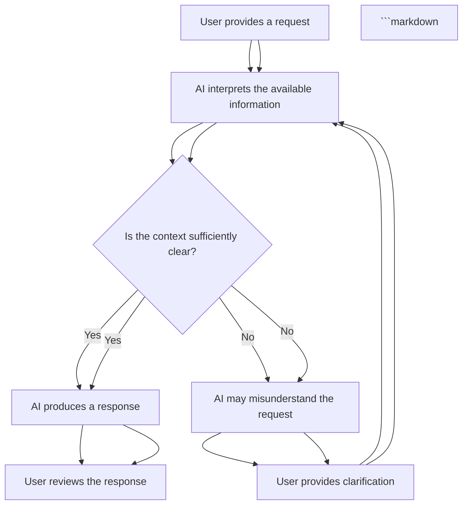
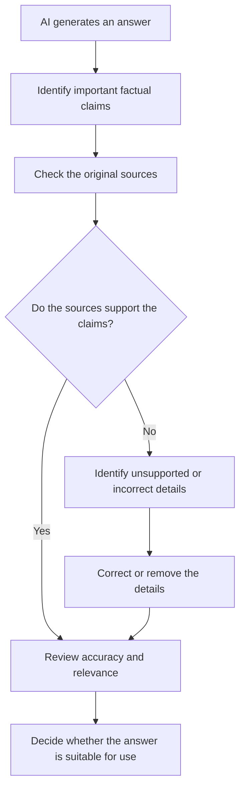
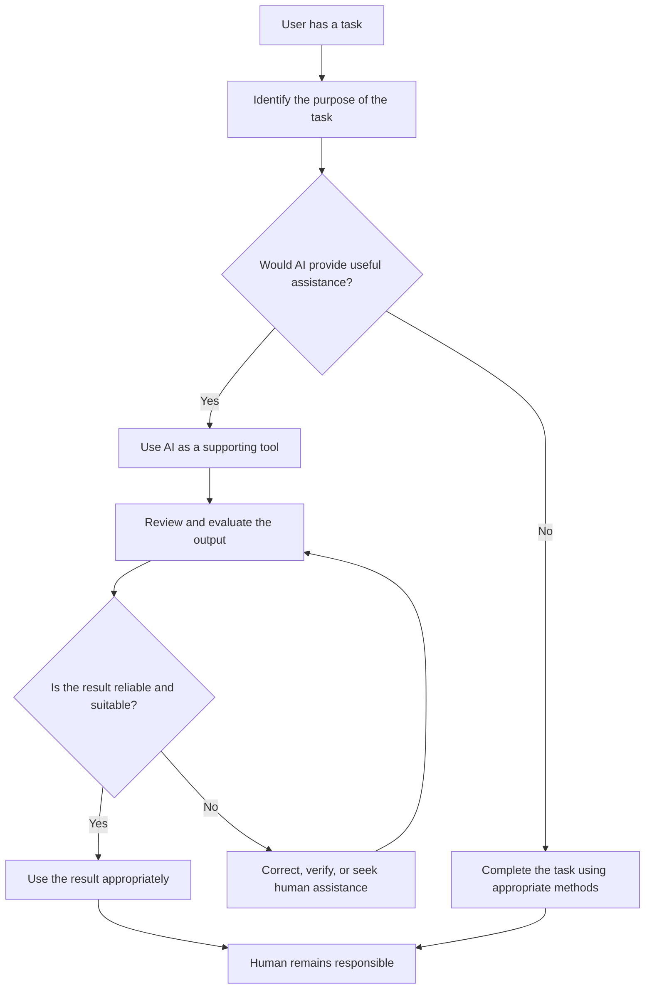
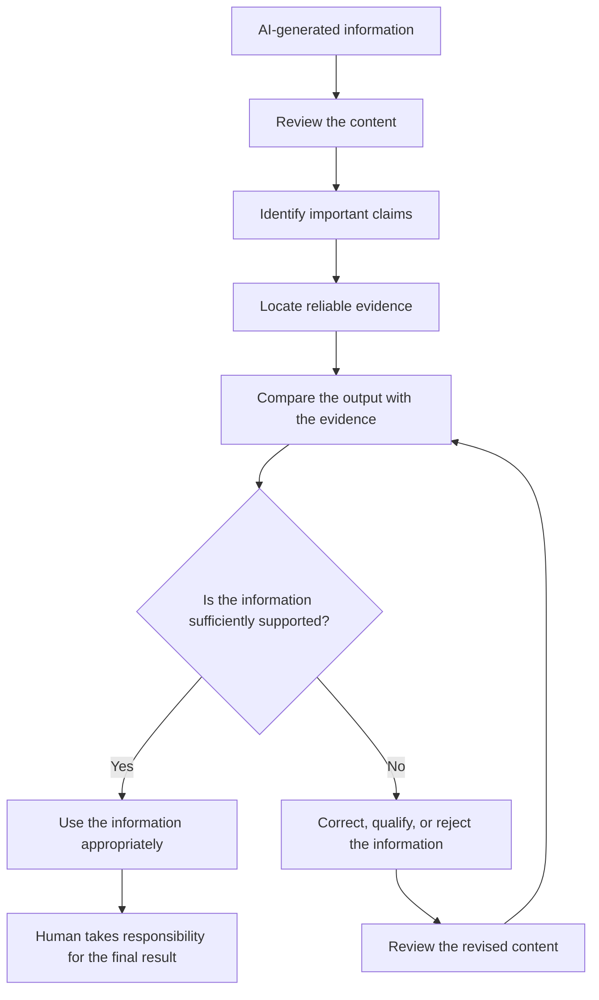

# TOPIC 04 — BENEFITS, LIMITATIONS, AND CHALLENGES OF AI

<p align="center">
  <strong>SLN · AI OVERVIEW</strong><br>
  <em>Understanding the Advantages, Limitations, and Responsible Use of Artificial Intelligence</em>
</p>

---

## CONTENTS

| No. | Section |
|---:|---|
| 01 | [Benefits of Artificial Intelligence](#01--benefits-of-artificial-intelligence) |
| 02 | [Limitations in Understanding Context](#02--limitations-in-understanding-context) |
| 03 | [Inaccurate Outputs and AI Hallucinations](#03--inaccurate-outputs-and-ai-hallucinations) |
| 04 | [Data Quality and Bias](#04--data-quality-and-bias) |
| 05 | [Overdependence on AI](#05--overdependence-on-ai) |
| 06 | [The Importance of Verifying AI-Generated Information](#06--the-importance-of-verifying-ai-generated-information) |

---

# 01 · Benefits of Artificial Intelligence

Artificial intelligence provides several benefits in education, business, healthcare, transportation, communication, and many other areas. It can help people process information, perform repetitive tasks, recognise patterns, and support decisions.

AI is particularly useful when a task involves large amounts of data or repeated activities that would otherwise require significant time and effort. By assisting with these activities, AI can help people focus on tasks that require creativity, judgement, communication, and problem-solving.

However, the benefits of AI depend on how a system is designed and used. A tool may improve efficiency in one situation but produce limited results in another. Organisations and individuals should therefore evaluate whether AI is genuinely useful for a particular purpose.

## 1.1 Improving Efficiency

Efficiency refers to completing a task with less unnecessary time, effort, or resources while maintaining an appropriate level of quality.

AI can improve efficiency by automating selected activities, organising information, and providing faster access to relevant results.

For example, an organisation may use AI to classify thousands of documents. Instead of manually opening and sorting every document, employees can review categories prepared by the system and focus on unusual cases.

In education, AI may help teachers prepare draft questions or organise learning materials. In customer service, chatbots can answer common questions without requiring an employee to respond individually to every routine enquiry.

| Area | Traditional Approach | AI-Supported Approach | Possible Efficiency Benefit |
|---|---|---|---|
| Document management | Manually sorting files | Automatically classifying documents | Reduces repetitive sorting |
| Customer service | Employees answer every routine question | Chatbots handle selected enquiries | Reduces routine workload |
| Education | Teachers prepare every practice question manually | AI assists with draft question generation | Supports preparation |
| Data analysis | Reviewing large datasets manually | AI identifies selected patterns | Speeds up initial analysis |
| Communication | Manually translating every message | Translation tools provide draft translations | Reduces translation effort |
| Administration | Repeated manual data entry | Automated extraction and classification | Reduces repetitive work |

Efficiency does not always mean that a task should be completed as quickly as possible. The result must still be accurate, suitable, and useful.

A system that produces incorrect information quickly may create additional work because people must identify and correct its mistakes.

## 1.2 Supporting Automation

Automation refers to using technology to perform tasks with limited manual involvement.

AI can support automation when a system can analyse information, recognise patterns, or select an appropriate response based on its design.

Traditional automation often follows predefined instructions. AI-supported automation may use machine learning to respond to patterns in data or interpret certain forms of input.

Examples include:

- Sorting incoming customer enquiries.
- Identifying selected information in documents.
- Organising digital records.
- Recommending products or content.
- Supporting routine scheduling.
- Monitoring selected equipment information.
- Generating draft summaries.

| Type of Automation | Example | Human Involvement |
|---|---|---|
| Rule-based automation | Sending a standard confirmation message | Sets and reviews the rules |
| AI-supported classification | Sorting customer enquiries by topic | Handles incorrect classifications |
| Document automation | Extracting information from invoices | Checks extracted details |
| Recommendation automation | Suggesting relevant content | Reviews suitability and settings |
| Predictive automation | Estimating future demand | Interprets predictions |

AI-supported automation can reduce repetitive work, but it does not remove the need for human supervision.

Some situations require flexibility, empathy, professional knowledge, or consideration of unusual circumstances. These responsibilities should not be transferred blindly to an automated system.

## 1.3 Increasing Productivity

Productivity describes how effectively resources such as time, effort, knowledge, and equipment are used to produce useful results.

AI can support productivity by helping people complete certain tasks more efficiently.

For example, a student may use an AI assistant to generate practice questions after studying a topic. The student can then spend more time solving problems and reviewing difficult concepts.

An employee may use AI to prepare a first draft of a routine report and then spend time checking the information and improving the final document.

| Productivity Area | AI Contribution | Human Contribution |
|---|---|---|
| Writing | Produces draft text and suggestions | Reviews and improves the message |
| Research | Helps organise supplied information | Evaluates evidence and sources |
| Programming | Suggests code and explanations | Understands and tests the code |
| Planning | Organises possible activities | Selects realistic priorities |
| Data analysis | Identifies patterns | Interprets their significance |
| Learning | Provides examples and explanations | Practises and develops understanding |

Productivity should not be measured only by the number of tasks completed.

The quality of the result, the amount of correction required, and the effect on people should also be considered.

## 1.4 Supporting Decision-Making

AI can analyse information and identify patterns that may help people make decisions.

For example, a business may use AI to examine historical sales information and estimate future demand. A transport organisation may analyse traffic patterns to identify areas where congestion frequently occurs.

In both cases, AI provides information that supports a decision rather than guaranteeing that a particular decision is correct.

| Decision Area | AI-Supported Analysis | Human Judgement |
|---|---|---|
| Business planning | Estimates demand and identifies trends | Considers business conditions |
| Education | Identifies learning patterns | Understands individual student needs |
| Transportation | Analyses traffic information | Considers current road conditions |
| Healthcare | Organises selected medical information | Applies professional expertise |
| Customer service | Classifies enquiries | Responds to unusual situations |

AI-generated recommendations should be considered alongside other relevant information.

A person must understand the purpose of the decision, examine possible consequences, and consider information that the system may not have received.

## 1.5 Improving Access to Information

AI can make information easier to access by allowing users to interact with digital systems through natural language, speech, translation, or other accessible features.

For example, conversational AI can explain a difficult concept using simpler language. Text-to-speech applications can read written material aloud, while speech-to-text systems can convert spoken words into text.

These features may support people who have different language backgrounds or accessibility needs.

| AI Feature | Accessibility Benefit | Possible Limitation |
|---|---|---|
| Text-to-speech | Reads written information aloud | Pronunciation may be unclear |
| Speech-to-text | Converts speech into text | May misunderstand accents |
| Translation | Supports communication across languages | May lose cultural meaning |
| Automatic captions | Makes audio content easier to follow | Captions may contain errors |
| Conversational assistance | Allows questions in natural language | Responses may be inaccurate |

AI can improve access, but accessibility also depends on device availability, internet access, language support, and suitable interface design.

## 1.6 Supporting Creativity and Innovation

AI can support creative work by helping people explore ideas, produce drafts, and experiment with different approaches.

Generative AI systems can create text, images, audio, and other content based on prompts.

For example, a designer may use an AI tool to explore possible visual concepts before producing a final design. A student may request different ways to organise a presentation and then choose the approach that best communicates the topic.

AI can therefore act as a supporting tool during the creative process.

However, creativity still involves personal ideas, cultural understanding, experience, and decisions about meaning.

Users should review generated content and respect the rights of original creators.

## 1.7 Reducing Repetitive Work

Many activities involve repeated steps that require time but do not always require complex judgement.

AI can help organise or automate some of these activities.

Examples include:

- Classifying documents.
- Preparing draft summaries.
- Organising customer messages.
- Checking selected formatting issues.
- Extracting information from forms.
- Generating routine reports.
- Identifying repeated patterns in records.

Reducing repetitive work may allow people to focus on activities that require more attention.

However, employees should still understand the automated process and know how to identify errors.

## 1.8 Overall Benefits of AI

| Benefit | Explanation | Example |
|---|---|---|
| Efficiency | Reduces unnecessary time and effort | Faster document classification |
| Automation | Performs selected repeated tasks | Sorting routine enquiries |
| Productivity | Helps people complete useful work | Preparing a draft report |
| Decision support | Identifies patterns in information | Analysing sales trends |
| Accessibility | Provides alternative ways to access information | Captions and text-to-speech |
| Creativity | Supports idea development | Exploring visual concepts |
| Information processing | Handles large amounts of data | Analysing customer feedback |
| Personalisation | Adjusts selected services to user needs | Adaptive learning activities |

> **Core Insight:** AI can improve efficiency, automation, productivity, accessibility, and decision support, but its benefits depend on appropriate use, reliable information, and human judgement.

---

# 02 · Limitations in Understanding Context

One important limitation of AI is that it may not understand the full context of a question or situation.

AI systems process information according to their design, training, available data, and instructions. Although some systems can produce responses that appear natural and meaningful, they may misunderstand the intention behind a message.

Human communication often depends on background knowledge, emotions, culture, personal experiences, and circumstances that are not fully expressed in words.

AI may not have access to these details.

## 2.1 Understanding Context

Context refers to the surrounding information that helps explain the meaning of a message, event, or situation.

A sentence may have different meanings depending on where it appears, who says it, and what happened before it.

For example, the statement "That was interesting" may express genuine interest, uncertainty, surprise, or criticism depending on tone and circumstances.

An AI system receiving only the written sentence may not know which meaning is intended.

| Contextual Element | Meaning | Possible AI Difficulty |
|---|---|---|
| Previous conversation | Earlier information related to a message | May not have the complete conversation |
| Tone | The emotional quality of communication | May misinterpret sarcasm or frustration |
| Culture | Social meanings and shared practices | May miss cultural references |
| Personal experience | Individual background and circumstances | May lack relevant personal context |
| Intention | What the speaker wants to communicate | May interpret words too literally |
| Situation | Events surrounding a message | May not know important external details |

Context is especially important when a question involves unclear instructions, personal circumstances, or information that changes over time.

## 2.2 Ambiguous Questions

An ambiguous question is a question that can have more than one possible meaning.

For example:

"Can you explain Java?"

The user might be asking about:

- The Java programming language.
- The Indonesian island of Java.
- Coffee associated with the word Java.
- Another subject using the same name.

Without additional context, an AI system may select the wrong interpretation.

| Question | Possible Interpretations | Why Clarification Helps |
|---|---|---|
| "Explain Java." | Programming, geography, or another meaning | Identifies the intended subject |
| "What is Python?" | Programming language or animal | Establishes the topic |
| "Make it shorter." | Shorten a paragraph, report, or explanation | Identifies the intended content |
| "Is it safe?" | Safety of a product, activity, or process | Identifies what is being evaluated |
| "Compare these." | Compare quality, price, features, or suitability | Establishes comparison criteria |

A useful response should ask for clarification when the missing information significantly changes the answer.

## 2.3 Missing Background Information

AI can only use information available through its input, connected sources, and system capabilities.

If a user asks for advice without providing important details, the system may produce a general answer that does not fit the actual situation.

For example, a student may ask for a study schedule without explaining the subjects, deadlines, or available study time.

The system may produce a reasonable-looking schedule, but it may not be suitable for the student's real circumstances.

This limitation demonstrates why relevant background information matters.

## 2.4 Cultural and Language Differences

Language is influenced by culture, social relationships, and local communication styles.

A phrase that is polite in one language may sound unusual or too direct in another.

AI translation systems may preserve the general meaning while losing some cultural nuance.

For example, greetings, humour, idioms, and informal expressions may not have direct equivalents in another language.

| Language Feature | Example of Difficulty | Possible Result |
|---|---|---|
| Idioms | Expressions with non-literal meanings | Incorrect direct translation |
| Humour | Meaning depends on timing and cultural knowledge | Joke may lose its meaning |
| Sarcasm | Words communicate the opposite of their literal meaning | Incorrect interpretation |
| Formality | Different levels of politeness | Inappropriate tone |
| Local expressions | Regional vocabulary | Confusing translation |
| Cultural references | Depends on shared background knowledge | Missing meaning |

Users should review AI-generated communication when tone, cultural meaning, or professional language is important.

## 2.5 Emotional and Social Understanding

AI may recognise certain words associated with emotions, but this does not mean it experiences emotions in the same way as a human.

A system may identify language that appears frustrated or uncertain and produce a supportive response.

However, it may not fully understand the person's circumstances or the social meaning of the situation.

Human communication often requires empathy, trust, responsibility, and awareness of relationships.

AI should therefore be used carefully in situations that require meaningful emotional support or sensitive personal judgement.

## 2.6 Context Changes Over Time

Some information becomes outdated as circumstances change.

Examples include:

- School schedules.
- Product availability.
- Software features.
- Business policies.
- Travel conditions.
- Public announcements.
- Regulations and institutional procedures.

An AI system may produce an answer based on older information if it does not have access to current sources.

Users should check the date and origin of information when current accuracy matters.

## 2.7 Ways to Reduce Context-Related Errors

Users can improve the quality of AI responses by providing clear and relevant information.

Useful practices include:

1. Explain the purpose of the request.
2. Include relevant background information.
3. Identify the intended audience.
4. Specify the expected format.
5. Explain important limitations.
6. Provide examples when necessary.
7. Ask the system to clarify uncertain details.



Providing additional context can reduce misunderstandings, but it does not guarantee that every response will be correct. AI systems may still interpret information incorrectly or produce incomplete answers.

Users should also avoid sharing unnecessary personal or confidential information when providing context. Only relevant information should be included.

> **Core Insight:** AI may produce responses that appear relevant without fully understanding the circumstances behind a request. Clear instructions, sufficient context, and human review can reduce misunderstandings, but they cannot eliminate every limitation.

---

# 03 · Inaccurate Outputs and AI Hallucinations

AI systems can produce information that is incorrect, incomplete, misleading, or unsupported by reliable evidence.

This is an important limitation because AI-generated responses may appear convincing even when some details are inaccurate.

In particular, generative AI systems can produce statements that sound natural and confident but are not supported by factual information. This behaviour is commonly described as an **AI hallucination**.

Understanding inaccurate outputs is important because people may use AI-generated information for learning, research, communication, professional activities, and decision-making.

## 3.1 Understanding Inaccurate AI Outputs

An inaccurate AI output is a response that contains information that does not correctly represent the facts, the user's request, or the available evidence.

Inaccurate outputs can take different forms.

For example, an AI system may:

- Provide an incorrect explanation of a concept.
- Miscalculate a numerical result.
- Misinterpret a question.
- Present outdated information as current.
- Leave out important details.
- Produce an incorrect translation.
- Generate code containing errors.
- Provide a conclusion that is not supported by the available information.

Not all inaccurate outputs are hallucinations. Some errors occur because the input is unclear, the available data is incomplete, or the system has limitations in processing a particular task.

| Type of Inaccuracy | Explanation | Example |
|---|---|---|
| Factual error | Provides information that is not true | Giving an incorrect historical date |
| Misinterpretation | Understands the request incorrectly | Answering about the wrong subject |
| Calculation error | Produces an incorrect numerical result | Providing an incorrect percentage |
| Outdated information | Uses information that is no longer current | Describing an old software feature |
| Incomplete response | Leaves out important information | Explaining a process without a necessary step |
| Unsupported conclusion | Makes a conclusion without sufficient evidence | Claiming a trend exists based on limited data |
| Incorrect translation | Changes the intended meaning | Translating an idiom literally |

An inaccurate response may contain both correct and incorrect information. Therefore, users should not assume that an entire answer is reliable simply because some parts are correct.

## 3.2 Understanding AI Hallucinations

An AI hallucination occurs when an AI system generates information that appears meaningful or factual but is false, unsupported, or not grounded in the available evidence.

The term is commonly used when discussing generative AI, especially language models.

For example, a language model may produce:

- A research title that does not exist.
- An incorrect quotation attributed to a real author.
- A reference containing inaccurate publication details.
- A description of a feature that a product does not have.
- An explanation containing invented facts.

The response may be grammatically correct and well organised. However, its presentation does not guarantee that the information is true.

This is particularly important when an AI system is asked to provide citations, references, statistics, or detailed factual explanations.

| Situation | Possible Hallucination |
|---|---|
| Academic research | Producing a non-existent academic reference |
| Historical explanation | Describing an event with invented details |
| Scientific information | Presenting an unsupported scientific claim |
| Programming | Suggesting a function or library feature that does not exist |
| Product information | Describing an unavailable product feature |
| Legal information | Giving an incorrect description of a regulation |

AI hallucinations demonstrate that fluent language generation and factual accuracy are different qualities.

## 3.3 Why AI Hallucinations Occur

Generative AI systems produce outputs based on patterns learned during training and information available through their inputs and system capabilities.

A language model does not automatically verify every statement against an authoritative external source before generating a response.

Several factors can contribute to hallucinations.

**1. Limited or incomplete information**

A system may not have sufficient information to answer a question accurately. It may nevertheless generate a response based on patterns that appear relevant.

**2. Ambiguous instructions**

When a question has multiple possible interpretations, the system may select an interpretation that does not match the user's intention.

**3. Gaps in training information**

Training data may not contain sufficient information about a particular subject, event, or specialised topic.

**4. Outdated information**

A system without access to current information may provide details that were previously correct but have since changed.

**5. Statistical language generation**

Language models generate text by estimating likely sequences of tokens. A sequence that is linguistically plausible is not necessarily factually correct.

**6. Requests for highly specific details**

Questions requiring exact dates, quotations, references, statistics, or technical specifications can expose limitations when the system does not have sufficient supporting information.

| Contributing Factor | How It Can Affect the Output |
|---|---|
| Incomplete information | Encourages unsupported assumptions |
| Ambiguous prompts | Produces an answer based on the wrong interpretation |
| Training data limitations | Reduces reliability in less-represented topics |
| Outdated knowledge | Produces information that may no longer be accurate |
| Pattern-based generation | Produces plausible but unsupported statements |
| Highly specific requests | Increases the possibility of invented details |

Hallucinations should not be understood simply as random mistakes. They are connected to how generative systems process information and produce outputs.

## 3.4 The Difference Between Fluent and Accurate Responses

One of the main challenges of generative AI is that the quality of its language does not necessarily reflect the accuracy of its information.

A response may have:

- Clear grammar.
- Professional vocabulary.
- Logical-looking explanations.
- Well-organised paragraphs.
- Confident wording.
- Detailed examples.

However, these characteristics do not independently prove that the response is correct.

For example, an AI-generated explanation may contain a convincing description of a scientific concept while including an incorrect measurement.

A user who focuses only on the writing quality may overlook the factual error.

| Output Characteristic | What It Demonstrates | What It Does Not Guarantee |
|---|---|---|
| Fluent language | The response is grammatically readable | Factual accuracy |
| Detailed explanation | The system provides extensive information | Completeness or correctness |
| Confident tone | The response is presented assertively | Reliability |
| Structured formatting | Information is organised | Valid supporting evidence |
| Technical vocabulary | Specialised terms are used | Correct technical interpretation |
| Citations | Sources are presented | That the sources exist or support the claims |

Users should evaluate the content of an answer rather than judging its reliability based only on its presentation.

## 3.5 The Difference Between Hallucinations and Other AI Errors

Although hallucinations are an important form of inaccurate output, they should be distinguished from other types of system errors.

For example, a system may misunderstand a request because the user did not provide enough context. This is a problem of interpretation rather than necessarily a hallucination.

Similarly, a system may provide an outdated answer because it does not have access to current information.

| Issue | Main Problem | Example |
|---|---|---|
| Hallucination | Generates unsupported or fabricated information | Inventing an academic publication |
| Misinterpretation | Understands the request incorrectly | Explaining the wrong meaning of a term |
| Outdated information | Relies on information that has changed | Providing an old policy |
| Incomplete information | Omits relevant details | Leaving out an important condition |
| Technical error | Produces an incorrect technical result | Suggesting code with an invalid operation |
| Reasoning error | Reaches an incorrect conclusion | Drawing the wrong conclusion from supplied data |

These problems may overlap. For example, an ambiguous request can lead to an incorrect interpretation followed by unsupported details.

Understanding the differences helps users identify what kind of verification or correction is necessary.

## 3.6 The Risks of Inaccurate AI Outputs

Inaccurate information can create problems when users rely on it without checking its reliability.

The possible consequences depend on the subject, the importance of the decision, and the extent to which the information is used.

**Education and academic work**

Students may learn incorrect concepts, include inaccurate information in assignments, or cite sources that do not exist.

**Business and finance**

Organisations may make poor decisions if they rely on incorrect predictions, summaries, or data analysis.

**Healthcare**

Incorrect health-related information may create confusion or lead people to misunderstand important medical information. Professional guidance remains essential.

**Communication**

Incorrect translations or summaries may change the intended meaning of a message.

**Programming and technology**

Incorrect code suggestions may create technical problems, unexpected results, or security weaknesses.

| Area | Possible Consequence | Appropriate Response |
|---|---|---|
| Education | Learning incorrect information | Compare explanations with reliable learning materials |
| Research | Using unsupported claims or references | Check original publications |
| Business | Making decisions based on incorrect analysis | Review data and assumptions |
| Healthcare | Misunderstanding health information | Consult qualified professionals |
| Communication | Sending inaccurate or misleading messages | Review meaning and context |
| Programming | Using code that does not work as intended | Test and inspect the code |

The potential impact of an inaccurate response should determine how carefully it is reviewed.

## 3.7 How to Reduce the Risk of Hallucinations

Users can reduce the risk of relying on inaccurate AI-generated information through careful prompting and verification.

Useful practices include:

1. Provide a clear and specific question.
2. Supply relevant source material when appropriate.
3. Ask the system to distinguish facts from assumptions.
4. Request explanations of how a conclusion was reached.
5. Verify important claims using reliable sources.
6. Check whether cited publications actually exist.
7. Compare important information across independent sources.
8. Avoid treating confident wording as proof of accuracy.
9. Ask the system to identify uncertainty or missing information.
10. Review the final result before using or sharing it.

For example, instead of asking an AI system to provide an academic reference without further instructions, users can request that it work only with publications they have supplied.

Even then, the publication details and the way each source is used should be checked.

## 3.8 A Verification Process for AI-Generated Information

Verification is the process of checking whether information is accurate, relevant, and supported by appropriate evidence.

A simple verification process can help users identify possible errors before relying on an AI-generated response.



The verification process should consider more than whether a source exists. Users should also check whether the source is relevant, trustworthy, current, and accurately represented.

For example, an academic article may exist but may not support the specific statement attributed to it.

## 3.9 The Importance of Human Review

Human review remains important because AI systems can produce inaccurate outputs without clearly indicating every uncertainty.

A human reviewer can consider the purpose of the task, the reliability of the evidence, the consequences of an error, and information outside the system's available context.

Human review is especially important when the output is used for:

- Academic submissions.
- Professional reports.
- Public communication.
- Financial decisions.
- Health-related information.
- Legal or regulatory matters.
- Technical systems that affect other people.

The appropriate level of review should depend on the potential impact of the task.

> **Core Insight:** AI hallucinations occur when systems generate information that appears convincing but is false or unsupported. Fluent language does not guarantee factual accuracy. Important AI-generated information must be checked against reliable evidence and reviewed by people.

---

# 04 · Data Quality and Bias

AI systems depend on data to learn patterns, identify relationships, and generate outputs. The quality and characteristics of that data can strongly influence how well a system performs.

If the data used to develop or operate an AI system is incomplete, inaccurate, outdated, or unrepresentative, the system may produce unreliable results.

Another important challenge is bias. AI bias can occur when data, system design, or decision-making processes produce systematically unfair or unbalanced outcomes.

These issues are important because an AI system may process information consistently while still producing results that reflect problems in the data or its design.

## 4.1 Understanding Data Quality

Data quality refers to how suitable data is for a particular purpose.

High-quality data should contain information that is sufficiently accurate, relevant, complete, consistent, and appropriate for the task.

For example, an AI system developed to classify customer enquiries requires examples that correctly represent the types of enquiries it is expected to process.

If the training data contains many incorrect labels, the system may learn misleading patterns.

Several dimensions are commonly used to evaluate data quality.

| Data Quality Dimension | Explanation | Example of a Problem |
|---|---|---|
| Accuracy | Information correctly represents what it describes | Incorrect customer details |
| Completeness | Important information is present | Missing values in a dataset |
| Consistency | Information follows compatible formats and rules | Different date formats |
| Relevance | Data is appropriate for the intended task | Using unrelated information |
| Timeliness | Data is sufficiently current | Using outdated records |
| Validity | Data follows defined rules and acceptable formats | Invalid numerical values |
| Uniqueness | Unnecessary duplicate records are avoided | Repeated customer entries |

Data quality is not determined by the amount of data alone. A large dataset can still be unsuitable if it contains significant errors or does not represent the intended task.

## 4.2 Why Data Quality Matters in AI

Machine learning systems identify patterns from examples. The information contained in those examples influences what the system learns.

When the training data is reliable and relevant, the system has a stronger foundation for learning useful patterns.

When the data is poor, the system may learn relationships that do not accurately represent the real situation.

For example, imagine a system designed to classify messages into different categories.

If a large proportion of the training examples are labelled incorrectly, the model may learn the wrong associations.

The result may be inaccurate classifications even when the system follows its learned patterns consistently.

| Data Problem | Possible Effect on AI |
|---|---|
| Incorrect records | Learns inaccurate relationships |
| Missing information | Has an incomplete representation of the task |
| Duplicate records | May overemphasise repeated examples |
| Outdated information | Learns patterns that no longer apply |
| Inconsistent formats | Creates difficulties during processing |
| Irrelevant information | May learn patterns unrelated to the intended task |
| Incorrect labels | Learns incorrect target relationships |

This demonstrates why data preparation and quality assessment are important parts of AI development.

## 4.3 Understanding Bias in AI

Bias refers to a systematic tendency that influences how information is represented, interpreted, or used.

In AI, bias may occur when a dataset, model, or decision-making process consistently produces unbalanced outcomes.

Bias is not always caused by a single technical error. It can develop from historical inequalities, limited data representation, unsuitable assumptions, or decisions made during system development.

For example, a system trained using data that represents only a limited group of users may perform less reliably for people whose characteristics are not sufficiently represented.

An AI system may therefore appear effective for one group while producing less suitable results for another.

## 4.4 Common Sources of AI Bias

AI bias can enter a system at different stages of its development and use.

**1. Historical bias**

Historical bias occurs when training data reflects existing inequalities or unfair patterns in society.

A model trained on historical information may reproduce those patterns if they are not identified and addressed.

**2. Representation bias**

Representation bias occurs when certain groups, situations, or characteristics are insufficiently represented in the data.

The system may therefore perform less effectively for underrepresented cases.

**3. Selection bias**

Selection bias occurs when the process used to collect data creates an unbalanced sample.

For example, collecting information only from users of one particular platform may not represent the wider population.

**4. Measurement bias**

Measurement bias occurs when the method used to collect or measure information does not accurately represent the characteristic being studied.

**5. Labelling bias**

Labelling bias occurs when the people or processes assigning categories to training examples make inconsistent or unfair judgements.

**6. Evaluation bias**

Evaluation bias occurs when a system is tested using data or criteria that do not adequately represent the situations in which it will be used.

| Source of Bias | Explanation | Illustrative Example |
|---|---|---|
| Historical bias | Reflects existing inequalities | Historical records contain unequal outcomes |
| Representation bias | Some groups are underrepresented | Training data contains limited demographic diversity |
| Selection bias | Data collection produces an unbalanced sample | Survey responses come from only one user group |
| Measurement bias | Measurement does not accurately represent the intended concept | An unsuitable indicator is used |
| Labelling bias | Categories reflect inconsistent judgement | Similar examples receive different labels |
| Evaluation bias | Testing does not represent real-world conditions | A model is tested on a narrow dataset |

Identifying the source of bias is important because different problems require different approaches.

## 4.5 How Bias Can Affect AI Outputs

Bias can influence AI outputs in ways that affect individuals, organisations, and communities.

For example:

- A recommendation system may repeatedly promote content associated with a narrow set of preferences.
- A language model may reflect stereotypes found in parts of its training data.
- An automated screening system may produce unequal results if its training data contains historical imbalances.
- A classification system may perform less accurately for groups that are not adequately represented.
- An information system may provide less useful results for languages with limited representation.

These examples demonstrate that technical performance and fairness are related but different considerations.

A system can achieve a high overall accuracy score while still performing poorly for a particular group.

## 4.6 The Difference Between Data Quality Problems and Bias

Data quality problems and bias can overlap, but they are not identical.

Data quality focuses on whether information is suitable and reliable for a task.

Bias focuses on systematic patterns that may produce unbalanced or unfair results.

For example, missing values in a dataset represent a data quality problem. If those missing values occur more frequently for a particular group, they may also contribute to unfair outcomes.

| Aspect | Data Quality | AI Bias |
|---|---|---|
| Main concern | Reliability and suitability of data | Systematic imbalance or unfairness |
| Possible cause | Missing, incorrect, or outdated information | Historical patterns, representation, or design decisions |
| Possible effect | Inaccurate or unreliable outputs | Unequal or unfair outcomes |
| Evaluation | Checks completeness, accuracy, consistency, and relevance | Examines outcomes across relevant groups and situations |
| Improvement | Data cleaning and validation | Bias assessment, better representation, and system review |

Both issues should be considered during AI development and evaluation.

## 4.7 Improving Data Quality and Reducing Bias

There is no single method that removes every form of data-related problem or bias.

However, several practices can help improve the reliability and fairness of AI systems.

**Data collection**

- Collect information that is relevant to the intended task.
- Consider whether the dataset represents the situations in which the system will be used.
- Avoid relying on a narrow or unbalanced sample without justification.

**Data preparation**

- Identify missing or incorrect values.
- Remove unnecessary duplicates.
- Standardise formats.
- Check whether labels are consistent.
- Review whether the information is still relevant.

**Model evaluation**

- Test the system using appropriate evaluation data.
- Examine performance across relevant groups and conditions.
- Investigate unusual or unequal outcomes.
- Avoid relying on a single overall performance measure.

**Human oversight**

- Include appropriate human review in important decisions.
- Provide ways to identify and report problems.
- Reassess the system when its use or environment changes.

| Improvement Practice | Purpose |
|---|---|
| Data validation | Identifies incorrect or invalid information |
| Data cleaning | Reduces missing, duplicated, or inconsistent records |
| Representative data collection | Improves coverage of relevant situations |
| Label review | Checks whether categories are assigned consistently |
| Performance testing | Evaluates how well the system performs |
| Group-based evaluation | Identifies differences in performance |
| Human oversight | Supports responsible interpretation and intervention |
| Continuous monitoring | Helps identify problems after deployment |

Improving data quality and reducing bias should be treated as ongoing responsibilities rather than activities that occur only once.

## 4.8 Fairness and the Limits of Technical Solutions

Fairness in AI is not determined only by technical accuracy.

It also involves deciding which outcomes are appropriate, which groups may be affected, and what consequences should be considered.

Different situations may require different definitions of fairness. A method that is suitable for one application may not be appropriate for another.

For example, a recommendation system and a system used to support important institutional decisions do not necessarily require the same evaluation criteria.

Organisations should therefore consider the purpose of the system, the people affected, and the possible consequences of its outputs.

Technical tools can help identify problems, but human judgement and accountability remain necessary.

> **Core Insight:** AI systems depend on the quality and representation of their data. Inaccurate or unbalanced datasets can produce unreliable and potentially unfair outcomes. Data preparation, appropriate evaluation, and human oversight are essential for responsible AI development.

---

# 05 · Overdependence on AI

AI can make many activities easier by providing explanations, generating drafts, organising information, and automating selected tasks.

However, relying on AI too heavily can create problems when users stop checking information, developing their own understanding, or applying independent judgement.

Overdependence occurs when individuals or organisations rely on AI more than is appropriate for a task, especially when they accept its outputs without sufficient review.

AI should support human capabilities rather than replace the responsibility to think, learn, evaluate, and make informed decisions.

## 5.1 Understanding Overdependence on AI

Overdependence on AI occurs when users rely excessively on AI systems to perform tasks or make decisions that require human understanding and responsibility.

Using AI frequently does not automatically mean that someone is overdependent on it.

The important distinction is whether the user can still evaluate the output, understand the task, and take responsibility for the final result.

For example, a student may use AI to obtain additional explanations of a difficult concept. This can support learning.

However, if the student submits AI-generated answers without understanding the subject, the tool may interfere with the development of independent knowledge.

| Appropriate Use | Possible Overdependence |
|---|---|
| Using AI to understand a difficult concept | Accepting explanations without checking them |
| Asking for feedback on a draft | Submitting generated writing without reviewing it |
| Using AI to organise research notes | Relying on AI summaries without reading important sources |
| Requesting programming suggestions | Using code without understanding or testing it |
| Comparing possible solutions | Allowing AI to make every decision automatically |
| Using AI for practice questions | Depending on generated answers instead of practising independently |

The issue is not simply the frequency of AI use. It is whether the user continues to participate actively in the process.

## 5.2 Reduced Critical Thinking

Critical thinking involves analysing information, evaluating evidence, identifying assumptions, and considering whether a conclusion is reasonable.

When users accept AI-generated responses without questioning them, they may have fewer opportunities to practise these skills.

For example, a student who always asks AI to solve problems may receive answers without understanding the steps involved.

The student may complete a task but struggle to explain the reasoning independently.

AI can support critical thinking when it is used to compare ideas, identify weaknesses, and generate questions.

The user must still evaluate the information and decide whether the conclusions are justified.

| Learning Activity | Less Effective Use | More Constructive Use |
|---|---|---|
| Solving problems | Copying the final answer | Asking for an explanation and attempting the problem independently |
| Writing | Submitting generated text directly | Reviewing and improving a draft |
| Research | Accepting a generated summary | Comparing the summary with original sources |
| Decision-making | Following a recommendation automatically | Examining evidence and alternatives |
| Studying | Memorising generated answers | Using explanations to test understanding |

AI should encourage active learning rather than remove the need for intellectual effort.

## 5.3 Reduced Independent Learning

Independent learning involves developing knowledge and skills through personal effort, practice, reflection, and evaluation.

AI can provide useful learning support, but excessive reliance may reduce opportunities to develop these abilities.

For example, a student learning a programming language needs to understand how code works, identify errors, and practise solving problems.

If the student depends entirely on generated code, they may not develop the skills needed to create or debug programs independently.

Similarly, a student learning a new language needs opportunities to practise vocabulary, grammar, listening, and communication rather than relying only on automatic translation.

| Skill | How Overdependence May Affect It | Constructive Use of AI |
|---|---|---|
| Problem-solving | Reduces independent practice | Request hints before asking for a complete solution |
| Writing | Limits personal expression | Use AI for feedback and revision |
| Research | Reduces direct engagement with sources | Use AI to organise questions and research notes |
| Programming | Weakens understanding of code | Study explanations and test code independently |
| Language learning | Reduces active language practice | Use AI for conversation exercises and feedback |
| Decision-making | Encourages passive acceptance | Compare AI suggestions with other evidence |

The purpose of educational AI should be to strengthen learning, not simply to produce completed work.

## 5.4 Automation and the Loss of Human Involvement

Automation can reduce repetitive work, but excessive automation may create situations in which people become less involved in important processes.

If an organisation relies entirely on automated recommendations, employees may become less familiar with how decisions are made.

This can be problematic when a system encounters unusual circumstances or produces an unexpected result.

Human involvement is important because people can consider context, responsibility, values, and consequences that may not be fully represented in the system.

For example, an automated customer service system may correctly classify common enquiries but struggle with unusual complaints that require careful interpretation.

A person should be able to review and handle situations that the automated process cannot resolve appropriately.

## 5.5 Reduced Awareness of AI Limitations

Users who rely heavily on AI may become less attentive to its limitations.

They may assume that the system:

- Always provides correct information.
- Understands every instruction.
- Recognises every relevant circumstance.
- Uses current information.
- Produces unbiased results.
- Can independently verify every claim.
- Can make appropriate decisions in every situation.

These assumptions are not justified.

AI systems have technical, contextual, and data-related limitations. Users should understand those limitations before relying on their outputs.

| Incorrect Assumption | More Accurate Understanding |
|---|---|
| AI is always correct | AI can produce inaccurate information |
| AI understands every situation | Context may be incomplete or misunderstood |
| AI information is always current | Information may be outdated |
| AI is automatically unbiased | Data and design can introduce bias |
| AI recommendations are objective | Outputs may reflect limitations and assumptions |
| AI can replace all human judgement | Important decisions require appropriate human involvement |

Awareness of these limitations helps users maintain a balanced approach to AI.

## 5.6 Overdependence in Education

Education is an area where overdependence on AI requires particular attention.

AI can help students understand lessons, practise questions, organise notes, and receive feedback.

However, students are expected to develop their own knowledge and demonstrate their understanding.

If AI completes every stage of an assignment, the student may lose opportunities to practise research, writing, analysis, and problem-solving.

Teachers may also find it more difficult to evaluate a student's actual understanding when submitted work does not reflect the student's own learning.

Responsible educational use should focus on supporting the learning process.

Examples include:

- Asking AI to explain a difficult topic.
- Generating practice questions.
- Requesting feedback on an independently written paragraph.
- Comparing different explanations.
- Identifying areas that require further study.
- Reviewing concepts before an examination.

The student should remain responsible for understanding and evaluating the material.

## 5.7 Overdependence in the Workplace

AI can support workplace productivity by helping employees organise information, prepare drafts, analyse data, and automate routine tasks.

However, employees may become overly reliant on automated outputs if they stop checking results or understanding the processes involved.

For example, an employee who uses AI-generated reports without checking the underlying data may overlook important errors.

Similarly, an organisation that depends heavily on one automated system may face difficulties when the system becomes unavailable or produces unsuitable results.

Workplaces should therefore maintain appropriate human review, employee knowledge, and alternative procedures.

| Workplace Situation | Possible Risk of Overdependence | Appropriate Practice |
|---|---|---|
| Report preparation | Incorrect details remain unnoticed | Review the original data |
| Customer service | Unusual enquiries receive unsuitable responses | Provide human support |
| Data analysis | Conclusions are accepted without examination | Check methods and assumptions |
| Recruitment support | Automated recommendations are treated as final decisions | Apply appropriate human evaluation |
| Software development | Generated code is used without testing | Review and test the code |
| Administrative work | Employees lose awareness of the underlying process | Maintain process knowledge |

AI adoption should improve work without removing appropriate human responsibility.

## 5.8 Maintaining a Balanced Relationship with AI

A balanced approach means using AI where it provides meaningful assistance while retaining the ability to perform important tasks independently.

Users should understand when AI is useful, when it requires verification, and when a task needs human expertise.

Useful practices include:

1. Attempt a task independently before requesting AI assistance when learning is the main objective.
2. Use AI to explain concepts rather than simply provide final answers.
3. Check important information before using it.
4. Practise skills without depending on automated assistance every time.
5. Compare AI recommendations with other sources.
6. Maintain the ability to complete essential tasks independently.
7. Seek qualified human guidance when a task requires professional judgement.
8. Take responsibility for decisions and final outputs.



The objective is not to avoid AI. It is to use it in ways that preserve human understanding, independence, and responsibility.

> **Core Insight:** Overdependence on AI can weaken critical thinking, independent learning, and human involvement. AI is most useful when it supports people's abilities while allowing them to evaluate information and remain responsible for their work.

---

# 06 · The Importance of Verifying AI-Generated Information

Verification is an essential part of responsible AI use.

AI-generated information may be useful, but it should not automatically be treated as accurate or reliable. Users need to examine the information, check supporting evidence, and consider whether the output is appropriate for its intended purpose.

Verification is especially important when AI is used for academic work, research, professional communication, and decisions that may affect other people.

## 6.1 Understanding Verification

Verification is the process of checking information to determine whether it is accurate, supported by evidence, relevant, and suitable for a particular purpose.

When using AI, verification involves examining both the generated response and the information on which it is based.

For example, if an AI system provides a historical explanation, users should check important dates, events, and claims against reliable historical sources.

If the system produces a research summary, users should compare it with the original publication to ensure that the main findings have been represented correctly.

| Verification Aspect | Main Question | Example |
|---|---|---|
| Accuracy | Is the information correct? | Checking a historical date |
| Evidence | Is the claim supported by a source? | Reviewing an academic publication |
| Relevance | Does the information answer the question? | Checking whether a source addresses the intended topic |
| Timeliness | Is the information current enough? | Checking the latest policy |
| Completeness | Are important details missing? | Reviewing all major conditions |
| Interpretation | Has the source been represented correctly? | Comparing a summary with the original text |

Verification helps users distinguish useful information from unsupported or misleading content.

## 6.2 Why AI-Generated Information Must Be Checked

AI systems can produce inaccurate information for several reasons.

They may misunderstand a request, rely on incomplete information, generate unsupported claims, or provide details that are no longer current.

Because these problems are not always obvious, users should not rely only on how convincing a response appears.

Verification is important because:

- AI may produce factual errors.
- Generated references may contain incorrect details.
- Statistics may be presented without adequate context.
- Summaries may omit important qualifications.
- Information may be outdated.
- Recommendations may not fit the user's circumstances.
- Generated content may contain bias or unsupported assumptions.

Checking the output helps prevent errors from being repeated in assignments, reports, presentations, and other forms of communication.

## 6.3 Identifying Reliable Sources

A reliable source provides information that can be evaluated and supported by appropriate evidence.

The suitability of a source depends on the subject and the purpose of the task.

For academic research, appropriate sources may include peer-reviewed journal articles, academic books, official institutional publications, and recognised research organisations.

For current information, official announcements and updated institutional websites may be more suitable than older publications.

Users should consider several factors when evaluating a source.

| Evaluation Factor | Explanation | Question to Ask |
|---|---|---|
| Authority | The expertise or credibility of the source | Who produced the information? |
| Accuracy | Whether the information is supported by evidence | Can the claims be confirmed? |
| Currency | How recently the information was published or updated | Is it still current? |
| Relevance | Whether the source addresses the intended subject | Does it answer the research question? |
| Purpose | The reason the information was produced | Is it educational, commercial, persuasive, or informational? |
| Transparency | Whether methods and supporting evidence are explained | Can the information be examined? |

A source should not be considered reliable simply because it appears in a professional-looking website or is recommended by an AI system.

## 6.4 Checking AI-Generated References and Citations

References require particular attention because generative AI systems may produce publication details that look realistic but are inaccurate or do not exist.

When AI provides a reference, users should check:

- Whether the publication actually exists.
- Whether the author's name is correct.
- Whether the publication year is accurate.
- Whether the title matches the original work.
- Whether the journal, publisher, or conference details are correct.
- Whether the cited source supports the statement.
- Whether page numbers or other publication details are accurate.

For academic work, users should locate the original publication whenever possible rather than relying only on an AI-generated reference list.

| Reference Element | What Should Be Checked |
|---|---|
| Author | Correct spelling and author order |
| Year | Accurate publication year |
| Title | Exact or correctly represented title |
| Journal or publisher | Correct publication venue |
| Volume and issue | Accurate publication information when applicable |
| Page range | Correct page details when available |
| DOI or URL | Valid identifier or publication link |
| Supporting claim | Whether the source actually supports the statement |

A reference can be real while still being used incorrectly. Verification must therefore examine both the publication details and the claim associated with the source.

## 6.5 Cross-Checking Information

Cross-checking means comparing information with other appropriate sources to determine whether the same claim is supported.

This is particularly useful when a statement is important, controversial, highly specific, or potentially outdated.

For example, if an AI system provides a statistic about education, users can compare it with the original research publication or an official statistical report.

However, using several websites does not automatically guarantee accuracy. Multiple websites may repeat information from the same original source.

Users should consider the independence and quality of the sources being compared.

| Cross-Checking Method | Purpose |
|---|---|
| Compare with academic publications | Checks research-based claims |
| Consult official websites | Confirms institutional information |
| Review original documents | Avoids relying only on summaries |
| Compare independent sources | Identifies agreement or disagreement |
| Check publication dates | Identifies outdated information |
| Examine supporting evidence | Determines whether a claim is justified |

The goal is not simply to find several sources that repeat the same statement. It is to identify evidence that genuinely supports the information.

## 6.6 Checking Numerical Information and Statistics

Numerical information requires careful verification because incorrect calculations or missing context can change the meaning of a result.

AI systems may generate incorrect percentages, totals, averages, or statistical interpretations.

Users should check:

- The original dataset.
- The calculation method.
- The units of measurement.
- The time period covered.
- The sample size.
- The assumptions used.
- Whether the conclusion follows from the data.

For example, a percentage should not be interpreted without considering the total population or sample from which it was calculated.

A statistic may be mathematically correct but misleading if important context is missing.

| Numerical Element | Verification Question |
|---|---|
| Total values | Are the numbers added correctly? |
| Percentages | Is the correct denominator used? |
| Averages | Is the calculation method appropriate? |
| Units | Are measurements expressed consistently? |
| Sample size | Is the dataset sufficiently relevant? |
| Time period | Does the statistic refer to the correct period? |
| Interpretation | Does the conclusion match the numerical evidence? |

Important calculations should be checked independently using appropriate methods or tools.

## 6.7 Verifying Summaries and Paraphrased Information

AI systems can summarise long documents and rewrite information using different wording.

These functions can save time, but summaries may omit important qualifications or change the emphasis of the original material.

A paraphrased statement may also become inaccurate if the original meaning is not preserved.

When checking an AI-generated summary, users should:

1. Compare the summary with the original document.
2. Check whether the main arguments are represented correctly.
3. Identify any missing conditions or limitations.
4. Confirm that important figures and examples are accurate.
5. Check whether the summary introduces claims not found in the source.
6. Ensure that paraphrased statements preserve the original meaning.

For academic work, users should also follow the relevant citation and acknowledgement requirements.

## 6.8 Matching Verification with the Importance of the Task

Not every AI-generated response requires the same level of verification.

A simple brainstorming suggestion may require less formal checking than a factual statement used in a research paper or an important professional decision.

The level of verification should reflect the possible consequences of an error.

| Type of AI Use | Suggested Level of Verification | Reason |
|---|---|---|
| Brainstorming ideas | Basic review | Ideas may be explored and modified |
| Explaining a general concept | Check important factual claims | Explanations may contain errors |
| Academic assignments | Careful source and content verification | Accuracy and academic integrity matter |
| Research summaries | Compare with original publications | Important findings may be omitted |
| Professional reports | Detailed review | Errors may affect organisational decisions |
| Current regulations or policies | Check updated official sources | Information can change |
| Health-related information | Verify with reliable medical sources and qualified professionals | Incorrect information may affect health decisions |

The more significant the possible consequences, the more carefully the output should be evaluated.

## 6.9 Human Responsibility in Verification

AI can assist with checking information, but it should not be treated as the only authority responsible for confirming its own accuracy.

For example, asking one AI system whether another AI-generated statement is correct may provide additional feedback, but it does not independently establish that the statement is true.

Users should consult appropriate evidence and apply their own judgement.

Human responsibility includes:

- Deciding whether an AI-generated result is appropriate.
- Checking important claims and supporting sources.
- Recognising uncertainty and missing information.
- Correcting inaccurate or misleading content.
- Avoiding the distribution of unverified information.
- Taking responsibility for the final work or decision.

In professional and high-impact situations, appropriate expertise and established review procedures may also be necessary.

## 6.10 A Practical Verification Checklist

The following checklist can be used before relying on or sharing AI-generated information.

- [ ] Does the response answer the intended question?
- [ ] Are the main factual claims accurate?
- [ ] Can important claims be supported by reliable sources?
- [ ] Do the cited publications actually exist?
- [ ] Are publication details and quotations correct?
- [ ] Are numerical values and calculations accurate?
- [ ] Is the information sufficiently current?
- [ ] Are important limitations or qualifications included?
- [ ] Does the response contain unsupported assumptions?
- [ ] Is the final result appropriate for its intended purpose?
- [ ] Have relevant privacy and academic integrity requirements been considered?
- [ ] Has a human reviewed the final content?

Not every item applies to every task. Users should select the checks that are relevant to the type of information and its intended use.

## 6.11 The Relationship Between Verification and Responsible AI Use

Verification connects several important principles of responsible AI use.

It supports accuracy by checking whether information is correct.

It supports transparency by encouraging users to examine the evidence behind a claim.

It supports accountability by ensuring that people remain responsible for the information they use.

It also helps reduce the effects of hallucinations, outdated information, and bias.

The NIST AI Risk Management Framework emphasises the importance of managing AI-related risks through organised governance, risk identification, measurement, and management.

These principles reinforce the idea that AI systems should be evaluated throughout their development and use rather than trusted automatically.



Verification should be treated as a normal part of using AI rather than an optional step performed only after an error is discovered.

> **Core Insight:** AI-generated information should be evaluated before it is used or shared. Checking evidence, references, calculations, context, and relevance helps reduce the risk of misinformation. Human judgement and responsibility remain essential throughout the verification process.

---

## TOPIC 04 — KEY TAKEAWAYS

Artificial intelligence offers important benefits, including improved efficiency, automation, productivity, accessibility, decision support, and assistance with creative activities.

However, AI also has limitations and challenges that users need to understand.

Its ability to process information does not mean that it fully understands every context, intention, or human circumstance. Generative AI may also produce inaccurate outputs and hallucinations that appear convincing but are not supported by reliable evidence.

The quality of AI outputs is influenced by the data used to develop and operate the system. Incomplete, inaccurate, or unrepresentative data may reduce reliability and contribute to biased outcomes.

Another important challenge is overdependence. Excessive reliance on AI may weaken independent learning, critical thinking, and human involvement when users accept generated outputs without evaluation.

For these reasons, AI should be used as a supporting tool rather than an unquestioned source of information or decision-making authority.

Responsible use requires users to understand the limitations of AI, verify important information, consider the quality of evidence, and remain accountable for the final result.

| Main Area | Key Understanding |
|---|---|
| Benefits of AI | AI can improve efficiency, automation, productivity, accessibility, and decision support |
| Context limitations | AI may misunderstand intention, background information, culture, and changing circumstances |
| Inaccurate outputs and hallucinations | AI can generate information that appears convincing but is incorrect or unsupported |
| Data quality and bias | Poor or unrepresentative data can affect reliability and fairness |
| Overdependence on AI | Excessive reliance may reduce independent thinking and human involvement |
| Verification | AI-generated information should be checked against reliable evidence |

## Final Core Insight

> **Artificial intelligence is valuable when its capabilities are used appropriately and its limitations are recognised. Effective AI use requires more than obtaining fast or convincing outputs: it requires critical thinking, reliable evidence, human judgement, and responsibility for the final result.**

---

<p align="center">
  <strong>SLN · AI OVERVIEW</strong><br>
  <em>End of Topic 04 — Benefits, Limitations, and Challenges of AI</em>
</p>
```
