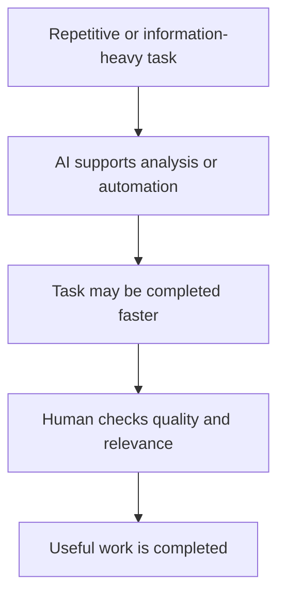
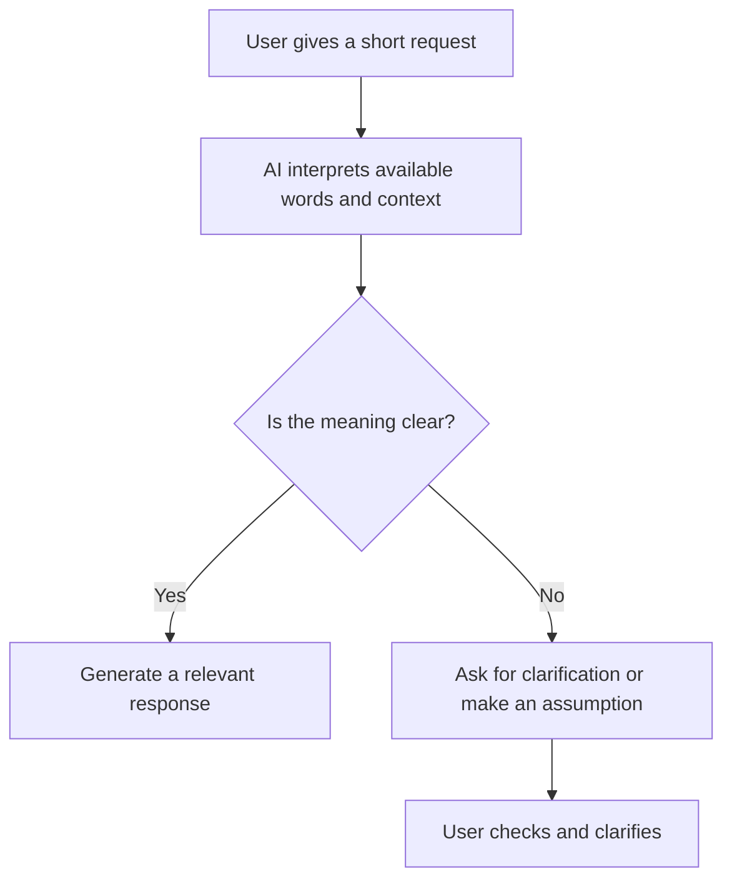
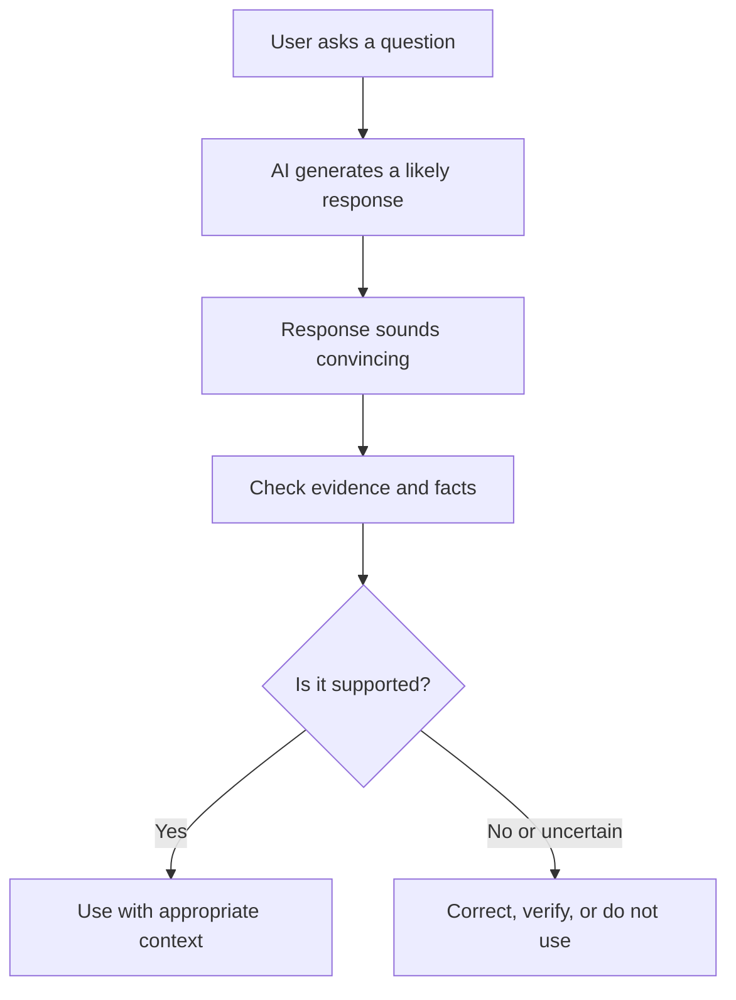
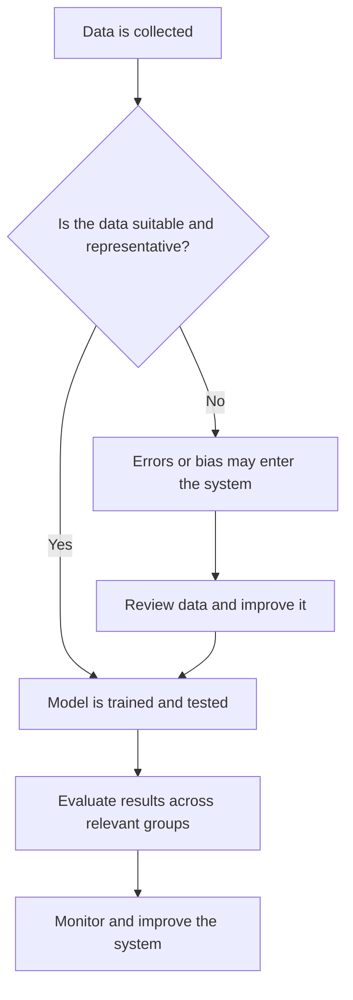
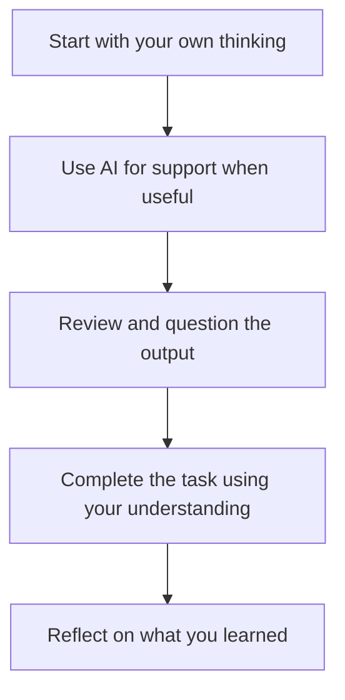
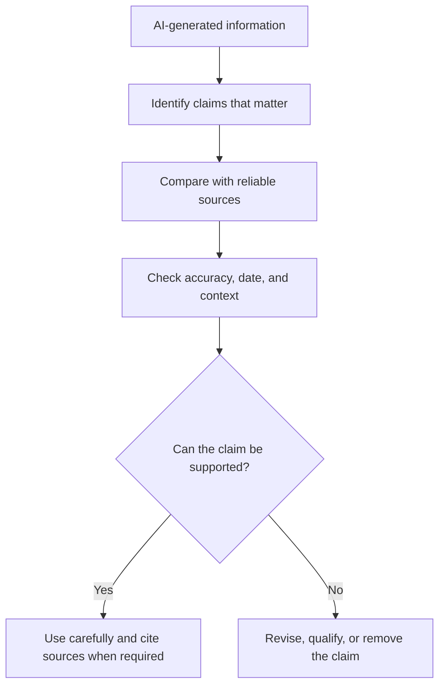

# TOPIC 04 — BENEFITS, LIMITATIONS, AND CHALLENGES OF AI

  <strong>SLN · AI OVERVIEW</strong> 
  <em>Understanding the Strengths, Weaknesses, and Challenges of Artificial Intelligence</em>

---

## CONTENTS

| No. | Section |
|---:|---|
| 01 | [Benefits of AI: Efficiency, Automation, and Productivity](#01--benefits-of-ai-efficiency-automation-and-productivity) |
| 02 | [Limitations in Understanding Context](#02--limitations-in-understanding-context) |
| 03 | [Inaccurate Outputs and AI Hallucinations](#03--inaccurate-outputs-and-ai-hallucinations) |
| 04 | [Data Quality and Bias](#04--data-quality-and-bias) |
| 05 | [Overdependence on AI](#05--overdependence-on-ai) |
| 06 | [The Importance of Verifying AI-Generated Information](#06--the-importance-of-verifying-ai-generated-information) |

---

# 01 · Benefits of AI: Efficiency, Automation, and Productivity

Artificial intelligence can help people and organisations complete some tasks more efficiently. It can process information, identify patterns, generate suggestions, and automate repetitive activities. These benefits are most useful when a task is suitable for automation and the system is properly checked.

### Efficiency

Efficiency means using time and resources effectively. AI can quickly sort large amounts of information, search for patterns, and prepare summaries. For example, an organisation may use AI to group customer messages by topic so staff can respond to common questions more easily.

### Automation

Automation means that a system performs a task, or part of a task, with limited manual input. AI-supported automation can handle repetitive activities such as sorting documents, classifying emails, or checking data for missing fields. Automation does not mean that every process should be fully independent. People may need to review exceptions and important outcomes.

### Productivity

Productivity is the amount of useful work completed with available resources. AI may help a person create an initial outline, organise notes, or generate ideas. The person still needs to check the content, improve it, and make sure it meets the task's requirements.

| Benefit | Explanation | Example |
|---|---|---|
| Efficiency | Processes information quickly | Sorting many support requests |
| Automation | Handles repetitive steps | Classifying incoming emails |
| Productivity | Supports more focused work | Preparing a first draft outline |
| Availability | Some services operate outside office hours | Basic chatbot support |

AI does not automatically improve productivity in every situation. Setting up a system, correcting its errors, protecting data, and training users all require time and resources. The best result comes when AI supports a clear process rather than being added without a purpose.

> **Core Insight:** AI can improve efficiency and productivity when it handles suitable tasks and people remain responsible for the quality of the result.

---

# 02 · Limitations in Understanding Context

AI systems can recognise patterns in information, but they do not always understand meaning in the same way people do. A system may produce a fluent answer while missing the situation, intention, background knowledge, or emotional meaning behind a request.

### What is context?

Context is the information surrounding a message or situation that helps explain what it means. It can include the topic, previous conversation, culture, tone, location, purpose, and details that are not directly stated.

For example, the word “bank” can refer to a financial institution or the side of a river. A system needs enough surrounding information to select the intended meaning. If the context is unclear, it may choose the wrong interpretation.

### Common context limitations

- **Ambiguous language:** A question may have more than one possible meaning.
- **Missing background information:** The user may assume the system knows details that were never provided.
- **Cultural differences:** Expressions, humour, and social expectations can vary between communities.
- **Tone and emotion:** A system may misread sarcasm, frustration, or a sensitive situation.
- **Changing circumstances:** Information that was correct earlier may no longer be current.

### Example

A user writes, “Can you make this lighter?” Depending on the context, “lighter” could mean a brighter colour, a lower file size, a less serious tone, or less physical weight. A useful system may ask what the user means, but it may also make an incorrect assumption.

### How to reduce misunderstandings

Give the AI enough relevant background, explain the intended audience and purpose, and specify the desired format. If the answer seems unrelated, correct the misunderstanding rather than accepting the first response.

> **Core Insight:** A fluent answer does not prove that an AI system has understood the full context. Clear instructions and human review help reduce misunderstandings.

---

# 03 · Inaccurate Outputs and AI Hallucinations

AI-generated information is not always correct. A system may produce an answer that sounds confident but contains false facts, incorrect calculations, invented details, or sources that do not support the claim. This is often called an **AI hallucination**.

### What is an AI hallucination?

An AI hallucination happens when an AI system generates information that appears reasonable but is inaccurate or unsupported. In generative AI, the system produces text based on patterns learned from data and the current prompt. It does not automatically verify every statement against reliable evidence.

### Examples of inaccurate output

- Giving a date, name, or statistic incorrectly.
- Describing a real event with details that did not happen.
- Providing a calculation with an arithmetic error.
- Presenting an outdated rule as if it were current.
- Creating a reference or quotation that cannot be found.
- Misinterpreting a question and answering a different one.

### Why can hallucinations happen?

The system may receive incomplete or unclear instructions, lack relevant information, rely on patterns that do not fit the question, or generate a plausible continuation without checking the claim. Some questions also ask for information that is uncertain or unavailable.

### Why this matters

Inaccurate information can cause confusion, poor decisions, and the spread of misinformation. The risk is higher when the subject is important, such as health, law, finance, safety, or academic work. In these areas, users should rely on qualified people and trustworthy sources rather than treating an AI answer as final authority.

> **Core Insight:** AI can generate convincing but incorrect information. Confidence and fluent writing are not proof of accuracy.

---

# 04 · Data Quality and Bias

AI systems often learn patterns from data. The quality and balance of that data can strongly affect the system's output. If data is incomplete, outdated, inaccurate, or unrepresentative, the system may produce unreliable results.

### What is data quality?

Data quality describes how suitable information is for a particular purpose. Useful data should be accurate, relevant, sufficiently complete, consistent, and appropriately updated. A large dataset is not automatically a good dataset.

### What is bias?

Bias occurs when information or a process systematically favours or disadvantages certain people, groups, or outcomes. AI bias may come from historical inequalities, unbalanced training data, decisions made during system design, or the way results are used.

### Examples

- A recruitment tool trained on historical hiring data may repeat patterns that disadvantaged some applicants.
- A facial recognition system may perform differently across groups if its training data did not represent them adequately.
- A recommendation system may repeatedly promote one type of content because its data or design favours that pattern.
- A dataset with missing records may produce an incomplete picture of a situation.

### Reducing data-related problems

Organisations should examine where data comes from, whether it is current, whose experiences are missing, and whether the system performs fairly across relevant groups. Testing should continue after deployment because data and circumstances can change.

| Data problem | Possible effect | Useful response |
|---|---|---|
| Incomplete data | Missing patterns | Collect suitable additional data |
| Outdated data | Old assumptions | Review and update datasets |
| Unrepresentative data | Unequal performance | Improve representation and testing |
| Incorrect labels | Wrong learning signals | Check and correct annotations |

> **Core Insight:** AI output depends partly on the data used to build and operate the system. Better data and ongoing evaluation can reduce—but may not completely remove—bias and error.

---

# 05 · Overdependence on AI

Overdependence on AI happens when people rely on AI tools too much or accept their output without enough independent thinking. AI can be useful, but depending on it for every task may weaken a person's ability to practise skills, evaluate information, and make decisions.

### Possible effects

- **Reduced independent thinking:** A person may accept generated answers instead of considering the problem.
- **Less skill practice:** Always using AI to write, calculate, or solve tasks may reduce opportunities to develop those skills.
- **Lower attention to accuracy:** Users may stop checking whether an answer is correct.
- **Loss of personal voice:** Writing or creative work may become less personal if generated content is used without meaningful editing.
- **Poor decisions:** Users may follow an unsuitable suggestion without considering their own circumstances.

### Example in education

A student can use AI to explain a difficult concept or generate practice questions. However, if the student submits generated work without understanding it, the tool has replaced the learning process instead of supporting it.

### Keeping a healthy balance

Users can try a problem independently first, ask AI for hints or explanations, and then complete a similar task without assistance. This approach uses AI as a support tool while preserving independent skills.

> **Core Insight:** AI should strengthen human abilities, not become a replacement for learning, judgement, and personal responsibility.

---

# 06 · The Importance of Verifying AI-Generated Information

Verification means checking whether information is accurate, current, relevant, and supported by trustworthy evidence. It is an essential step whenever AI is used to produce explanations, summaries, calculations, recommendations, or written content.

### A practical verification process

1. **Identify important claims.** Separate facts, opinions, estimates, and recommendations.
2. **Check reliable sources.** Compare important claims with textbooks, official websites, academic materials, or recognised organisations.
3. **Check dates and context.** Make sure the information applies to the correct time, place, and situation.
4. **Review numbers and calculations.** Recalculate important results or use an appropriate independent method.
5. **Check quotations and references.** Confirm that a source exists and actually supports the statement.
6. **Correct or remove unsupported claims.** Do not keep information simply because it sounds convincing.

### Example

If an AI tool states that a particular technology was invented in a certain year, the user should check that date against a reliable historical or institutional source. If sources disagree, the user should explain the uncertainty rather than presenting one answer as unquestionably correct.

### When verification is especially important

Verification is important for academic assignments, public communication, current events, statistics, technical instructions, and any decision that may affect people's wellbeing or rights. The higher the possible impact of an error, the more careful the checking should be.

> **Core Insight:** AI-generated content should be treated as a starting point, not automatic evidence. Verification turns a possible answer into information that can be used more responsibly.

---

  <strong>SLN · AI OVERVIEW</strong> 
  Topic 04 — Benefits, Limitations, And Challenges Of Ai

