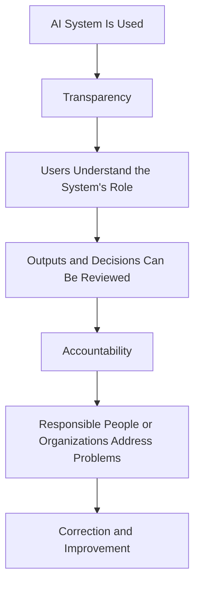
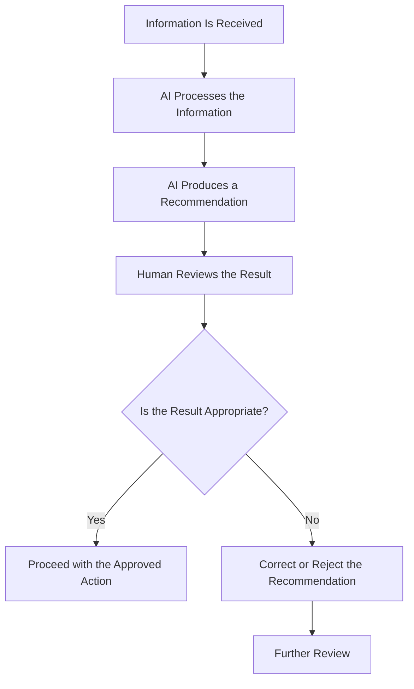
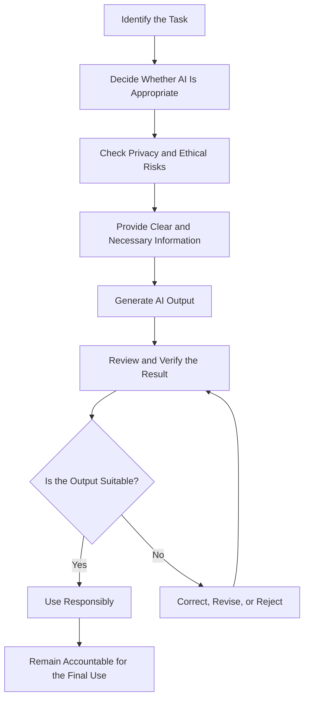

# TOPIC 05 — ETHICAL AND RESPONSIBLE USE OF AI

  <strong>SLN · AI OVERVIEW</strong> 
  <em>Understanding Privacy, Fairness, Transparency, Academic Integrity, and Human Responsibility</em>

---

## CONTENTS

1. [Privacy and Data Protection](#01--privacy-and-data-protection)
2. [Fairness and Bias](#02--fairness-and-bias)
3. [Transparency and Accountability](#03--transparency-and-accountability)
4. [Academic Integrity](#04--academic-integrity)
5. [Human Judgment and Oversight](#05--human-judgment-and-oversight)
6. [Responsible AI Use and Verification of AI-Generated Content](#06--responsible-ai-use-and-verification-of-ai-generated-content)

---

# 01 · PRIVACY AND DATA PROTECTION

## 1.1 Understanding AI Ethics

Artificial Intelligence is increasingly used to process information, support decisions, and generate content. As AI becomes more common, questions arise about how the technology should be designed and used.

AI ethics refers to the principles and values that guide the responsible development and use of AI systems.

Ethical AI use considers how technology affects individuals, communities, organizations, and society.

It involves more than asking whether an AI system can perform a task. It also requires considering whether the system should perform that task, how information is handled, who may be affected, and who is responsible for the result.

Important ethical considerations include:

- Privacy and data protection.
- Fairness and non-discrimination.
- Transparency.
- Accountability.
- Human judgment.
- Safety and reliability.
- Responsible use of generated information.

These principles help ensure that AI is used in ways that respect people's rights and support beneficial outcomes.

## 1.2 What Is Privacy?

Privacy refers to an individual's ability to maintain appropriate control over personal information and how it is collected, used, stored, and shared.

Personal information may include:

- Full names.
- Email addresses.
- Phone numbers.
- Home addresses.
- Identification details.
- Personal photographs.
- Financial information.
- Educational records.
- Location information.
- Health-related information.

Some information may seem ordinary when considered separately but can become sensitive when combined with other details.

For example, a name combined with an address and school information may reveal more about a person than intended.

AI systems may process personal information when users submit prompts, upload documents, provide images, or interact with connected services.

Users should therefore understand what information they are sharing and whether it is necessary for the task.

## 1.3 Why Privacy Matters in AI

Privacy is important because AI systems may process large amounts of information.

Depending on the service and its settings, information may be stored, reviewed, processed, or used according to the provider's policies.

If personal information is handled carelessly, individuals may face risks such as unwanted disclosure, misuse, unauthorized access, or loss of control over their information.

Privacy protection is especially important when AI is used in:

- Education.
- Healthcare.
- Banking and finance.
- Employment.
- Government services.
- Communication platforms.
- Personal digital assistants.

For example, a student may upload a document containing personal details without realizing that the document includes information that is not needed for the task.

A safer approach is to remove unnecessary personal information before using an AI tool.

## 1.4 Types of Data Used by AI Systems

AI systems may process different types of data.

| Data Type | Example | Privacy Consideration |
|---|---|---|
| Personal data | Name or email address | May identify an individual |
| Location data | Current or previous location | May reveal movement patterns |
| Educational data | Grades or learning records | May reveal academic performance |
| Financial data | Transaction information | May contain sensitive financial details |
| Health data | Medical records | Requires particularly careful handling |
| Biometric data | Facial or voice information | May be linked to personal identity |
| Communication data | Messages and conversations | May contain private information |

The level of protection required depends on the type of information and the applicable rules.

## 1.5 Data Collection and Consent

Data collection refers to obtaining information for a particular purpose.

Consent means that a person gives permission for information to be collected or used under appropriate conditions.

Ethical data practices should explain:

- What information is being collected.
- Why the information is needed.
- How it will be used.
- Whether it will be shared.
- How long it may be retained.
- What choices are available to the individual.

People should not be encouraged to share personal information without understanding the purpose and relevant conditions.

Organizations should also avoid collecting information that is unnecessary for the intended task.

## 1.6 Data Minimization

Data minimization is the practice of collecting or sharing only the information needed for a specific purpose.

This principle can reduce unnecessary exposure of personal information.

For example, if a user wants an AI tool to improve the grammar of a paragraph, the system usually does not need the user's full name, home address, or identification number.

The user can provide only the paragraph that requires editing.

Other examples include:

- Removing names from sample documents.
- Hiding account numbers in screenshots.
- Using general descriptions instead of personal details.
- Avoiding unnecessary uploads.
- Sharing only the relevant section of a document.

Data minimization is a practical way to reduce privacy risks.

## 1.7 Protecting Personal Information When Using AI

Users can follow several practices to protect their information.

**Avoid unnecessary personal details.** Do not include private information when it is not needed.

**Review uploaded files.** Check documents and images before sharing them with an AI service.

**Understand privacy settings.** Read the service's privacy information and available data controls.

**Use trusted services.** Choose tools with clear policies and appropriate security practices.

**Be careful with sensitive information.** Avoid entering confidential details into tools unless their use is authorized and suitable.

**Check sharing permissions.** Make sure that documents or generated content are not publicly accessible unintentionally.

These practices do not guarantee complete privacy, but they help reduce unnecessary exposure.

## 1.8 Data Security and AI

Data security refers to protecting information against unauthorized access, alteration, loss, or disclosure.

AI systems and the organizations operating them should use suitable security practices.

Examples of security measures may include:

- Access controls.
- Encryption.
- Secure storage.
- Authentication.
- Monitoring.
- Regular security updates.
- Appropriate data retention policies.

Security is important because AI systems may be connected to databases, applications, and other digital services.

If an organization does not protect these systems properly, information may become vulnerable.

## 1.9 Privacy Risks in AI Applications

Different AI applications may create different privacy concerns.

### Education

Learning platforms may process student information, assignment records, and performance data.

Schools should consider whether the information is necessary and how access is controlled.

### Healthcare

Healthcare-related AI may process sensitive medical information.

Such systems require strong privacy protections and appropriate professional oversight.

### Business

Customer-service and business systems may process contact details, purchasing records, and communication histories.

Organizations should ensure that information is handled according to relevant policies.

### Social Media

Recommendation systems may use activity and interaction data to personalize content.

Users should understand available privacy controls and how their information may be used.

## 1.10 Responsible Handling of Uploaded Information

Before uploading a document or image to an AI tool, users should ask:

1. Does the file contain personal information?
2. Is all of the information necessary?
3. Am I allowed to share this information?
4. Do I understand the service's relevant privacy conditions?
5. Can I remove unnecessary details?
6. Is the selected AI tool appropriate for this material?

This simple review can prevent many avoidable privacy problems.

## 1.11 Privacy as a Shared Responsibility

Privacy protection is not only the responsibility of AI developers.

Users should make careful choices about what they share. Organizations should establish suitable policies. Developers should design systems with privacy protections.

Responsible AI requires cooperation between these groups.

> **Core Insight:** Protecting privacy means understanding what information is shared, why it is needed, and how it may be handled. Users should share only what is necessary and appropriate.

---

# 02 · FAIRNESS AND BIAS

## 2.1 Understanding Fairness in AI

Fairness refers to treating people appropriately and avoiding unjustified discrimination or disadvantage.

In AI, fairness means evaluating whether a system produces acceptable outcomes for different individuals and groups.

AI systems may influence recommendations, classifications, rankings, predictions, and decisions.

If a system consistently disadvantages certain groups, its use may create unfair outcomes.

For example, an AI-supported recruitment system may evaluate applicants using historical employment data. If that data reflects unequal opportunities, the system may reproduce those patterns.

Fairness is therefore an important part of responsible AI development.

## 2.2 What Is Bias in AI?

Bias occurs when an AI system produces systematic patterns that favor or disadvantage particular groups, characteristics, or situations.

Bias may result from:

- Historical data.
- Unrepresentative training datasets.
- Inaccurate labels.
- Design assumptions.
- Measurement methods.
- Unequal data collection.
- Inappropriate evaluation methods.

Bias may be intentional or unintentional.

Even when developers do not intend to create unfair outcomes, their choices and the available data may still influence system behavior.

## 2.3 How Bias Enters AI Systems

Bias can enter an AI system at different stages.

### A. Data Collection

If data is collected from only a limited group or environment, the system may not represent the wider population.

### B. Data Labeling

Human decisions during labeling may contain assumptions or inconsistencies.

### C. Model Development

Developers choose objectives, features, and methods that influence how a system behaves.

### D. Testing and Evaluation

A system may appear accurate overall while performing poorly for certain groups.

### E. Deployment

The environment in which an AI system is used may differ from the conditions represented in its training data.

### F. Ongoing Use

Changes in users, behavior, and circumstances may affect performance over time.

## 2.4 Examples of Unfair AI Outcomes

| Application | Possible Problem | Ethical Concern |
|---|---|---|
| Recruitment | Some applicants receive systematically lower scores | Unequal employment opportunities |
| Education | Recommendations do not suit certain learners | Unequal learning support |
| Language systems | Some dialects are interpreted less accurately | Unequal communication quality |
| Image recognition | Performance varies across demographic groups | Unequal system reliability |
| Financial services | Predictions reflect historical inequalities | Unfair access to services |

These examples show why AI systems should be tested in the situations where they will actually be used.

## 2.5 Fairness Does Not Always Mean Identical Treatment

Treating everyone identically does not always produce fair outcomes.

Different users may have different needs, circumstances, and levels of access.

For example, an educational platform may need accessibility features to support students with different learning requirements.

Fairness may require considering these differences rather than assuming that one approach works equally well for everyone.

However, decisions about fairness should be based on appropriate evidence, relevant rules, and the purpose of the system.

## 2.6 Representation in Training Data

Representation refers to whether a dataset adequately includes the groups, environments, and conditions that an AI system is expected to encounter.

A dataset with limited representation may cause uneven performance.

For example, a speech-recognition system trained primarily on one accent may perform less accurately for speakers with other accents.

Similarly, an image-recognition system trained using a narrow range of lighting and environments may struggle under different conditions.

Improving representation can help, but it must be combined with suitable data quality and evaluation.

## 2.7 Evaluating Fairness

Fairness evaluation examines whether an AI system performs appropriately across relevant groups and conditions.

Organizations may examine:

- Accuracy across different groups.
- Error rates.
- False positive and false negative rates.
- Differences in access.
- Differences in recommendations.
- The consequences of incorrect decisions.

A system should not be evaluated only by its overall accuracy if that number hides important differences.

Fairness is also context-dependent. The appropriate evaluation method depends on the purpose, users, and possible consequences of the system.

## 2.8 Reducing Bias and Improving Fairness

Organizations can reduce bias through several actions:

1. Review the origin of training data.
2. Improve representation where appropriate.
3. Examine data labels and measurement methods.
4. Test performance across relevant groups.
5. Include diverse expertise in development.
6. Review outcomes after deployment.
7. Provide ways to report unfair results.
8. Correct problems when they are identified.

These practices require ongoing attention.

## 2.9 Human Review and Fair Outcomes

Human review is important when AI systems influence decisions that affect people.

A human reviewer can consider circumstances that may not be represented in the data.

For example, an AI-supported system may classify an application as unsuitable based on available information. A human reviewer may identify missing details or circumstances that require additional consideration.

Human review should be meaningful rather than simply approving every automated result.

Reviewers need sufficient information, authority, and time to question an AI recommendation.

## 2.10 Fairness and Social Responsibility

AI systems operate within society and may influence access to opportunities, services, and information.

Organizations should consider whether their systems could reinforce existing inequalities.

Responsible development involves examining not only whether a system functions correctly but also who benefits, who may be disadvantaged, and what can be done to reduce unfair effects.

> **Core Insight:** AI is not automatically fair or objective. Fairness requires representative data, careful evaluation, human review, and continuous improvement.

---

# 03 · TRANSPARENCY AND ACCOUNTABILITY

## 3.1 Understanding Transparency in AI

Transparency refers to providing understandable information about how an AI system is used, what it is intended to do, and what limitations it may have.

Transparency helps users understand the role of AI in a process.

For example, an organization using an AI system to assist with customer service should make it clear when users are interacting with an automated system rather than a human representative.

Transparency is important because people should not be misled about how decisions or content are produced.

## 3.2 Why Transparency Matters

Without transparency, users may not understand:

- Whether AI is being used.
- What the system is designed to do.
- What information it processes.
- What its limitations are.
- Whether a human reviews its output.
- How to report a problem.
- Who is responsible for the result.

Clear information can help users make informed decisions about whether to trust or use an AI service.

## 3.3 Explaining AI Capabilities and Limitations

AI providers and organizations should communicate what their systems can and cannot do.

For example, a generative AI tool may be able to produce summaries and explanations, but it may also generate inaccurate information.

A transparent explanation should not present the system as completely reliable.

Users should understand that:

- Outputs may contain errors.
- Results depend on available information.
- Performance may vary by task.
- Some decisions require human judgment.
- Important information should be verified.

This helps prevent unrealistic expectations.

## 3.4 Explainability

Explainability refers to the ability to provide understandable reasons or explanations about an AI system's outputs or behavior.

Some AI systems are easier to explain than others.

For example, a simple rule-based system may provide a direct explanation because it follows clearly defined rules.

A complex machine-learning model may be more difficult to interpret because its behavior depends on many learned relationships.

Explainability is important when users need to understand why a system produced a particular result.

In high-impact settings, explanations can help people question decisions, identify errors, and determine whether further review is needed.

## 3.5 Transparency in AI-Generated Content

AI-generated content should be presented honestly.

If a person uses AI to create text, images, or other materials, they should follow relevant disclosure requirements.

For example:

- A school may require students to disclose AI assistance.
- A workplace may require employees to identify AI-generated material in reports.
- A publisher may have rules about AI-assisted content.
- An organization may need to inform customers when they are interacting with an AI system.

Disclosure requirements vary depending on the institution, service, and context.

The important principle is that users should not misrepresent how content or decisions were produced.

## 3.6 Understanding Accountability

Accountability means being responsible for actions, decisions, and their consequences.

In AI, accountability concerns who is responsible when a system produces an incorrect, harmful, or unfair result.

AI systems do not remove human or organizational responsibility.

Developers are responsible for appropriate system design and testing. Organizations are responsible for how systems are implemented. Users are responsible for how they apply generated information within their roles.

The exact responsibilities depend on the situation and applicable rules.

## 3.7 Who Is Responsible for AI Outcomes?

Responsibility may be shared among several groups.

| Group | Main Responsibility |
|---|---|
| Developers | Design, test, and improve AI systems |
| Organizations | Select, manage, and monitor AI applications |
| Users | Apply AI outputs carefully and follow relevant rules |
| Human reviewers | Examine important outputs and decisions |
| Institutions | Establish appropriate policies and procedures |

Shared responsibility does not mean that no one is accountable. Each group should understand its role.

## 3.8 Accountability in Decision-Making

When AI supports a decision, organizations should identify who has authority to review and approve the result.

For example, if an AI system assists with evaluating applications, an organization should establish whether the result is advisory or whether it influences an automated process.

It should also provide appropriate ways to examine errors or challenge decisions.

A process should not rely on the statement that "the computer decided" as a complete explanation of responsibility.

## 3.9 Documentation and Record-Keeping

Documentation helps organizations understand how AI systems are developed and used.

Useful documentation may include:

- The system's intended purpose.
- The types of data used.
- Known limitations.
- Testing results.
- Human review procedures.
- Changes made to the system.
- Procedures for reporting problems.

Record-keeping can support evaluation, investigation, and improvement.

It can also help organizations identify whether a system is being used outside its intended purpose.

## 3.10 Transparency and Accountability Together

Transparency and accountability are closely related.

Transparency helps people understand how AI is being used. Accountability establishes who is responsible for the system and its outcomes.

A transparent system without accountability may explain its behavior but fail to address problems.

An accountable process without transparency may make it difficult for people to understand what happened.

Both principles are necessary for responsible AI use.

## 3.11 Challenges in Achieving Transparency

Transparency can be difficult when systems are technically complex or involve confidential information.

Organizations may need to balance explanation, privacy, security, and intellectual property considerations.

However, complexity should not be used as a reason to provide no meaningful information.

Users should receive explanations that are appropriate for the system's purpose and the consequences of its use.

## 3.12 Building Trust Through Transparency

Trust should be based on reliable performance, clear communication, and responsible behavior.

Organizations can support trust by:

- Explaining when AI is used.
- Communicating known limitations.
- Providing meaningful explanations.
- Establishing human review.
- Making reporting processes available.
- Correcting identified problems.

Trust should not depend only on promotional claims or the appearance of advanced technology.

> **Core Insight:** Transparency helps people understand AI, while accountability ensures that responsible people and organizations address its outcomes.

---

# 04 · ACADEMIC INTEGRITY

## 4.1 Understanding Academic Integrity

Academic integrity refers to the principles of honesty, fairness, responsibility, and respect in learning and academic work.

Students are expected to represent their knowledge and work honestly.

Academic integrity includes:

- Completing work honestly.
- Acknowledging sources.
- Avoiding plagiarism.
- Following assignment instructions.
- Respecting examination rules.
- Representing contributions accurately.
- Taking responsibility for submitted work.

AI tools create new opportunities for learning, but they also create questions about originality, authorship, and acceptable assistance.

## 4.2 AI in Education

AI tools can support educational activities in several ways.

Students may use AI to:

- Explain difficult concepts.
- Generate practice questions.
- Organize study notes.
- Check grammar.
- Translate unfamiliar terms.
- Suggest presentation structures.
- Receive feedback on drafts.

Teachers may use AI to support lesson preparation, generate practice materials, and organize educational resources.

These applications can be useful when they support the learning process.

However, students and teachers must follow relevant institutional policies.

## 4.3 Appropriate and Inappropriate AI Use

Whether AI use is acceptable depends on the purpose of the task and the rules established by the school or institution.

| AI Use | Possible Academic Application |
|---|---|
| Asking for an explanation | Supports understanding |
| Generating practice questions | Supports revision |
| Checking grammar | Helps improve writing |
| Organizing study notes | Supports organization |
| Creating an initial outline | Helps plan a task when permitted |
| Submitting generated work as entirely original | May violate academic rules |
| Inventing references | Misrepresents research |
| Using AI during a restricted examination | May violate assessment rules |

Students should never assume that every AI use is permitted.

## 4.4 Plagiarism and AI-Generated Content

Plagiarism involves presenting another person's work or ideas as one's own without appropriate acknowledgment.

AI-generated content creates additional questions about authorship and originality.

Copying generated text without following relevant rules may misrepresent the student's contribution.

Even when AI-generated content is not copied from a specific source, submitting it without required disclosure may still violate institutional expectations.

Students should understand their institution's definition of acceptable AI assistance.

## 4.5 AI and Original Work

Original work demonstrates a student's own understanding, reasoning, and contribution.

AI may help with preparation, but students should still engage with the subject.

For example, a student preparing an essay may ask AI to explain a concept. The student should then examine the course materials, develop an argument, and write a response that reflects personal understanding.

The purpose of education is not simply to produce a completed document. It is to develop knowledge and skills.

## 4.6 Acknowledging AI Assistance

Some educational institutions require students to disclose AI assistance.

Disclosure may involve explaining:

- Which AI tool was used.
- What it was used for.
- Which parts of the work were assisted.
- How the generated information was checked.

The exact format should follow institutional instructions.

Students should not invent disclosure statements or claim that a tool was used when it was not.

## 4.7 AI and Research References

AI systems may generate inaccurate or fabricated references.

Students should verify every reference before including it in academic work.

A reference should be checked against the original publication or an appropriate academic database.

Students should confirm that:

- The source exists.
- The author is correct.
- The publication details are accurate.
- The source supports the claim.
- The citation format follows the required style.

A convincing-looking citation is not sufficient evidence that a source is real.

## 4.8 Maintaining Learning Through AI Assistance

AI can support learning when students use it actively.

A useful process is:

1. Read the lesson or assignment.
2. Attempt to understand the task independently.
3. Ask AI for clarification when needed.
4. Compare the explanation with course materials.
5. Complete the required work using personal understanding.
6. Verify important information.
7. Follow the institution's disclosure requirements.

This approach helps students use technology without avoiding the learning process.

## 4.9 Teachers and Institutional Responsibilities

Schools and educational institutions should provide clear guidance about AI use.

Students need to know:

- Which tools are permitted.
- Which activities allow AI assistance.
- When disclosure is required.
- What types of AI use are prohibited.
- How generated information should be verified.
- How academic work will be evaluated.

Clear rules reduce confusion and help students make responsible choices.

Teachers should also consider that students may have different levels of access to AI tools.

Educational policies should address fairness, privacy, and the purpose of assessment.

## 4.10 Academic Integrity in the Age of Generative AI

Generative AI makes it easier to produce text, summaries, images, and other content.

This creates opportunities for learning but also increases the importance of honesty and verification.

Students should remember that using AI does not remove responsibility for the final submission.

They should be able to explain their work, identify their sources, and demonstrate understanding.

> **Core Insight:** AI can support education, but it should not replace honest academic effort. Students must follow institutional rules, verify information, and take responsibility for their work.

---

# 05 · HUMAN JUDGMENT AND OVERSIGHT

## 5.1 Why Human Judgment Remains Important

AI systems can process information and produce recommendations, but they do not automatically understand every human situation.

Human judgment involves considering evidence, context, values, consequences, and responsibilities before making a decision.

People may recognize circumstances that are not included in an AI system's input.

For this reason, human involvement remains important when AI is used in situations that affect individuals or organizations.

## 5.2 What Is Human Oversight?

Human oversight refers to the process of monitoring, reviewing, and controlling AI systems through appropriate human involvement.

It helps ensure that AI systems are used within their intended purpose and that important decisions can be examined.

Human oversight may include:

- Reviewing AI-generated recommendations.
- Checking important information.
- Monitoring system performance.
- Identifying errors.
- Correcting unsuitable outputs.
- Stopping an AI-supported process when necessary.
- Taking responsibility for decisions.

The level of oversight should depend on the system and the possible consequences of errors.

## 5.3 Human Judgment and AI Recommendations

An AI recommendation is information produced by a system to suggest a possible action or decision.

Recommendations can be useful, but they should not automatically be treated as instructions.

For example, an AI system may recommend a particular learning activity based on student performance data.

A teacher may review the recommendation and consider classroom circumstances before deciding whether it is suitable.

Similarly, a business may use AI-generated forecasts but still consider market conditions and professional experience.

Human judgment adds context that may not be available to the system.

## 5.4 Human Oversight in Different Fields

### Education

Teachers can review AI-generated learning recommendations and determine whether they match students' needs.

### Healthcare

Qualified healthcare professionals must evaluate relevant clinical information and make decisions according to professional standards.

### Business

Managers can review AI-supported analysis before making organizational decisions.

### Transportation

Human operators and relevant authorities may need to monitor automated systems and respond to unusual conditions.

### Public Services

Organizations should establish appropriate review procedures when AI influences access to services or important decisions.

## 5.5 Human-in-the-Loop Systems

A human-in-the-loop system includes people as part of the decision or processing process.

The AI system may analyze information or produce a recommendation, but a person reviews or approves important actions.

For example, an AI system may identify documents that require attention. A human employee then examines the documents and decides what action is appropriate.

This approach can reduce the risk of relying on an incorrect automated result.

However, human review is only effective when reviewers understand the task and have the authority to challenge the system.

## 5.6 Human-on-the-Loop Systems

In a human-on-the-loop arrangement, an AI system may operate with a degree of automation while people monitor its performance.

Human supervisors may examine system activity, respond to problems, or intervene when necessary.

This approach may be used when a system performs repeated tasks but still requires human monitoring.

The exact level of human control depends on the application and its risks.

## 5.7 Human-in-Command Principles

Human-in-command emphasizes that people and responsible organizations should retain appropriate authority over how AI systems are used.

This includes decisions about:

- Whether AI should be used.
- What tasks it may perform.
- What limits should apply.
- When human review is necessary.
- When a system should be stopped or changed.

The principle is especially important when AI systems affect important rights, opportunities, or services.

## 5.8 Risks of Removing Human Oversight

Removing appropriate human oversight may create several problems.

### Unnoticed Errors

An AI system may produce incorrect results that remain uncorrected.

### Unfair Decisions

A system may produce biased outcomes without meaningful review.

### Loss of Accountability

People may avoid responsibility by claiming that an automated system made the decision.

### Inappropriate Automation

A system may be used for tasks that require human understanding and judgment.

### Unexpected Situations

AI may perform poorly when circumstances differ from the information it was designed to handle.

These risks demonstrate why oversight should be planned rather than added only after problems occur.

## 5.9 Avoiding Blind Trust in AI

Human reviewers can also make mistakes.

A reviewer may accept an AI recommendation because it appears professional, is produced quickly, or comes from a system that is generally useful.

This behavior can create automation bias.

To reduce this risk, reviewers should:

- Examine evidence.
- Question unusual results.
- Compare outputs with other information.
- Understand system limitations.
- Consider alternative explanations.
- Record important decisions when appropriate.

Human oversight should involve active evaluation rather than automatic approval.

## 5.10 Responsibility for Final Decisions

When AI supports a decision, people and organizations should understand who is responsible for approving and implementing the result.

Responsibility should be clear before the system is used.

For example, an organization should not allow an AI-generated recommendation to influence an important decision without defining who reviews it and how errors can be addressed.

AI can support a decision-making process, but it does not remove the need for responsible decision-makers.

## 5.11 Building Effective Oversight

Effective oversight requires suitable processes.

Organizations should:

1. Define the system's purpose.
2. Identify possible risks.
3. Establish review responsibilities.
4. Train relevant users.
5. Monitor performance.
6. Provide ways to report problems.
7. Correct errors.
8. Reassess the system when conditions change.

Oversight should be appropriate to the importance of the task.

A simple writing assistant may require less formal review than a system used to support high-impact decisions.

> **Core Insight:** Human oversight ensures that AI recommendations are evaluated in context and that people remain responsible for important decisions.

---

# 06 · RESPONSIBLE AI USE AND VERIFICATION OF AI-GENERATED CONTENT

## 6.1 Understanding Responsible AI Use

Responsible AI use means using artificial intelligence carefully, ethically, and appropriately.

It involves understanding what an AI system can do, recognizing its limitations, protecting information, and evaluating the effects of its outputs.

Responsible use applies to students, teachers, employees, organizations, developers, and everyday users.

The goal is to benefit from AI while reducing unnecessary risks.

## 6.2 Main Principles of Responsible AI Use

Responsible AI use includes several connected principles.

| Principle | Explanation |
|---|---|
| Privacy | Protect personal and confidential information |
| Fairness | Avoid unjustified discrimination |
| Transparency | Be clear about AI involvement |
| Accountability | Take responsibility for actions and outcomes |
| Human oversight | Review important AI outputs and decisions |
| Accuracy | Check information before relying on it |
| Appropriate use | Use AI for suitable purposes |
| Security | Protect systems and information from unauthorized access |

These principles should guide both everyday use and organizational AI practices.

## 6.3 Using AI for Appropriate Purposes

Not every task should be performed by AI.

Users should consider whether the system is suitable for the intended activity.

AI may be useful for:

- Organizing information.
- Explaining general concepts.
- Generating initial ideas.
- Summarizing suitable documents.
- Supporting language tasks.
- Creating practice questions.
- Identifying patterns in data.

However, tasks involving sensitive personal information, high-impact decisions, or specialized professional judgment may require additional safeguards and qualified human involvement.

Users should follow relevant rules and policies before applying AI to these tasks.

## 6.4 Understanding AI Limitations Before Use

Responsible use begins with recognizing that AI systems can make mistakes.

Users should understand that:

- AI may misunderstand context.
- Generated information may be inaccurate.
- Outputs may contain hallucinations.
- Training data may contain bias.
- Information may be outdated.
- Recommendations may be unsuitable.
- Complex situations may require human judgment.

Knowing these limitations helps users choose appropriate tasks and verification methods.

## 6.5 Writing Clear and Responsible Prompts

A prompt is the instruction or information provided to an AI system.

Clear prompts can improve relevance and reduce misunderstandings.

A useful prompt generally explains:

1. The task.
2. The purpose.
3. Relevant background information.
4. Important requirements.
5. The expected output format.
6. Any restrictions.

For example, instead of asking:

"Explain AI."

A clearer prompt might be:

"Explain how artificial intelligence is used in education. Include practical examples, benefits, limitations, and a short summary. Use clear academic English."

However, users should avoid including personal or confidential details that are not necessary.

## 6.6 Verifying AI-Generated Information

Verification is an essential part of responsible AI use.

Users should check important claims against reliable sources before using them.

Verification may include:

- Checking facts and dates.
- Confirming statistics.
- Locating original references.
- Comparing explanations with trusted materials.
- Reviewing calculations.
- Checking whether summaries accurately represent the original document.
- Identifying unsupported statements.

The amount of checking should depend on the importance of the information.

## 6.7 Evaluating Source Reliability

Not every source has the same level of reliability.

Users should consider:

- Who published the information?
- Does the source have relevant expertise?
- Is the information supported by evidence?
- Is the publication date appropriate?
- Does the source have a clear purpose?
- Can the original material be examined?
- Do other reliable sources support the claim?

Official documents and academic publications may be appropriate for some tasks, while other subjects may require different forms of evidence.

A source should be selected according to the question being investigated.

## 6.8 Avoiding the Spread of Misinformation

Misinformation refers to false or inaccurate information that is shared, regardless of whether the person sharing it intends to mislead others.

AI-generated content can contribute to misinformation if users share it without checking.

For example, an AI-generated summary may contain an incorrect statistic. If the summary is copied into social media posts or reports, the error may spread to other people.

Before sharing AI-generated information, users should:

1. Identify important factual claims.
2. Check the original source.
3. Confirm dates and statistics.
4. Examine the context.
5. Correct unsupported claims.
6. Avoid sharing information that cannot be adequately verified.

This is especially important for information involving public events, health, finance, and other important matters.

## 6.9 Responsible Use in Education

Students should use AI to support learning rather than avoid it.

Appropriate activities may include:

- Asking for explanations.
- Generating revision questions.
- Organizing notes.
- Checking grammar.
- Receiving feedback.
- Exploring different examples.

Students should also:

- Follow school policies.
- Avoid submitting prohibited AI-generated work.
- Acknowledge AI assistance when required.
- Verify references and factual claims.
- Understand and explain their final work.

The purpose of responsible educational AI use is to improve learning while maintaining academic integrity.

## 6.10 Responsible Use in the Workplace

Employees and organizations should use AI according to professional responsibilities and internal policies.

Before using AI for work, users should consider:

- Whether the organization permits the selected tool.
- Whether the information is confidential.
- Whether personal data may be involved.
- Whether the output requires professional review.
- Whether AI use must be disclosed.
- Who is responsible for the final result.

Organizations should provide guidance and training so employees understand appropriate practices.

## 6.11 Ethical Considerations Before Using AI

Before using an AI system, users can consider the following questions:

| Question | Purpose |
|---|---|
| Is this task suitable for AI? | Prevent inappropriate use |
| Does the input contain personal data? | Protect privacy |
| Could the result disadvantage someone? | Consider fairness |
| Will users know AI is involved? | Support transparency |
| Who reviews the result? | Establish oversight |
| Can the output be verified? | Improve accuracy |
| Who is responsible for the final action? | Maintain accountability |

These questions help users evaluate AI use before problems occur.

## 6.12 A Responsible AI Workflow

A practical responsible-use process can be organized into several stages.

This workflow helps ensure that AI is used as a support tool rather than an unquestioned authority.

## 6.13 The Importance of Continuous Learning

AI technology changes over time.

New tools, capabilities, and risks may appear as systems develop.

Users should therefore continue learning about:

- How AI systems work.
- New limitations.
- Privacy practices.
- Ethical concerns.
- Verification methods.
- Institutional policies.
- Relevant laws and guidance.

Continuous learning helps individuals and organizations respond to changes responsibly.

## 6.14 Responsible AI Is a Shared Responsibility

Responsible AI requires cooperation between developers, organizations, institutions, and users.

Developers should design systems with appropriate safeguards.

Organizations should establish clear policies and monitor how AI is used.

Educational institutions should teach students how to use AI responsibly.

Users should protect information, verify outputs, and take responsibility for their actions.

No single group can address every ethical challenge alone.

## 6.15 Final Understanding of Ethical and Responsible AI

Ethical and responsible AI use requires more than understanding how to operate an AI tool.

Users must consider privacy, fairness, transparency, accountability, academic integrity, and human oversight.

AI can support learning, work, creativity, and decision-making. However, it should not be used without considering its limitations and possible effects on other people.

Responsible use means selecting appropriate tasks, protecting personal information, evaluating generated content, and maintaining human responsibility.

> **Core Insight:** Responsible AI use combines technological assistance with privacy protection, fairness, honesty, verification, and human judgment. AI should support people while respecting their rights and responsibilities.

---

  <strong>SLN · AI OVERVIEW</strong> 
  Topic 05 — Ethical and Responsible Use of AI

