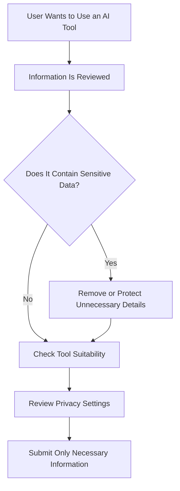
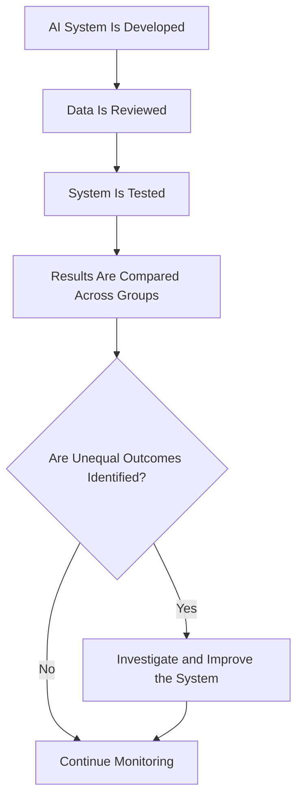
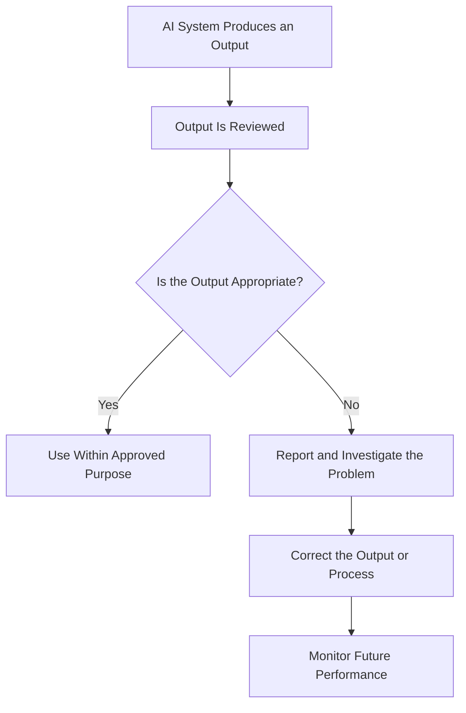
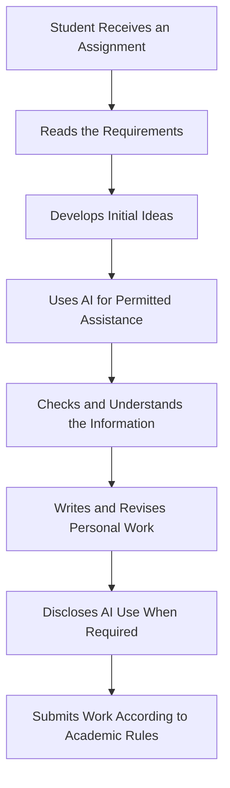
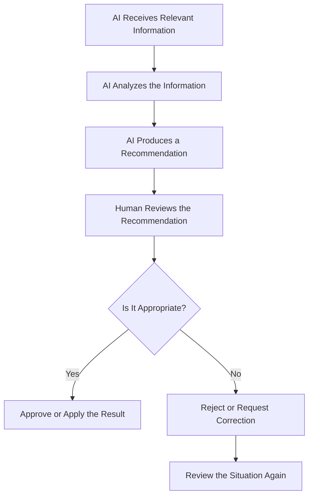
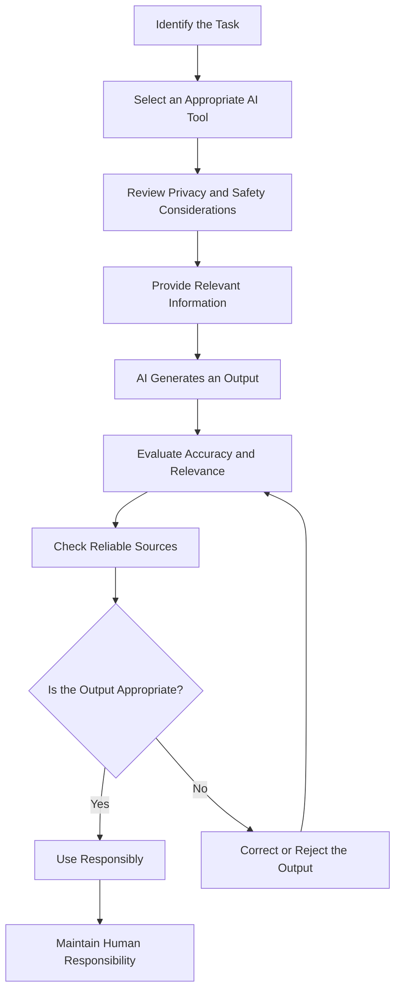

# TOPIC 05 — ETHICAL AND RESPONSIBLE USE OF ARTIFICIAL INTELLIGENCE

  <strong>SLN · AI OVERVIEW</strong> 
  <em>Understanding Privacy, Fairness, Transparency, Academic Integrity, and Human Responsibility</em>

---

## CONTENTS

1. [Privacy and Data Protection](#01--privacy-and-data-protection)
2. [Fairness and Bias](#02--fairness-and-bias)
3. [Transparency and Accountability](#03--transparency-and-accountability)
4. [Academic Integrity](#04--academic-integrity)
5. [Human Judgment and Oversight](#05--human-judgment-and-oversight)
6. [Responsible AI Use and Verification of AI-Generated Content](#06--responsible-ai-use-and-verification-of-ai-generated-content)

---

# 01 · PRIVACY AND DATA PROTECTION

## 1.1 Understanding Privacy in AI

Privacy refers to an individual's ability to maintain appropriate control over personal information and how that information is collected, used, stored, and shared.

AI systems may process large amounts of information to perform tasks such as answering questions, recognizing patterns, generating recommendations, and analyzing data.

Some information may be personal or confidential. Therefore, using AI requires careful consideration of what information is entered into a system.

For example, a student may use an AI assistant to summarize a school document. If the document contains private student records, uploading it to an external service without permission may create a privacy problem.

Responsible AI use requires understanding the sensitivity of information before sharing it.

## 1.2 What Is Personal Data?

Personal data is information that relates to an identifiable individual.

Examples may include:

- Full names.
- Home addresses.
- Telephone numbers.
- Email addresses.
- Identification details.
- Financial account information.
- Personal photographs.
- Private messages.
- Location information.

The sensitivity of information depends on its nature and the circumstances in which it is used.

Some information may seem harmless when considered separately but may become identifying when combined with other details.

## 1.3 How AI Systems May Process Data

AI applications may process user inputs, uploaded documents, images, audio, and other information.

The exact handling of data depends on the application, its settings, and its privacy policy.

| Data Type | Example | Privacy Consideration |
|---|---|---|
| Text | Questions and messages | May contain personal details |
| Documents | Reports and assignments | May include confidential information |
| Images | Uploaded photographs | May reveal identities or private surroundings |
| Audio | Voice recordings | May contain identifiable speech |
| Location | Location-related information | May reveal movement patterns |
| Account information | User profile details | Requires appropriate protection |

Users should understand how the specific service handles submitted information.

## 1.4 Data Collection and Data Usage

Data collection refers to obtaining information from users or other sources.

Data usage refers to how that information is processed or applied.

AI applications may use information to provide requested features, improve services, or perform other activities described in their terms and privacy settings.

Users should not assume that every AI service handles information in the same way.

Before using an application, it is important to examine its privacy information and available controls.

## 1.5 Risks of Sharing Sensitive Information

Sharing unnecessary personal information can create privacy and security risks.

Examples include:

| Information Shared | Potential Concern |
|---|---|
| Home address | Exposure of private location |
| Passwords | Unauthorized account access |
| Financial details | Financial privacy risks |
| Private documents | Unintended disclosure |
| Personal photographs | Misuse or unwanted distribution |
| Confidential workplace information | Organizational data exposure |

Users should avoid entering passwords, private access codes, and other highly sensitive information into general-purpose AI tools.

## 1.6 Data Protection Principles

Responsible data protection involves several important principles.

| Principle | Meaning | Practical Application |
|---|---|---|
| Data minimization | Collect only necessary information | Avoid unnecessary personal details |
| Purpose limitation | Use data for an appropriate purpose | Understand why information is requested |
| Security | Protect information against unauthorized access | Use suitable security controls |
| Transparency | Explain relevant data practices | Provide understandable privacy information |
| Retention control | Avoid keeping data longer than necessary | Apply suitable retention policies |
| User rights | Respect applicable rights over personal data | Provide appropriate privacy controls |

## 1.7 Protecting Personal Information When Using AI

Users can protect privacy by following several practices:

1. Avoid submitting unnecessary personal information.
2. Do not share passwords or private access credentials.
3. Remove identifying details from documents when possible.
4. Check the privacy settings of the application.
5. Use approved services for confidential work.
6. Follow school or organizational data policies.
7. Ask for permission before uploading information belonging to other people.

## 1.8 Privacy in Educational and Workplace Settings

Privacy is particularly important in environments where information about students, employees, customers, or patients is involved.

For example, a teacher should consider whether a digital tool is approved before entering student information.

Similarly, employees should not upload confidential company documents to external AI services without authorization.

> **Core Insight:** AI can be useful only when information is handled responsibly. Protecting privacy means understanding what data is shared, why it is needed, and how the application may process it.

## 1.9 Example: Responsible Data Sharing

---

# 02 · FAIRNESS AND BIAS

## 2.1 Understanding Fairness in AI

Fairness in AI refers to the principle that AI systems should avoid unjustified discrimination and should be evaluated for unequal effects on different individuals or groups.

AI systems can influence decisions in areas such as education, employment, financial services, and access to information.

If a system produces systematically unfair outcomes, it may disadvantage certain people.

Fairness is therefore an important ethical consideration in the development and use of AI.

## 2.2 Understanding AI Bias

AI bias occurs when an AI system produces systematically unbalanced or unfair results.

Bias may originate from training data, data collection methods, model design, evaluation procedures, or the environment in which a system is used.

For example, a system trained using information that does not adequately represent a population may perform less accurately for underrepresented individuals.

## 2.3 Sources of Bias

| Source | Explanation | Example |
|---|---|---|
| Historical bias | Existing inequalities appear in historical data | Past decisions influence future predictions |
| Representation bias | Some groups are insufficiently represented | Limited diversity in training examples |
| Measurement bias | Data is collected inconsistently | Different groups are measured differently |
| Labeling bias | Human judgments affect training labels | Subjective categories |
| Algorithmic bias | Design choices create unequal outcomes | Inappropriate optimization criteria |
| Deployment bias | Real-world use differs from intended conditions | A system is used outside its tested environment |

## 2.4 Examples of Fairness Concerns

### Education

An AI assessment system may produce different levels of accuracy for students with different language backgrounds.

If the system is not evaluated properly, some students may receive less accurate feedback.

### Employment

An AI recruitment system may learn patterns from historical hiring decisions.

If those decisions contain unfair patterns, the system may reproduce them.

### Financial Services

An automated financial system may use variables that produce unequal effects across groups.

Organizations should evaluate whether the system's decisions are appropriate and fair.

### Recommendation Systems

Recommendation systems may repeatedly display similar content because they are based on previous interactions.

This may reduce exposure to different perspectives and content categories.

## 2.5 Why Fairness Is Difficult to Measure

Fairness is not always represented by a single measurement.

Different systems may require different fairness criteria depending on their purpose, users, and potential consequences.

For example, an educational recommendation system may be evaluated differently from a system used to support financial decisions.

Organizations should identify relevant risks and evaluate outcomes across appropriate groups.

## 2.6 Promoting Fairness in AI Systems

Fairness can be supported through several practices:

- Using relevant and representative data.
- Examining data collection methods.
- Testing system performance across different groups.
- Reviewing possible discriminatory outcomes.
- Documenting known limitations.
- Providing human review and appeal procedures.
- Monitoring performance after deployment.

| Fairness Practice | Purpose |
|---|---|
| Data review | Identifies gaps and imbalances |
| Diverse testing | Examines performance across groups |
| Bias evaluation | Detects unequal outcomes |
| Documentation | Records limitations and assumptions |
| Human review | Allows contextual examination |
| Continuous monitoring | Identifies problems after deployment |

## 2.7 Fairness and Human Responsibility

AI developers and organizations should not assume that a system is fair simply because it uses mathematical models.

Fairness requires deliberate evaluation, suitable safeguards, and ongoing responsibility.

Users should also question recommendations that appear unreasonable or discriminatory.

> **Core Insight:** AI fairness must be evaluated rather than assumed. Data, system design, and real-world use can all influence whether an AI application treats people appropriately.

## 2.8 Example: Fairness Evaluation

---

# 03 · TRANSPARENCY AND ACCOUNTABILITY

## 3.1 Understanding Transparency

Transparency refers to making relevant information about an AI system understandable to the people who use, manage, or are affected by it.

Users should be able to understand important aspects of an AI system, such as:

- Its intended purpose.
- The type of task it performs.
- Its major limitations.
- Whether it generates or analyzes information.
- Whether human review is involved.
- Relevant risks associated with its use.

Transparency does not necessarily mean revealing every technical detail. It means providing information that helps people understand the system and make informed decisions.

## 3.2 Why Transparency Matters

Transparency helps users evaluate whether an AI system is appropriate for a particular task.

For example, a student should know whether an answer comes from an AI-generated explanation or from an independently verified educational source.

A customer should also be informed when interacting with an automated service rather than a human representative, where that distinction is relevant.

| Transparency Area | Important Information |
|---|---|
| System purpose | What the AI is designed to do |
| Capabilities | What tasks it can perform |
| Limitations | What it may not handle accurately |
| Data use | Relevant information about data processing |
| Automated decisions | Whether AI contributes to decisions |
| Human involvement | Whether people review important outputs |

## 3.3 Understanding Explainability

Explainability refers to the ability to provide understandable information about how an AI system reaches or supports a result.

Some AI systems are relatively simple to explain, while others use complex models that are difficult to interpret.

For example, a basic classification system may provide a clear explanation of the features used to categorize information.

A complex model may require additional methods to help people understand its behavior.

Explainability is important when AI outputs influence significant decisions.

## 3.4 The Importance of Clear Communication

Organizations should communicate AI capabilities and limitations in language that users can understand.

Technical descriptions alone may not be sufficient.

For example, saying that a system uses a machine learning model does not explain whether its predictions are reliable or what users should do when the system makes a mistake.

Clear communication should explain the practical meaning of system limitations.

## 3.5 Understanding Accountability

Accountability means that people and organizations remain responsible for the development, deployment, supervision, and use of AI systems.

An organization should not avoid responsibility by claiming that an AI system independently produced an outcome.

People must establish procedures for evaluating outputs, responding to errors, and addressing harmful consequences.

## 3.6 Responsibilities of Different Stakeholders

| Stakeholder | Main Responsibility |
|---|---|
| Developers | Design, test, and document systems responsibly |
| Organizations | Establish policies and supervise deployment |
| Operators | Use systems appropriately and monitor outputs |
| Users | Evaluate outputs before relying on them |
| Educators | Explain appropriate academic AI use |
| Decision-makers | Remain responsible for important decisions |

## 3.7 Accountability When AI Makes Mistakes

AI systems may produce incorrect or inappropriate outputs.

Responsible organizations should establish procedures to:

1. Identify the problem.
2. Evaluate its possible consequences.
3. Correct inaccurate information.
4. Inform relevant people when appropriate.
5. Review the cause of the problem.
6. Improve the system or its procedures.
7. Monitor whether the problem happens again.

## 3.8 Transparency and Accountability in Practice

For example, an organization using an AI chatbot should explain that customers are interacting with an automated system.

It should also provide a way to contact a human employee when the chatbot cannot address a problem.

This supports transparency because users understand the nature of the service. It supports accountability because the organization remains responsible for customer support.

> **Core Insight:** Transparency helps people understand AI systems, while accountability ensures that humans and organizations remain responsible for their consequences.

## 3.9 Example: Accountable AI Use

---

# 04 · ACADEMIC INTEGRITY

## 4.1 Understanding Academic Integrity

Academic integrity refers to the principles of honesty, fairness, responsibility, and respect in educational work.

Students are expected to represent their knowledge and contributions honestly.

AI tools can support learning, but their use must follow the rules established by teachers and educational institutions.

The important distinction is between using AI to support understanding and presenting AI-generated work in a misleading way.

## 4.2 Appropriate Uses of AI in Education

AI can be useful when it supports learning activities without replacing the student's own effort.

Examples include:

- Asking for explanations of difficult concepts.
- Generating practice questions.
- Receiving feedback on grammar.
- Creating a study outline.
- Exploring different ways to understand a topic.
- Summarizing notes for revision.
- Practicing a foreign language.

The student should still understand the material and complete the learning objectives.

## 4.3 Inappropriate Academic Uses

Problems may occur when students use AI in ways that misrepresent their work.

Examples include:

- Submitting generated work as entirely original when disclosure is required.
- Copying answers without understanding them.
- Inventing sources or citations.
- Using AI during prohibited assessments.
- Presenting fabricated information as research evidence.
- Hiding AI involvement when institutional rules require disclosure.

The exact rules depend on the school, course, teacher, and assessment.

## 4.4 AI Assistance Versus Academic Misrepresentation

| Situation | Academic Consideration |
|---|---|
| Asking AI to explain a concept | Usually supports learning |
| Generating practice questions | Supports revision |
| Requesting grammar feedback | May support editing |
| Copying a generated essay without permission | May violate academic rules |
| Inventing references | Misrepresents evidence |
| Using AI during a prohibited examination | Violates assessment requirements |
| Disclosing AI assistance when required | Supports transparency |

## 4.5 Maintaining Original Thinking

Students should use AI to explore ideas rather than automatically accept generated conclusions.

A useful learning process is to attempt a task independently, use AI to clarify difficult points, compare the explanation with learning materials, and then produce a final response based on personal understanding.

This approach allows AI to provide assistance while preserving the student's responsibility for learning.

## 4.6 Proper Acknowledgment of AI Use

Some educational institutions require students to disclose the use of AI tools.

The appropriate method may depend on the institution's academic rules.

Students should check whether disclosure is required and follow the instructions provided by their teachers.

A disclosure should accurately describe the role of AI rather than exaggerate or hide its contribution.

## 4.7 Checking AI-Generated Academic Content

Students should verify:

- Definitions and explanations.
- Historical facts and dates.
- Mathematical calculations.
- Scientific information.
- References and citations.
- Examples and quotations.
- Alignment with assignment instructions.

AI-generated citations should be checked directly because a system may produce references that do not exist.

## 4.8 Responsible Academic Workflow

## 4.9 The Role of Teachers and Institutions

Teachers should provide clear expectations about acceptable AI use.

Educational institutions may establish rules about AI assistance, disclosure, assessments, and academic misconduct.

Clear guidance helps students understand the difference between appropriate learning support and unacceptable academic practices.

> **Core Insight:** AI can support education, but it should not replace a student's own learning or be used to misrepresent academic contributions. Honesty and compliance with educational rules remain essential.

---

# 05 · HUMAN JUDGMENT AND OVERSIGHT

## 5.1 Understanding Human Judgment

Human judgment refers to the ability to evaluate situations, consider different perspectives, interpret context, and make decisions using reasoning and experience.

AI can process information and provide recommendations, but many decisions require more than identifying patterns.

People may need to consider ethical values, social circumstances, personal needs, and possible consequences.

These factors make human judgment important when using AI.

## 5.2 Why Human Oversight Is Necessary

Human oversight means that people monitor, evaluate, and supervise AI systems.

Oversight helps identify errors, review unusual situations, and ensure that automated outputs are used appropriately.

For example, an AI system may recommend a particular action based on available data. A human decision-maker should evaluate whether the recommendation is suitable in the actual situation.

## 5.3 Human Judgment and AI Capabilities

| AI Capability | Human Contribution |
|---|---|
| Processes large datasets | Interprets relevance and meaning |
| Recognizes patterns | Evaluates whether patterns matter |
| Generates recommendations | Considers ethical and practical consequences |
| Summarizes information | Checks completeness and accuracy |
| Automates routine activities | Handles unusual situations |
| Predicts possible outcomes | Considers uncertainty and responsibility |

AI and human judgment can complement one another.

## 5.4 Situations Requiring Human Oversight

Human oversight is especially important when AI is used in areas involving:

- Healthcare.
- Education assessment.
- Employment decisions.
- Financial services.
- Public services.
- Safety-related systems.
- Legal or administrative processes.

These areas may involve significant consequences for individuals.

Automated recommendations should not be treated as unquestionable decisions.

## 5.5 Human-in-the-Loop Approaches

A human-in-the-loop approach involves human participation in an AI-supported process.

The system may analyze information and suggest an output, while a person reviews the result before an important action is taken.

For example, an automated document system may classify records, but an employee checks whether the classification is correct.

| Stage | AI Role | Human Role |
|---|---|---|
| Information input | Processes data | Provides relevant information |
| Analysis | Identifies patterns | Reviews assumptions |
| Recommendation | Generates suggestions | Evaluates suitability |
| Decision | Supports the process | Makes or approves the decision |
| Monitoring | Produces performance information | Responds to problems |

## 5.6 Human Oversight and Accountability

Human oversight should be meaningful rather than purely formal.

A person reviewing an AI recommendation should have sufficient information, authority, and time to question the result.

If people are expected to approve automated decisions without understanding them, oversight may become ineffective.

Organizations should therefore establish clear responsibilities and suitable review procedures.

## 5.7 Risks of Removing Human Oversight

| Risk | Possible Consequence |
|---|---|
| Unchecked inaccuracies | Incorrect decisions |
| Unrecognized bias | Unfair outcomes |
| Missing context | Unsuitable recommendations |
| System failure | Disrupted processes |
| Unclear responsibility | Difficulty correcting problems |
| Excessive automation | Reduced human control |

## 5.8 Balancing Automation and Human Control

AI should be used where it provides appropriate support.

Routine tasks may be suitable for automation, while complex or high-impact decisions may require stronger human involvement.

The correct balance depends on the purpose of the system and the possible consequences of mistakes.

> **Core Insight:** AI can provide useful analysis and recommendations, but humans must retain appropriate judgment, control, and responsibility, especially when decisions affect people's rights, safety, or opportunities.

## 5.9 Example: Human Oversight Process

---

# 06 · RESPONSIBLE AI USE AND VERIFICATION OF AI-GENERATED CONTENT

## 6.1 Understanding Responsible AI Use

Responsible AI use means using artificial intelligence in ways that are appropriate, ethical, safe, and consistent with relevant rules and expectations.

It involves considering not only what AI can do, but also how its outputs may affect individuals, organizations, and society.

Responsible use requires users to understand system limitations, protect information, evaluate outputs, and maintain human responsibility.

## 6.2 Core Principles of Responsible AI Use

| Principle | Explanation | Practical Example |
|---|---|---|
| Privacy | Protect personal information | Avoid uploading confidential records |
| Fairness | Consider unequal outcomes | Question potentially discriminatory results |
| Transparency | Understand AI involvement | Identify AI-generated content when relevant |
| Accountability | Take responsibility for use | Review outputs before publication |
| Safety | Consider possible harm | Avoid relying on unsuitable outputs |
| Reliability | Check accuracy | Verify factual claims |
| Human oversight | Preserve appropriate control | Review important recommendations |

## 6.3 Using AI for the Right Purpose

Users should select AI tools according to the task.

A tool designed for language translation may not be suitable for verifying financial information.

A generative writing tool may help prepare a draft, but it should not automatically be treated as an authoritative source.

Before using an AI application, users should consider:

- What task needs to be completed?
- Is AI appropriate for this task?
- What information will be shared?
- What are the system's limitations?
- Does the task require expert review?
- Are there rules governing AI use?

## 6.4 Protecting Privacy

Responsible AI use requires limiting the information shared with AI systems.

Users should avoid entering unnecessary personal, confidential, or sensitive information.

Organizations should also establish clear procedures for approved AI tools and data handling.

## 6.5 Recognizing Bias and Limitations

Users should recognize that AI outputs may reflect limitations in training data, system design, or the information provided.

A response that appears neutral may still contain assumptions or unbalanced perspectives.

Important recommendations should be evaluated for relevance, fairness, and evidence.

## 6.6 Verifying AI-Generated Content

Verification is one of the most important practices in responsible AI use.

AI-generated information may contain factual errors, unsupported claims, inaccurate calculations, or fabricated references.

Users should compare important information with reliable sources before relying on it.

| Content Type | Verification Method |
|---|---|
| Historical information | Check credible historical sources |
| Scientific explanation | Compare with established educational material |
| Statistics | Locate original data or reports |
| Mathematical calculations | Recalculate independently |
| Citations | Open and inspect the cited source |
| Translations | Review meaning and context |
| Technical instructions | Check authoritative documentation |

## 6.7 Evaluating the Reliability of AI Outputs

A useful verification process considers several dimensions.

### Accuracy

Does the information correctly describe the facts?

### Relevance

Does the answer address the actual question?

### Completeness

Does it include the important information needed for the task?

### Context

Does the response consider the relevant circumstances?

### Evidence

Can important claims be supported by reliable sources?

### Appropriateness

Is the information suitable for the intended audience and purpose?

## 6.8 Responsible Use in Different Environments

| Environment | Responsible AI Practice |
|---|---|
| Education | Follow academic rules and understand submitted work |
| Business | Review recommendations and protect company information |
| Healthcare | Maintain professional oversight |
| Finance | Verify calculations and risk-related information |
| Communication | Check generated messages before sending |
| Research | Confirm evidence and references |
| Public services | Evaluate fairness and accountability |

## 6.9 Developing Good AI Habits

Responsible AI use should become a regular habit rather than an occasional check.

Users can develop good habits by:

1. Defining the task before using AI.
2. Choosing an appropriate tool.
3. Sharing only necessary information.
4. Giving clear instructions.
5. Reviewing generated outputs.
6. Verifying important claims.
7. Considering fairness and possible consequences.
8. Following relevant rules.
9. Taking responsibility for final decisions.

## 6.10 A Complete Responsible AI Workflow

## 6.11 The Importance of Responsible AI for Society

AI affects how people learn, work, communicate, and access information.

As AI becomes more common, responsible use becomes increasingly important.

Individuals need to understand how to evaluate AI-generated information. Organizations need policies that protect users and establish accountability. Developers need to consider fairness, reliability, privacy, and safety during system design.

Responsible AI requires cooperation between developers, organizations, educators, users, and decision-makers.

## 6.12 Final Principles for Responsible AI Use

The following principles summarize responsible AI use:

- Use AI to support human abilities, not automatically replace them.
- Protect personal and confidential information.
- Consider fairness and possible bias.
- Be transparent about AI involvement when required.
- Follow academic and professional rules.
- Maintain human judgment and oversight.
- Verify important AI-generated information.
- Accept responsibility for how AI outputs are used.

> **Core Insight:** Responsible AI use combines privacy protection, fairness, transparency, academic integrity, human oversight, and verification. AI is most useful when people understand its limitations and remain accountable for its use.

---

  <strong>SLN · AI OVERVIEW</strong> 
  Topic 05 — Ethical and Responsible Use of Artificial Intelligence

