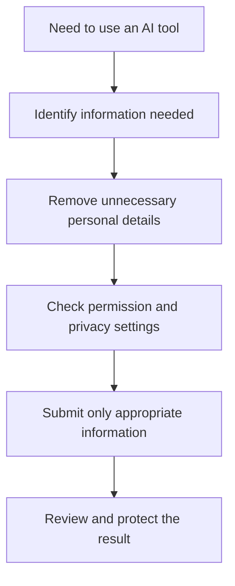
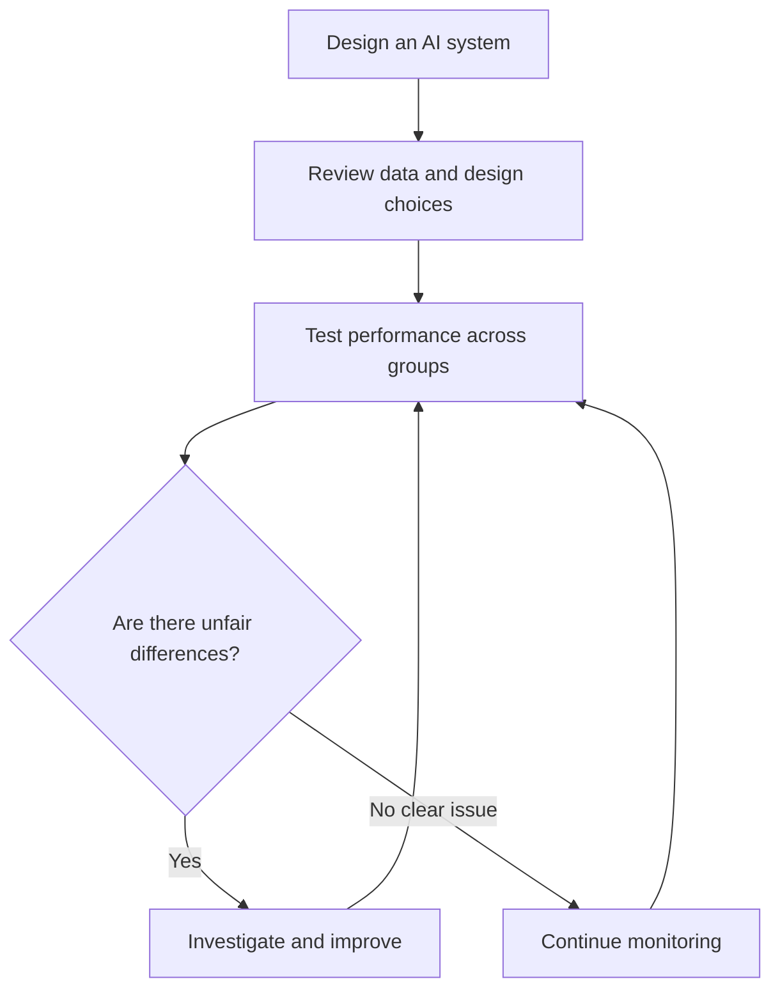
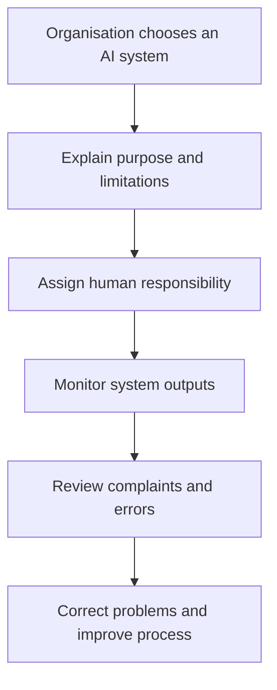
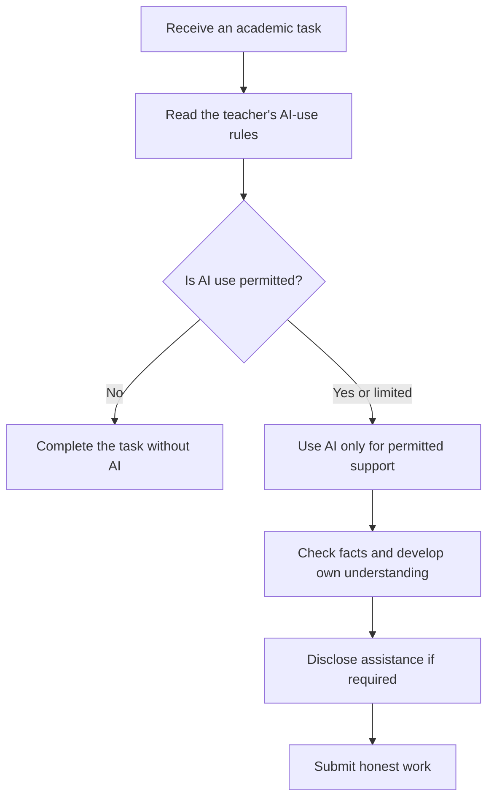
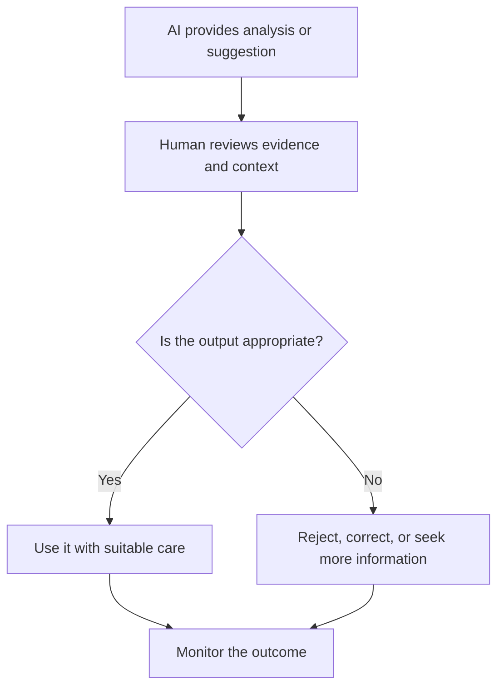
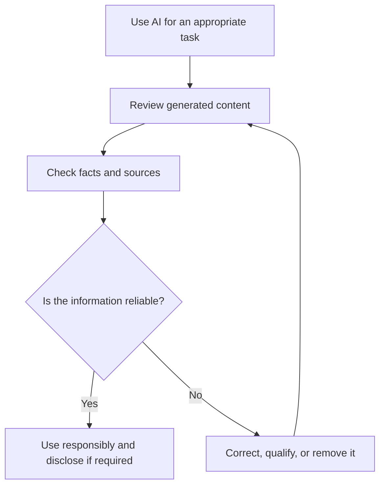

# TOPIC 05 — ETHICAL AND RESPONSIBLE USE OF AI

  <strong>SLN · AI OVERVIEW</strong> 
  <em>Using Artificial Intelligence Fairly, Safely, and Responsibly</em>

---

## CONTENTS

| No. | Section |
|---:|---|
| 01 | [Privacy and Data Protection](#01--privacy-and-data-protection) |
| 02 | [Fairness and Bias](#02--fairness-and-bias) |
| 03 | [Transparency and Accountability](#03--transparency-and-accountability) |
| 04 | [Academic Integrity](#04--academic-integrity) |
| 05 | [Human Judgment and Oversight](#05--human-judgment-and-oversight) |
| 06 | [Responsible AI Use and Verification of AI-Generated Content](#06--responsible-ai-use-and-verification-of-ai-generated-content) |

---

# 01 · Privacy and Data Protection

Privacy is the ability to control how personal information is collected, used, stored, and shared. Data protection refers to the practices and safeguards used to keep information secure and handle it appropriately. These issues matter because AI tools may process text, images, audio, documents, and other information provided by users.

### What counts as personal information?

Personal information can include a person's name, address, phone number, email address, identification details, location, photographs, school or workplace information, and other details that can identify them. Sensitive information may require additional protection.

### Privacy risks when using AI

- **Sharing too much information:** Users may paste private details into a tool without considering where the information goes.
- **Unclear data handling:** Users may not understand how a service stores or uses submitted information.
- **Unauthorised access:** Poor security can expose information to people who should not see it.
- **Re-identification:** Information that appears anonymous may sometimes be linked with other data to identify a person.
- **Unintended disclosure:** A generated response or shared document may reveal information that should remain private.

### Responsible privacy practices

1. Do not enter passwords, private identification numbers, or confidential records into an AI tool.
2. Share only the minimum information needed for the task.
3. Remove names and identifying details when they are not necessary.
4. Review the tool's privacy settings and data policies.
5. Get permission before uploading another person's information.
6. Follow school, workplace, and legal requirements.

> **Core Insight:** Protecting privacy begins before information is submitted. Users should share only what is necessary and understand how the tool handles their data.

---

# 02 · Fairness and Bias

Fairness means treating people justly and avoiding unjustified discrimination. AI systems can affect people through recommendations, classifications, rankings, or decisions. If an AI system produces different or unfair results for certain groups, it can reinforce existing inequalities.

### How bias can enter AI

Bias can appear in training data, the way information is labelled, the choices made by designers, the goals used to evaluate a system, or the way people interpret its output. Bias is not always intentional. It can still cause harm even when nobody planned to create an unfair result.

### Examples of fairness concerns

- A system used to screen applications may learn patterns from historical decisions that were not fair.
- A recognition tool may work less accurately for some groups if its training data was unbalanced.
- A recommendation system may repeatedly show limited perspectives and reduce the variety of information people see.
- An automated assessment tool may disadvantage people whose work or communication style differs from the examples used to develop it.

### Supporting fairness

Organisations should use appropriate and representative data, test systems across relevant groups, examine unexpected differences, and provide ways for people to request a review. Fairness also requires human judgement because statistical results alone cannot decide what is just in every situation.

| Fairness practice | Why it matters |
|---|---|
| Representative data | Includes a wider range of experiences |
| Testing across groups | Helps reveal unequal performance |
| Human review | Adds context and judgement |
| Clear appeal process | Allows errors to be challenged |
| Ongoing monitoring | Detects problems that appear later |

> **Core Insight:** Fair AI requires more than accurate predictions. It also requires attention to who benefits, who may be disadvantaged, and how unfair outcomes can be challenged.

---

# 03 · Transparency and Accountability

Transparency means making relevant information about an AI system understandable, including what it is used for, what its limitations are, and when AI has contributed to a result. Accountability means that people or organisations remain responsible for how the system is selected, operated, and used.

### Why transparency matters

People should not be misled into believing that an AI-generated result is necessarily human-written, fully verified, or free from error. Clear communication helps users understand when AI is involved and what level of confidence they should place in its output.

Transparency may include:
- Telling users when they are interacting with an AI assistant.
- Explaining the purpose of an AI system.
- Describing important limitations and possible errors.
- Providing understandable information about how a result may be used.
- Explaining how a person can request human review.

### Understanding accountability

AI systems do not remove human responsibility. A school, company, or organisation that uses AI should decide who checks its outputs, who handles complaints, and who is responsible when the system causes a problem.

### Example

If an organisation uses AI to help sort applications, it should not simply blame the software when an unfair result occurs. The organisation must review the process, examine the system's role, and provide an appropriate way to correct mistakes.

> **Core Insight:** Transparency helps people understand AI use, while accountability ensures that humans and organisations remain responsible for its consequences.

---

# 04 · Academic Integrity

Academic integrity means being honest, fair, and responsible in learning and academic work. AI tools can support learning, but students must follow the rules set by their teachers or educational institutions. Using AI in a way that misrepresents someone else's work as one's own can violate academic integrity.

### Acceptable support and inappropriate use

The rules can differ between assignments and institutions. In some tasks, AI may be allowed for brainstorming, language feedback, or explaining difficult ideas. In other tasks, independent work may be required and AI use may be restricted.

| Possible learning support | What students should do |
|---|---|
| Asking for an explanation | Make sure they understand the concept |
| Generating practice questions | Answer and review them independently |
| Checking grammar | Keep ownership of the ideas and final writing |
| Brainstorming | Develop and evaluate their own argument |
| Summarising notes | Compare the summary with the original material |

### Responsible academic use

- Read the assignment instructions before using AI.
- Ask the teacher if the permitted use is unclear.
- Do not submit generated work as entirely your own when that is not allowed.
- Check facts, quotations, and references rather than assuming they are real.
- Disclose AI assistance when the rules require it.
- Keep drafts and notes when useful to show how the work was developed.
- Make sure the final submission reflects your own understanding.

### Example

A student may ask an AI tool to explain the difference between machine learning and deep learning, then use class notes and textbooks to write their own explanation. This is different from submitting an AI-generated essay without understanding it or claiming that all of its content was independently written.

> **Core Insight:** AI should support learning without replacing a student's own effort, understanding, or honesty.

---

# 05 · Human Judgment and Oversight

Human judgement is the ability to consider information, context, values, consequences, and responsibility when making decisions. Human oversight means that people monitor an AI system and can review, question, correct, or stop its use when necessary.

### Why human oversight is important

AI systems can process information quickly, but they may misunderstand context, rely on unsuitable data, or produce inaccurate results. People can consider details that are missing from the system and recognise when a decision needs further discussion.

Human oversight is especially important when AI is used in areas that may affect people's rights, opportunities, education, health, safety, or finances.

### Responsibilities of people using AI

- Check whether the system is suitable for the task.
- Review important outputs before acting on them.
- Consider the situation and information that the AI may have missed.
- Recognise when expert advice is needed.
- Correct errors and report serious problems.
- Take responsibility for decisions rather than blaming the tool.

### Example

A teacher may use an AI tool to identify topics that students find difficult. The teacher should review the results alongside classroom activities, student questions, and individual circumstances before changing a lesson plan.

### Human oversight is not just approval

Meaningful oversight requires enough knowledge, time, and authority to question an AI result. A person who automatically accepts every recommendation is not providing effective oversight. Organisations should make responsibilities clear and ensure that people can intervene when necessary.

> **Core Insight:** AI can assist decisions, but meaningful human oversight keeps decisions connected to context, values, and responsibility.

---

# 06 · Responsible AI Use and Verification of AI-Generated Content

Responsible AI use means using AI in ways that are safe, honest, fair, respectful, and appropriate for the task. It includes protecting privacy, following relevant rules, recognising limitations, and checking generated information before relying on it.

### Principles of responsible use

- **Purpose:** Use AI for a clear and appropriate reason.
- **Privacy:** Avoid sharing unnecessary personal or confidential information.
- **Fairness:** Consider whether the system may produce biased or unequal results.
- **Honesty:** Be clear about AI assistance when disclosure is required.
- **Safety:** Do not rely on AI alone for important decisions that require qualified judgement.
- **Human responsibility:** Review the result and take responsibility for how it is used.

### How to verify AI-generated content

1. Identify factual claims, numbers, quotations, and recommendations.
2. Check important claims against reliable and relevant sources.
3. Confirm that sources exist and support the statements.
4. Review dates, context, and whether information is current.
5. Recheck calculations and technical details independently.
6. Correct or remove information that cannot be supported.

### Example

If an AI tool creates a paragraph about a recent event, the user should compare its claims with reliable news organisations or official announcements. If the tool provides a quotation, the user should find the original source and confirm the wording. If a claim cannot be verified, it should not be presented as a fact.

### A final responsible-use checklist

| Question | Purpose |
|---|---|
| Is AI allowed for this task? | Follow relevant rules |
| Have I protected private information? | Respect privacy |
| Could the output be biased? | Consider fairness |
| Have I checked important claims? | Reduce misinformation |
| Do I understand the final result? | Preserve independent judgement |
| Have I disclosed AI use if required? | Maintain honesty |

> **Core Insight:** Responsible AI use does not end when a tool generates an answer. It continues through checking, thoughtful judgement, and taking responsibility for the final result.

---

  <strong>SLN · AI OVERVIEW</strong> 
  Topic 05 — Ethical And Responsible Use Of Ai

