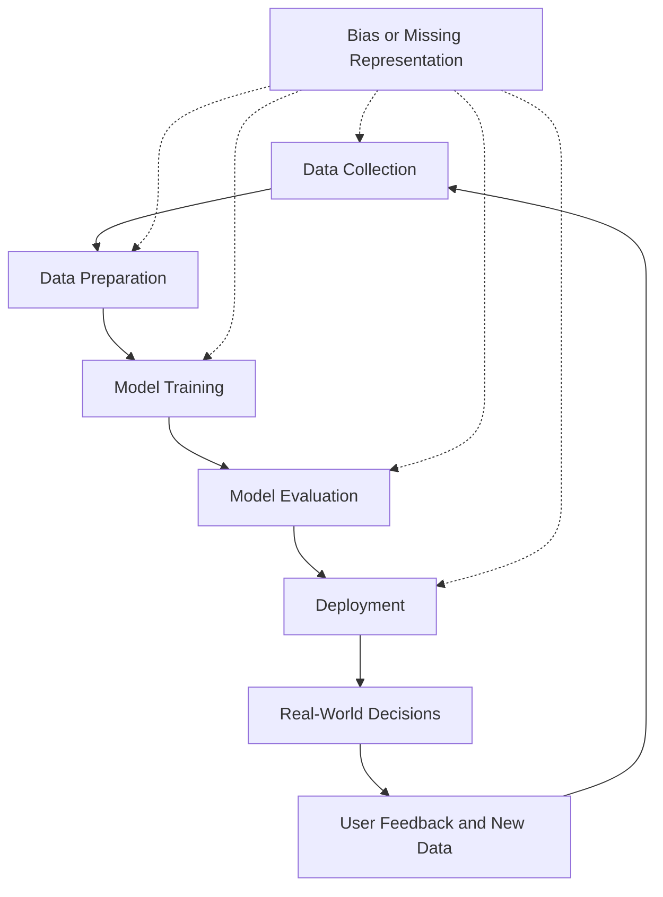
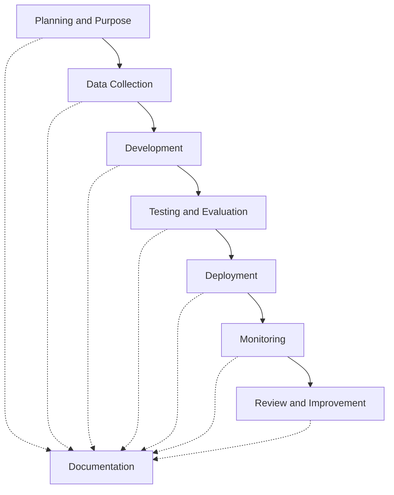
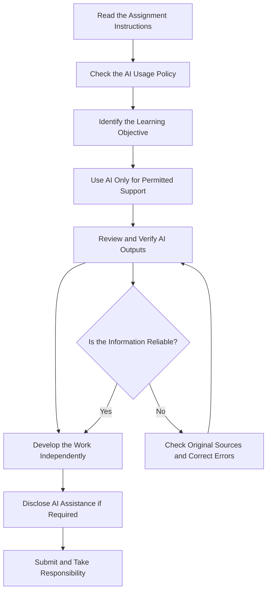
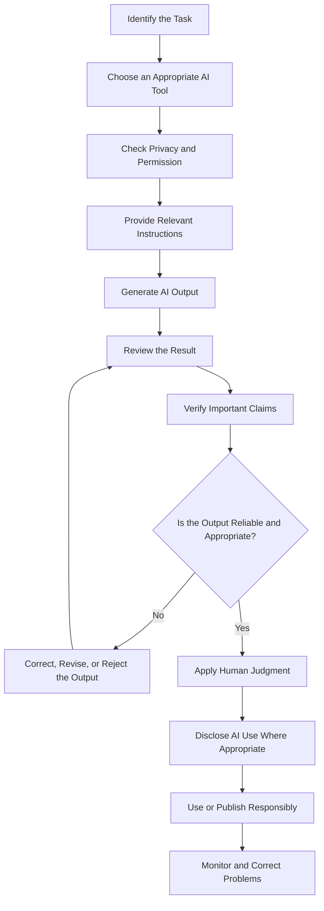

# TOPIC 05 — ETHICAL AND RESPONSIBLE USE OF AI

<p align="center">
  <strong>SLN · AI OVERVIEW</strong><br>
  <em>Understanding Privacy, Fairness, Accountability, Academic Integrity, and Responsible Artificial Intelligence</em>
</p>

---

## CONTENTS

| No. | Section |
|---:|---|
| 01 | [Privacy and Data Protection](#01--privacy-and-data-protection) |
| 02 | [Fairness and Bias](#02--fairness-and-bias) |
| 03 | [Transparency and Accountability](#03--transparency-and-accountability) |
| 04 | [Academic Integrity](#04--academic-integrity) |
| 05 | [Human Judgment and Oversight](#05--human-judgment-and-oversight) |
| 06 | [Responsible AI Use and Verification of AI-Generated Content](#06--responsible-ai-use-and-verification-of-ai-generated-content) |

---

# 01 · Privacy and Data Protection

## 1.1 Understanding Privacy in Artificial Intelligence

Privacy is one of the most important ethical considerations when using Artificial Intelligence (AI). AI systems frequently process information to generate responses, recognise patterns, make predictions, and perform automated tasks. Some of this information may contain personal, sensitive, or confidential data.

Privacy refers to an individual's right to control how information about them is collected, accessed, used, stored, and shared. Data protection refers to the practices, policies, and technical measures used to safeguard information against unauthorised access, misuse, loss, or disclosure.

AI applications may process information such as names, email addresses, locations, photographs, educational records, financial details, health information, and communication histories. If this information is handled improperly, it may create privacy risks for individuals and organisations.

For example, a student who uploads an assignment containing personal details to an AI platform should understand how the platform processes submitted information. Similarly, an employee should not automatically upload confidential company documents into an external AI tool without checking organisational policies.

> **Core Insight:** Using AI responsibly means considering not only what information an AI system needs, but also whether the user has permission to share that information.

## 1.2 Types of Data and Their Privacy Risks

Different types of information require different levels of protection. Public information may be suitable for general AI applications, while sensitive and confidential information requires stricter controls.

| Data Type | Description | Examples | Recommended Handling |
|---|---|---|---|
| Public Data | Information intended for public access. | Published articles, public announcements, official reports. | May be used when the source and usage conditions are appropriate. |
| Personal Data | Information that identifies or relates to an individual. | Name, email address, telephone number, home address. | Share only when necessary and authorised. |
| Sensitive Personal Data | Information that may expose individuals to significant privacy risks. | Health records, biometric information, financial details. | Apply strong protection and avoid unnecessary sharing. |
| Confidential Data | Information restricted to authorised individuals. | Internal business reports, private contracts, examination materials. | Follow organisational access and disclosure policies. |
| Anonymised Data | Data processed so individuals cannot reasonably be identified. | Statistical information without identifying details. | Confirm that identification is not reasonably possible. |
| Pseudonymised Data | Data in which direct identifiers are replaced with alternative identifiers. | Student records using codes instead of names. | Continue treating it as protected data because re-identification may be possible. |

Anonymisation and pseudonymisation are not identical.

Anonymisation aims to remove identifying information so that individuals cannot reasonably be identified. Pseudonymisation replaces identifying details with codes or alternative identifiers, but additional information may still allow the original identity to be recovered.

For example, replacing a student's name with Student A is pseudonymisation if another document connects Student A to the real person. Therefore, pseudonymised information should not automatically be considered anonymous.

## 1.3 Data Collection and Consent

AI systems may collect or process information through direct user input, uploaded documents, connected applications, sensors, or other data sources.

Responsible data collection should follow several principles:

1. **Purpose limitation:** Information should be collected for a clear and legitimate purpose.
2. **Data minimisation:** Only the information necessary for the intended task should be collected.
3. **Consent and authorisation:** Users should understand when their information is being collected or shared and provide permission where required.
4. **Accuracy:** Information should be maintained accurately and corrected when necessary.
5. **Storage limitation:** Information should not be retained longer than necessary.
6. **Security:** Appropriate safeguards should protect information against unauthorised access.
7. **Transparency:** People should receive understandable information about how their data is handled.

Consent should be meaningful rather than assumed. A person should not be expected to understand every technical detail, but they should be given clear information about important data practices.

For example, an educational platform should explain what student information is collected, why it is needed, and whether it is shared with external service providers.

## 1.4 Privacy Risks When Using AI Tools

Privacy risks can arise from ordinary AI interactions, especially when users submit information without checking whether it is appropriate.

| Privacy Risk | Explanation | Possible Consequence |
|---|---|---|
| Unnecessary Data Sharing | Users provide more information than the task requires. | Exposure of private details. |
| Unauthorised Access | Individuals without permission access stored information. | Loss of confidentiality. |
| Data Leakage | Information becomes available outside its intended environment. | Disclosure of personal or business information. |
| Improper Retention | Information is stored longer than necessary. | Increased exposure over time. |
| Re-identification | Anonymous-looking data is combined with other information to identify individuals. | Loss of privacy. |
| Third-Party Processing | External services process submitted information. | Reduced control over information handling. |
| Weak Account Security | Poor authentication or account protection allows access by others. | Unauthorised use of an account or its data. |

An important concern is that users may not know exactly how an AI service handles submitted information. Data practices vary between providers, products, account types, and settings.

Users should therefore check applicable privacy notices, data controls, retention policies, and organisational requirements before submitting sensitive information.

## 1.5 Practical Methods for Protecting Data

Responsible AI use requires both careful user behaviour and appropriate technical safeguards.

| Protection Method | Description | Practical Example |
|---|---|---|
| Data Minimisation | Submit only necessary information. | Remove student names before requesting feedback on an assignment. |
| Anonymisation | Remove identifying information where appropriate. | Replace names and contact details with generic labels. |
| Access Control | Restrict access to authorised users. | Use individual accounts with appropriate permissions. |
| Strong Authentication | Strengthen account protection. | Use strong passwords and multi-factor authentication where available. |
| Encryption | Protect information during storage or transmission. | Use services that apply appropriate encryption. |
| Retention Management | Avoid unnecessary long-term storage. | Delete temporary files when they are no longer needed. |
| Permission Checks | Confirm that sharing information is allowed. | Check company policies before uploading internal documents. |
| Privacy Review | Examine how a service processes information. | Read the provider's privacy policy and data settings. |

### Example: Safe and Unsafe AI Prompts

**Unsafe prompt:**

```text
Analyse this student's performance:
Name: John Smith
Home Address: 123 Example Street
Student ID: 202600123
Medical History: ...
Full academic records: ...
```

This prompt includes identifying and potentially sensitive information that may not be necessary for general academic analysis.

**Safer prompt:**

```text
Analyse the following anonymised academic performance data.

Student A:
Mathematics: 78
English: 85
Science: 81

Identify general learning strengths and areas
that may require additional support.
```

The second prompt provides relevant information without unnecessarily exposing personal identifiers.

## 1.6 Privacy Responsibilities in Different Environments

Privacy responsibilities apply across education, business, healthcare, and everyday technology use.

| Environment | Information That May Be Processed | Responsible Practice |
|---|---|---|
| Education | Student records, grades, assignments. | Avoid exposing student identities and private academic records. |
| Healthcare | Medical histories, test results, patient details. | Use authorised systems and follow professional confidentiality requirements. |
| Business | Financial reports, customer information, internal documents. | Follow company data policies and restrict confidential information. |
| Banking | Account details, transaction histories, financial profiles. | Use secure and authorised financial services. |
| Social Media | Images, personal interests, messages, location information. | Understand privacy settings and avoid sharing other people's information without permission. |
| Public Services | Identity records, applications, official information. | Maintain appropriate access controls and data governance. |

## 1.7 Privacy Protection Checklist

Before entering information into an AI system, users should ask:

- Is this information necessary for the task?
- Does it contain personal or confidential details?
- Do I have permission to share it?
- Is the AI platform authorised for this type of information?
- Can identifying details be removed?
- Do I understand how the service handles submitted data?
- Is there a safer way to complete the task?

A responsible user does not assume that information is safe to upload simply because an AI application accepts it.

---

# 02 · Fairness and Bias

## 2.1 Understanding Fairness in AI

Fairness in AI means designing, developing, and using systems in ways that avoid unjustified discrimination and provide appropriate treatment to different individuals and groups.

AI systems learn patterns from data. If the training data contains historical inequalities, incomplete representation, or inaccurate labels, an AI model may reproduce those problems in its predictions.

For example, an AI recruitment system trained using historical hiring records may learn patterns that favour applicants resembling previously selected employees. If historical recruitment decisions were biased, the system may repeat those patterns.

Fairness does not necessarily mean that every person receives exactly the same outcome. Different situations may require different forms of support. The important objective is to prevent unfair treatment based on irrelevant or unjustified characteristics.

> **Core Insight:** AI systems can reproduce existing inequalities when the information used to train or operate them is incomplete, unrepresentative, or biased.

## 2.2 Understanding Bias in AI Systems

Bias refers to a systematic tendency that causes an AI system to produce distorted or unfair results.

Bias may occur during data collection, model development, evaluation, deployment, or interaction with users.

| Source of Bias | Explanation | Example |
|---|---|---|
| Historical Bias | Existing inequalities are reflected in historical data. | A recruitment model learns patterns from an unequal hiring history. |
| Sampling Bias | Some groups are underrepresented in the dataset. | A speech recognition system is trained mainly on one accent. |
| Measurement Bias | Data is collected using unsuitable or inconsistent measurements. | A system uses an unreliable indicator to evaluate performance. |
| Labelling Bias | Human-generated labels contain subjective or incorrect judgments. | Training examples contain inconsistent classifications. |
| Algorithmic Bias | Model design or optimisation choices produce unequal outcomes. | A model performs poorly for a particular group. |
| Deployment Bias | A system is used in circumstances different from those for which it was designed. | A model developed for one population is applied to another without testing. |
| Feedback Loop Bias | System outputs influence future data and reinforce earlier patterns. | A recommendation system repeatedly promotes similar content. |

Bias is not always intentional. Developers may attempt to create a neutral system but still produce unfair results because of limitations in data, assumptions, or evaluation methods.

## 2.3 How Bias Develops in the AI Lifecycle

Bias can enter an AI system at multiple stages.



The diagram illustrates that bias is not limited to the training stage. It can appear throughout the system lifecycle.

For example, a model may be trained using balanced data but still produce unequal outcomes after deployment because real-world users behave differently from the training population.

## 2.4 Dimensions of Fairness

Fairness can be evaluated from several perspectives. Different dimensions may be relevant depending on the application and the potential consequences of decisions.

| Fairness Dimension | Meaning | Example |
|---|---|---|
| Representation | Different relevant groups are appropriately represented. | A dataset includes a broad range of speech patterns. |
| Equal Treatment | People in comparable situations are treated consistently. | Applicants with equivalent qualifications are evaluated using consistent criteria. |
| Equal Opportunity | Qualified individuals have fair opportunities to receive positive outcomes. | A scholarship system does not unfairly exclude qualified students. |
| Accessibility | People with different abilities can use the system. | An AI learning platform supports assistive technologies. |
| Performance Fairness | The system performs reliably across relevant groups. | A recognition system is tested across different lighting conditions and populations. |
| Procedural Fairness | Decisions follow clear and consistent procedures. | People can request an explanation or review of an automated decision. |

Fairness dimensions may conflict. For example, improving one statistical fairness measure does not automatically guarantee that every other fairness measure will improve.

Therefore, organisations should identify which fairness concerns are most relevant to the decision and assess the consequences of different design choices.

## 2.5 Examples of Bias in Different Applications

| AI Application | Potential Bias | Possible Impact | Responsible Response |
|---|---|---|---|
| Recruitment | Historical hiring patterns favour certain backgrounds. | Qualified applicants may be unfairly rejected. | Review data, test outcomes, and retain human review. |
| Facial Recognition | Unequal performance across demographic groups. | Some individuals may be misidentified more frequently. | Evaluate performance across relevant populations. |
| Healthcare | Training data does not represent the patient population. | Recommendations may be less reliable for some patients. | Validate systems with appropriate clinical populations. |
| Education | Learning data reflects unequal access to technology. | Student performance may be assessed unfairly. | Consider context and avoid relying on one automated score. |
| Credit Assessment | Historical financial data contains unequal patterns. | Applicants may receive inconsistent assessments. | Review variables, outcomes, and applicable regulations. |
| Translation | Language data underrepresents certain dialects. | Some communities receive less accurate translations. | Test across languages and dialects. |

## 2.6 Measuring and Evaluating Fairness

Fairness evaluation should examine both overall performance and performance across relevant groups.

A model with high overall accuracy may still perform poorly for a smaller group.

For example, consider an AI system that correctly classifies 95% of its overall cases. That figure alone does not reveal whether one group experiences a significantly higher error rate.

Illustrative evaluation table:

| Evaluation Group | Correct Predictions | Incorrect Predictions | Total | Accuracy |
|---|---:|---:|---:|---:|
| Group A | 90 | 10 | 100 | 90% |
| Group B | 70 | 30 | 100 | 70% |
| Group C | 85 | 15 | 100 | 85% |
| Overall | 245 | 55 | 300 | 81.7% |

The example demonstrates why overall performance should not be the only evaluation measure.

Useful evaluation questions include:

- Does the system make different types of errors for different groups?
- Are certain groups underrepresented in the training data?
- Are the labels accurate and consistently defined?
- Does performance change across different environments?
- Are the evaluation results based on sufficiently large and relevant samples?
- Can affected individuals request a review?

Statistical measures such as accuracy, precision, recall, and false positive rates can help identify performance differences. However, the appropriate measures depend on the application and the consequences of errors.

## 2.7 Methods for Reducing AI Bias

| Method | Explanation | Expected Benefit |
|---|---|---|
| Representative Data | Include relevant populations and situations in datasets. | Reduces gaps caused by missing representation. |
| Data Quality Review | Identify missing, inaccurate, or inconsistent records. | Improves reliability. |
| Fairness Testing | Compare model outcomes across relevant groups. | Identifies unequal performance. |
| Diverse Development Teams | Include different perspectives during development. | Helps identify overlooked assumptions. |
| Independent Auditing | Review system design and performance separately. | Provides additional scrutiny. |
| Continuous Monitoring | Examine performance after deployment. | Detects emerging problems. |
| Human Review | Allow qualified people to examine important decisions. | Reduces dependence on potentially unfair automated results. |
| Feedback Mechanisms | Allow users to report problems and request corrections. | Helps identify real-world issues. |

Reducing bias is an ongoing process. A model that performs fairly during initial testing may become less reliable when populations, environments, or usage patterns change.

## 2.8 Example: Fairness in AI Recruitment

An organisation introduces an AI system to help shortlist job applicants.

The system analyses applications using historical recruitment information. During evaluation, reviewers discover that applicants from some educational backgrounds receive lower scores even when their qualifications are comparable.

A responsible organisation should not immediately accept the ranking as objective.

Instead, it should:

1. Investigate the variables used by the model.
2. Examine whether historical recruitment data contains unfair patterns.
3. Compare outcomes across relevant applicant groups.
4. Check whether the system uses appropriate job-related criteria.
5. Involve qualified recruitment professionals.
6. Provide an appropriate review process for affected applicants.
7. Continue monitoring the system after changes are introduced.

This example demonstrates that AI should support recruitment decisions rather than replace fair and professional evaluation.

## 2.9 Fairness and Continuous Improvement

Fairness must be maintained throughout the AI lifecycle.

Organisations should periodically review training data, evaluation methods, model performance, and user feedback. They should also document important limitations and establish procedures for responding to unfair outcomes.

> **Core Insight:** Fairness is not achieved simply by removing sensitive variables from a dataset. Other variables may still indirectly represent characteristics that create unequal outcomes.

---

# 03 · Transparency and Accountability

## 3.1 Understanding Transparency in AI

Transparency means providing understandable information about an AI system, including its purpose, capabilities, limitations, and role in a decision-making process.

Users should know when they are interacting with AI, when AI-generated information is being used, and when automated recommendations influence important decisions.

Transparency is important because AI systems can affect education, employment, financial services, healthcare, and access to information.

Without transparency, users may assume that an AI-generated recommendation is completely accurate or that an automated decision has been independently verified.

For example, if a company uses an AI chatbot to respond to customers, customers should not be misled into believing that every response comes directly from a human employee.

> **Core Insight:** Transparency helps people understand how AI is being used, while accountability ensures that responsible individuals or organisations can be held answerable for its consequences.

## 3.2 Key Concepts: Transparency, Explainability, and Accountability

These concepts are related but have different meanings.

| Concept | Definition | Main Question |
|---|---|---|
| Transparency | Providing clear information about an AI system and its use. | Is the use of AI made clear? |
| Explainability | Providing understandable reasons for a system's output. | Why did the system produce this result? |
| Interpretability | How easily humans can understand the internal behaviour or relationships of a model. | Can people understand how the model works? |
| Documentation | Recording information about the system, its development, testing, and limitations. | Is there a reliable record of the system? |
| Disclosure | Informing users when AI has contributed to content or decisions. | Have users been informed about AI involvement? |
| Accountability | Assigning responsibility for decisions, actions, and consequences. | Who is responsible if something goes wrong? |

Not every AI model can provide a simple explanation of its internal processes. Some complex models operate through many mathematical relationships that are difficult to interpret directly.

Nevertheless, organisations can provide useful information about system purpose, input data, evaluation results, limitations, and decision procedures.

## 3.3 Why Transparency Matters

Transparency supports responsible use in several ways.

**Building trust:** Users can make more informed decisions when they understand how AI is used.

**Supporting informed choices:** People can decide whether to rely on an AI recommendation or seek additional advice.

**Identifying limitations:** Clear information helps users recognise situations in which a system may be unreliable.

**Supporting audits:** Documentation allows reviewers to examine whether a system follows applicable requirements.

**Preventing deception:** Disclosure reduces the risk of presenting AI-generated material as independently created human work.

**Improving accountability:** Clear roles help organisations determine who must investigate and address problems.

## 3.4 Accountability in AI Systems

Accountability means that individuals and organisations remain responsible for the systems they develop, provide, deploy, or use.

An AI system cannot independently accept legal or professional responsibility in the same way that an accountable person or organisation can.

Responsibility should therefore be assigned according to the roles of the people and organisations involved.

| Responsible Party | Main Responsibilities | Example |
|---|---|---|
| AI Developers | Design, test, and document systems appropriately. | Evaluate model performance before release. |
| AI Providers | Communicate capabilities, limitations, and relevant usage conditions. | Explain product features and data practices. |
| Organisations | Establish policies and supervise AI deployment. | Approve appropriate AI applications for employees. |
| Managers | Ensure that staff follow relevant procedures. | Review the use of AI in important business decisions. |
| Professional Users | Apply expertise and verify important outputs. | A teacher checks AI-generated educational feedback. |
| End Users | Use systems responsibly and report concerns. | A student checks information before including it in an assignment. |

Accountability should be clear before a system is deployed. If responsibilities are unclear, problems may remain unresolved because each party assumes that someone else is responsible.

## 3.5 Transparency Across the AI Lifecycle

Transparency should be maintained from initial planning to ongoing monitoring.



At each stage, organisations should maintain suitable records.

| Lifecycle Stage | Information to Document |
|---|---|
| Planning | Intended purpose, expected users, and possible risks. |
| Data Collection | Data sources, permissions, and relevant limitations. |
| Development | Model design, assumptions, and technical decisions. |
| Testing | Evaluation methods, performance, and known weaknesses. |
| Deployment | Approved use cases, user instructions, and safeguards. |
| Monitoring | Performance changes, complaints, and incidents. |
| Improvement | Corrective actions, updates, and review results. |

## 3.6 Explaining AI Decisions to Users

Explanations should be appropriate to the audience and the importance of the decision.

A technical explanation for an AI developer may include model architecture and evaluation statistics. A general user may need a simpler explanation of what information influenced a recommendation.

For example, an educational platform may explain that a learning recommendation is based on recent quiz performance, completed exercises, and areas where the student requested additional practice.

However, the platform should not suggest that its recommendation represents a complete judgment of the student's ability.

Useful explanations should communicate:

- The purpose of the system.
- The information used to produce the result.
- The main factors influencing the output, where available.
- The limitations of the result.
- Whether a human reviewed the decision.
- How a user can request correction or review.

## 3.7 Accountability When AI Makes Mistakes

AI systems can produce inaccurate, incomplete, or inappropriate outputs. Responsible organisations need procedures for identifying and correcting these problems.

An incident management process may include:

1. Identify the inaccurate output or harmful result.
2. Record the relevant information about the incident.
3. Assess the potential impact.
4. Inform appropriate responsible personnel.
5. Correct the output or suspend the affected process where necessary.
6. Investigate the cause.
7. Introduce corrective measures.
8. Monitor whether the problem occurs again.

### Example: AI Customer Service System

A company uses an AI chatbot to answer customer questions about product returns. The chatbot provides an incorrect explanation of the return policy.

A responsible response should include:

- Checking the official policy.
- Correcting the inaccurate information.
- Informing the customer of the correct procedure.
- Reviewing why the chatbot produced the wrong response.
- Updating relevant information or instructions.
- Providing access to a human representative when necessary.

The company should not avoid responsibility by claiming that the incorrect answer was generated by AI.

## 3.8 Transparency and Accountability Checklist

| Question | Why It Matters |
|---|---|
| Is AI involvement clearly disclosed? | Prevents misleading users. |
| Is the system's purpose documented? | Helps define appropriate use. |
| Are important limitations communicated? | Prevents excessive trust. |
| Are decisions traceable where appropriate? | Supports review and investigation. |
| Are responsibilities clearly assigned? | Prevents responsibility gaps. |
| Can users report errors? | Creates a way to address problems. |
| Are corrective procedures available? | Supports continuous improvement. |

---

# 04 · Academic Integrity

## 4.1 Understanding Academic Integrity

Academic integrity refers to the principles of honesty, fairness, responsibility, respect, and originality in educational activities.

Students are expected to complete academic work honestly, acknowledge the contributions of others, and follow the rules established by their educational institutions.

AI tools can support learning by explaining concepts, providing feedback, generating practice questions, and helping students organise ideas. However, AI can also create academic integrity problems when students use generated content in ways that misrepresent their knowledge or violate institutional rules.

For example, using an AI tool to explain a difficult mathematical concept may support learning. Submitting an AI-generated assignment as entirely independent work when such assistance is prohibited may violate academic expectations.

> **Core Insight:** AI should support the learning process, not replace the student's responsibility to understand, evaluate, and produce their own academic work.

## 4.2 Appropriate and Inappropriate Uses of AI in Education

The acceptability of AI assistance depends on the task, the educational institution, and the instructor's instructions.

| Academic Activity | Appropriate Use | Potentially Inappropriate Use |
|---|---|---|
| Understanding Concepts | Asking AI to explain a difficult topic. | Copying an explanation without understanding it when independent work is required. |
| Brainstorming | Exploring possible research questions. | Presenting generated ideas as original research findings. |
| Grammar Support | Requesting feedback on sentence clarity. | Using prohibited rewriting assistance to disguise copied work. |
| Research | Identifying keywords and possible research directions. | Treating unverified AI-generated claims as established facts. |
| Programming | Asking for explanations of coding concepts. | Submitting generated code in violation of assignment rules. |
| Practice | Generating sample questions and explanations. | Using AI to obtain unauthorised answers during a restricted assessment. |
| Writing | Receiving feedback on organisation and clarity. | Submitting generated work as independent work when this is not permitted. |

Students should check assignment instructions rather than assuming that all forms of AI assistance are allowed.

## 4.3 Maintaining Originality and Personal Understanding

Original academic work demonstrates a student's own understanding, reasoning, and ability to apply knowledge.

AI-generated text may sound convincing, but fluent writing does not necessarily demonstrate accurate understanding.

Students should use AI as a learning assistant by:

- Asking for explanations of unfamiliar concepts.
- Comparing different explanations.
- Requesting examples to improve understanding.
- Identifying possible weaknesses in their reasoning.
- Checking grammar and clarity when permitted.
- Revising work using their own understanding.
- Following the instructor's requirements for disclosure.

The student remains responsible for the submitted work.

## 4.4 Disclosure of AI Assistance

Disclosure means informing readers, instructors, or evaluators when AI has contributed to academic work, where such disclosure is required.

A disclosure should accurately describe the type of assistance used.

For example:

> **Example AI-use disclosure:**  
> An AI tool was used to help explain selected concepts, suggest possible improvements to sentence clarity, and generate practice questions. The final content was reviewed and revised by the student, and factual claims were checked against appropriate learning materials.

This statement should only be used if it accurately reflects what happened.

Different institutions may require specific formats, levels of detail, or citation methods. Students should follow the relevant academic policy.

## 4.5 AI-Generated References and Academic Sources

One important academic risk is the generation of inaccurate or fabricated references.

An AI tool may produce a citation that appears academically credible but contains an incorrect title, author, publication date, journal, or DOI.

Students should never assume that a reference is genuine simply because it is presented in a formal citation format.

| Reference Element | What to Verify |
|---|---|
| Author | Confirm the author's identity and spelling. |
| Publication Title | Check that the title matches the actual source. |
| Publication Year | Verify the publication date. |
| Journal or Publisher | Confirm that the publication exists. |
| DOI | Check whether the DOI leads to the intended work. |
| URL | Confirm that the link opens the correct source. |
| Quoted Content | Compare the quotation with the original publication. |
| Page Number | Confirm the location of the quoted material. |

A reliable academic workflow uses original sources rather than relying only on AI-generated summaries.

## 4.6 Responsible Academic Workflow

The following process helps students use AI while maintaining academic integrity.



This workflow encourages students to use AI as a supplementary tool rather than as a replacement for academic effort.

## 4.7 Example: AI Assistance in an Essay Assignment

A student receives an assignment requiring an explanation of how artificial intelligence affects education.

The student asks an AI tool to suggest possible themes, such as personalised learning, automated feedback, accessibility, and privacy.

The student then:

1. Reads the assignment instructions.
2. Checks whether AI brainstorming is permitted.
3. Uses the suggested themes to guide independent research.
4. Finds reliable academic and institutional sources.
5. Checks the accuracy of relevant information.
6. Develops their own arguments.
7. Revises the essay using their understanding.
8. Discloses AI assistance if required.

This approach uses AI to support the learning process while preserving the student's responsibility for the final work.

## 4.8 Academic Integrity Checklist

Before submitting an assignment, students should consider:

- Did I follow the assignment instructions?
- Is AI assistance permitted for this task?
- Have I understood the material I am submitting?
- Have I checked the accuracy of AI-generated information?
- Are my references genuine and verifiable?
- Have I acknowledged sources correctly?
- Have I disclosed AI assistance where required?
- Does the final submission represent my own permitted academic contribution?

Academic integrity is not only about avoiding misconduct. It is also about developing knowledge, independent thinking, and responsible learning habits.

---

# 05 · Human Judgment and Oversight

## 5.1 Why Human Judgment Remains Important

AI systems can analyse large datasets, identify patterns, generate predictions, and automate repetitive tasks. However, these capabilities do not mean that AI can replace all human judgment.

Human judgment involves understanding context, considering values, recognising uncertainty, interpreting complex situations, and taking responsibility for decisions.

AI systems may produce recommendations based on patterns in available data, but they may not fully understand personal circumstances, social consequences, professional duties, or ethical considerations.

For example, an AI learning platform may identify that a student performs poorly on several tests. However, it may not know whether the student has experienced technical difficulties, personal challenges, language barriers, or other circumstances that affect performance.

A teacher can consider these factors before making an educational decision.

> **Core Insight:** AI can provide information and recommendations, but meaningful human oversight is necessary when decisions require professional judgment, ethical reasoning, or consideration of individual circumstances.

## 5.2 Understanding Human Oversight

Human oversight refers to the involvement of people in supervising, reviewing, controlling, and evaluating AI systems.

Oversight ensures that AI outputs are not accepted automatically without considering their accuracy, suitability, and potential consequences.

Effective oversight includes:

- Understanding the purpose of the AI system.
- Knowing its capabilities and limitations.
- Reviewing important recommendations.
- Identifying errors and unusual outputs.
- Intervening when necessary.
- Providing alternative decision processes.
- Taking responsibility for decisions within one's role.

Human oversight should be meaningful. A person who simply approves every AI recommendation without examining it does not provide effective supervision.

## 5.3 Types of Human Oversight

There are different ways to organise human involvement in AI-assisted processes.

| Oversight Model | Description | Human Role | Example |
|---|---|---|---|
| Human-in-the-Loop | A human participates directly in important decisions or processes. | Reviews or approves outputs before action. | A doctor reviews an AI-supported diagnostic recommendation. |
| Human-on-the-Loop | A human supervises an automated system while it operates. | Monitors performance and intervenes when necessary. | An operator monitors an automated industrial process. |
| Human-in-Command | Humans retain overall authority over the system and its use. | Defines boundaries, policies, and decision authority. | An organisation determines which decisions may be automated. |

These approaches are not interchangeable in every situation. The appropriate model depends on the risks, application, and degree of automation.

## 5.4 Human Judgment Compared with AI Capabilities

AI and human decision-making have different strengths and limitations.

| Area | AI Capabilities | Human Capabilities |
|---|---|---|
| Data Processing | Can process large datasets quickly. | May require more time for extensive calculations. |
| Pattern Recognition | Can identify statistical patterns. | Can interpret patterns using broader context. |
| Consistency | Can apply programmed procedures consistently. | May be influenced by fatigue or personal assumptions. |
| Contextual Understanding | May struggle with unusual or incomplete situations. | Can consider circumstances beyond structured data. |
| Ethical Reasoning | Can apply predefined rules or learned patterns. | Can deliberate about values, duties, and consequences. |
| Empathy | Can generate empathetic-sounding responses. | Can provide genuine interpersonal understanding. |
| Responsibility | Does not independently accept professional accountability. | Can take responsibility within a legal or professional role. |
| Adaptability | May require updates or retraining. | Can adapt through experience and reflection. |

Neither AI nor humans are automatically correct. Human reviewers can also make mistakes. Therefore, effective oversight combines reliable technical evaluation with appropriate human expertise.

## 5.5 Automation Bias and Overreliance

Automation bias occurs when people place excessive trust in automated recommendations and accept them without sufficient independent evaluation.

This can happen because AI outputs may appear objective, detailed, or highly confident.

For example, a manager may accept an AI-generated employee ranking without checking whether the underlying data is accurate or relevant.

Automation bias can lead to:

- Reduced independent thinking.
- Failure to notice inaccurate recommendations.
- Insufficient examination of unusual cases.
- Excessive dependence on automated scores.
- Difficulty recognising when a system is operating outside its intended purpose.

To reduce automation bias, organisations should train users to question AI outputs, compare them with reliable evidence, and document important decisions.

## 5.6 Risk-Based Human Oversight

The level of human oversight should be proportionate to the potential impact of an AI-assisted decision.

| Risk Level | Characteristics | Appropriate Oversight | Example |
|---|---|---|---|
| Low Risk | Errors have limited consequences and can be corrected easily. | Basic user review and routine monitoring. | AI suggests alternative wording for a personal note. |
| Medium Risk | Errors may cause inconvenience, financial loss, or operational problems. | More careful review and established correction procedures. | AI helps categorise customer service requests. |
| High Risk | Errors may significantly affect health, safety, rights, finances, or important opportunities. | Qualified human decision-makers, strong validation, documentation, and appeal procedures. | AI supports medical or employment decisions. |

Risk levels depend on context. The same AI function may create different levels of risk depending on how it is used.

For example, a recommendation system used to suggest optional learning resources may have relatively low impact. A system used to determine access to important educational opportunities requires much stronger safeguards.

## 5.7 Human Oversight in Different Fields

| Field | AI Contribution | Human Responsibility |
|---|---|---|
| Healthcare | Helps analyse medical information and identify possible patterns. | Healthcare professionals interpret findings and make clinical decisions. |
| Education | Identifies learning patterns and suggests practice materials. | Teachers consider individual circumstances and evaluate student development. |
| Recruitment | Helps organise applications and identify relevant qualifications. | Recruiters assess suitability using fair and appropriate criteria. |
| Finance | Supports risk analysis and fraud detection. | Financial professionals review important decisions and ensure proper procedures. |
| Transportation | Supports navigation and automated driving functions. | Responsible operators and organisations supervise safety according to applicable requirements. |
| Customer Service | Generates responses and categorises enquiries. | Human staff handle complex, sensitive, or unresolved issues. |

Human expertise is particularly important when a decision requires knowledge that cannot be fully represented in the system's available data.

## 5.8 Meaningful Human Review

A human review process should involve more than clicking an approval button.

Meaningful review requires the reviewer to:

1. Understand what the AI system is designed to do.
2. Know which information influenced its output.
3. Recognise important limitations.
4. Have enough time and authority to examine the result.
5. Access additional information when needed.
6. Reject or modify recommendations when justified.
7. Escalate uncertain or high-risk cases.
8. Record important decisions and reasons where appropriate.

An organisation should also ensure that reviewers receive suitable training. Without adequate knowledge, people may be unable to recognise incorrect outputs.

## 5.9 Human Oversight and the Right to Review

In important decision-making processes, individuals may need a way to question or challenge decisions influenced by AI.

An effective review process should provide:

- Clear information about the decision.
- A way to report suspected errors.
- Access to an appropriate human reviewer.
- A process for correcting inaccurate information.
- An explanation of the review outcome.
- A suitable route for further escalation where available.

For example, if an applicant believes that an AI-supported recruitment process has incorrectly assessed their qualifications, the organisation should have an appropriate procedure for reviewing the relevant information.

## 5.10 Human Oversight Checklist

| Question | Purpose |
|---|---|
| Is the AI system being used for an appropriate purpose? | Prevents misuse. |
| Does the reviewer understand its limitations? | Reduces automation bias. |
| Is the decision sufficiently important to require human approval? | Matches oversight to risk. |
| Can a reviewer reject the AI recommendation? | Maintains meaningful control. |
| Are unusual cases reviewed separately? | Prevents inappropriate automatic decisions. |
| Are decisions documented where necessary? | Supports accountability. |
| Can affected individuals request a review? | Provides a way to address potential errors. |
| Is system performance monitored over time? | Identifies changes and emerging problems. |

Human oversight should be designed into the AI process rather than added only after an incident occurs.

---

# 06 · Responsible AI Use and Verification of AI-Generated Content

## 6.1 Understanding Responsible AI Use

Responsible AI use means applying AI systems carefully, ethically, and appropriately while considering their effects on individuals, organisations, and society.

Responsible use requires more than knowing how to operate an AI application. Users should understand its purpose, limitations, possible errors, and potential consequences.

AI-generated content can include:

- Written explanations and summaries.
- Images and illustrations.
- Audio and speech.
- Videos and animations.
- Computer code.
- Translations.
- Recommendations and predictions.
- Data analysis and reports.

Although these outputs can be useful, they are not automatically accurate, original, unbiased, or suitable for every purpose.

A responsible user should evaluate AI-generated information before relying on it or sharing it with others.

> **Core Insight:** AI-generated content should be treated as material that requires evaluation, not as automatically verified information.

## 6.2 Principles of Responsible AI Use

| Principle | Meaning | Practical Application |
|---|---|---|
| Accuracy | Information should be checked before use. | Verify important claims using reliable sources. |
| Privacy | Personal and confidential information should be protected. | Avoid unnecessary disclosure in prompts. |
| Fairness | Outputs should not be used to justify unjustified discrimination. | Review recommendations for potential bias. |
| Transparency | AI involvement should be disclosed when appropriate. | Inform readers when content has been substantially AI-assisted. |
| Accountability | Users and organisations remain responsible for their actions. | Review and correct inaccurate outputs. |
| Security | AI systems and information should be protected. | Use authorised services and secure accounts. |
| Human Oversight | Important decisions should receive appropriate human review. | Consult qualified professionals for high-impact matters. |
| Respect for Rights | The rights of creators and other individuals should be considered. | Follow applicable copyright and licensing requirements. |

These principles help users evaluate not only the output of AI systems but also the process through which those outputs are created and used.

## 6.3 Understanding AI Hallucinations and Inaccurate Content

An AI hallucination occurs when an AI system generates information that appears plausible but is inaccurate, unsupported, or fabricated.

Examples include:

- Inventing a historical event.
- Producing a fictional academic reference.
- Providing an incorrect mathematical explanation.
- Misrepresenting a law or regulation.
- Attributing a statement to the wrong person.
- Creating a nonexistent website or publication.
- Presenting outdated information as current.

AI systems may generate confident-sounding statements even when the underlying information is unreliable.

Users should therefore distinguish between fluent language and factual accuracy.

| Type of Error | Description | Example |
|---|---|---|
| Factual Error | A statement contradicts reliable evidence. | An incorrect historical date. |
| Fabricated Reference | A citation or publication does not exist. | A fictional academic journal article. |
| Outdated Information | Previously correct information is no longer current. | An old policy presented as the current policy. |
| Incorrect Calculation | A mathematical or numerical result is wrong. | An inaccurate percentage calculation. |
| Misleading Summary | Important details are omitted or distorted. | A report summary that changes the original conclusion. |
| Unsupported Claim | A statement is presented without sufficient evidence. | A prediction described as a confirmed fact. |

The possibility of hallucination means that users should verify important claims before using them in academic, professional, or public contexts.

## 6.4 A Practical Method for Verifying AI-Generated Information

A systematic verification process helps reduce the risk of spreading inaccurate information.

**Step 1: Identify important claims.**

Separate factual statements, interpretations, opinions, calculations, and predictions.

**Step 2: Check original sources.**

Whenever possible, examine official documents, original research, government publications, or other reliable primary sources.

**Step 3: Compare independent sources.**

Check whether multiple credible sources support the same information. Independent sources are more useful than several websites repeating the same unsupported claim.

**Step 4: Verify dates and context.**

Check whether information is current and whether it applies to the correct location, population, or situation.

**Step 5: Recalculate numerical results.**

Check formulas, assumptions, units, and arithmetic rather than accepting generated calculations automatically.

**Step 6: Review quotations and references.**

Compare quotations with original material and confirm that citations identify real publications.

**Step 7: Correct or remove unsupported information.**

If a claim cannot be verified, qualify it appropriately or exclude it.

## 6.5 Fact-Checking AI-Generated Information

| Information Type | Verification Method | Suitable Evidence |
|---|---|---|
| Historical Facts | Compare dates and events with established historical records. | Historical archives and academic publications. |
| Scientific Claims | Examine research methods and original findings. | Peer-reviewed research and recognised scientific organisations. |
| Government Policies | Check the latest official publication. | Government websites and official documents. |
| Statistics | Verify the dataset, calculation, and publication date. | Official statistical agencies and original datasets. |
| Medical Information | Check recognised medical guidance and consult qualified professionals. | Healthcare institutions and medical authorities. |
| Financial Information | Confirm figures and assumptions using reliable financial information. | Official reports and authorised financial sources. |
| Legal Information | Check the relevant jurisdiction and current legal text. | Official legislation and qualified legal professionals. |
| Academic References | Search for the original publication and verify its details. | Publisher websites, academic databases, and DOI records. |

The reliability of a source depends on the claim being evaluated. A government website may be appropriate for a current policy, while a peer-reviewed publication may be more suitable for examining a scientific finding.

## 6.6 Evaluating Sources and Evidence

Not all online information has the same level of reliability.

Users should consider the following factors:

| Evaluation Factor | Important Question |
|---|---|
| Authority | Is the author or organisation qualified to discuss the topic? |
| Accuracy | Is the information supported by evidence? |
| Currency | When was the information published or updated? |
| Relevance | Does the source directly address the question? |
| Purpose | Is the content intended to inform, persuade, advertise, or entertain? |
| Evidence | Are claims supported by data, documents, or research? |
| Independence | Does the source provide independent information or merely repeat another source? |
| Context | Does the source represent the original information accurately? |

A source should not be considered reliable merely because it looks professional or appears near the top of search results.

## 6.7 Responsible Use of AI-Generated Images, Audio, and Videos

Modern AI tools can generate or modify visual and audio content. These capabilities can support education, design, communication, and entertainment.

However, synthetic media can also create confusion when viewers believe that generated or manipulated content is authentic.

Examples include:

- AI-generated photographs presented as real events.
- Synthetic audio that imitates a person's voice.
- Edited videos that misrepresent someone's actions.
- Fabricated images used as evidence.
- Misleading content shared without context.

Users should evaluate the origin, context, and authenticity of media before relying on it.

| Media Type | Potential Risk | Responsible Practice |
|---|---|---|
| AI-Generated Images | Images may depict events or people that do not exist. | Disclose synthetic content when necessary. |
| Edited Photographs | Changes may misrepresent the original scene. | Preserve context and identify significant alterations. |
| Synthetic Audio | Generated voices may be mistaken for authentic recordings. | Verify the source and avoid misleading impersonation. |
| AI-Generated Video | Fabricated events may appear realistic. | Check provenance and corroborating evidence. |
| Deepfake Content | Manipulated media may falsely associate individuals with statements or actions. | Avoid sharing unverified media as authentic. |
| AI-Generated Illustrations | Users may misunderstand the origin or status of an image. | Clarify whether an image is illustrative or documentary. |

### Media Verification Checklist

Before sharing an image, recording, or video, consider:

- Who created or published the content?
- Is the original source available?
- Is the date and location credible?
- Has the content been edited or generated?
- Is there independent evidence supporting the event?
- Does the caption accurately describe the media?
- Could sharing it mislead or harm another person?

No single visual clue or detection tool can guarantee that media is authentic. Verification should consider multiple forms of evidence.

## 6.8 Copyright and Respect for Creative Work

Copyright protects certain forms of original creative expression, subject to applicable laws and exceptions.

AI systems may generate content based on patterns learned from large datasets. The legal and ethical implications of training data, generated outputs, and the use of existing creative works can vary by jurisdiction and circumstances.

Responsible AI users should consider the rights of creators when using text, images, music, videos, and other materials.

Important considerations include:

1. **Copyright ownership:** Understand that generated content may raise questions about ownership and protection.
2. **Licensing:** Check whether source material may be used for the intended purpose.
3. **Attribution:** Acknowledge creators and sources when required or appropriate.
4. **Originality:** Avoid presenting another creator's protected work as entirely original.
5. **Permission:** Obtain permission when required before reproducing or distributing protected material.
6. **Commercial use:** Review the relevant platform terms and applicable legal requirements before commercial publication.
7. **Creator rights:** Consider the interests and rights of people whose work or identity is represented.

| Situation | Potential Concern | Responsible Action |
|---|---|---|
| Reusing an Online Image | The image may be protected by copyright. | Check its licence and obtain permission when required. |
| Using AI to Rewrite Text | The output may closely reproduce protected expression. | Review originality and avoid unauthorised copying. |
| Generating Music | The result may raise questions about training data or similarity to existing works. | Check applicable terms and rights before distribution. |
| Using AI-Generated Illustrations | Ownership and usage conditions may vary. | Review the provider's terms and relevant law. |
| Publishing AI-Assisted Content | Readers may need to understand the role of AI. | Disclose AI assistance where appropriate or required. |
| Using Another Person's Likeness | The content may affect privacy, identity, or publicity rights. | Obtain appropriate permission and avoid misleading representation. |

Responsible AI use includes respecting creators rather than assuming that all material available online can be freely reproduced.

## 6.9 Prompt Quality and Responsible Interaction

The quality of AI-generated content depends partly on how users communicate their requests.

A clear prompt should provide sufficient context, explain the intended task, and identify relevant constraints. However, users should not include unnecessary personal or confidential information.

A useful prompt can specify:

- The intended purpose.
- The subject or context.
- The expected output format.
- The audience.
- Important limitations.
- The need to identify uncertainty.
- The requirement to distinguish verified facts from assumptions.

### Example of a Responsible Prompt

```text
Explain the main benefits and limitations of artificial
intelligence in education.

Requirements:
1. Use clear academic language.
2. Separate established facts from opinions.
3. Provide practical examples.
4. Identify information that requires verification.
5. Do not invent academic references.
6. Explain important limitations.
7. Organise the response using headings and a summary table.
```

This prompt encourages a more structured response, but it does not guarantee accuracy. The user must still evaluate the result.

## 6.10 Responsible AI Workflow

The following workflow combines privacy protection, appropriate AI use, verification, and human responsibility.



This process should be adapted to the risk and purpose of each task. High-impact applications require stronger validation and oversight than low-risk everyday activities.

## 6.11 Practical Scenarios of Responsible AI Use

### Scenario A: Preparing an Academic Summary

A student uses AI to summarise a chapter for revision.

Responsible actions:

- Read the original chapter.
- Compare the summary with the source.
- Check important definitions and examples.
- Correct missing or inaccurate information.
- Use the summary as a learning aid rather than a replacement for understanding.

### Scenario B: Creating a Business Report

An employee asks AI to analyse a business dataset.

Responsible actions:

- Check whether the data is authorised for use.
- Remove unnecessary personal information.
- Verify calculations and assumptions.
- Compare conclusions with the original data.
- Avoid presenting uncertain predictions as confirmed results.
- Obtain appropriate review before distributing the report.

### Scenario C: Sharing an AI-Generated Image

A user generates an image for an online presentation.

Responsible actions:

- Check the platform's usage terms.
- Avoid misleading viewers about whether the image is real.
- Consider privacy and identity rights.
- Provide a disclosure when necessary.
- Ensure that the image does not misrepresent real individuals or events.

### Scenario D: Using AI for Research

A researcher uses AI to identify possible research themes and summarise relevant publications.

Responsible actions:

- Locate the original publications.
- Confirm that each reference exists.
- Read important source material.
- Check whether summaries accurately represent the research.
- Avoid treating AI-generated interpretations as direct evidence.
- Disclose AI assistance according to relevant research policies.

## 6.12 Final Responsible AI Checklist

| Area | Verification Question |
|---|---|
| Purpose | Am I using AI for an appropriate task? |
| Privacy | Have I avoided unnecessary personal or confidential information? |
| Permissions | Am I authorised to use the information provided? |
| Accuracy | Have I verified important factual claims? |
| Sources | Are the references genuine and relevant? |
| Fairness | Could the output produce or reinforce unfair treatment? |
| Transparency | Should I disclose AI involvement? |
| Copyright | Have I considered relevant creator rights and licensing? |
| Human Review | Has an appropriate person examined important outputs? |
| Accountability | Am I prepared to correct errors and take responsibility for how I use the result? |

## 6.13 Summary of Ethical and Responsible AI Principles

| Principle | Main Focus | Expected Responsible Behaviour |
|---|---|---|
| Privacy and Data Protection | Protecting personal and confidential information. | Minimise data sharing and follow security requirements. |
| Fairness and Bias | Preventing unjustified discrimination. | Evaluate data and system performance across relevant groups. |
| Transparency | Making AI involvement understandable. | Communicate system purpose, limitations, and use. |
| Accountability | Maintaining responsibility for outcomes. | Assign clear responsibilities and correct problems. |
| Academic Integrity | Preserving honesty in education. | Follow institutional rules and acknowledge assistance where required. |
| Human Oversight | Maintaining meaningful human control. | Review important AI recommendations using appropriate expertise. |
| Verification | Checking the reliability of generated information. | Compare claims with credible evidence and original sources. |
| Respect for Rights | Considering privacy and creative rights. | Follow applicable permissions, licensing, and disclosure requirements. |

Responsible AI use requires continuous attention. Ethical principles should guide how systems are selected, how information is provided, how outputs are evaluated, and how decisions are made.

AI can provide valuable support, but users and organisations must remain aware of its limitations and potential consequences.

The goal is not to avoid AI entirely or to accept every AI-generated result. The goal is to use AI in ways that are useful, fair, secure, transparent, and consistent with human values and responsibilities.

---

<p align="center">
  <strong>SLN · AI OVERVIEW</strong><br>
  <sub>Topic 05 — Ethical and Responsible Use of AI</sub>
</p>
